# Decorative Brick Factory in Visual Components 4.8 — complete build & service guide

> FANUC LR Mate 200iD/7L · R-30iB Plus · Pick and Place palletizing cell

Part 1 is a click-by-click layout build of the palletizing cell with a FANUC LR Mate 200iD/7L. Parts 2–5 solve the service task: INTP-106 diagnostics, J5 belt tension measurement with real FANUC parameters, a 6-month maintenance programme, mastering recovery after a lost battery swap, and the claim paperwork. Every number is traceable to an official FANUC or Visual Components document listed in Part 6.

---

## Contents

- **Part 0 — Orientation**
  - How to use this guide
  - The assignment
  - Equipment data sheet
  - Visual Components 4.8 — what you need and where things are
  - Product and plant definition
- **Part 1 — Build the factory in Visual Components 4.8**
  - 1.0 The workflow at a glance
  - 1.1 New layout, floor and units
  - 1.2 Products: brick, pallet, full pallet
  - 1.3 Infeed: feeder, conveyor, pick station
  - 1.4 The robot: FANUC LR Mate 200iD/7L
  - 1.5 End effector: vacuum gripper and TCP
  - 1.6 Pallet station and the swap shuttle
  - 1.7 Pick and Place processes
  - 1.8 Transport controller and flow
  - 1.9 Safety: fence, light curtain, cabinet, signage
  - 1.10 The rest of the plant (zones A–C, E)
  - 1.11 Route B — teach the robot program by hand
  - 1.12 Route C — drive the robot from Python
  - 1.13 Run, measure, tune
  - 1.14 Deliverables: drawings, BOM, 3D PDF, video
  - 1.15 Post-process to FANUC (OLP variants)
  - 1.16 Save, version and hand over
  - 1.17 When it does not run
- **Part 2 — Diagnostics: INTP-106, the J5 belt and the J5 play**
  - 2.0 The three clues, read together
  - 2.1 INTP-106: what the alarm really says
  - 2.2 Fault tree: ranked causes of INTP-106 on this cell
  - 2.3 Checking J5 belt tension with a tensionmeter — preparation
  - 2.4 The measurement sequence, step by step
  - 2.5 Measuring the J5 play (backlash)
  - 2.6 Action plan for the J5 backlash
  - 2.7 Root cause: the missing log entry
  - 2.8 Verification after the repair
- **Part 3 — ППР: the 6-month maintenance programme**
  - 3.0 The programme at a glance
  - 3.1 Reading the FANUC periodic inspection table
  - 3.2 Daily visual inspection (operator, 10 min, before start-up)
  - 3.3 Quarterly checks: bolt torque and belt condition
  - 3.4 Battery replacement — and the safety rule everyone gets wrong
  - 3.5 Backups: what to save, when, and how to restore it
  - 3.6 Reducer greasing — quantities and procedure
  - 3.7 The 6-month schedule for this cell
  - 3.8 The maintenance tool list
  - 3.9 Records, KPIs and closing the loop
- **Part 4 — Emergency: mastering lost during a battery change**
  - 4.0 What happened, minute by minute
  - 4.1 What mastering is, and the six ways to do it
  - 4.2 Route 1 — Quick Master from the SYSMAST.SV backup
  - 4.3 Route 2 — Single Axis Mastering by witness marks
  - 4.4 Route 3 — Zero Position Mastering (no backup at all)
  - 4.5 SRVO-038 pulse mismatch and RES_PCA
  - 4.6 Verification and return to production
  - 4.7 Prevention: making this incident impossible
  - 4.8 Modelling the incident in Visual Components
- **Part 5 — The report: warranty claim, tools and conclusions**
  - 5.0 How to assemble the report
  - 5.1 Is it a warranty case?
  - 5.2 The claim act (акт-рекламация)
  - 5.3 The maintenance tool list, as the task asks for it
  - 5.4 The economics, so the report has a conclusion a manager can use
  - 5.5 Conclusions and recommendations
  - 5.6 Final submission checklist
- **Part 6 — Sources, document numbers and traceability**
  - 6.0 How to verify anything in this guide
  - 6.1 FANUC documents used
  - 6.2 Visual Components documents used
  - 6.3 Standards, options and plant documents
  - 6.4 Traceability: every number and where it comes from
  - 6.5 Figures in circulation that do not survive checking
  - 6.6 Where the documents were consulted

---

# Part 0 — Orientation

_What you are building, on which machine, in which software — and the numbers everything else is calculated from._

## How to use this guide

This is a single continuous guide split into six parts. Parts 0–1 are the **simulation build** in Visual Components 4.8; Parts 2–5 are the **service engineering** around the same robot; Part 6 is the source list and the downloadable annexes.

| Part | What it covers | Assignment it answers | Typical effort |
|---|---|---|---|
| 0 · Orientation | task brief, robot data sheet, software map, product definition | — | 30 min reading |
| 1 · Build the factory | layout, products, conveyor, robot, gripper, pallet pattern, process modelling, robot program, statistics, OLP export | "Decorative brick factory in VC 4.8" | 6–10 h of work |
| 2 · Diagnostics | INTP-106 analysis, J5 belt check with a tension meter, backlash, action plan | Assignment 1 | 2 h |
| 3 · Maintenance programme | daily / quarterly / annual routines, batteries, greasing, 6-month schedule | Assignment 2 | 2 h |
| 4 · Emergency recovery | mastering lost during a battery swap, Quick Master with SYSMAST.SV, Single Axis Master | Assignment 3 | 2 h |
| 5 · Reporting | claim report (акт-рекламация), tool list, report structure, filled logs | Assignment 4 | 2 h |
| 6 · Sources & annexes | official documents, downloads, glossary, Larp Components variant | — | reference |

**How to work through it**

- If you have Visual Components 4.8 installed, keep Part 1 open on a second screen and follow the numbered steps. Every step names the ribbon tab, the panel and the property exactly as they appear in 4.8.
- If you do not have a licence, Parts 2–5 stand alone: they are pure FANUC service engineering and can be written up as a report without opening the simulator.
- If you only need the paperwork, jump to Part 5 and use the downloadable templates.

> TIP — The print button in the top bar produces a clean, paginated PDF of the whole guide with the current language. Sections break sensibly and links are expanded with their URLs, so the printout is a valid report annex.

> NOTE — Units. The layout is built in **millimetres** (Visual Components default) and masses are in **kilograms**. FANUC belt tension is given in **newtons**, backlash in **millimetres**, torques in **newton-metres**. Do not mix: the single most common student error in this task is quoting belt tension in kgf.

#### Conventions used in the text

| Notation | Meaning | Example |
|---|---|---|
| **TAB › Group › Command** | ribbon path in Visual Components | **HOME › Manipulation › PnP** |
| MENU › … | teach-pendant path on the FANUC controller | MENU › SYSTEM › Master/Cal |
| <kbd>F4</kbd>, <kbd>SHIFT</kbd> | teach-pendant hard or soft key | hold <kbd>SHIFT</kbd> + <kbd>RESET</kbd> |
| `Property` | a component property in the Properties panel | `ProcessType`, `TcpIndex` |
| B-8xxxxxEN | FANUC manual document number | B-83494EN — LR Mate 200iD operator's manual |
| § 6.1 | section of that manual | § 6.1 Adjusting tension of belt |

## The assignment

> TASK — A production cell runs an industrial robot **FANUC LR Mate 200iD/7L** performing a **Pick and Place** operation: it takes parts off a conveyor and stacks them on a pallet.

**Given conditions**

1. The service log has **no entry for a belt check in the last 6 months** at the last scheduled maintenance.
2. The operator reports a recurring **INTP-106** error at program start; each occurrence stops the line for **30–40 minutes**.
3. The robot controller is an **R-30iB Plus**.
4. During a visual inspection the technician found **slight play when rotating the 5th axis (J5)**.

**Four assignments**

1. **Fault diagnosis** — analyse the possible causes of INTP-106; describe how to check the J5 belt condition with a tension meter including the setting parameters (belt type, width, span length); propose an action plan for the J5 play (fasteners, belt, reducer).
2. **Maintenance programme (ППР)** — build a 6-month service schedule for the LR Mate 200iD/7L covering daily inspections, quarterly checks and the backup-battery replacement procedure performed **with the controller powered on**.
3. **Emergency scenario** — power was cut during a battery change and the robot lost mastering. Restore the zero position: describe **Quick Master** when a backup of SYSMAST.SV exists, and **Single Axis Mastering** by the witness marks when it does not.
4. **Reporting** — write a claim report (акт-рекламация) if the belt problem occurred inside the warranty period, and list the tooling required for the service (tension meter, key set, LOCTITE for bolted joints).

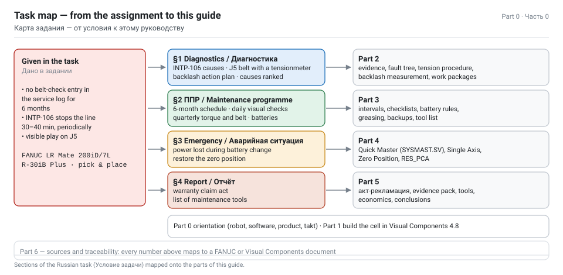

**The reading of the case that this guide defends**

The four conditions are not independent. A missing belt check for six months on a wrist axis means the belt tension has been drifting; a drifting J5 belt produces positional error and, past a limit, motion faults. INTP-106 is *not* a mechanical alarm — it is the interpreter refusing to resume a program — but it is what the **operator sees** when a motion or state fault has aborted or paused the program and the cell then tries to continue. So the chain is:

```text
no PM entry (6 months)  →  J5 belt tension out of band  →  wrist positioning error / play
                                                        →  motion aborted or program paused at start
                                                        →  CONTINUE request rejected  →  INTP-106
                                                        →  30–40 min of unplanned downtime
```

Part 2 proves each arrow with manual references and gives you the measurements that decide whether the fix is a re-torque, a new belt, or a wrist reducer.

## Equipment data sheet

Everything below is the machine you are simulating and servicing. Copy these tables into your report — they are the "исходные данные" section of any respectable technical document.

#### Robot — FANUC LR Mate 200iD/7L

| Parameter | Value | Note |
|---|---|---|
| Type | articulated, 6 controlled axes (J1…J6) | long-reach variant of the LR Mate 200iD family |
| Max payload (wrist) | **7 kg** | includes the gripper mass |
| Reach (H-reach) | **911 mm** | the standard 200iD has 717 mm; 911 mm is the least that makes a palletizing layout feasible at all — and it still needs a rotary pallet indexer, see the reach check in Part 1.4 |
| Repeatability | **±0.01 mm** | FANUC America product data; some reseller sheets quote ±0.03 mm — the manual for your serial is authoritative |
| Mechanical unit mass | **27 kg** | |
| Mounting | floor, angle (wall), inverted | mount angle is set at controlled start |
| Average power consumption | **0.5 kW** | |
| Protection | IP67 standard, IP69K optional | relevant for a brick plant: abrasive dust |
| Controller | R-30iB Plus (also R-30iB Mate Plus, open-air cabinet, iPendant Touch) | the task specifies R-30iB Plus |

**Motion range and speed**

| Axis | Range | Max speed |
|---|---|---|
| J1 | 340° (360°) | 370 °/s |
| J2 | 245° | 310 °/s |
| J3 | 430° | 410 °/s |
| J4 | 380° | 550 °/s |
| **J5** | **250°** | **545 °/s** |
| J6 | 720° | 1000 °/s |

**Wrist load limits — needed for the gripper check in Part 1**

| Axis | Allowable moment | Allowable inertia |
|---|---|---|
| J4 | 16.6 N·m | 0.47 kg·m² |
| J5 | 16.6 N·m | 0.47 kg·m² |
| J6 | 9.4 N·m | 0.15 kg·m² |

**Installation and service envelope**

| Item | Requirement |
|---|---|
| Base fixing | 4 × Ø11 through holes, base plate 190 × 190 mm |
| Mounting surface flatness | ≤ 0.5 mm |
| Mounting surface inclination | ≤ 0.5° |
| Maintenance clearance | 500 mm around the arm; **705 mm** above for the 7L |
| Base load, static (7L) | vertical moment 147.3 N·m, vertical force 333.2 N |
| Base load, power-off stop (7L) | vertical moment **1657.2 N·m**, vertical force 1612.7 N; horizontal moment 1285.6 N·m, horizontal force 1656.8 N |
| Stopping distance after a stop signal (7L) | J1 69.0°, J2 57.3°, J3 54.4° (power-off stop) |

> NOTE — Why the power-off-stop figures matter for the layout: 69° of J1 travel after the stop signal means your fence and light curtain in Part 1 must be dimensioned from the **stopping** envelope, not the static one. That is the ISO 10218-1 minimum-distance calculation, and quoting it is an easy mark in a student report.

#### Controller — FANUC R-30iB Plus

| Item | Detail |
|---|---|
| Pendant | iPendant (colour), three-position deadman, <kbd>SHIFT</kbd>, <kbd>RESET</kbd>, <kbd>FCTN</kbd>, <kbd>MENU</kbd> |
| Mode switch | T1 (≤ 250 mm/s) / T2 / AUTO, plus REMOTE-LOCAL |
| Operator panel | E-stop, alarm release, start, mode indicator LEDs |
| Memory backup | lithium battery on the main board, 3 V DC; programs and system variables live in SRAM |
| Controller battery part | **A05B-2650-K030** (also listed A98L-0031-0028) — Mate Plus cabinets; the full-size R-30iB/Plus lists A02B-0200-K102 / A98L-0031-0012. Check which cabinet you actually have. |
| Battery life | about 4 years from factory fit; low-voltage alarm **SYST-035** |
| Robot (mechanical unit) battery | battery box at the J1 base; **4 × C cells (1.5 V)** with the built-in option, **4 × D cells (1.5 V)** with the external option |
| Mechanical-unit battery interval | **1 year** (built-in) / **1.5 years** (external) |
| Relevant alarms | SYST-035 low battery, SRVO-062 BZAL (battery alarm, group/axis), SRVO-038 pulse mismatch, MOTN-049 / SYST-035 robot not mastered, INTP-106 continue request failed |
| Software options worth naming | PalletTool, iRVision 2D/3DV, DCS (Dual Check Safety), ASCII program upload, Ethernet/IP or PROFINET |

> WARNING — The two batteries follow **opposite** rules and this is exactly where the emergency scenario in Part 4 comes from.
> The **robot base** battery (pulse coder backup) must be changed with the controller **powered ON**: the operator's manual cautions that removing the external battery with the power off loses all current position data and forces re-mastering.
> The **controller main-board** battery (SRAM backup) is changed by powering the controller on for about 30 s, then **off**, and completing the swap within **30 minutes**.
> Confusing the two is the classic way to lose mastering during "routine" maintenance.

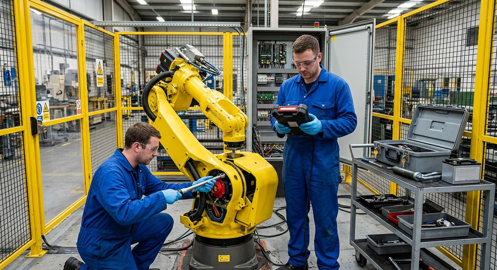

## Visual Components 4.8 — what you need and where things are

#### Editions

Visual Components 4.8 ships as **Essentials**, **Professional**, **Premium** and the **OLP** variants (Professional OLP, Premium OLP, Robotics OLP). 4.8 is the release that merged the Delfoi offline-programming tools into the product line, so the OLP capability is now part of the family rather than a separate brand.

| Capability you need for this guide | Minimum edition |
|---|---|
| Build the layout, add eCatalog components, PnP connections, fences, drawings | Essentials |
| Process Modelling (products, processes, flow, robot transport controller) | Essentials and up |
| Robot program teaching in the PROGRAM tab, signals, Python scripting | Essentials and up |
| FANUC-branded robot components from the Web eCatalog | Essentials and up |
| OLP: post-process the taught program to a FANUC **.LS** file, path validation, Via/Robotics Solver | **OLP variant** (separate licence; the Robotics Solver add-on is a further paid subscription) |
| FANUC Connectivity Plugin (drive a real or ROBOGUIDE virtual controller) | Premium + plugin licence |

> NOTE — If your classroom licence is Essentials or Professional, you can still complete 100 % of Part 1. Only step 1.15 (post-processing to FANUC .LS) needs an OLP variant, and that step is optional — it is shown so you can describe it in the report.

#### What is new in 4.8 (worth one paragraph in your report)

- **Visual Components Robotics OLP** became the main feature of the release: all OLP processes (Arc, Cut, Spot, Surf, Paint) and all robot post-processors are exposed on the **PROGRAM** tab for OLP users.
- **Via Solver** is available in **all** product versions (limited compared with the paid Robotics Solver add-on, which solves collisions, singularities, joint limits and reachability on process, via and search paths).
- **Program Validation** now supports conveyor synchronisation, and a **linear 180-degree check** warns when a joint rotates more than 180° during a linear motion.
- **Online help**: the application help and the Python API reference moved online (help.visualcomponents.com/4.8/…), with a configurable help location.
- **CAD import/export** updated to HOOPS 2023 H2: ACIS up to 2023, Autodesk Inventor up to 2024, Navisworks 2012–2024.
- 4.8.0.1 (January 2024) fixed interactive VR, statement loading from Via Solver, and added KUKA.Sim to Premium OLP.
- Upgrade note: 4.6/4.7 users needed a **new product key and a valid maintenance contract** to move to 4.8.

#### The interface you will be clicking

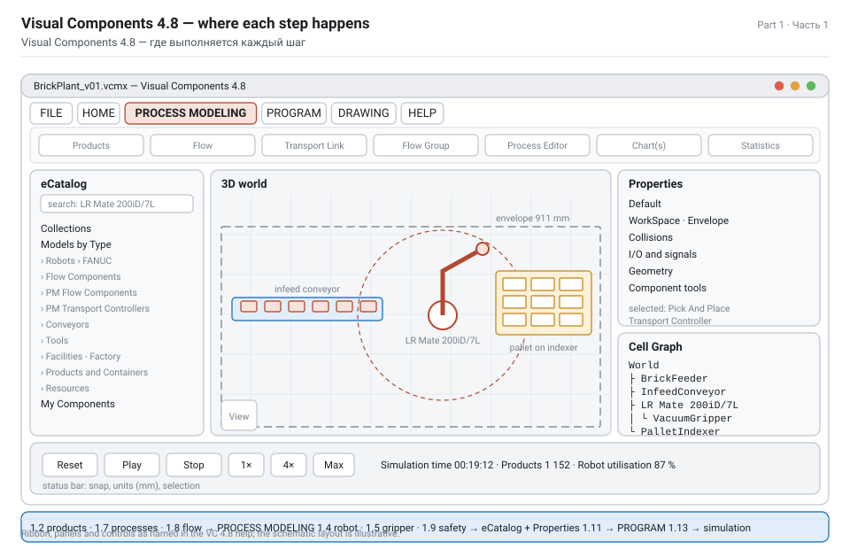

| Ribbon tab | What it is for in this project |
|---|---|
| **FILE** | new/save layout (`.vcmx`), export 3D PDF, video, statistics, print |
| **HOME** | clipboard, Select / Move / **PnP** / Interact, size and snap, measure, dimensions, **Interfaces**, **Signals**, Attach / Detach, Hierarchy, geometry import, camera and view |
| **PROCESS MODELING** | **Products** (Product Type Editor), **Processes** (Process Editor), **Flow**, **Filter**, transport links, create frame/signal |
| **PROGRAM** | robot **Jog**, Program Editor (routines and statements), tools, TCP/base frames, and — in OLP variants — the OLP process tools |
| **DRAWING** | 2D drawings, dimensions, annotations, bill of materials |
| **HELP** | online help, Python API reference, support and forum links |

| Panel | Use |
|---|---|
| **eCatalog** | the component library: Collections › Models by Type / Models by Manufacturer, plus a search box. FANUC robots live under Models by Type › Robots › FANUC (and under Models by Manufacturer › Fanuc). |
| **Properties** | every property of the selected component, tab by tab (Default, Geometry, WorkSpace, ProductCreator, …) |
| **Cell Graph** | the component tree; the fastest way to select something buried in an assembly |
| **Program Editor** | robot routines (Subprograms) and statements |
| **Jog** | manipulator, coordinates, tool/base selection, taught XYZABC readout |
| **Output / Statistics** | simulation results, product counters, resource utilisation |
| **Simulation controls** | play / pause / reset, speed, time — the initial state of every component is captured when you press play |

**Camera and selection drills you should know cold**

- Rotate: hold <kbd>RMB</kbd> and drag. Pan: <kbd>LMB</kbd> + <kbd>RMB</kbd> and drag. Zoom: wheel or <kbd>SHIFT</kbd> + <kbd>RMB</kbd>.
- Centre on a component: right-click › **SetCOI**, or <kbd>CTRL</kbd> + right-click.
- Multi-select: hold <kbd>CTRL</kbd> and click; click again to remove from the selection.
- **PnP** (Plug and Play): drag a component towards a compatible interface until a green arrow appears, keep dragging until it snaps. This is how a feeder meets a conveyor, a conveyor meets a process, and a gripper meets the robot flange.
- **Interact**: jog interactive parts (robot joints, machine doors, gripper fingers) with the pointer.

#### Official documentation for 4.8

| Document | Where |
|---|---|
| Visual Components 4.8 Release Notes (06.10.2023) and 4.8.0.1 notes | visualcomponents.com › Downloads / release notes PDF |
| Visual Components Premium 4.8 Help (online) | help.visualcomponents.com/4.8/Premium/en/ |
| Python API reference (online, 4.8) | help.visualcomponents.com/4.8/…/Python_API/ |
| Introduction to Layout Configuration (tutorial PDF) | academy.visualcomponents.com |
| Pick And Place Components — Manual (PM Flow Components) | academy.visualcomponents.com |
| Robot Transport Controller Manual | academy.visualcomponents.com |
| Palletize using PM TransportPatternIn statement (4.8.0+) | academy.visualcomponents.com › lessons |
| Depalletizing using PM Detach statement (4.8.0+) | academy.visualcomponents.com › lessons |
| Component library / eCatalog file index | download.visualcomponents.net/elib |

> TIP — The Academy pages state the software version each lesson was recorded against. Two of them are newer than 4.8: the *Palletizing robot programming* lesson is tagged 4.9.0+ and the *Robot Transport Controller Manual* page is tagged 5.0+. The components themselves exist in 4.8 — only some newer properties differ. Where this guide uses something version-sensitive it says so explicitly.

## Product and plant definition

The assignment says "pick and place parts from a conveyor onto a pallet" but never says what the part is. Since you are building a **decorative brick factory**, the part is a brick — and that choice drives every number in the layout. Fix the product data first; do not invent it later mid-build.

#### Product: decorative facing brick

| Property | Value | Comment |
|---|---|---|
| Name | `Brick_Deco` | product type name in the Product Type Editor |
| Format | **250 × 120 × 65 mm** | standard facing-brick format |
| Mass | **3.2 kg** | hollow decorative brick; solid would be ~4.2 kg |
| Material / colour | fired clay, terracotta | for the visual only |
| Orientation on the belt | bed face up, 250 mm along the belt | so the vacuum gripper sees the largest face |
| Fragile? | no, but abrasive | dust is the real enemy — see the IP67 note |

#### Payload and wrist check (do this before you model anything else)

```text
gripper (2-cup vacuum, aluminium)        0.80 kg
brick                                      3.20 kg
--------------------------------------------------
total on the flange                        4.00 kg   ≤ 7 kg payload      ✔  57 % used

static moment about J5, CoG 0.10 m out:
  M = 4.00 kg × 9.81 m/s² × 0.10 m =       3.92 N·m  ≤ 16.6 N·m allowed   ✔  24 % used

inertia about J4/J5 (point mass at 0.15 m):
  I = 4.00 kg × (0.15 m)² =                0.090 kg·m² ≤ 0.47 kg·m²      ✔  19 % used
```

> TIP — Put this calculation in the report. It is the difference between "I attached a gripper" and "I verified the tool against the machine's wrist limits", and it is the same arithmetic FANUC's own payload evaluation does.

#### Pallet and stacking pattern

| Property | Value |
|---|---|
| Pallet | EUR flat pallet **1200 × 800 × 144 mm**, tare 25 kg, rated 1000–1500 kg |
| Layer pattern | 24 bricks per layer: 4 along the 1200 mm side (4 × 250 = 1000 mm) × 6 rows along the 800 mm side (6 × 120 = 720 mm) |
| Layers | 8 |
| Bricks per pallet | **192** |
| Net mass | 192 × 3.2 = **614 kg** |
| Gross mass | 614 + 25 = **639 kg** — 64 % of the 1000 kg conservative rating ✔ |
| Stack height | 144 + 8 × 65 = **664 mm** — inside the robot's reach and stable without wrapping |
| Footprint used | 1000 × 720 mm of 1200 × 800 mm (75 %) — leaves margin for gripper clearance |

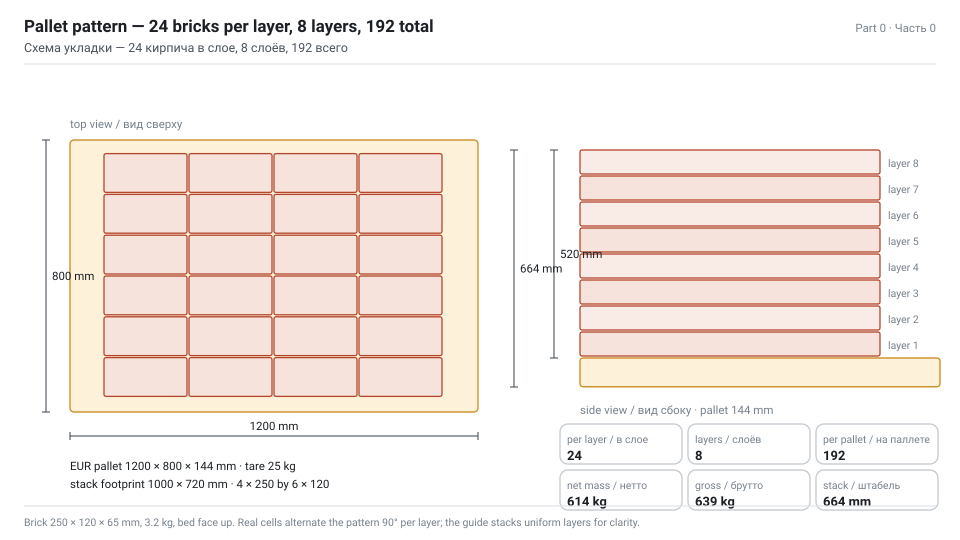

#### Takt, throughput and buffer — the arithmetic the simulation must reproduce

```text
Target cell output                     600 bricks/h  = 10 bricks/min  → takt 6.0 s

Robot cycle (to be confirmed by simulation):
  approach + pick                       1.2 s
  transfer conveyor → pallet            2.0 s
  place + release                       1.2 s
  return to pick position               1.6 s
  ------------------------------------------------
  total                                 6.0 s   → 600 bricks/h        ✔ exactly at takt

Infeed conveyor:
  pitch 300 mm, speed 0.10 m/s  →  20 bricks/min arriving
  that is 2× the robot takt, so the pick station needs a stopper and a buffer

Buffer: 6 brick positions = 6 × 300 mm = 1.8 m of belt  →  36 s of autonomy
  absorbs kiln surges and the pallet exchange

Pallet cycle:
  fill 192 × 6.0 s                     19.2 min
  empty pallet out / full pallet in      2.0 min
  ------------------------------------------------
  per pallet                           21.2 min  →  2.83 pallets/h  →  543 bricks/h

  ✘ 4 % below target — the pallet exchange eats the margin

Countermeasure: a two-position pallet shuttle (fill position + swap position),
so the exchange happens in parallel with filling:
  per pallet                           19.2 min  →  3.13 pallets/h  →  600 bricks/h ✔
```

> NOTE — This is the kind of finding a simulation exists to produce. Build the single-position version first, measure it, then add the shuttle and measure again: you now have a before/after result with numbers, which is a conclusion you can defend in a report and a recommendation you can cost.

#### Plant context

| Zone | Content | Modelled how |
|---|---|---|
| A · Raw material and forming | clay silo, mixer, extruder/press, cutter | static geometry + machines (or simple process boxes) |
| B · Drying and firing | dryer, tunnel kiln, kiln cars | long conveyor + machine with a long cycle time |
| C · Unloading and finishing | unloading conveyor, brushing, visual QC reject station | conveyor + sensor + a human resource |
| **D · Palletizing cell** | **the LR Mate 200iD/7L pick-and-place cell** | **the detailed part of this guide** |
| E · Packing and dispatch | stretch wrapper, label printer, forklift, rack warehouse | machine + mobile robot or human + forklift |

Zone D is where the assignment lives and where 80 % of your modelling time goes. Zones A–C and E are built to the level of detail that makes the flow continuous — they matter because the palletizing cell has to be fed at 20 bricks/min and emptied at 2.8–3.1 pallets/h, and because a report about a *factory* that contains one robot cell is not a factory.

---

# Part 1 — Build the factory in Visual Components 4.8

_Seventeen steps from an empty 3D world to a running, measured, documented and post-processed decorative brick plant._

## 1.0 The workflow at a glance

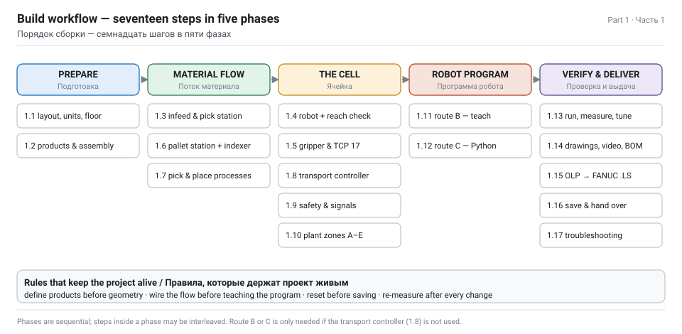

Work in this order. Every step consumes the output of the previous one, and the two most common ways this project fails are (a) modelling geometry before the product data exists and (b) teaching the robot program before the process flow is wired.

| # | Step | Tab | Output |
|---|---|---|---|
| 1.1 | New layout, units, floor, grid, save early | FILE / HOME | `BrickPlant_v01.vcmx` |
| 1.2 | Define products: brick, pallet, full pallet assembly | PROCESS MODELING | product types + flow groups |
| 1.3 | Infeed: feeder → conveyor → pick station with stopper | HOME / eCatalog | material arrives at 20/min |
| 1.4 | Add the FANUC LR Mate 200iD/7L, set base and envelope | HOME / eCatalog | robot in the world |
| 1.5 | Attach the vacuum gripper, set TCP, add collision and mass | HOME / Properties | TOOL[17] ready |
| 1.6 | Pallet station: pallet feeder, assembly, swap shuttle | PROCESS MODELING | place target exists |
| 1.7 | Configure the Pick and Place processes | PROCESS MODELING | `Pick`, `Place` |
| 1.8 | Wire the transport controller and the flow | PROCESS MODELING | robot has work |
| 1.9 | Safety: fence, light curtain, gate, cabinet, signage | HOME / eCatalog | guarded cell |
| 1.10 | Plant zones A–C and E: forming, kiln, QC, wrapping | HOME / PROCESS | a factory, not a cell |
| 1.11 | Route B: teach the robot program by hand | PROGRAM | routines + statements |
| 1.12 | Route C: drive the robot from Python | MODELING | scripted cycle |
| 1.13 | Run, measure, tune the bottleneck | Simulation / Statistics | 600 bricks/h proven |
| 1.14 | Drawings, BOM, 3D PDF, video | DRAWING / FILE | deliverables |
| 1.15 | Post-process to FANUC .LS and verify in ROBOGUIDE | PROGRAM (OLP) | robot code |
| 1.16 | Save, version, hand over | FILE | final package |
| 1.17 | Troubleshooting table | — | when it does not run |

> NOTE — Routes 1.8, 1.11 and 1.12 are **three different ways to make the same robot move**. Pick one as your main route and mention the other two in the report. For a palletizing cell driven by product flow, **1.8 (transport controller)** is the professional choice; **1.11 (taught program)** is what an integrator hands to FANUC; **1.12 (Python)** is what you use when the pattern must be computed.

## 1.1 New layout, floor and units

1. **FILE › New › Empty Layout**. Visual Components works in millimetres; the world origin is the floor at Z = 0.
2. Set the grid: **HOME › Snap › Grid Snap** with 100 mm spacing, and turn on **Always Snap** while you place static equipment. A brick plant is a rectangular plant — the grid saves you from a crooked kiln line.
3. Lay the floor: **eCatalog › Collections › Models by Type › Facilities - Factory › Visual Components › Floor** (or draw a floor plan with **HOME › Drawing**). Size it 40 000 × 16 000 mm: that fits zones A–E with aisles.
4. Save immediately: **FILE › Save As › `BrickPlant_v01.vcmx`**. Save after every completed step from here on, incrementing the version. There is no undo across sessions.
5. Create the views you will reuse: top-down (<kbd>T</kbd> on the View Selector), and two saved camera views via **View Editor › +** — one on the palletizing cell, one on the whole plant. You will need them for the video in step 1.14.

> TIP — Reset the simulation (<kbd>Reset</kbd> in the simulation controls) before you save. The initial state of every component is captured when the simulation starts, so saving mid-run bakes whatever bricks happen to be on the belt into the layout.

**Dimensions of the plant you are about to lay out**

| Zone | Footprint (mm) | Position in the layout |
|---|---|---|
| A · Forming | 8000 × 6000 | X −18000 … −10000 |
| B · Dryer + tunnel kiln | 16000 × 4000 | X −8000 … +8000 |
| C · Unloading + QC | 4000 × 4000 | X +8000 … +12000 |
| **D · Palletizing cell** | **5000 × 4500** | **X +12000 … +17000** |
| E · Wrapping + dispatch | 6000 × 6000 | X +17000 … +23000 |

## 1.2 Products: brick, pallet, full pallet

Process Modelling requires products to be **defined before they are created**. Old "Feeder"-folder components create *components*; the Process Modelling components create *products*, and only products can flow through processes, be transported by a robot transport controller, and be counted in the statistics.

**Step A — put the geometry into the world once**

1. **eCatalog › Models by Type › Products and Containers › Visual Components**: drag a **Box** into the world (this will stand in for the brick until you import real geometry).
2. Drag a **Pallet** (or CollarPallet) into the world next to it.
3. Resize the box in the **Properties** panel to **X 250, Y 120, Z 65**. Give it a terracotta material so renders read as brick.

**Step B — define the product types**

1. **PROCESS MODELING › Products** opens the **Product Type Editor**.
2. Create flow group **`Bricks`** and inside it a product type **`Brick_Deco`**:
   - `Name` = Brick_Deco
   - `ParentProduct` = Any
   - `ComponentUri` — use the pick-component tool and click the resized box in the 3D world
   - `OriginFrame` — leave at zero unless the geometry is offset from its own origin
3. Create flow group **`Pallets`** and inside it:
   - product type **`Pallet_Empty`** → ComponentUri = the pallet component
   - **assembly** **`Pallet_Full`** → root step = Pallet_Empty, child step = the bricks

**Step C — the stacking pattern as assembly slots**

The assembly is how Visual Components knows *where* each brick goes. In the assembly editor:

- **Step 0** — `Pallet_Empty`, one slot, already present when the assembly is created (the pallet itself).
- **Step 1** — `Brick_Deco`, **192 slots**, arranged as 8 layers of 24.

| Slot parameter | Value | How |
|---|---|---|
| Slots per layer | 24 | 4 along X (250 mm pitch) × 6 along Y (120 mm pitch) |
| Layers | 8 | 65 mm Z pitch |
| Slot origin | first brick centre at X −500 + 125, Y −360 + 60, Z 144 + 32.5 | relative to the pallet origin |
| `OrderIndex` | 1 … 192, layer by layer | the place process fills the lowest free index first |
| `AcceptedProductTypes` | Brick_Deco | so a stray product cannot land in the stack |
| `DefaultProductType` | **Null** | critical — this is what makes the slots arrive *empty* |
| `AcceptAllProductTypes` | unchecked | |

> WARNING — If you leave `DefaultProductType` set to Brick_Deco, every created pallet arrives already full and the robot has nothing to do. Setting it to **Null** is the documented way to create an incomplete assembly from a feeder.

**Step D — verify**

1. Add a **Feeder** from **Models by Type › Flow Components** temporarily, set its product to `Pallet_Full` and press play. You should see a pallet with 192 bricks appear.
2. Reset, delete the test feeder.

## 1.3 Infeed: feeder, conveyor, pick station

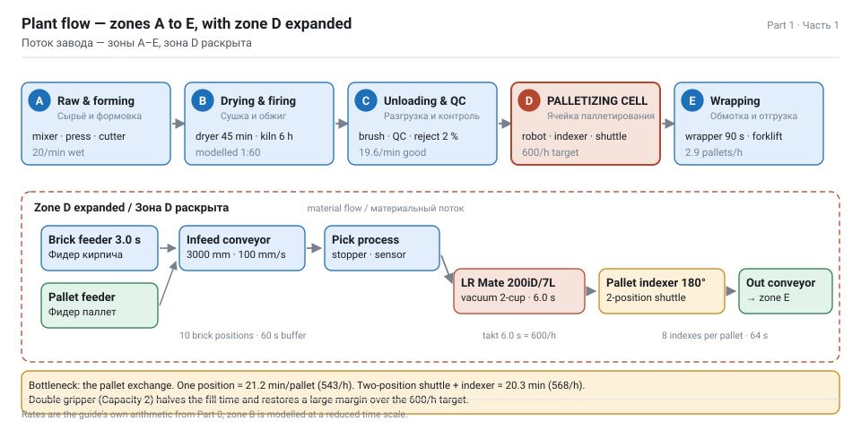

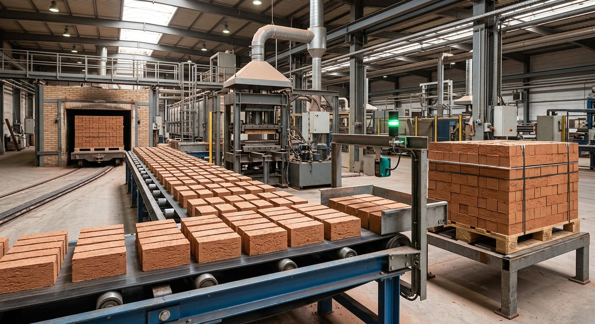

1. **eCatalog › Models by Type › Flow Components › Visual Components › Feeder** into the world at the start of zone D.
2. **Models by Type › Conveyors › Visual Components › Conveyor**, and connect it to the feeder with **PnP**: drag the conveyor towards the feeder until the green arrow appears, keep dragging until it snaps.
   - *Tip:* with the feeder selected, double-clicking a conveyor in the eCatalog adds it already attached.
3. Set the feeder properties:

| Property | Value | Why |
|---|---|---|
| `Product` | Brick_Deco | the product type from step 1.2 |
| `CreationInterval` | 3.0 s | 20 bricks/min — twice the robot takt, so the buffer is real |
| `Container` | the infeed conveyor | products are created *onto* the belt |

4. Set the conveyor properties:

| Property | Value |
|---|---|
| `ConveyorWidth` | 400 |
| `Speed` | 100 mm/s |
| `Length` | 3000 mm (edit the path points in the 3D world) |
| `ProductSpacing` | 300 mm — enforced by the feeder interval and belt speed |

5. Add the pick station. Two options, both correct:
   - **PM Flow Components › Pick And Place Process** — a conveyor segment with an in-sensor (green) and an out-sensor (red); anything between them is inside the process. Configure it in step 1.7.
   - a plain **Conveyor** + **Conveyor Sensor** snapped to the path + a **Stopper** so the brick waits for the robot. Use this if you are on the taught-program route (1.11).
6. Add a **From Conveyor Process** or a second conveyor at the end of zone C so the bricks arrive continuously from the kiln line rather than being created from nothing — a factory report reads much better when the material has an origin.

> NOTE — Belt length matters. 3000 mm at 300 mm pitch is ten brick positions; the robot consumes one every 6 s, so the belt holds 60 s of material. That is your buffer, and you can now state it in the report instead of guessing.

## 1.4 The robot: FANUC LR Mate 200iD/7L

**From the eCatalog**

1. **eCatalog › Collections › Models by Type › Robots › FANUC** (or **Models by Manufacturer › Fanuc**) and search **`LR Mate 200iD/7L`**. The component is authored by Visual Components and is tagged for Assembly, Dispensing, Machine Tending and Material Handling.
2. Double-click to place it at the world origin, or drag it into the world and position it with **Move** + numeric X/Y/Rz.
3. Position it for this cell: base on the centreline of a long side of the pallet station, **650 mm from the pallet turntable centre**, and about 1100 mm from the pick station, rotated so J1 sweeps between the two. Do not copy those numbers without doing the reach check below — this is the step where most student layouts are quietly wrong.
4. **Properties › WorkSpace tab › check `Envelope`**. The reachability area appears in the 3D world. Switch to the top-down view and confirm that *both* the pick point and *the whole working window of the pallet* fall inside it.

**The reach check you must do (and show in the report)**

Pallet footprint 1200 × 800 mm, centre C; robot base B on the long-side centreline at distance *d* from C. The farthest corner of the stack is at:

```text
r_far = sqrt(600^2 + (400 + d)^2)

d = 900 mm  ->  r_far = sqrt(360000 + 1690000) = 1432 mm   >> 911 mm  UNREACHABLE
d = 650 mm  ->  r_far = sqrt(360000 + 1102500) = 1206 mm   >> 911 mm  UNREACHABLE
solve r_far <= 911  ->  (400 + d)^2 <= 911^2 - 600^2 = 469921
                    ->  d <= 285 mm
```

A base 285 mm from the pallet centre would sit **inside the pallet footprint** (its near edge is 400 mm from the centre), so it is physically impossible. Conclusion, and it is worth writing in the report in exactly these words:

> WARNING — **A single fixed base cannot palletize a full EUR pallet with a 911 mm arm.** Any layout that claims otherwise has not checked the far corner. Three workable fixes, in order of preference for this cell:
>
> 1. **180° rotary pallet indexer (turntable)** — chosen here. The pallet turns so that only the near half is ever in the working window.
> 2. **Linear rail (7th axis)** along the 1200 mm side — the base travels with the placement; simple and robust, but adds travel time to every cycle.
> 3. **Double gripper plus a smaller work window**, or two robots — the Pick And Place manual's own scaling advice.

**With the indexer: does it now fit?**

Base B at 650 mm from the turntable centre C, on the long-side centreline. After a 180° index, every point of the pallet lies in the near half, i.e. within 600 mm laterally and 0–400 mm towards the robot:

```text
farthest point  (600, 0)      r = sqrt(600^2 + 650^2) = 884 mm   <= 911 mm  OK
nearest point   (0, -400)     r = 650 - 400 = 250 mm             OK (arm not folded into itself)
top layer at +585 mm above the pallet  -> vertical reach checked separately in the envelope view
```

884 mm against a 911 mm limit is a real margin — 27 mm — and it is the kind of number a reviewer wants to see. Keep it under 90 % of the rated reach so that the wrist can still orient the gripper.

**What the indexer costs you**

| Item | Value |
|---|---|
| Indexes per pallet | 8 (one 180° index per layer) |
| Index time, 640 kg loaded table | ~8 s |
| Added pallet time | 64 s = 1.07 min |
| Pallet cycle, two-position shuttle + indexer | 19.2 + 1.1 = **20.3 min** |
| Resulting output | **568 bricks/h** — 5 % under the 600/h target |
| Fix that restores the target | double gripper (Capacity 2, Part 1.8): fill time halves to ~9.6 min → ~10.7 min/pallet → **1075 bricks/h**, i.e. large margin |
| Alternative fix | accept 568 bricks/h and state it, or add a second robot |

This is exactly the kind of finding a report should contain: the target was checked, it failed for a stated physical reason, and two quantified remedies are offered.

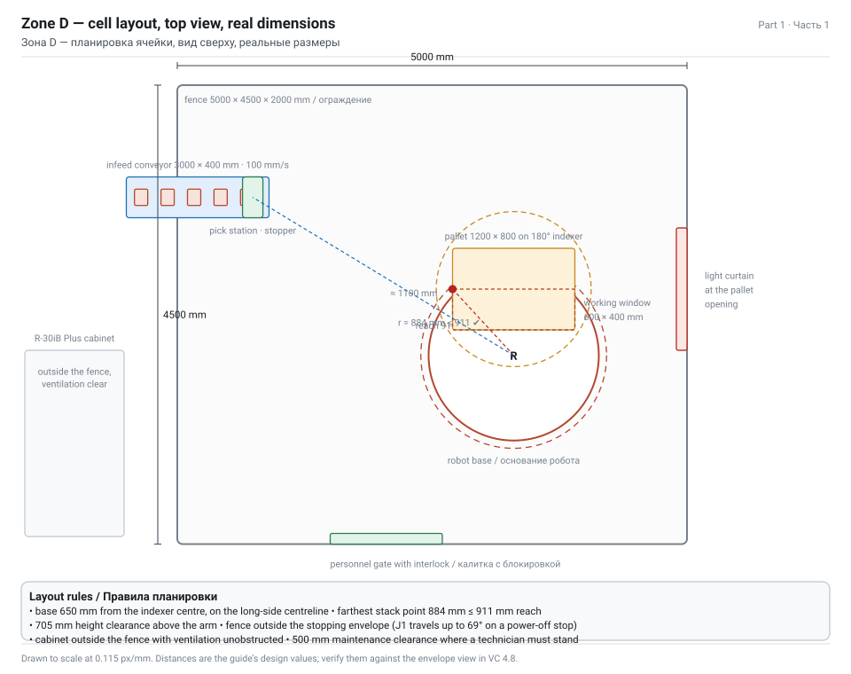

**If the component is not in your catalogue**

The Web eCatalog needs a network connection and a licence. Three fallbacks, in order of preference:

1. Use **LR Mate-200iD** (the short-reach sibling) and note the substitution in the report — the maintenance content in Parts 2–5 is identical for both, only the reach differs (717 mm vs 911 mm).
2. Download the component file from the public eLibrary index at `download.visualcomponents.net/elib` and open it in Visual Components (FILE › Open › `.vcmx`), then copy the robot into your layout.
3. Model it from a template: **Models by Type › Component Templates › Generic Articulated Robot v3**, then replace the geometry with your own CAD (STEP import) and set the joints — this is the standard component-modelling workflow and is worth describing in the report because it proves you understand what a robot component actually is.

**Modelling a robot from a template (fallback 3, in brief)**

1. Import the CAD: **HOME › Geometry › Import**, pick the STEP of the LR Mate 200iD/7L. Set the import scale so the model is in millimetres.
2. Add the template robot, select all its geometry features, copy them onto the imported component's root, then delete the template's block features.
3. Create one **link** per moving group (base, J1 arm, J2 arm, J3 arm, J4 wrist, J5 wrist, J6 flange) and a **revolute joint** between them with the correct axis, range and speed:

| Joint | Axis | Range | Max speed |
|---|---|---|---|
| J1 | Z of the base | ±170° | 370 °/s |
| J2 | Y | ±122.5° | 310 °/s |
| J3 | Y | ±215° | 410 °/s |
| J4 | X of the arm | ±190° | 550 °/s |
| **J5** | **Y of the wrist** | **±125°** | **545 °/s** |
| J6 | X of the flange | ±360° | 1000 °/s |

4. Move the **FlangeFrame** feature to the real J6 mounting face, then set the robot executor's tool frames.
5. Switch Move Mode back to **Hierarchy** and press **Reset** so the executor re-reads the frames.

> WARNING — The mounting surface in your layout must respect the real machine's requirements: flatness ≤ 0.5 mm, inclination ≤ 0.5°, and a pedestal able to take **1657 N·m** of vertical moment during a power-off stop. Model the pedestal as a solid component and mention the load case in the report — that single sentence connects your layout to the machine's datasheet.

## 1.5 End effector: vacuum gripper and TCP

A brick is porous, abrasive and 3.2 kg. Vacuum is the right family of gripper; a parallel jaw gripper would need 250 mm of stroke and would chip the arrises. Use **two cups**, not four: two Ø63 cups at −0.7 bar hold roughly 300 N each, and you need ~35 N of holding force — a safety factor of about 17.

1. **eCatalog › Models by Type › Tools › Visual Components › Parametric Suction Cup Gripper** into the world.
2. **PnP**: drag the gripper onto the robot's **mount plate** until it snaps. The gripper becomes a child of the flange in the **Cell Graph**.
3. Set the gripper properties:

| Property | Value | Comment |
|---|---|---|
| `NumberOfCups` | 2 | |
| `CupDiameter` | 63 mm | Ø63 bellows cup |
| `CupSpacing` | 150 mm | across the 250 mm bed face, inside the 240 mm edges |
| `GrippingDia` / stroke | 250 mm | only relevant for a jaw gripper |
| `Mass` | 0.80 kg | aluminium plate + venturi + cups |
| `SignalIn` / `SignalOut` | see step 1.8 | vacuum ON = close, vacuum OFF = open |

4. **Tool frame.** When an end effector with a predefined tool is connected to a robot, Visual Components appends it to the robot's 16 default tool frames as **index 17**. Set `TcpIndex` = 17 on the transport controller or link so motions are calculated at the cup face, not at the bare flange. If you teach by hand, select **TOOL[17]** in the Jog panel.
5. **Collision geometry.** Select the gripper and the brick, then add them to the robot's collision set (Properties › Collisions). Without this the simulation will happily drive the arm through the fence.
6. **Payload check in the component.** Set the robot's payload property (or the tool's attached mass) so the simulated dynamics match the 4.00 kg you calculated in Part 0.

> TIP — Name your frames. `TOOL_Vacuum2Cup` rather than TOOL[17], `BASE_PalletCell` rather than Base[1]. The Visual Components robot-programming course makes the same point: label statements and positions clearly, because somebody else will open this layout.

**Gripper signals**

The Pick And Place transport controller can drive a gripper two ways:

- **By port numbers** — `GripperSignalClose` = 102, `GripperSignalOpen` = 101 on the link.
- **By naming convention** — set the port to −1 and the controller looks for signals in the tool component named `IN_J1_Action`, or `IN_J1_Close` / `IN_J1_Open`. Enable `UseGripperSignals` on the controller's Advanced tab.

For a vacuum gripper the honest signal set is: `DO[10] vacuum ON`, `DI[11] vacuum reached`, `DO[12] blow-off`. Model at least the first two — the "vacuum reached" input is what a real program waits for before lifting, and it is the detail that separates a student layout from an integrator layout.

## 1.6 Pallet station and the swap shuttle

1. **Empty pallets in.** Add a second **Feeder** (Models by Type › Flow Components), set `Product` = `Pallet_Full` (the assembly whose slots are empty) and `CreationInterval` = 1200 s. Connect it to a short **roller conveyor** or a **Shape Feeder → Pallet Filler** pair if you prefer the pattern to be generated by the component instead of by the assembly.
2. **The place target.** Add a **Pick And Place Process** where the pallet stops, and configure `ProcessType` = **Place**, `ProductsOn` = **Assembly** (step 1.7).
3. **Full pallets out.** Add a **Transport Link** or a short outbound conveyor to zone E (stretch wrapper). Since a full pallet is an assembly, the robot does not move it — the conveyor does.
4. **The rotary indexer.** Part 1.4 showed that a fixed base cannot reach a whole EUR pallet with a 911 mm arm, so the pallet station is a **180° turntable** whose centre sits 650 mm from the robot base. In Visual Components, model it as a component with a revolute joint driven by a signal (`DO_Index` → rotate 180° in 8 s), and make the place routine wait for `DI_IndexDone`. Eight indexes per pallet, 64 s.
5. **The two-position shuttle.** Part 0 showed that a single-position station loses 4 % of the target output to the pallet exchange. Model the fix:
   - a **shuttle conveyor** with two positions (fill and swap) or two parallel place processes,
   - the flow: `PalletFeeder → SwapPosition → FillPosition → OutConveyor`,
   - a signal `PalletReady` from the fill position to the pallet feeder so a new empty pallet only enters when the full one has left.
6. **Height matters.** A pallet on the floor puts the first layer at 144 mm and the eighth at 599 mm. That is comfortable for this robot. If you model the pallet on a 500 mm station, the top layer is at 1099 mm and you must re-check the envelope.

> TIP — Add a **human resource** or a **forklift/mobile robot** to take full pallets away (Models by Type › Mobile Robots, or Resources › Characters). Then the statistics show whether the cell ever waits for transport — a real finding, and one you can only get if the pallets actually leave.

## 1.7 Pick and Place processes

The **Pick And Place Process** component lives under **eCatalog › PM Flow Components**. It is a conveyor with two sensors: everything between the green in-sensor and the red out-sensor is "inside the process" and eligible for transport.

> WARNING — These components ship with a fixed statement structure. The manual is explicit: **rename the process, do not add or delete statements; select the process statement and modify its properties.** Adding statements to a Pick And Place Process breaks the Python-driven logic underneath.

**Pick process (on the infeed conveyor)**

| Property | Value | Meaning |
|---|---|---|
| Process name | `Pick_Brick` | rename, do not re-create |
| `ProcessType` | **Pick** | products are taken *from* here |
| `ProductsOn` | **Conveyor** | the source is a belt |
| `InSensorPosition` | 20 % | green sensor at 20 % of the component length |
| `OutSensorPosition` | 80 % | red sensor at 80 % |
| `AcceptAllProductTypes` | unchecked | |
| Accepted types | Brick_Deco | |
| `StopAt` | **Never** for a moving pick / **Sensor** if you want the brick to wait | Never keeps the line flowing; Sensor makes the robot's job easier |

**Place process (on the pallet station)**

| Property | Value | Meaning |
|---|---|---|
| Process name | `Place_Pallet` | |
| `ProcessType` | **Place** | products are delivered *to* here |
| `ProductsOn` | **Assembly** | the target is the pallet assembly, so slots define the exact positions |
| `ReverseSlotOrder` | unchecked | fill from the lowest OrderIndex = bottom layer first |
| `AcceptAllProductTypes` | unchecked | |
| `StopAt` | Never | |

> NOTE — `ProductsOn = Assembly` is what makes palletising work without teaching 192 points. The place process creates transport tasks for the assembly steps in **depth-first** order, and within a step the slots are filled by ascending `OrderIndex` — so the bottom-left brick of layer 1 is placed first and the top-right brick of layer 8 last. If you set `DefaultProductType` on the slots by mistake (step 1.2), the process finds no free slot and the robot idles forever.

## 1.8 Transport controller and flow

This is the step that makes the robot work without writing a program.

**Add the controller**

1. **eCatalog › PM Transport Controllers › Pick And Place Transport Controller** (or **Robot Transport Controller** for a classic articulated palletizing cell) into the world above the working area.
2. **PnP** the FANUC robot onto the controller so the robot is "attached" to it. In the Cell Graph the robot becomes a child of the controller.
3. If you used the plain Robot Transport Controller, connect the robot's interface to the controller: select the controller, **HOME › Connect › Interfaces**, and click each interface in the list to add a connection.

**LinkDefaults tab — the values that matter**

| Property | Value | Why |
|---|---|---|
| `TcpIndex` | **17** | the connected end effector's tool frame; if 17 does not exist VC falls back to the first tool frame, which will place bricks at the flange |
| `PlaceMultiple` | One-By-One | single-cup pick; use All-At-Once with Capacity 2 for a double gripper |
| `PickTime` | 0.4 s | vacuum build-up + valve |
| `PlaceTime` | 0.3 s | release + blow-off |
| `ApproachMotion` | **LIN** | linear approach; the exact pick and place motions are always LIN |
| `PickApproach` | X 0, Y 0, **Z 150** | retract height above the belt — clear the stopper and the neighbouring bricks |
| `PlaceApproach` | X 0, Y 0, **Z 200** | higher, because layer 8 is 585 mm above the pallet and you must clear the finished stack |
| `GripperSignalOpen` | 101 | |
| `GripperSignalClose` | 102 | set to −1 to use the tool's naming convention instead |

**Speeds and AutoHoming**

- **Speeds tab**: set the joint and linear speeds the robot may use in the cell. A realistic palletizing value is 800–1200 mm/s linear; do not leave the default maximum or your cycle time will be fantasy.
- **AutoHoming tab**: `Enabled` checked, `Delay` 5 s. The home position is the pose the robot has when the simulation is reset, **unless** the program contains a non-empty subroutine named `home` — then that subroutine is used. Teach a proper home (arm folded, wrist neutral, clear of the stack) rather than relying on the reset pose.

**Helpers tab**

- `OptimizePosition` moves and rotates the controller to the middle of the connected processes, assuming parallel conveyors. Use it *after* the flow and transport links exist.
- `OptimizeFrameHeight` only applies to a ceiling-mounted frame.

**Transport links and flow**

1. **PROCESS MODELING › Transport Link**: create the link from `Pick_Brick` to `Place_Pallet` and set its **Implementer** to your transport controller.
2. Leave `UseCustomParameters` **unchecked** on the link so it inherits LinkDefaults; check it only when this one link needs different values.
3. **PROCESS MODELING › Flow** and define the product flow steps:

```text
Flow group "Bricks" :  BrickFeeder  →  Pick_Brick  →  Place_Pallet  →  OutConveyor
Flow group "Pallets":  PalletFeeder →  SwapPosition →  Place_Pallet  →  OutConveyor
```

4. Conveyor transport between feeder and pick process needs **no** transport link — products ride inside the conveyor container. Only the pick→place jump needs one.
5. Press play. The robot should now pick from the belt and fill the pallet layer by layer.

> TIP — If the belt outruns the robot, the manual's own advice applies: slow the conveyor, make it stop, or clone the pick process, the place process and the controller to add a second robot. Cloning is the fastest capacity experiment you can run, and comparing one robot against two is an excellent results section for a report.

**Multi-pick (optional, and worth the marks)**

Two bricks per cycle would halve the cycle time. To model it: set `Capacity` = 2 on the controller's Transport tab, `TcpIndex` = "1,2" (two tool frames spaced exactly like the slot pair), `PlaceMultiple` = All-At-Once, and `GripperSignalOpen/Close` = "101,111" / "102,112". The slot spacing in the assembly must be uniform, and the distance between the two tool frames must equal the distance between the paired slots.

## 1.9 Safety: fence, light curtain, cabinet, signage

A palletizing cell without guarding is not a layout, it is a lawsuit. Model it properly.

1. **Fence.** **eCatalog › Models by Type › Facilities - Factory › Visual Components › Fence and Wall Builder** (or **Generic Fence** panels). Draw the perimeter around the robot, the pick station and the pallet station. Cell size 5000 × 4500 mm, panel height 2000 mm. Delete the builder component once the fence exists — it is a tool, not part of the layout.
2. **Keep-out distance.** The fence must be outside the **stopping** envelope, not the static one. For the 7L, a power-off stop travels up to 69° in J1. Add the 500 mm maintenance clearance from the manual on the sides where a technician must stand, and 705 mm of height clearance above the arm.
3. **Light curtain** at the pallet in/out opening, plus a **Grill Door** with an interlock signal on the personnel gate.
4. **Safety area** component around the cell, and **Safety Signs** on the fence.
5. **Controller cabinet.** Place an R-30iB Plus cabinet model (Facilities - Factory, or a generic cabinet) **outside** the guarded envelope, within reach of the pendant cable, with its ventilation side unobstructed — the daily check in Part 3 is literally "is the controller ventilation dusty", and you cannot check what you did not model.
6. **Signals.** Create the safety chain in **HOME › Connect › Signals**:

| Signal | Type | Meaning |
|---|---|---|
| `SI_FenceGate` | Boolean input | gate closed = TRUE |
| `SI_LightCurtain` | Boolean input | beam clear = TRUE |
| `SO_CellRunning` | Boolean output | beacon / beacon-and-horn |
| `SO_RobotFault` | Boolean output | alarm state to the plant PLC |

Wire `SI_FenceGate` and `SI_LightCurtain` into the robot controller's enable chain so that opening the gate stops the cell. In the simulation this is what makes the statistics honest: if you never model an interlock, your OEE has no downtime in it.

> NOTE — In your report, state the standard you designed to. ISO 10218-1 (robot), ISO 10218-2 (cell/installation), ISO/TS 15066 only if you claim collaboration — the LR Mate 200iD is an industrial robot and is **not** collaborative unless a DCS-configured safe zone says otherwise. FANUC's own safety handbook is B-80687EN and the Dual Check Safety manual for the R-30iB Plus is B-83184EN.

## 1.10 The rest of the plant (zones A–C, E)

Model these at flow level, not geometry level. The point of zones A–C and E is to give the palletizing cell a **source** and a **sink** with realistic rates.

| Zone | Components | Key properties |
|---|---|---|
| A · Forming | Mixer (machine), extruder/press (machine), cutter (machine), belt conveyor | cycle times 8–12 s per brick group; output = wet bricks at 20/min |
| B · Drying + firing | long belt or chain conveyor through a dryer box and a tunnel kiln box; kiln cars as products | dryer cycle 45 min, kiln cycle 6 h — model as one machine with a long `ProcessTime` and a large internal buffer, otherwise the simulation crawls |
| C · Unloading + QC | unloading conveyor, brushing station, human resource for visual inspection, reject bin | QC rejects 2 % → a second flow to scrap; this is where your OEE loss comes from |
| E · Packing | stretch wrapper (machine), label printer, forklift/mobile robot, rack warehouse | wrapper cycle 90 s per pallet — compare it to the 19.2 min fill time; it is never the bottleneck |

**How to make a long process not destroy your simulation**

1. Do not simulate six hours of firing. Use a machine component with `ProcessTime` scaled down and a note in the report: "kiln modelled at 1:60 time scale; throughput preserved by matching the output rate".
2. Alternatively, let zone B be a **feeder with a fixed output rate** and no internal process at all. Honest, simple, and the statistics downstream are identical.
3. Keep the *bottleneck analysis* inside zone D where the robot lives — that is where the assignment is.

> TIP — Add a **Chart** (HOME › Export › Chart(s)) for product counts at three points: after zone C, into the pallet, out of the wrapper. Three curves on one chart is the single most convincing picture you can put in a report, and it immediately shows whether material is disappearing between stages.

## 1.11 Route B — teach the robot program by hand

Use this route when the report must show an actual robot program — and it is the route that maps one-to-one onto the FANUC TP program you would write on the real controller.

**Prepare**

1. **PROGRAM** tab. Click the robot in the 3D world (or use **Jog** and then click it). The **Program Editor** panel shows its program; the manipulator appears on the flange.
2. In the **Jog** panel: `Base` = the cell base frame, `Tool` = **TOOL[17]** (the vacuum gripper), `Coordinates` = World or Object as needed. The XYZABC readout now shows the cup face position.

**Teach the pick**

1. **Program Editor › Subprograms › +** to add a sequence; rename it **`T1_PICK`**.
2. **HOME/PROGRAM › Tools › Snap**, point at the centre of the brick's top face, click to move the robot there.
3. Add statements in this order, then drag them into place:

| # | Statement | Position | Purpose |
|---|---|---|---|
| 1 | Joint Motion Statement | **P1 · Approach** | fast PTP to 150 mm above the brick |
| 2 | Linear Motion Statement | **P2 · Pick** | linear descent onto the brick |
| 3 | Set Binary Output Statement | — | `OutputPort` = 10, `OutputValue` = TRUE → vacuum ON |
| 4 | Wait For Signal Statement | — | wait for `DI[11] vacuum reached`, timeout 1 s |
| 5 | Linear Motion Statement | **P3 · Retract** | linear lift back to P1 height |

4. Name every statement and position (`Approach - P1`, `Pick - P2`, `Retract - P3`). Motion statement labels appear in the 3D world, so unnamed points become unreadable after ten cycles.

**Teach the place with a computed pattern**

Teaching 192 positions by hand is not what a professional does. Three better options:

- **Frame offset**: teach one corner position and use a **Wait/If** with a frame or offset so each brick is placed at `P_place + (col × 250, row × 120, layer × 65)`.
- **Robot base on the pallet**: create a base frame attached to the pallet node (Frame types → robot bases → pick the pallet), then place positions are relative to the pallet and stay correct as the stack grows.
- **Call a pattern subroutine** with counters — the structure below.

```text
MAIN
  1:  J PR[1:HOME] 100% FINE
  2:  R[10:layer] = 0
  3:  WHILE R[10] < 8
  4:    R[11:row] = 0
  5:    WHILE R[11] < 6
  6:      R[12:col] = 0
  7:      WHILE R[12] < 4
  8:        CALL T1_PICK
  9:        CALL T2_PLACE(R[10], R[11], R[12])
 10:        R[12:col] = R[12] + 1
 11:      ENDWHILE
 12:      R[11:row] = R[11] + 1
 13:    ENDWHILE
 14:    R[10:layer] = R[10] + 1
 15:  ENDWHILE
 16:  DO[20:pallet full] = ON
 17:  CALL T3_HOME
```

That listing is what you put in the report as the FANUC-side program; the Visual Components routines `T1_PICK`, `T2_PLACE`, `T3_HOME` mirror it exactly, which is precisely what makes step 1.15 (post-processing) credible.

**Signals to the cell**

- `DO[20] pallet full` → the pallet shuttle swaps.
- `DI[21] pallet in position` → the robot may start the layer loop.
- `DI[22] brick at pick station` → from the conveyor sensor, so the robot does not grab air.
- `DO[23] conveyor stop` → hold the belt while picking, if you chose `StopAt = Sensor`.

> NOTE — On the real FANUC, the same cell would normally run **PalletTool** with a pattern register instead of hand-written loops. Mention that in the report: it shows you know the difference between a teaching exercise and a production cell.

## 1.12 Route C — drive the robot from Python

Use Python when the pattern must be computed (mixed SKUs, layers that alternate orientation, a pattern that depends on the incoming order) or when you want the cycle to be reproducible without 192 taught points.

The helper library is **vcHelpers.Robot2**. Attach the script to the robot component (or to a controller component) and use its `pick()` and `place()` methods.

```python
from vcScript import *
from vcHelpers.Robot2 import *

comp   = getComponent()
robot  = getRobot(comp)          # vcHelpers.Robot2 wrapper
sim    = getSimulation()

BRICKS_PER_LAYER = 24
LAYERS           = 8
PITCH_X          = 250.0         # mm
PITCH_Y          = 120.0
PITCH_Z          = 65.0
ORIGIN           = (-375.0, -300.0, 176.5)   # first brick centre on the pallet

def place_position(col, row, layer):
    """Return the frame position of one slot in the stack."""
    x = ORIGIN[0] + col * PITCH_X
    y = ORIGIN[1] + row * PITCH_Y
    z = ORIGIN[2] + layer * PITCH_Z
    return x, y, z

def run():
    robot.home()
    for layer in range(LAYERS):
        for row in range(BRICKS_PER_LAYER // 4):
            for col in range(4):
                # 1. pick the next brick from the belt
                part = robot.findFreeProduct("Pick_Brick")
                if part is None:
                    sim.delay(0.5, lambda: robot.findFreeProduct("Pick_Brick") is None)
                    part = robot.findFreeProduct("Pick_Brick")
                if part is None:
                    return
                robot.pick(part, "TOOL[17]")

                # 2. place it into the computed slot
                x, y, z = place_position(col, row, layer)
                robot.place(part, target=(x, y, z))
    robot.setOutput("DO_PalletFull", True)

while True:
    run()
```

| Method | What it does |
|---|---|
| `getRobot(comp)` | wraps the component's robot executor with the helper API |
| `robot.home()` | runs the `home` subroutine if present, otherwise returns to the reset pose |
| `robot.pick(part, tcp)` | moves to the part, closes the tool, attaches the part |
| `robot.place(part, target)` | moves to the target, opens the tool, releases the part |
| `sim.delay(t, condition)` | suspends the script until the condition is false — the correct way to wait for material |
| `robot.driveJoints(...)` | direct joint control, useful for a maintenance-pose demo (see Part 2) |

> TIP — The same script can demonstrate the failure mode from the task. Add a joint-position offset to J5 of 0.3° inside the loop and watch the top layers drift off the pattern: that is exactly what a slack J5 belt does to a palletizing cell, and it is a far more convincing argument in a report than a sentence saying "backlash causes errors".

> WARNING — Python scripting requires the MODELING tab, i.e. Professional or Premium. On Essentials use route 1.8 or 1.11.

## 1.13 Run, measure, tune

1. **Reset**, then **Play**. Set the speed to ×4 once the cell behaves, but always validate at ×1 first — collisions and dropped products look different at high speed.
2. Let it run to at least **one full pallet** (≈ 20 minutes of simulated time) so the pallet-exchange overhead is inside the measurement window.
3. Read the results in the **Output / Statistics** panel and via **FILE › Export › Statistics**:

| Metric | Target | Where to read it |
|---|---|---|
| Cell throughput | 600 bricks/h | product counter at the out-conveyor |
| Robot utilisation | ≥ 85 % | resource utilisation of the robot |
| Robot idle waiting for material | ≤ 5 % | idle time of the transport controller |
| Pallet cycle time | 19.2 min (shuttle) / 21.2 min (single) | timestamp between two `PalletFull` signals |
| Products dropped / missed picks | 0 | counter difference between pick and place |
| Collisions | 0 | collision highlight during run; check the collision log |

4. **Tune in this order**, changing one thing at a time and re-measuring:

| Symptom | First thing to change |
|---|---|
| Robot idle, belt empty | feeder `CreationInterval` down, or belt speed up |
| Bricks pile up at the pick station | belt speed down, or add a stopper so they queue neatly |
| Robot cannot reach the far pallet corners | move the robot base 100–200 mm towards the pallet, or raise `PlaceApproach` |
| Bricks placed inside each other | check the slot pitch against the brick size; `PlaceTime` too short can release mid-motion |
| Gripper hits the finished stack | increase `PlaceApproach` Z, or teach a via point above the stack |
| Cycle time above 6 s | check the Speeds tab — you are probably at a conservative joint speed |

5. Record the **before** and **after** numbers of at least one tuning action. That table is the results section of your report.

> NOTE — Always **Reset** before you save or export statistics. Resetting returns the simulation to runtime zero and to the initial component state, which is the only reproducible baseline.

## 1.14 Deliverables: drawings, BOM, 3D PDF, video

| Deliverable | How | What to put in it |
|---|---|---|
| 2D layout drawing | **DRAWING** tab → create views (top, front), add **Linear** / **Angular** dimensions and annotations | cell footprint, fence dimensions, keep-out distances, aisle widths |
| Bill of materials | **DRAWING › Print › bill of materials** (BOM) | every component with quantity — this doubles as your equipment list for the report |
| 3D PDF | **FILE › Export › 3D PDF** | an orbitable model of the cell; the best single artefact to hand to a non-specialist |
| Video | **FILE › Export › Video**, with a camera path built from **Camera Animator** and saved views in the **View Editor** | 30–60 s: whole plant → cell → close-up of the pick → the finished pallet |
| Statistics export | **FILE › Export › Statistics** / **Chart(s)** | the throughput and utilisation numbers from step 1.13 |
| Saved layout | **FILE › Save** → `.vcmx` | version-numbered; also **Export copy** if you need to move it |

**Camera work that makes the video look professional**

1. Reset, select a component, **Fill Selected** on the 3D world toolbar.
2. Set the View Selector to the angle you want, open **View Editor › +** and save it as a named view.
3. Repeat for 4–6 views: plant overview, cell from the fence corner, top-down, gripper close-up, pallet close-up, operator's viewpoint.
4. In **Camera Animator**, add the views as keyframes with 2–4 s each and a 1 s hold; export.

> TIP — Long file names broke video export in some earlier builds and were fixed in 4.8; still, keep export names short and ASCII (`brickcell_v1.mp4`) and export into an empty folder.

## 1.15 Post-process to FANUC (OLP variants)

Requires an **OLP** variant of Visual Components 4.8 (Professional OLP, Premium OLP or Robotics OLP). This is the bridge from "a nice animation" to "code the real robot can run", and it is the part of the assignment that connects the simulation to INTP-106.

1. **PROGRAM** tab → OLP tools. In 4.8 all OLP functionality is presented on the PROGRAM tab.
2. Check the motion with **Path Check** and **Program Validation** (4.8 added conveyor synchronisation support to validation and a linear 180° joint-rotation check).
3. Use **Via Solver** (available in every 4.8 product version) to fix unreachable or awkward via points. The paid **Robotics Solver** add-on additionally solves collisions, singularities and joint-limit problems on process, via and search paths.
4. **Post-process** with the FANUC post-processor. Output is an ASCII **`.LS`** TP source file.
5. Get it onto a controller:
   - if the target controller has the **ASCII upload / convertor option**, copy the `.LS` to USB (`UD1:`) or memory card (`MC:`) and load it from the **FILE** menu;
   - if it does not, the controller accepts only compiled binary **`.TP`** files — import the `.LS` into **ROBOGUIDE** (or WinOLPC), compile it for the exact robot model and software version, and transfer the resulting `.TP`.
6. Verify in **ROBOGUIDE** with the matching robot model (LR Mate 200iD/7L) and controller software before anything touches a real machine. Run at reduced speed, single step the first cycle.

| Symptom after transfer | Likely cause | Check |
|---|---|---|
| Program loads but the first motion never executes | singularity or configuration conflict at P[1] | run it in ROBOGUIDE and read the CONFIG string and the J5 value at that point |
| File will not load / not in the SELECT list | no ASCII upload option; `.LS` not compiled | controller option list; compile to `.TP` offline |
| Points reachable but the TCP is consistently offset | UFRAME / UTOOL mismatch between layout and controller | compare the taught frames against UF/UT in the /POS block |
| Logic or statements missing compared with the simulation | the translator does not support that statement type | re-post with the maintained translator and diff the files |
| **INTP-106 at program start** | the program cannot be resumed — see Part 2 | Alarm Log, cause code, options installed on the source vs target controller |

> NOTE — Two translator families exist: the downloadable **Robot Program Post Processor** add-on sample (wide brand list, not all statements supported, no longer actively developed) and the translators bundled with **Premium / the OLP products**, which are shared with the connectivity plugins and are maintained. For anything that will run on real hardware, use the bundled one.

## 1.16 Save, version and hand over

| Item | Recommendation |
|---|---|
| File name | `BrickPlant_LR200iD7L_v03_2026-11-09.vcmx` — model, robot, version, date |
| Version rule | increment on every completed step, keep the last three versions |
| What to archive with it | the statistics CSV, the exported charts, the 3D PDF, the video, the `.LS` file, the product/assembly screenshots |
| Component sources | note which components came from the Web eCatalog versus which you modelled — a reviewer must be able to reproduce the layout |
| Read-me | one page: what the layout proves, the assumptions (takt 6 s, 24 bricks/layer, 8 layers), and the known simplifications (kiln at 1:60 time scale) |

> TIP — Screenshot the **Product Type Editor**, the **assembly slot list**, the **LinkDefaults** tab and the **Program Editor** tree. Those four pictures are the evidence that your flow is configured rather than faked, and they take two minutes.

## 1.17 When it does not run

| Symptom | Most likely cause | Fix |
|---|---|---|
| Feeder runs but nothing appears | the feeder creates *components*, not *products* — it is from the old Feeder folder | use a feeder from **PM Flow Components** and define the product type |
| Products appear but never move to the robot | no flow defined, or the flow skips the pick process | **PROCESS MODELING › Flow** — check the step chain per flow group |
| Robot never moves although products arrive | no transport link between pick and place, or the link has no implementer | create the transport link and set **Implementer** to the controller |
| Robot moves to the product but does not attach it | `TcpIndex` wrong, or the tool has no grasp/attachment behaviour | set `TcpIndex` = 17; check the gripper's signals and `UseGripperSignals` |
| Robot picks but places everything at one point | `ProductsOn` on the place process is Conveyor, not Assembly | set **Place → `ProductsOn` = Assembly** |
| Robot places bricks in mid-air above the pallet | slot Z origin wrong, or the pallet assembly root step is offset | recompute the slot origin: pallet top + 65/2 for layer 1 |
| Pallet arrives already full | `DefaultProductType` set on the slots | set it to **Null** |
| Robot idles after the first layer | `ReverseSlotOrder` on, or `OrderIndex` duplicated | check the slot list order |
| Arm drives through the fence | no collision geometry on the tool or the product | add collision sets |
| Envelope says unreachable but the arm reaches | base frame of the robot component is not at the mounting surface | check the robot's `Base` frame and the WorkSpace envelope setting |
| Statistics show zero throughput although bricks move | counter is on the wrong component | place the counting sensor downstream of the place process |
| Program editor is empty after selecting the robot | you selected the component, not the robot executor | use **Jog**, then click the robot in the 3D world |
| OLP post-processing greyed out | not an OLP variant, or no post-processor licence | check the licence and the product variant |

**The three questions that resolve 90 % of Process Modelling problems**

1. Is the thing moving a **product** of a defined product type, or just a component? (Only products flow.)
2. Does a **flow** exist that passes through both the source and the destination process?
3. Is there a **transport link** with an **implementer** for every jump that is not a conveyor ride?

---

# Part 2 — Diagnostics: INTP-106, the J5 belt and the J5 play

_Task section 1. What INTP-106 actually means, how to measure J5 belt tension with a tensionmeter, and what to do about the visible backlash._

## 2.0 The three clues, read together


The task gives you three facts. Separately each one is a nuisance; together they form a single, coherent failure story, and saying so is the whole point of the diagnosis section.

| # | Fact from the task | What it tells you |
|---|---|---|
| 1 | No entry about belt condition in the service log for **6 months** | The periodic inspection was skipped. The LR Mate 200iD maintenance schedule requires belt condition to be checked **every 3 months / 960 h**, so at least two checks are missing |
| 2 | **INTP-106** periodically stops the line for **30–40 min** | A program was paused and could not be continued. INTP-106 is a *consequence* alarm — it is the pause that failed to resume, not the root fault |
| 3 | **Visible play on the J5 axis** | The wrist belt has lost tension, or a fastener has loosened, or the reducer has wear. Visible play at the wrist is far beyond the 0.18 mm limit |

**The causal chain you should state in the report**

```text
skipped quarterly belt check  (no log entry for 6 months)
        ↓
J5 timing belt loses tension  (slow loss is normal; nobody noticed)
        ↓
wrist backlash grows          (visible play, > 0.18 mm at 180 mm)
        ↓
actual J5 position ≠ commanded position
        ↓
pulse-coder / position mismatch during a deceleration or a paused move
        ↓
motion or program abort → the program is PAUSED at an arbitrary point
        ↓
CONT (continue) request fails → INTP-106
        ↓
operator cannot resume; technician must reset, jog out, restart the cycle
        ↓
30–40 minutes of lost production, every occurrence
```

> NOTE — This chain is a hypothesis, not a verdict. Part 2.1 to 2.5 is the sequence of checks that either confirms it or eliminates it. Never write "INTP-106 was caused by the belt" without the tension reading and the backlash measurement to back it up — that is exactly the sentence a warranty department will challenge.

**Tools and documents you need on site**

| Item | Part number / reference |
|---|---|
| Belt tensionmeter | **A97L-0218-0700** (Mitsuboshi DOCTOR TENSION TYPE-III) |
| Dial gauge, 1/100 mm, with magnetic base | for the backlash measurement |
| Hex and open-end wrench set, torque wrench | cover bolt torque 5.6 N·m |
| Thread locker | LOCTITE **243** (medium), **263** (high), **518** (flange sealant), **638** (retaining) |
| Grease | **A98L-0040-0230** (Harmonic Drive 4B No.2), kit **A05B-1142-K021** |
| Manuals | Operator's Manual **B-83494EN**, Maintenance Manual **B-83495EN**, R-30iB Plus Error Code Manual |

## 2.1 INTP-106: what the alarm really says

> SOURCE — R-30iB Plus Error Code Manual, interpreter (INTP) group. Text: **`INTP-106 PAUSE.L (%s^4, %d^5) Continue request failed`**

Decode the message instead of guessing at it:

- **INTP** = interpreter alarm group: the fault is in the *program execution layer*, not in the servo or the safety chain.
- **106** = the specific number in that group.
- **PAUSE.L** = the program is currently in the **paused** state (L = latch: the pause is held).
- **`%s^4`** = argument 4, a *string* — the name of the program or the routine that was running.
- **`%d^5`** = argument 5, a *number* — typically the line number within that program.
- **Continue request failed** = somebody pressed <kbd>FWD</kbd>/<kbd>CONT</kbd> (or an external start signal was given) and the controller refused to resume.

So INTP-106 is **not a root cause**. It is the controller telling you: *"something already stopped this program in a way that makes it non-resumable, and now you are asking me to continue."* The real fault happened **before** the alarm, and its code is sitting in the alarm history.

**Step 1 — read the arguments**

1. On the teach pendant press <kbd>MENU</kbd> → **4 ALARM** → **[LOG]** (F4 or soft key) to open the alarm log.
2. Find the INTP-106 entry and press <kbd>DETAIL</kbd>. It shows the substituted arguments: the program name and the line number.
3. Write both down. In a palletizing cell the line number tells you whether the fault happened during the **approach**, the **pick**, the **transfer** or the **place** — and that narrows the cause list dramatically.
4. Look at the entries **immediately above and below** it in time order. The cause is usually there:

| Preceding alarm | Meaning | Where to look next |
|---|---|---|
| **MOTN-049** / **MOTN-xxx** | motion aborted mid-path | joint configuration, singularity near J5 = 0°, wrist limit |
| **SRVO-038** pulse mismatch | commanded vs actual position differ by more than the allowed pulses | **lost mastering data or a slipping belt** — this is your J5 candidate |
| **SRVO-062** BZAL | battery for the absolute pulse coder failed | the APC battery in the robot base |
| **SRVO-075** pulse coder data abnormal | encoder signal fault | cable, connector, coder itself |
| **SRVO-199** control axis off | drive stopped | breaker, external axis enable |
| **INTP-202 / INTP-203** | motion-related interpreter abort | the statement that could not be executed |
| **INTP-106 alone, no preceding alarm** | the pause came from an external signal, a group mask, or a program logic state | check DI/UI signals, program state flags |

**Step 2 — clear and restart, per the manual's remedy**

The manual's remedy for INTP-106 is: *find the cause code from the alarm log, correct the cause, then release the alarm and restart the program; if it still will not continue, perform a controlled start (cold start).*

1. Correct the cause found in step 1.
2. Press <kbd>RESET</kbd> to release the alarm.
3. Reposition the robot: with the pendant in **T1**, override ≤ 30 %, deadman held, jog the arm to a safe posture, then **MENU → 0 NEXT → 6 SYSTEM → F1 [TYPE] → Variables** is not needed — just restart the cycle from the program's beginning with <kbd>FWD</kbd>.
4. If the program still refuses to continue: **cold start**. Press and hold <kbd>PREV</kbd> + <kbd>NEXT</kbd> while powering on → choose **3 Controlled start**. This re-reads the system variables from the image file and usually clears a stuck interpreter state.

> WARNING — A controlled start does **not** erase programs or mastering data, but it does reload system variables. Always take a backup (Part 3.6) before you cold-start a production controller, and never press **INITIAL START**, which will wipe it.

**Step 3 — the 30–40 minutes, accounted for**

Your report should break the downtime down, because "30–40 min" is an alarmingly large number for what should be a 5-minute reset:

| Phase | Realistic time | Why it is long here |
|---|---|---|
| Alarm appears, operator reacts | 1–2 min | |
| Operator tries RESET + CONT | 2–3 min | fails, because the cause is still present |
| Technician called, arrives | 5–15 min | the reason for the whole exercise |
| Read alarm log, identify cause | 5 min | |
| Correct the cause (re-tension / jog out / clear product) | 5–10 min | |
| Re-master or re-zero if needed | 0–15 min | only if SRVO-038/062 was involved |
| Restart, verify first cycle at low speed | 5 min | |
| **Total** | **23–55 min** | matches the reported 30–40 min |

**DeviceNet variant**

If your controller uses DeviceNet I/O for the cell, INTP-106 can also follow a network abort. Then check: the device's OFF/ERROR status in the **DEV LST** screen, the baud rate against the network's, duplicate MAC IDs, and loose connectors at the tap points. A belt problem and a network problem produce the *same* alarm, which is why you must read the log and not the symptom.

## 2.2 Fault tree: ranked causes of INTP-106 on this cell

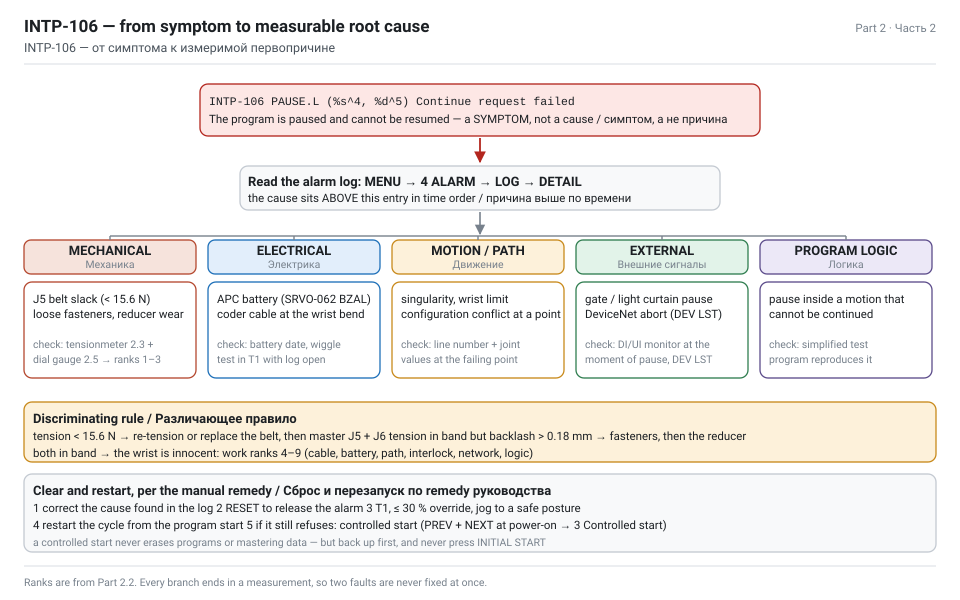

Work top-down and stop at the first branch whose evidence is present. Every branch lists the check that *discriminates* it — the measurement that proves or disproves it — so you never fix two things at once.

| Rank | Candidate cause | Evidence for it | Discriminating check | Fix |
|---|---|---|---|---|
| 1 | **J5 belt slack** → backlash → position mismatch during a paused move | Visible play at the wrist; no belt check logged for 6 months; alarm appears on motions that pause mid-path | Measure J5 belt tension (2.3) and J5 backlash (2.5) | Re-tension to 15.6–20.6 N, or replace the belt, then **master J5 and J6** |
| 2 | Loosened fasteners at the wrist or the motor mount | Play that disappears when you hold the arm; shiny witness marks around a bolt | Torque check of the cover, motor and reducer bolts | Re-torque to spec with LOCTITE 243/263 |
| 3 | **Worn J5 reducer** (harmonic drive) | Play that remains after the belt is correctly tensioned; grease with metal particles; noise | Backlash still > 0.18 mm with correct tension; inspect grease | Replace the reducer, re-grease, wait ≥ 1 h, master J5 |
| 4 | Damaged or loose motor/coder cable | Intermittent alarms that correlate with arm position; chafed jacket at the wrist bend | Wiggle test in T1 with the alarm log open; inspect the cable every 4 years per schedule | Replace the mechanical unit cable |
| 5 | APC battery weak → SRVO-062 BZAL → lost mastering | Battery older than 1 year (built-in C cells) or 1.5 years (external D cells); alarm after a power-off period | Check battery voltage/age, check for BZAL in the log | Replace **with power ON** (Part 3.5) |
| 6 | Singularity or wrist limit reached in the taught path | Alarm always at the same line number; J5 near 0° or near ±125° | Read the line number, look at the joint values at that point | Add a via point or change the configuration |
| 7 | External pause: gate, light curtain, upstream stop signal | INTP-106 with no preceding servo alarm; correlates with personnel movement | Monitor the DI/UI signals at the moment of the pause | Fix the interlock tuning or the sensor |
| 8 | DeviceNet / network abort | Cell I/O on DeviceNet; OFF or ERROR on the DEV LST screen | DEV LST status, baud rate, duplicate MAC IDs | Repair the network |
| 9 | Program logic pause that cannot be resumed (e.g. paused inside a motion statement with an unsupported continue) | Always the same program, same line, no hardware fault | Test with a simplified program | Restructure the program |

> TIP — Rank 1 and rank 3 look identical from the outside: both give wrist play. The only thing that separates them is the tension reading. Measure the belt **first** — it takes 25 minutes and costs nothing; a reducer replacement costs a day and a mastering of the whole axis.

**The one check that decides everything**

```text
IF  J5 belt tension < 15.6 N            → re-tension / replace belt → master J5+J6 → re-test
ELIF J5 belt tension in 15.6 … 20.6 N
     AND backlash ≤ 0.18 mm at 180 mm   → the wrist is fine; go to ranks 4–9
     AND backlash > 0.18 mm             → reducer or fasteners; torque check, then reducer
ELSE (tension > 20.6 N)                 → over-tensioned; bearing and motor load; re-tension down
```

## 2.3 Checking J5 belt tension with a tensionmeter — preparation

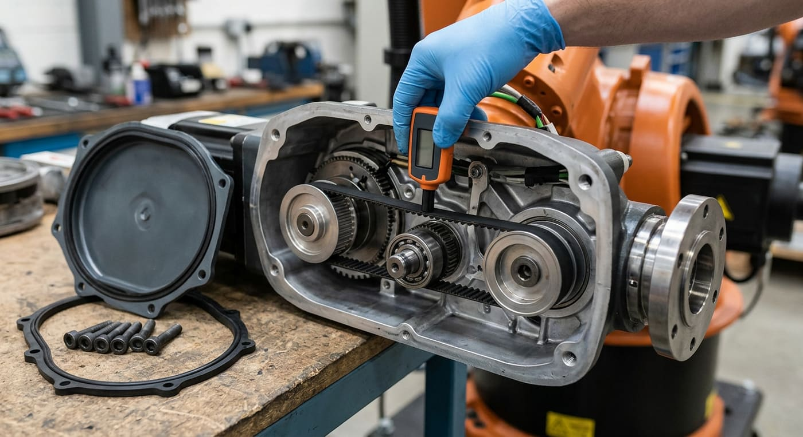

The LR Mate 200iD/7L uses timing belts to drive the wrist. The maintenance manual specifies a **non-contact vibration-type tensionmeter** and gives the exact parameters for each axis. Do not "pluck and guess": an under-tensioned belt slips and loses position; an over-tensioned belt loads the motor bearings and the reducer and fails early.

**The instrument**

| Item | Value |
|---|---|
| FANUC part number | **A97L-0218-0700** |
| Make / model | Mitsuboshi **DOCTOR TENSION TYPE-III** |
| Principle | excites the free span of the belt, measures its resonant frequency, converts to tension using the belt mass per unit length and the span length |
| Contact with the belt | none — the microphone/sensor head sits beside the span |

**Target values from the maintenance manual (§6.1 Belt tension adjustment)**

| Axis | Tension (N) | Belt mass (kg/m) | Belt width (mm) | Span length (mm) |
|---|---|---|---|---|
| J1 | 49–65 (long arm 7L) / 30–40 (standard) | 0.0367 | 6 | 167.5 |
| J2 | 49–65 (long arm 7L) / 30–40 (standard) | 0.0290 | 6 | 167.5 |
| J3 | see manual for the variant | — | — | — |
| **J5** | **15.6–20.6** | **0.02083** | **4** | **187** |
| J6 | 15.6–20.6 | 0.02083 | 4 | 116 |

Belt part number for J5/J6: **A98L-0040-0286#004-157**.

> NOTE — The manual explicitly says tension **slowly decreases with use, and that is normal**. A reading at the bottom of the band on a 2-year-old robot is not a fault. A reading *below* the band, or one that dropped since the last check, is.

**Cross-check of the numbers (worth showing in the report)**

The meter's physics is `T = 4 · m · L² · f²`, where *m* is the belt mass per unit length and *L* the span. Rearranged, the resonant frequency the meter should see is `f = √(T / (4 m L²))`. Plugging in FANUC's own J5 values:

| Axis | Span | f at the low limit | f at the high limit |
|---|---|---|---|
| J5 | 187 mm | 73 Hz (15.6 N) | 84 Hz (20.6 N) |
| J6 | 116 mm | 118 Hz (15.6 N) | 136 Hz (20.6 N) |
| J1 (7L) | 167.5 mm | 109 Hz (49 N) | 126 Hz (65 N) |
| J2 (7L) | 167.5 mm | 123 Hz (49 N) | 141 Hz (65 N) |

These frequencies are derived, not quoted from the manual — but they land exactly inside the working range of a vibration tensionmeter, which confirms the parameters are being interpreted correctly. If your meter shows 400 Hz on J5, your inputs are wrong, not the belt.

**Safety before you touch anything**

1. **Stop the cell.** Program paused, cycle finished, no product in the gripper.
2. **Lock out / tag out** the main disconnect. Belt tension measurement is done with the power **OFF**; the manual's adjustment procedure has you move the arm by hand.
3. **Support the arm mechanically** before releasing any brake. The wrist is light, but a J3 or J2 axis is not — if you release brakes to reach a pose, the arm will fall. Use the manual's rule: never release a brake without mechanically supporting that axis.
4. Let the machine cool; the reducer and motor housings get hot in production.
5. Wear gloves. Belt dust and old grease are not pleasant, and the cover edges are sharp.
6. Have the record sheet open before you start (download: [belt-tension-record.csv](assets/dl/belt-tension-record.csv)) — a measurement nobody wrote down is a measurement that did not happen. That is literally how this task began.

> DANGER — Never remove the robot's external APC battery with the power **OFF**, and never open the controller's battery compartment during this work. Doing so loses mastering data and creates SRVO-062 BZAL — turning a 25-minute tension check into a half-day mastering job. Parts 4 and 5 exist because somebody did exactly that.

## 2.4 The measurement sequence, step by step

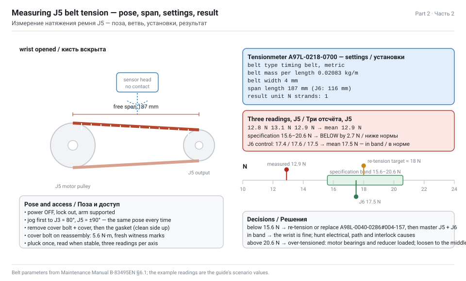

Follow the maintenance manual's §6.1 sequence. Total time: about 25 minutes for J5 and J6 together.

**A. Bring the arm to the measurement pose**

1. With power ON, in **T1**, override ≤ 10 %, deadman held, jog to the manual's inspection pose: **J3 = 80°, J5 = ±90°**.
2. Record the pose on the sheet. Every reading must be taken in the same pose, otherwise the span length changes and the numbers are not comparable.
3. Power **OFF**, lock out.

**B. Open the wrist**

4. Remove the fixing bolt and the **arm cover** on the wrist. Keep the bolts in a tray — they are different lengths.
5. Remove the **gasket** and put it aside, clean side up. It goes back; a missing gasket is how dust and brick abrasive get into a reducer.
6. Note the cover bolt torque for reassembly: **5.6 N·m**.

**C. Set up the tensionmeter**

7. Switch the meter on and set the parameters exactly as the manual gives them:

| Setting | J5 | J6 |
|---|---|---|
| Belt type / unit | timing belt, metric | timing belt, metric |
| **Belt mass per unit length** | **0.02083 kg/m** | **0.02083 kg/m** |
| **Belt width** | **4 mm** | **4 mm** |
| **Span length** | **187 mm** | **116 mm** |
| Unit of result | N | N |
| Number of belt strands | 1 | 1 |

8. Zero / calibrate the meter in a quiet place with no belt nearby. A brick plant is noisy — take the reading during a line stop, not with the kiln fans running.

**D. Measure**

9. Place the sensor head beside the **free span** of the J5 belt — the straight run between the two pulleys, 187 mm of it — without touching the belt.
10. Pluck the belt once with a fingertip (or use the meter's excitation), and read the tension when the value stabilises.
11. Take **three readings** and record all three plus the mean. Repeatability worse than ±0.5 N means your span length or mass input is wrong.
12. Repeat steps 9–11 for **J6** (span 116 mm) — the manual has you adjust both in the same opening, and a J5 belt replacement always requires re-mastering **J5 and J6**.
13. While the cover is off, do the free visual checks that cost nothing:

| Check | What a bad sign looks like |
|---|---|
| Belt teeth | glazing, missing teeth, cracks at the tooth root, fibres sticking out |
| Belt sides | fraying, uneven wear (a sign of pulley misalignment) |
| Pulleys | debris in the teeth, rust, a shiny band where the belt has been slipping |
| Bolt witness marks | paint marks broken or rotated → a fastener has moved |
| Grease around the reducer | grey or black grease, metal flakes → reducer wear |
| Cable at the wrist bend | chafed jacket, cracked strain relief |

**E. Adjust, if the reading is out of band**

14. Loosen the **tension-adjusting bolts** of the motor mount.
15. Move the motor to change tension — small turns. Re-measure after each adjustment; the belt needs a moment to settle.
16. Target the **middle** of the band (about 18 N for J5/J6), not the edge: it gives you the longest interval before the next check finds it low again.
17. Tighten the adjusting bolts, re-measure once more (tightening changes the tension slightly), then refit the **gasket**, the **cover** and the bolt at **5.6 N·m**.
18. Apply thread locker to the fasteners the manual lists (LOCTITE 243 for general bolts, 263 for high-strength) and mark fresh witness marks with a paint pen.

**F. After any belt work**

19. Removing or replacing the belt breaks the relationship between the motor and the joint, so the axis must be re-mastered:
   - belt re-tensioned only → verify the master position; if the arm was moved by hand with brakes released, re-master.
   - belt replaced, motor or reducer removed → **single-axis mastering is mandatory**. For **J5 you must master J5 *and* J6**.
20. Full procedure in Part 4.4.
21. Power on, jog in T1 at low override, check that the wrist holds position when you nudge it by hand (it should not move at all), and run a slow test cycle before returning the cell to production.
22. **Write the entry in the service log.** Date, hours, pose, three readings, mean, action taken, who did it. This is the step whose absence created the assignment.

> TIP — Photograph the witness marks and the meter display with the reading visible. Two photos in the report are worth more than a table of numbers nobody can trace.

## 2.5 Measuring the J5 play (backlash)

"Visible play" is not a measurement. The maintenance manual gives limits for every axis, measured with a **dial gauge (1/100 mm)** at a defined distance from the axis of rotation, and for the wrist the number is small.

**Table 3.3(b) — backlash limits, LR Mate 200iD (values for the 7L long-arm variant in brackets)**

| Axis | Measuring distance from the axis (mm) | Maximum backlash (mm) |
|---|---|---|
| J1 | 715 (910 for 7L) | 0.41 (0.52 for 7L) |
| J2 | 330 (440 for 7L) | 0.19 (0.25 for 7L) |
| J3 | 335 (420 for 7L) | 0.20 (0.25 for 7L) |
| J4 | 100 | 0.16 |
| **J5** | **180** | **0.18** |
| J6 | 100 | 0.15 |

**How to measure it**

1. Power OFF, lock out, and **mechanically support the arm** if you intend to release brakes — otherwise keep the brakes engaged and measure only what is measurable with them on.
2. Mount the dial gauge on a magnetic base fixed to a solid, non-moving part (the pedestal or the arm casting upstream of J5). Zero the gauge.
3. Put the gauge tip on the measured point at **180 mm from the J5 axis**, perpendicular to the direction of motion.
4. Apply a light, consistent force in one direction and note the reading. Reverse the force direction slowly and note how far the tip travels before the joint actually moves. That travel is the backlash.
5. Repeat three times in both directions. Report the **maximum**.
6. For comparison, do the same at J6 (100 mm, limit 0.15 mm) and, if you can reach it, at J4.

**Interpreting the result**

| Measured at 180 mm | Verdict | Action |
|---|---|---|
| ≤ 0.18 mm | within specification | record it, no action |
| 0.18 – 0.40 mm | out of specification, moderate | check fasteners and belt tension first (2.6), re-measure |
| > 0.40 mm, or visible by eye | far out of specification | treat as a fault: belt, reducer or a loose motor mount |
| play disappears when the belt is tensioned correctly | belt was the cause | re-tension / replace, master J5+J6 |
| play remains at correct tension | reducer or fasteners | torque check, then reducer replacement |

> NOTE — Convert the number to something a report reader feels. 0.18 mm at 180 mm from the axis is about **0.057°** of angular play. The robot's repeatability specification is **±0.01 mm** — so a wrist at its backlash limit has roughly **six times** the positional slop of the whole machine's accuracy spec, and it sits at the far end of a 911 mm arm where every degree of wrist error becomes millimetres at the brick. That is why a brick on layer 8 lands off-pattern while layer 1 looks fine.

**Why backlash produces alarms and not just bad placement**

A loose belt means the motor turns and the joint does not. The pulse coder sits on the **motor**, so the controller believes the joint is where the motor says it is. During a rapid deceleration, a paused motion or a direction reversal, the joint lags, catches up, or overshoots — and the mismatch between commanded and actual position is what raises the servo-level alarms (SRVO-038 pulse mismatch being the classic). The interpreter, meanwhile, has a program paused in the middle of a motion it can no longer guarantee — and refuses the continue request. **INTP-106.**

## 2.6 Action plan for the J5 backlash

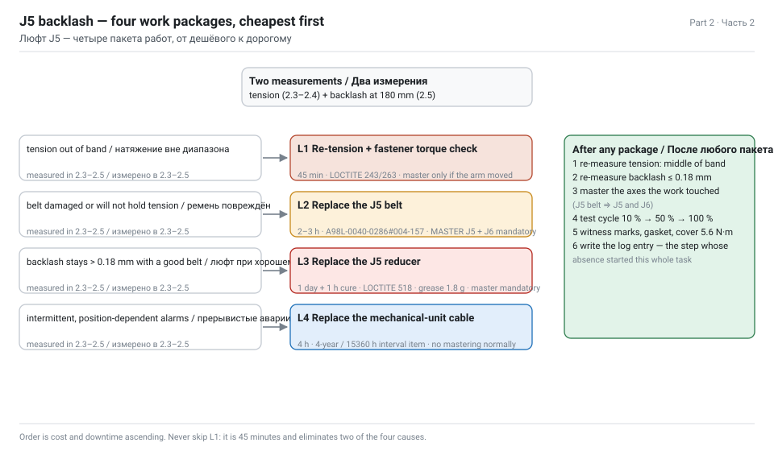

The task asks for an action plan covering three things: **checking the fasteners**, **replacing the belt**, and **replacing the gearbox**. Do them in that order — they are also in ascending order of cost and downtime.

**Level 1 — fasteners and re-tension (≈ 45 min, no parts, no mastering if the arm was not moved)**

| # | Action | Spec |
|---|---|---|
| 1 | Lock out, support the arm, open the wrist cover | cover bolt 5.6 N·m on reassembly |
| 2 | Inspect witness marks on the motor mount, reducer and cover bolts | broken/rotated marks = a fastener moved |
| 3 | Torque-check every listed fastener with a calibrated wrench | tighten to the manual's values, in the stated sequence |
| 4 | Apply thread locker where the manual requires it | LOCTITE **243** medium strength for general bolts; **263** for high-strength; **518** as a flange sealant on mating faces; **638** for retaining cylindrical parts |
| 5 | Measure the belt tension and correct to the middle of the band | J5 and J6: 15.6–20.6 N, target ≈ 18 N |
| 6 | Re-measure the backlash at 180 mm | accept only if ≤ 0.18 mm |
| 7 | Paint fresh witness marks, refit gasket + cover, close the record | |

**Level 2 — belt replacement (≈ 2–3 h, part A98L-0040-0286#004-157, mastering J5 + J6 mandatory)**

Trigger: tension cannot be brought into the band, the belt has missing/cracked/glazed teeth, the sides are frayed, or the pulley shows a polished slip band.

1. Support the arm, remove the cover and gasket.
2. Loosen the tension-adjusting bolts and slide the motor to release the belt.
3. Remove the old belt; **compare it with the new one** tooth count and width before fitting (a wrong belt is a silent killer).
4. Clean the pulleys; check them for tooth damage and for runout.
5. Fit the new belt, set tension to the middle of the band, tighten the adjusting bolts, re-measure.
6. Refit gasket, cover, bolt at 5.6 N·m, thread locker and witness marks.
7. **Master J5 and J6** (Part 4.4). Removing the belt breaks the motor-to-joint relationship for both axes driven through that wrist.
8. Test cycle at 10 % override, then 50 %, then production speed.

**Level 3 — reducer (gearbox) replacement (≈ 1 day + curing, mastering mandatory, specialist tools)**

Trigger: backlash still above 0.18 mm with a correctly tensioned new belt; abnormal noise; grease containing metal particles; or the reducer has exceeded its service life.

| # | Action | Notes |
|---|---|---|
| 1 | Order the correct reducer for the **7L** variant | the long-arm wrist differs from the standard; verify by serial number |
| 2 | Drain/collect the old grease and inspect it | metal flakes confirm the diagnosis — photograph it for the claim |
| 3 | Remove the belt, the motor and the reducer | gear puller, separator, C-ring pliers per the manual's tool list |
| 4 | Clean the housing, inspect the mating faces | no dents, no old sealant residue |
| 5 | Fit the new reducer with **LOCTITE 518** on the flange | the manual specifies it for reducer mounting |
| 6 | Refit motor, belt, set tension, torque everything | |
| 7 | **Wait at least 1 hour** before operating | the sealant must set — the manual is explicit |
| 8 | Re-grease to the regulated amounts | J5 and J6: **1.8 g (2 ml)** each; grease A98L-0040-0230, kit A05B-1142-K021, plunger 2.5 mm = 1 ml |
| 9 | Master the axis, then run-in | slow cycles first, then re-measure backlash after 1 h of running |
| 10 | Record everything, including the old part's condition | this is your evidence for the claim in Part 5 |

> WARNING — Never use **Harmonic Drive SK-3** grease in these reducers even though it is the same brand family; the manual specifies **4B No.2 (A98L-0040-0230)**. Never exceed the regulated grease quantity: over-greasing builds pressure, blows the seals and creates the oil-seepage fault the manual tells you to check for. After greasing, if pressure builds up inside, vent through the grease inlet.

**Level 4 — cable and coder (only if levels 1–3 do not explain it)**

Replace the mechanical unit cable (the manual puts it on a 4-year / 15360 h interval), inspect the coder connector, and re-check. Cable faults produce *intermittent* alarms correlated with arm position, not steady backlash — which is how you tell them apart.

**The plan you hand in**

| Level | Trigger | Time | Parts | Mastering |
|---|---|---|---|---|
| 1 | first attempt, always | 45 min | LOCTITE only | only if the arm was moved with brakes off |
| 2 | tension out of band or belt damaged | 2–3 h | belt A98L-0040-0286#004-157 | **J5 + J6, mandatory** |
| 3 | backlash persists with a good belt | 1 day + 1 h cure | reducer, grease kit | **mandatory** |
| 4 | intermittent, position-dependent alarms | 4 h | mechanical unit cable | not normally required |

## 2.7 Root cause: the missing log entry

A good diagnosis report separates the **technical cause** (a slack belt) from the **organisational cause** (nobody was checking). Fixing only the first one guarantees a repeat in six months.

| Question | Answer for this task |
|---|---|
| What failed? | The J5 wrist timing belt lost tension beyond 15.6 N, creating backlash above the 0.18 mm limit |
| Why did it fail? | Tension decreases slowly in normal use and nobody re-tensioned it |
| Why did nobody notice? | The quarterly belt-condition check was not performed for at least two cycles — 6 months of missing log entries |
| Why was the check not performed? | No scheduled work order, no checklist in the cell, no owner for the task |
| What is the corrective action? | Re-tension/replace + master (technical) **and** introduce the 6-month PPM programme with signed checklists (organisational) — Part 3 |
| What is the preventive action? | Belt tension becomes a *recorded, trending* value; an alarm threshold at 16.5 N triggers work before the limit is reached |

**What the trend should look like once you start recording**

| Check | Running hours | J5 tension (N) | Action |
|---|---|---|---|
| Baseline (after repair) | 0 | 18.1 | record |
| +3 months | 960 | 17.6 | none — normal slow loss |
| +6 months | 1920 | 17.1 | none |
| +9 months | 2880 | 16.6 | watch — approaching the trigger |
| +12 months | 3840 | 16.0 | re-tension to 18 N before it reaches 15.6 |

The manual's own wording — tension slowly decreases with use, which is normal — only becomes a maintenance programme when somebody writes the numbers down. That table is the difference between "the robot broke" and "the robot was maintained".

> TIP — Put the trigger value on the checklist, not just the limit: *"J5 belt tension must read 15.6–20.6 N; raise a work order at ≤ 16.5 N."* Limits tell you when you have already failed; triggers tell you when to act.

## 2.8 Verification after the repair

Do not hand the cell back to production on the strength of a good tension reading. Verify in four stages, and record each.

| Stage | Test | Pass criterion |
|---|---|---|
| 1 · Static | Nudge the wrist by hand at the measured point | no perceptible movement; gauge ≤ 0.18 mm at 180 mm |
| 2 · No-load motion | T1, 10 % override, jog J5 through its full ±125° range and back, three times | smooth, no noise, no alarm, no drift in the displayed position when returning to a mark |
| 3 · Accuracy | Jog to a fixed point, mark it, move away and return three times | returns to the same point within the repeatability spec (±0.01 mm) |
| 4 · Production | Run the palletizing cycle for one full pallet at 50 %, then 100 % | all 192 bricks placed on pattern, zero INTP-106, zero servo alarms |

**Then, in the simulation** — reproduce the whole story so the report is not just prose. In the Visual Components layout from Part 1, add a joint-position offset of 0.3° to J5 inside the place routine and watch layers 5–8 drift off the pattern; then set the offset to 0 and watch it disappear. Export both runs as video and statistics. A reviewer who sees the drift cannot argue with your diagnosis.

**Finally, the paperwork**

1. Service log entry: date, hours, what was measured, what was replaced, who did it, next due date.
2. Attach the tension record sheet ([download](assets/dl/belt-tension-record.csv)) and the backlash readings.
3. If the belt or reducer failed inside the warranty period → the claim act in Part 5.2, with the photographs of the old part.
4. Update the PPM schedule in Part 3 with the new "next due" dates, counted from today, not from the last (missing) check.

---

# Part 3 — ППР: the 6-month maintenance programme

_Task section 2. Daily visual inspections, quarterly torque and belt checks, battery replacement with the power ON, greasing, backups and the signed record._

## 3.0 The programme at a glance

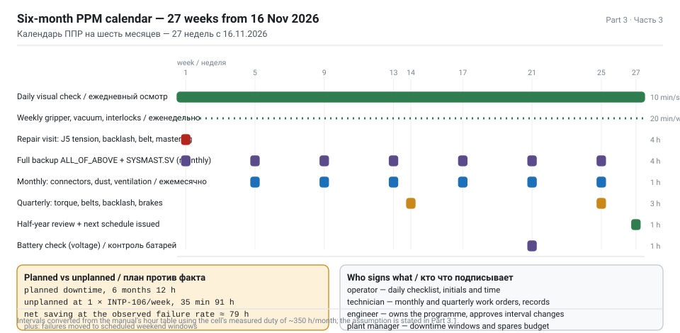

Planned preventive maintenance (ППР) for this cell is built from FANUC's own periodic inspection table, converted from running hours into calendar dates and split between what the **operator** does every shift and what the **technician** does every quarter.

| Frequency | Owner | Duration | Downtime | Content |
|---|---|---|---|---|
| Every shift (daily) | operator | 10 min | none — before start-up | visual check, cables, cleanliness, alarm review |
| Weekly | operator + setter | 20 min | none | gripper cups, vacuum, fence and interlocks, beacon |
| Monthly (320 h) | technician | 1 h | 1 h planned | connector looseness, dust removal, ventilation, oil-seepage look |
| Quarterly (960 h) | technician | 3 h | 3 h planned | **bolt torque**, **belt condition and tension**, backlash, brake test |
| Half-yearly (1920 h) | technician + engineer | 4 h | 4 h planned | everything above + battery voltage check, backup verification, cycle-time trend |
| Annual (3840 h) | FANUC-trained technician | 8 h | 1 shift | battery replacement, full inspection, accuracy check |
| 1.5-year (5760 h) | specialist | 8 h | 1 shift | per manual's periodic table |
| 2-year (7680 h) | specialist | 8 h | 1 shift | per manual's periodic table |
| 4-year (15360 h) | FANUC service | 2 days | 2 shifts | **replenish reducer grease + replace the mechanical-unit cable** — whichever comes first |

**Assumption that makes the calendar legal**

FANUC's periodic table is written for a machine running **up to 3840 hours per year** (roughly two shifts, five days). Convert your real duty cycle before you copy the dates:

```text
this cell :  6.0 s per brick × 600 bricks/h  →  running ≈ 8 h/shift
shifts    :  2 per day, 5 days per week      →  80 h/week  →  ~4160 h/year
result    :  slightly above the 3840 h/yr assumption
            → shorten every hour-based interval by ~7 %, or keep the calendar
              and add one extra quarterly check in the summer shutdown
```

> NOTE — For a student report the important sentence is this: *"the intervals below are calendar dates derived from FANUC's hour-based table using a stated duty-cycle assumption, and the assumption is written down so that a different production schedule can be recalculated."* That single sentence is what separates an engineering schedule from a copied one.

**Downloads**

- [PPM-6-month-schedule.csv](assets/dl/PPM-6-month-schedule.csv) — the calendar below as a spreadsheet
- [daily-checklist.md](assets/dl/daily-checklist.md) — printable shift check
- [quarterly-checklist.md](assets/dl/quarterly-checklist.md) — printable quarterly check with torque and tension fields

## 3.1 Reading the FANUC periodic inspection table

> SOURCE — LR Mate 200iD Operator's Manual B-83494EN, §7.1.2 periodic inspection; Maintenance Manual B-83495EN, §1 periodic inspection and Appendix C; §7.3.1 batteries; §7.3.2 grease.

The manual does not give you a calendar. It gives you **intervals in running hours** and a list of inspection items, and expects you to convert. Three things to get right:

1. **The hour base.** The table assumes ≤ 3840 h/year. A cell that runs 24/7 hits the "1-year" items in nine months.
2. **Whichever comes first.** Several items are specified as "X hours or Y months, whichever comes first" — the 4-year grease and cable item explicitly says so. A robot that sits idle still needs its cable and grease attention on calendar time.
3. **Where the hours come from.** Read them from the controller, do not estimate:
   - <kbd>MENU</kbd> → **0 NEXT** → **6 SYSTEM** → <kbd>F1 [TYPE]</kbd> → **Variables** → look at the operating-time counters, or
   - <kbd>MENU</kbd> → **STATUS** → the runtime display, or
   - <kbd>MENU</kbd> → **0 NEXT** → **6 SYSTEM** → **Drive time / operation time** screen (name varies with software version).

| Interval | Running hours (≤3840 h/yr) | Calendar equivalent at 80 h/week | Items |
|---|---|---|---|
| 1 month | 320 h | 4 weeks | connector looseness, dust and spatter removal, ventilation filter |
| 3 months | 960 h | 12 weeks | **bolt torque**, **belt condition/tension**, backlash, oil-seepage check, gripper and external battery cable |
| 1 year | 3840 h | 48 weeks | battery replacement, full inspection, brake and accuracy check |
| 1.5 years | 5760 h | 72 weeks | per the manual's table for your duty |
| 2 years | 7680 h | 96 weeks | per the manual's table |
| 4 years | 15360 h | 192 weeks | replenish reducer grease, replace mechanical-unit cable |

> WARNING — The 4-year item is the one plants miss, because the robot still runs perfectly. Grease degrades and cable insulation work-hardens at the flex points long before either shows a symptom. When the symptom arrives it arrives as a stopped line during the busiest week of the year. Put the date in the calendar now.

**How to record running hours so the schedule stays honest**

Read the controller's runtime at the start of every month and write it in the log. The delta is the true duty for that month, and the sum tells you when each interval falls due — with no guessing.

| Month | Controller runtime (h) | Delta (h) | Cumulative since last 3-month check | Due? |
|---|---|---|---|---|
| Nov 2026 | 12 480 | — | 0 | — |
| Dec 2026 | 12 830 | 350 | 350 | no |
| Jan 2027 | 13 150 | 320 | 670 | no |
| Feb 2027 | 13 500 | 350 | 1020 | **yes — quarterly check** |

## 3.2 Daily visual inspection (operator, 10 min, before start-up)

The daily check is the cheapest insurance in the whole programme and the one the task specifically names: **cables** and **dust cleaning**. It must be doable by an operator, in 10 minutes, without tools, before the shift starts.

**A. Before power-on (walk-around, 4 min)**

| # | Check | What you look for | If bad |
|---|---|---|---|
| 1 | Floor around the cell | brick dust, granules, fragments, spilled grease | sweep/vacuum — dust in the reducer vent is how a wrist dies |
| 2 | Robot cable dress | cables not touching the fence, not resting on the conveyor, not kinked at the wrist bend | re-dress, add a clip |
| 3 | Cable jackets | cuts, abrasion, cracked strain reliefs, tape repairs | stop, tag, call the technician |
| 4 | Connectors | seated, latched, no corrosion, no dust caps missing | reseat, replace the cap |
| 5 | Gripper | cups intact, not torn or glazed, no brick dust packed into the venturi | clean or replace the cup |
| 6 | Fence, gate, light curtain | nothing stored against the fence, lens clean, gate closes and latches | clear, clean the lens |
| 7 | E-stops | not pressed, not obstructed, red mushroom visible | reset only after finding out why |
| 8 | Controller cabinet | ventilation slots not blocked, fan running quietly, no dust blanket | clean with low-pressure air from a safe distance |
| 9 | Pallet station | no pallet debris, no strapping in the robot's path | clear |
| 10 | Beacon and horn | lens clean | clean |

**B. After power-on (2 min)**

| # | Check | Pass criterion |
|---|---|---|
| 11 | No alarms on the pendant | the alarm list is empty; write down any that appeared overnight |
| 12 | 7-segment display on the controller | shows the normal running indication, not "1" |
| 13 | Battery warning | no SYST-035 (controller battery low) and no SRVO-062 BZAL (coder battery) |
| 14 | Jog test in T1 at 10 % | all six axes move smoothly both ways, no noise, no vibration at the wrist |
| 15 | Home position | the arm returns to the taught home, not to a visibly different pose |

**C. During the shift (glance checks)**

- Listen: a wrist that starts whining or clicking is telling you something weeks before it fails.
- Watch the placement: if layer 6 starts landing 2 mm off, that is backlash growing — measure it (Part 2.5) instead of "adjusting the program".
- Count the stops: every INTP-106 gets a tick on the shift sheet with the time. Ten ticks in a week is a work order, not a nuisance.

> TIP — Laminate the checklist and hang it on the fence gate with a dry-wipe marker. A checklist that lives in a folder in the maintenance office does not get done; a checklist on the gate does. Download: [daily-checklist.md](assets/dl/daily-checklist.md).

**Dust is a real hazard in a brick plant, not a cosmetic one**

| Where dust goes | What it does |
|---|---|
| Controller ventilation slots | insulation blanket → overheating → derating and random faults |
| Belt and pulley area at the wrist | abrasive paste with grease → accelerates belt and bearing wear |
| Light curtain lenses | false stops, or worse, a beam that fails to detect |
| Vacuum cups and venturi | loss of holding force → dropped bricks |
| Fence gate interlock | intermittent contact → random cell stops that look like INTP-106 |

Cleaning method: dry, low-pressure air or a vacuum — **never** a wet cloth on electrical parts, and never compressed air blown *into* a connector or a reducer vent.

## 3.3 Quarterly checks: bolt torque and belt condition

Three hours of planned downtime, four times a year, prevents almost everything in this task. The two items the assignment names are **bolt torque** and **belt condition**.

**A. Bolt torque check (≈ 60 min)**

1. Lock out, support the arm where you will release nothing, gather a calibrated torque wrench and the manual's torque values for your variant.
2. Work through the list and **mark each bolt after checking** with a paint pen so the next quarter starts from a clean slate:

| Location | What to check | Notes |
|---|---|---|
| Robot base to pedestal | the 4 base fixing bolts | the highest-load joint; a power-off stop applies up to 1657 N·m of vertical moment |
| Pedestal to floor | anchor bolts | look for cracks in the grout or the concrete |
| Arm cover bolts (all axes) | tightness and gasket condition | wrist cover 5.6 N·m |
| Motor mounting bolts (J5) | witness marks intact | the direct cause of "backlash that is not the belt" |
| Reducer mounting bolts | witness marks intact | |
| End-effector / gripper bolts | tightness every quarter — the manual lists end-effector bolt tightening as a periodic item | a vacuum plate that shifts by 1 mm shifts every brick by 1 mm |
| Tool changer, if fitted | locking and alignment | |
| Fence and gate fixings | tightness, no missing panels | |
| Controller cabinet mounting and cable glands | tight, sealed | |

3. Any bolt that turns **without reaching torque** has loosened: clean the thread, apply the specified LOCTITE (**243** general, **263** high strength), re-torque, and mark. Any bolt that is already at torque but whose witness mark has rotated has moved — investigate why (vibration source, overload, wrong washer).
4. Record: number of bolts checked, number re-torqued, number with broken witness marks.

**B. Belt condition and tension (≈ 60 min)**

Follow Part 2.4 in full, but as a *check* rather than a repair:

1. Pose J3 = 80°, J5 = ±90°; power OFF; open the wrist.
2. Measure J5 and J6 tension three times each; record the mean.
3. Compare with the previous quarter's reading — **the trend matters more than the absolute value**.
4. Inspect teeth, sides, pulleys and the free span for cracks and glazing.
5. Check the other axes you can reach (J1/J2 at 49–65 N for the 7L).
6. Re-measure backlash at 180 mm (J5) and 100 mm (J6) with the dial gauge.
7. Close up: gasket, cover, 5.6 N·m, fresh witness marks.

| Axis | Target (N) | Alarm trigger (N) | Backlash limit |
|---|---|---|---|
| J1 (7L) | 49–65 | ≤ 51 | 0.52 mm at 910 mm |
| J2 (7L) | 49–65 | ≤ 51 | 0.25 mm at 440 mm |
| J5 | 15.6–20.6 | ≤ 16.5 | 0.18 mm at 180 mm |
| J6 | 15.6–20.6 | ≤ 16.5 | 0.15 mm at 100 mm |

**C. The rest of the quarterly visit (≈ 60 min)**

| Item | Method |
|---|---|
| Oil-seepage check | wipe the reducer housings clean, run the cell, re-check the next day; if seepage returns, find the source. If internal pressure has built up after greasing, vent it through the grease inlet |
| Grease condition | colour and particles at the vent; grey/black or metallic = reducer wear |
| Mechanical stoppers | present, not deformed, bolts tight |
| Brake test | in T1 with the power on, release one axis at a time (arm supported!) and check it holds; the wrist should not drift |
| Battery voltage | controller battery 3.1–3.3 VDC is healthy; plan replacement below that |
| Backup verification | restore the latest backup into a test controller or verify file integrity and date |
| Cycle-time trend | compare the current pallet cycle time with the commissioning value — a creeping cycle time is early backlash |
| Pendant and cables | screen, keys, deadman, emergency stop, cable jacket at the strain relief |

Download the printable form: [quarterly-checklist.md](assets/dl/quarterly-checklist.md).

## 3.4 Battery replacement — and the safety rule everyone gets wrong

There are **two** battery systems and they have **opposite** rules. Mixing them up is how a 15-minute job becomes a lost-mastering incident.

| | Robot base — APC battery | Controller main board — SRAM battery |
|---|---|---|
| What it keeps alive | the **absolute pulse coder** — the robot's knowledge of where its joints are | the **SRAM** — programs, system variables, mastering data, alarm history |
| Cells | 4 × **C (LR14) 1.5 V**, built-in unit | 3 V **lithium** unit |
| FANUC part | built-in battery unit (see manual Appendix A for your variant) | **A05B-2650-K030** (also listed as A98L-0031-0028) |
| Life | ~**1 year** (built-in) / ~**1.5 years** (external D-cell pack) | ~**4 years** |
| Healthy voltage | fresh alkaline cells | **3.1–3.3 VDC** |
| Warning alarm | **SRVO-062 BZAL** | **SYST-035** (battery voltage low) |
| Power state during replacement | **POWER ON** | power ON ~30 s, then **OFF**, swap within **30 minutes** |
| If you get it wrong | power OFF swap → BZAL → **mastering data lost** | battery dead and power cycled → controller will not start, 7-segment shows "1", **SRAM contents lost** |

> DANGER — **Replace the robot's APC battery with the controller power ON.** The manual is explicit, and so is this task. With the power off, the absolute pulse coder loses its reference the instant the battery is disconnected and the mastering data is destroyed. The E-stop must be pressed and the cell guarded while you do it, because the drives are live.

**Procedure A — robot base APC battery (power ON)**

1. Back up first: Part 3.5. Yes, even for a battery swap.
2. Finish the cycle, park the arm in the **zero-position/mastering pose** so that if anything does go wrong you can re-master quickly.
3. Press the **E-stop** on the pendant and/or the cell. The drives are inhibited but the controller stays powered.
4. Put the pendant down somewhere safe, tell the operator what you are doing, and hang a tag on the cell: "battery replacement in progress — do not release E-stop".
5. Open the battery compartment in the robot base (or the external battery box, if your cell uses the D-cell pack).
6. Note the polarity and the connector orientation. **Photograph it.**
7. Disconnect the old unit and connect the new one **within a few seconds** — do not leave the coder unpowered. Have the new battery unpacked and in your hand *before* you disconnect the old.
8. Close the compartment, verify the connector is latched.
9. Release the E-stop, check that **SRVO-062 BZAL** does not appear, and confirm the joint positions on the screen still match the arm's physical pose (compare against the witness marks).
10. Write the date in the log and on a label stuck to the battery compartment. Next due: **+12 months** (built-in) or **+18 months** (external pack).

**Procedure B — controller SRAM battery**

1. **Back up** programs, system variables and the mastering file (Part 3.5). This is not optional: if the battery is already weak, the SRAM contents are the only copy of your cell.
2. Turn the controller **ON** and leave it for about **30 seconds** — this brings the SRAM up and lets the backup circuitry charge.
3. Turn the controller **OFF**.
4. **The whole replacement must be completed within 30 minutes** of power-off. Set a timer. Beyond that the SRAM contents are not guaranteed.
5. Open the controller, find the battery unit — it is latched in the **lower-right area of the backplane**.
6. Unlatch and withdraw the old unit; insert the new one until the latch **snaps** home.
7. Close the controller, power **ON**.
8. Check for **SYST-035**: if it appears, the battery did not seat or is faulty.
9. Verify programs and system variables are intact; log the date and the next due date (**+4 years**, but check the voltage quarterly).

> WARNING — Never carry spare batteries loose in a toolbox where the terminals can short. Alkaline C cells shorted in a pocket get hot enough to burn. Keep them in the original packaging until the moment of use, and dispose of the old ones properly.

**Sizing the spares kit**

| Item | Quantity to hold on site | Reason |
|---|---|---|
| Robot APC battery unit | 2 | one in use, one spare; 1-year life means an annual purchase anyway |
| Controller battery A05B-2650-K030 | 2 | lithium cells lose charge on the shelf — check the date code |
| J5/J6 belt A98L-0040-0286#004-157 | 1 | 2–3 h to fit, but a day to obtain |
| Grease A98L-0040-0230 (tube A05B-1139-K022) | 1 tube | enough for several axes |
| Cover gaskets | 2 | they get damaged on removal |
| LOCTITE 243 / 263 / 518 | 1 each | |

## 3.5 Backups: what to save, when, and how to restore it

A maintenance programme without backups is a programme that will lose the cell. Back up **before** any of the following: battery replacement, a cold start, a software upgrade, mastering work, and any change to the safety configuration.

**What to back up**

| Data | Contains | File / device |
|---|---|---|
| **All of above** (image backup) | everything below in one file — the fastest full recovery | `ALL_OF_ABOVE.SYS` (+ `.VA`) on USB |
| Programs | TP programs, including the palletizing routine | `.TP` / binary or ASCII `.LS` |
| System variables | $MASTER_ENB, $DMR_GRP, device configuration, motion settings | `SYSVARS.SV`, `SYSVARS.VA` |
| **Mastering data** | the reference positions of every axis | **`SYSMAST.SV`** — this is the file Part 4 lives on |
| Registers | position, numeric, string registers | `POSREG.VA`, `NUMREG.VA`, `STRREG.VA` |
| I/O configuration | assigned signals, DeviceNet/PROFINET setup | `DEVLIST.SV` |
| Alarm history | the INTP-106 record you need for the report | print or capture the LOG screen |
| Setup data | tool frames, user frames, payload identification data | `.VR` files |

**How (R-30iB Plus)**

1. Insert a FAT32-formatted USB stick in the controller's USB port.
2. On the pendant: <kbd>MENU</kbd> → **1 UTILITIES** (or **FILE**) → choose the device with <kbd>F2</kbd> or <kbd>UTIL</kbd> → **Set Device** → **USB** (shown as `UD1:`).
3. <kbd>F1 [TYPE]</kbd> or **DIR** to list files; <kbd>UTIL</kbd> → **Save** (or **Backup**) and pick the data type. Choose **All of above** for the full set.
4. Wait for the confirmation. Never pull the stick during a write.
5. Verify: the files must exist, be non-zero, and carry today's date. Restore one into a test controller once a year to prove the backup is real.

**Naming and storage**

```text
UD1:/BACKUP/
   2026-11-09_palletcell_ALL/       ← full image
   2026-11-09_SYSMAST.SV            ← mastering data, also kept separately
   2026-11-09_programs/             ← .TP + .LS
   2026-11-09_sysvars.SV
   readme.txt                       ← controller software version, robot serial, who took it
```

Two copies minimum: one on the USB stick kept in the controller cabinet, one in the plant's file store. A backup that lives only next to the machine dies with the machine.

**Restore**

1. <kbd>MENU</kbd> → **FILE** → <kbd>UTIL</kbd> → **Set Device** → USB.
2. **DIR**, select the file, <kbd>F3 LOAD</kbd> (programs/variables) or <kbd>RESTORE</kbd> for an image backup.
3. Confirm with **YES**, then **cold start** (hold <kbd>PREV</kbd> + <kbd>NEXT</kbd> while powering on → **3 Controlled start**).

> WARNING — Restoring `SYSVARS.SV` or an image can overwrite mastering-related variables and cause **SRVO-038 pulse mismatch** if the encoder counts no longer match. That is exactly the situation Part 4.6 handles. Always restore into a controller whose robot has not moved, or be ready to re-master.

## 3.6 Reducer greasing — quantities and procedure

> SOURCE — Maintenance Manual B-83495EN, §2.2 greasing the reducers.

Greasing is on the long interval (replenish at 4 years / 15360 h, or after any reducer work), but you must know it because the quarterly inspection checks the grease condition, and because over-greasing is a fault in itself.

**Materials**

| Item | Part number |
|---|---|
| Grease | **A98L-0040-0230** — Harmonic Drive **4B No.2** |
| Grease kit (syringe + 80 g) | **A05B-1142-K021** |
| Refill tube | **A05B-1139-K022** |
| Syringe scale | plunger travel **2.5 mm = 1 ml** |

**Regulated quantities per axis**

| Axis | Quantity | Syringe volume |
|---|---|---|
| J1 | 2.7 g | 3 ml |
| J2 | 2.7 g | 3 ml |
| J3 | 1.8 g | 2 ml |
| J4 | 1.8 g | 2 ml |
| J5 | 1.8 g | 2 ml |
| J6 | 1.8 g | 2 ml |

**Procedure**

1. Power **OFF**, lock out. Greasing is done with the machine dead.
2. Place a catch tray under the axis; old grease will come out.
3. Remove the **grease-inlet seal bolts** of the reducer.
4. Fill the syringe with the regulated amount and inject it through the inlet. Count the plunger travel: 2.5 mm per ml.
5. Rotate the axis slowly by hand (brakes released only with the arm mechanically supported) to distribute the grease.
6. Fit **new** seal bolts. If you must reuse the old ones, apply seal tape.
7. Wipe away every spill — grease on the floor of a brick plant becomes an abrasive paste and a slip hazard.
8. Wait: after a **reducer replacement**, do not operate for **at least 1 hour** so the LOCTITE 518 flange sealant sets.
9. Run the axis slowly for a few minutes, then check for seepage. If internal pressure has built up, vent it through the grease inlet.

> WARNING — **Never exceed the regulated quantity** and **never use Harmonic Drive SK-3**. Over-greasing raises internal pressure, extrudes grease past the seals, and the leaked grease collects brick dust into a grinding paste. The manual lists oil seepage as an inspection item precisely because over-greasing is a common mistake.

**What the quarterly grease inspection actually looks at**

| Observation | Meaning |
|---|---|
| Grease is the original pale colour, no particles | healthy |
| Grease darkened, no particles | normal ageing — note it, keep the interval |
| Grease grey/black with fine metallic particles | reducer wear — plan replacement (Part 2.6 level 3) |
| Grease leaking from the seal | over-greased or a damaged seal |
| Grease dried and crusty at the vent | vent blocked — clean it |

## 3.7 The 6-month schedule for this cell

Dates counted from **Monday 16 November 2026** (week 1), at the cell's real duty of ~350 running hours per month. Everything marked ▣ needs planned downtime; everything else is done during a shift change or before start-up.

| Date | Week | Task | Owner | Downtime |
|---|---|---|---|---|
| every shift | 1–26 | Daily visual inspection A + B + C ([checklist](assets/dl/daily-checklist.md)) | operator | 0 |
| every Friday | 1–26 | Weekly gripper/vacuum/interlock check | setter | 0 |
| **Mon 16 Nov 2026** | 1 | **Repair visit**: J5 tension measurement, backlash measurement, re-tension/replace belt, master J5+J6, open the new log | technician | 4 h |
| Mon 16 Nov 2026 | 1 | Full backup: ALL_OF_ABOVE + SYSMAST.SV, stored twice | technician | 0.5 h |
| Mon 14 Dec 2026 | 5 | ▣ Monthly: connectors, dust removal, controller ventilation, oil-seepage look | technician | 1 h |
| Mon 11 Jan 2027 | 9 | ▣ Monthly + verify backups restore | technician | 1 h |
| Mon 8 Feb 2027 | 13 | ▣ Monthly | technician | 1 h |
| **Mon 15 Feb 2027** | 14 | ▣ **Quarterly Q1**: bolt torque all listed fasteners, J5/J6 belt condition + tension + backlash, brake test, grease condition, cycle-time trend | technician | 3 h |
| Mon 8 Mar 2027 | 17 | ▣ Monthly | technician | 1 h |
| Mon 5 Apr 2027 | 21 | ▣ Monthly + controller battery voltage check (target 3.1–3.3 VDC) | technician | 1 h |
| **Mon 3 May 2027** | 25 | ▣ **Quarterly Q2** (same scope as Q1) | technician | 3 h |
| **Mon 17 May 2027** | 27 | ▣ **Half-yearly review**: 6-month trend report, spares audit, next 6-month schedule issued, PPM programme signed off | engineer | 1 h |
| (annual, if due) | — | ▣ **Battery replacement**: robot APC with power ON (Part 3.4 A); controller battery within 30 min of power-off (Part 3.4 B) | technician | 1 h |
| (4-year, if due) | — | ▣ Replenish reducer grease (J5/J6 1.8 g each) + replace the mechanical-unit cable | FANUC service | 2 days |

**Total planned downtime over six months: 12 hours** — against the 30–40 minutes lost per INTP-106 event. At one event per week that is 78–104 hours of unplanned stoppage, i.e. the entire PPM programme pays for itself roughly **8 times over** in the first six months. Put that arithmetic in the report; it is the sentence that convinces a production manager.

| | Hours over 6 months |
|---|---|
| Planned PPM downtime | 12 |
| Unplanned stops at 1 × INTP-106 per week, 35 min average | 91 |
| Unplanned stops at 1 × per month | 2 |
| **Net saving at the observed failure rate** | **≈ 79 h** |

**Who signs what**

| Role | Responsibility |
|---|---|
| Operator | daily checklist, initials and time; reports anything abnormal immediately |
| Setter / line lead | weekly checks; confirms the cell is safe to hand back after maintenance |
| Maintenance technician | monthly and quarterly work orders, measurements, records |
| Maintenance engineer | owns the PPM programme, approves interval changes, reviews trends |
| Plant manager | approves the downtime windows and the spares budget |

## 3.8 The maintenance tool list

The task asks for a list of maintenance tools. This is the complete kit for everything in Parts 2–5, grouped by what it is used for.

**Measuring and diagnostic**

| Tool | Spec / part number | Used for |
|---|---|---|
| Belt tensionmeter | **A97L-0218-0700** (Mitsuboshi DOCTOR TENSION TYPE-III) | J5/J6 and J1/J2 belt tension — the only accepted method |
| Dial gauge | 1/100 mm (0.01 mm) resolution, 0–10 mm travel, with magnetic base | backlash measurement at 180 mm from J5 |
| Digital multimeter | DC volts to 20 V, 0.01 V resolution | controller battery (3.1–3.3 VDC), APC battery, supply checks |
| Calibrated torque wrench | 1/4" and 3/8" drive, 1–25 N·m and 5–60 N·m | every bolt torque check; the wrist cover is 5.6 N·m |
| Feeler gauges | 0.05–1.0 mm | gap checks at covers and mounts |
| Steel rule / tape | 1 mm graduation | span length verification (187 mm J5, 116 mm J6) |
| Infrared thermometer | −20…+350 °C | motor and reducer housing temperature trend |
| Teach pendant | the cell's own, with the manual's B-83494EN and B-83495EN loaded or on the shelf | alarm log, variables, mastering, backups |

**Hand tools**

| Tool | Spec | Used for |
|---|---|---|
| Hex key set | 1.5–10 mm, ball-end and standard | cover bolts, motor mounts |
| Open-end / ring wrench set | 8–19 mm | base bolts, adjusting bolts |
| Monkey (adjustable) wrench | 200 mm | general |
| Screwdriver set | flat and Phillips, insulated | covers, terminal blocks |
| C-ring pliers | internal and external | reducer and bearing work |
| Gear puller | 2- and 3-arm, 50–150 mm | removing pulleys and the reducer |
| Puller separator | — | separating tightly fitted parts |
| Soft-face mallet | nylon | never a steel hammer on a robot casting |
| Torx set, if your variant uses them | T15–T40 | covers |

**Consumables and chemicals**

| Item | Part number / spec | Used for |
|---|---|---|
| Thread locker, medium strength | **LOCTITE 243** | general bolts after re-torque |
| Thread locker, high strength | **LOCTITE 263** | high-strength fasteners, base bolts |
| Flange sealant | **LOCTITE 518** | reducer mounting flange |
| Retaining compound | **LOCTITE 638** | cylindrical retention, bushings |
| Reducer grease | **A98L-0040-0230** (Harmonic 4B No.2) | greasing; **never SK-3** |
| Grease kit with syringe | **A05B-1142-K021** (syringe + 80 g) | measured injection, 2.5 mm = 1 ml |
| Grease refill tube | **A05B-1139-K022** | restocking |
| J5/J6 timing belt | **A98L-0040-0286#004-157** | replacement |
| Controller battery | **A05B-2650-K030** (3 V lithium) | SRAM backup |
| Robot APC cells | 4 × C (LR14) 1.5 V built-in, or 4 × D external | absolute pulse coder |
| Cover gaskets | per the parts list | refit after every opening |
| Seal bolts for grease inlets | per the parts list | new ones after greasing |
| Paint marker | contrasting colour | witness marks on fasteners and mastering |
| Cleaning | lint-free cloths, isopropyl alcohol, low-pressure air, vacuum | dust removal — never wet on electrical parts |

**Safety and support equipment**

| Item | Used for |
|---|---|
| Lock-out / tag-out kit with personal padlocks | every task with the power off |
| Arm support stand or a lifting sling plus a hoist | mandatory before releasing any brake |
| Barricade tape and "maintenance in progress" signs | guarding the cell while open |
| Insulated gloves and safety glasses | battery and electrical work |
| Nitrile gloves | grease and LOCTITE |
| Catch trays | old grease |
| Camera or phone | witness marks, meter readings, damaged parts — the evidence trail for the claim |

> TIP — Print this list, tick what the site actually owns, and attach the gaps as a purchase request to the report. A maintenance plan that assumes tools nobody has is a plan that will not be executed — and that is the organisational root cause you identified in Part 2.7.

## 3.9 Records, KPIs and closing the loop

The task's first clue is a missing log entry. The programme therefore has to end with records that cannot go missing.

**Every maintenance record must contain**

| Field | Example |
|---|---|
| Date and shift | 2027-02-15, day shift |
| Robot serial number and controller software version | LR Mate 200iD/7L, s/n …, R-30iB Plus V9.40P |
| Running hours at the time of work | 13 500 h |
| Work order number | ППР-2027-Q1-014 |
| Task performed | quarterly torque + belt tension + backlash |
| **Measurements** | J5 17.4 / 17.6 / 17.5 N → mean 17.5; J6 18.0 N; backlash J5 0.06 mm |
| Parts used | none / belt A98L-0040-0286#004-157 |
| Deviations found and actions taken | 2 base bolts below torque → re-torqued with LOCTITE 243 |
| Downtime taken | 3 h planned |
| Technician name and signature | |
| Verified by / cell handed back | setter signature |
| Next due dates | monthly 2027-03-08; quarterly 2027-05-03 |

**KPIs worth reporting**

| KPI | Definition | Target |
|---|---|---|
| PPM compliance | work orders closed on time ÷ work orders due | 100 % |
| Unplanned stoppage | minutes lost to faults per month | trending to zero |
| MTBF between INTP-106 events | hours between occurrences | from 40 h (before) to > 1000 h (after) |
| Mean time to repair | from alarm to production | ≤ 30 min with the checklist |
| Belt tension trend | J5 mean tension per quarter | inside 16.5–20.6 N |
| Backlash trend | J5 backlash per quarter | ≤ 0.18 mm, no upward drift |
| Spares availability | critical items in stock | 100 % |

**Closing the loop**

1. At the half-yearly review (week 27) put the trend tables on one page: tension, backlash, cycle time, INTP-106 count.
2. Compare with the baseline taken in week 1.
3. State one improvement and one risk for the next six months.
4. Re-issue the schedule with new dates, signed.
5. File the whole pack — that is your Part 5 report material, already written.

---

# Part 4 — Emergency: mastering lost during a battery change

_Task section 3. What was lost, how to make the robot safe, and the three recovery routes: Quick Master from SYSMAST.SV, Single Axis Mastering by witness marks, and Zero Position Mastering._

## 4.0 What happened, minute by minute

> TASK — The scenario: while the battery was being replaced, the power to the controller was lost. The robot will no longer run. Mastering is lost.

Reconstruct the timeline honestly in the report — it makes the root cause obvious and the lesson unarguable.

| Time | Event | Consequence |
|---|---|---|
| T+0 | Cycle finished, arm parked, cell stopped | normal |
| T+1 min | Technician opens the battery compartment in the robot base | — |
| T+2 min | **The APC battery connector is unplugged** | the absolute pulse coder loses its reference supply |
| T+2 min | Plant power dips / the disconnect is opened / somebody presses E-stop and cycles the panel | the coder has neither battery nor mains-derived supply |
| T+2 min 30 s | The new battery is connected | too late — the absolute position counts were being held in volatile memory backed only by that battery |
| T+3 min | Power restored, controller starts | **SRVO-062 BZAL** appears, or the position counts are invalid |
| T+4 min | Operator tries to start the program | refused; joint positions no longer correspond to the mastering reference |
| T+5 min | Alarm history read | pulse coder data lost → mastering data invalid → **all taught points are unusable** |

**What is actually lost**

| Item | Lost? | Why |
|---|---|---|
| TP programs | **No** | they live in SRAM/flash, kept alive by the *controller* battery |
| Position registers, numeric registers | **No** | same |
| System variables | **No** | same |
| Tool frames and user frames | **No** | they are numbers in variables |
| **Mastering data (the joint reference counts)** | **YES** | the absolute pulse coder's counts were maintained by the APC battery |
| The relationship between motor counts and physical joint angles | **YES** | that is what mastering *is* |
| Therefore: every taught point in every program | effectively **YES** | the points are stored as joint counts relative to the mastering reference; with the reference gone they point somewhere else |

> NOTE — This is why the procedure in Part 3.4 insists on **power ON** for the robot APC battery. It is not a formality. With the controller powered, the servo amplifier keeps the coder supplied while you swap cells, and nothing is lost. With the power off, the battery is the only thing holding 20 years of position history, and unplugging it is the same as erasing the robot's memory of where it is.

**Symptoms you will see on the pendant**

| Alarm | Text | Meaning here |
|---|---|---|
| **SRVO-062** | BZAL alarm (Group i) | the APC battery was disconnected with the power off → absolute data lost |
| **SRVO-038** | Pulse mismatch (Group i Axis j) | the pulse coder count disagrees with the stored mastering count |
| **SRVO-075** | Pulse coder data abnormal | the coder lost its multi-turn data |
| **MOTN-049 / MOTN-xxx** | motion aborted | attempting to run with invalid mastering |
| joint position display | shows values that do not match the arm's physical pose | the smoking gun |

**Do this before anything else**

1. Press **E-stop**. The robot is in an unknown state; do not let it move under program control.
2. **Do not run any program.** Do not press FWD. Do not jog in AUTO.
3. Photograph the arm's pose and the joint position screen **as found**. This is evidence for the report and it may help you recognise the pose later.
4. Check whether the arm is in a position where gravity will move it if a brake releases. If yes, **mechanically support it** before touching any setting.
5. Confirm the new battery is correctly fitted and the connector latched — a half-seated connector will lose the data again during the recovery.
6. Find out whether a backup exists. Look for `SYSMAST.SV` on the USB stick in the cabinet, in the plant file store, and in the FANUC service records. **The answer decides which route you take.**

## 4.1 What mastering is, and the six ways to do it

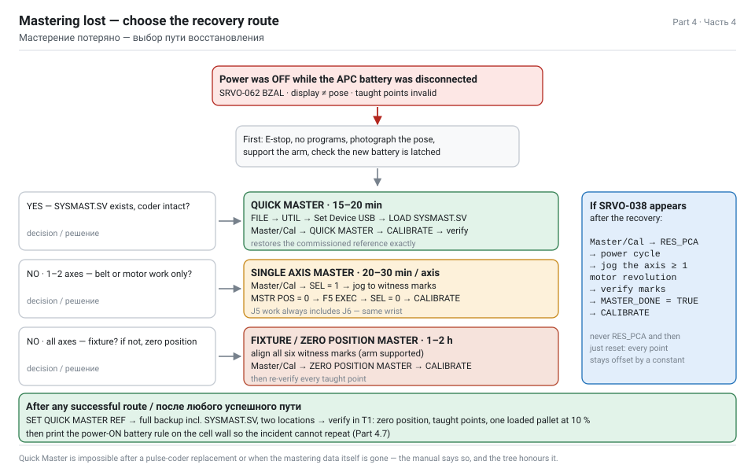

Every FANUC robot stores its taught points as **pulse counts of each motor**, not as coordinates. Mastering is the operation that tells the controller *"this physical pose corresponds to count zero"*. Once that anchor is set, every stored count becomes a meaningful position again.

**The zero position**

The reference posture for the LR Mate 200iD is the **zero position**: every axis at 0°. Each axis has **witness marks** — a machined line, notch or pair of arrows on the casting and on the moving part. When the marks on all six axes are aligned, the robot is mechanically at zero, and that is where the mastering reference lives.

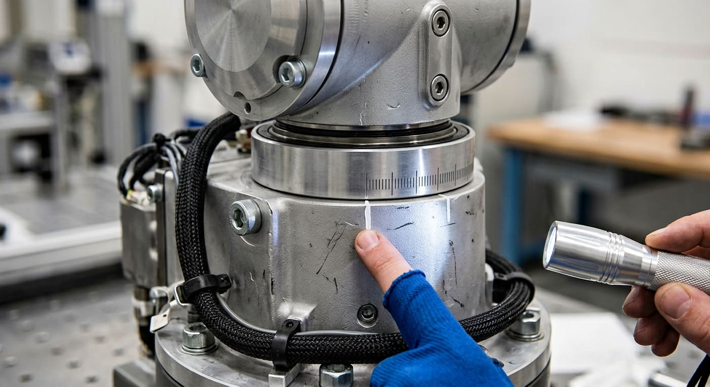

**The six methods**

| Method | Needs | Restores | Typical use | Time |
|---|---|---|---|---|
| **Fixture Position Master** | a dedicated fixture or a specially machined reference point | all axes | highest accuracy; used at manufacture and after major repair | 1–2 h |
| **Zero Position Master** | witness marks on all axes, all brakes releasable | all axes | the universal fallback when nothing is backed up | 1–2 h |
| **Quick Master** | a previously stored Quick Master reference **and** `SYSMAST.SV` (or the reference still in SRAM) | all axes at once | the fast recovery after a battery loss | 15–20 min |
| **Quick Master for Single Axis** | the stored reference for that axis | one axis | after single-axis work | 10 min |
| **Single Axis Master** | witness marks for that axis only | one axis | after belt, motor or reducer work on J5 | 20–30 min |
| **Set Quick Master Ref** | a correctly mastered robot | nothing — it *stores* the current state as the reference for future Quick Masters | prevention, done after every successful mastering | 2 min |
| **Calibrate** | valid mastering data | writes the mastered values into the system | the final step of most procedures | 1 min |

> WARNING — **Quick Master is impossible** if the pulse coder has been replaced, or if the mastering data itself is lost and no `SYSMAST.SV` backup exists. In those cases you must use Fixture Position Master or Zero Position Master. This is stated in the operator's manual, and it is the branch point of the decision tree above.

**Screen navigation used by every method**

```text
MENU  →  0 NEXT  →  6 SYSTEM  →  F1 [TYPE]  →  Master/Cal
```

If the Master/Cal items are greyed out or missing, the master-enable switch is off:

```text
MENU → 0 NEXT → 6 SYSTEM → F1 [TYPE] → Variables
   $MASTER_ENB          = 1        ← must be 1 to master
   $DMR_GRP[1].$MASTER_DONE        ← TRUE when the group is mastered
   $DMR_GRP[1].$REF_DONE           ← TRUE when the quick-master reference is stored
   $DMR_GRP[1].$MASTER_COUN[1..6]  ← the mastered counts per axis
```

Set `$MASTER_ENB = 1` using <kbd>F5 ASGN</kbd> or ENTER, as your software version requires, then return to Master/Cal.

> NOTE — Menu wording and soft-key labels differ slightly between R-30iB, R-30iB Mate and R-30iB Plus software versions. The *names* of the operations (ZERO POSITION MASTER, QUICK MASTER, SET QUICK MASTER REF, CALIBRATE, SINGLE AXIS MASTER) are stable across versions; the numbers in front of them are not. Read the screen, do not memorise the digits.

## 4.2 Route 1 — Quick Master from the SYSMAST.SV backup

**Use this route when a backup of the mastering data exists.** It is the fastest recovery (15–20 minutes) and it restores the exact reference the robot was commissioned with, so every taught point is valid again without re-teaching.

> TASK — This is the procedure the assignment asks for by name: *"restore the zero position using Quick Master with the SYSMAST.SV backup."*

**Prerequisites — check all four before you start**

| # | Prerequisite | How to check |
|---|---|---|
| 1 | A `SYSMAST.SV` file exists that belongs to **this** robot | file name/date, and the robot serial number in your backup readme |
| 2 | The pulse coder was **not** replaced | maintenance records; Quick Master is impossible after a coder swap |
| 3 | The arm can be moved to the reference pose | brakes releasable, arm supportable |
| 4 | `$MASTER_ENB = 1` | System Variables screen |

**Step 1 — restore the mastering file**

1. Insert the USB stick containing `SYSMAST.SV` into the controller's USB port.
2. <kbd>MENU</kbd> → **FILE** → <kbd>UTIL</kbd> → **Set Device** → **USB** (shown as `UD1:`).
3. <kbd>DIR</kbd> to list the files; navigate to the backup folder.
4. Select `SYSMAST.SV`, then <kbd>LOAD</kbd> (on some versions <kbd>RESTORE</kbd>) → confirm **YES**.
5. The controller reports the file loaded. **Do not** power off yet.

**Step 2 — Quick Master**

6. <kbd>MENU</kbd> → **0 NEXT** → **6 SYSTEM** → <kbd>F1 [TYPE]</kbd> → **Master/Cal**.
7. Select **QUICK MASTER (SEL AXIS)** — or simply **QUICK MASTER** for all axes at once. Confirm **YES** when asked.
8. The controller restores the mastering counts from the reference data for the selected axes. `$DMR_GRP[1].$MASTER_DONE` becomes **TRUE**.
9. Select **CALIBRATE** and confirm **YES**. This writes the restored values into the system and updates the internal position data. Some versions require a power cycle here — if the screen says so, do a **cold start** (hold <kbd>PREV</kbd> + <kbd>NEXT</kbd> while powering on → **3 Controlled start**).

**Step 3 — verify**

10. <kbd>MENU</kbd> → **0 NEXT** → **6 SYSTEM** → <kbd>F1 [TYPE]</kbd> → **Master/Cal**: check the mastering status shows all axes done.
11. Check `$DMR_GRP[1].$MASTER_DONE = TRUE`.
12. Jog the robot in **T1**, override ≤ 10 %, deadman held, to the **zero position** and compare each joint against the witness marks. All six must align simultaneously.
13. Jog to a taught point from the palletizing program (e.g. the pick position) and check the gripper sits where it should relative to the belt.
14. Reset alarms; run one cycle at 10 %, then 50 %, then 100 %.

**Step 4 — close the loop**

15. <kbd>Master/Cal</kbd> → **SET QUICK MASTER REF** → **YES**. This stores the present, verified state as the new reference, so the *next* battery incident is a 5-minute job instead of a 20-minute one.
16. Take a fresh full backup including the new `SYSMAST.SV`.
17. Write the record: [mastering-record.md](assets/dl/mastering-record.md).

> TIP — If Quick Master completes but SRVO-038 (pulse mismatch) still appears on one axis, that axis's counts moved — usually because the arm was jogged or fell while unpowered. Handle that axis with Route 2 (single axis) and then re-run CALIBRATE. Do not force it: a mismatched axis silently shifts every point in every program by a constant offset.

## 4.3 Route 2 — Single Axis Mastering by witness marks

**Use this route when there is no backup, or when only one axis lost its reference** — which is exactly the situation after a J5 belt replacement (Part 2.6 level 2), where the manual requires mastering **J5 and J6**.

> TASK — The assignment's fallback: *"if there is no backup file, perform Single Axis Mastering using the witness marks on the robot body."*

**Before you touch anything**

| # | Rule | Why |
|---|---|---|
| 1 | Support the axis mechanically | you are going to release its brake; an unsupported arm falls and can injure or damage itself |
| 2 | Nobody else at the pendant, cell barricaded | a jog command from anyone else during mastering destroys the result |
| 3 | Mode **T1**, override ≤ 10 %, deadman held | the only safe way to move an unmastered robot |
| 4 | `$MASTER_ENB = 1` | otherwise the Master/Cal items are hidden |
| 5 | Know the mastering position value for the axis | for the witness-mark reference it is normally **0** |

**Releasing the brakes (only if the axis will not move)**

If the servo is not enabled, the brake holds the axis and you cannot jog it to the marks. The manual's method:

```text
MENU → 0 NEXT → 6 SYSTEM → F1 [TYPE] → Variables
   $PARAM_GROUP.$SV_OFF_ALL   = FALSE     (release all brakes)
   $PARAM_GROUP.$SV_OFF_ENB[1..n] = FALSE (release selected brake)
then CYCLE POWER  (FCTN → 1 START (COLD) is not needed; a normal power cycle is)
```

With the brake released the axis is **free**: it must be held by a support, a sling, or a second person, and moved only by hand. Restore the variables to TRUE and power cycle again when the mastering is complete.

**The Single Axis Master procedure**

1. <kbd>MENU</kbd> → **0 NEXT** → **6 SYSTEM** → <kbd>F1 [TYPE]</kbd> → **Master/Cal**.
2. Select **SINGLE AXIS MASTER** (or **QUICK MASTER (SEL AXIS)** and choose single-axis mode, depending on the software version). The screen shows a list of axes with columns **SEL**, **ST**, **MSTR POS**, **POSN ERR**.
3. Set **SEL = 1** on the axis to master — for the belt job that is **J5**.
4. Move J5 until the **witness marks align exactly**. Use a mirror and a torch; parallax will fool you at 0.1 mm. On the LR Mate 200iD the wrist marks are on the J5 housing and the J6 flange carrier.
5. Enter **MSTR POS** = the mastering position for this reference — normally **0**.
6. Press <kbd>F5 EXEC</kbd> (labelled **SET** on some versions) → confirm. The controller records the present count as the reference for J5. **ST** changes from 0 to **2** (done).
7. Set **SEL back to 0** for that axis so it is not re-mastered by accident.
8. Repeat steps 3–7 for **J6** — mandatory after any J5 belt work, because both axes run through the same wrist.
9. Select **CALIBRATE** → **YES** to write the values into the system.
10. Power cycle if the screen requires it.
11. Restore the brake-release variables to TRUE and power cycle again.
12. Verify: jog to zero position, all marks aligned; check `$DMR_GRP[1].$MASTER_DONE = TRUE`; check the joint position display matches the physical pose.

**The other five axes, if they were lost too**

If the whole group lost its mastering (a dead APC battery does that), do all six axes one at a time in the same way, **or** use Route 3 (Zero Position Master) which aligns all six at once. Single-axis is preferable when you know only one or two axes moved, because it does not disturb the others.

| Axis | Witness mark location on the LR Mate 200iD | Reference value |
|---|---|---|
| J1 | base housing ↔ J1 rotating column | 0 |
| J2 | base/column ↔ lower arm | 0 |
| J3 | lower arm ↔ upper arm | 0 |
| J4 | upper arm ↔ J4 wrist housing | 0 |
| **J5** | **wrist housing ↔ J5 output carrier** | **0** |
| J6 | J5 carrier ↔ flange | 0 |

> WARNING — Never master an axis while the arm is hanging freely and unsupported, and never master from a position you cannot see clearly. If you cannot align the marks within the width of the scribed line, the axis is not at zero and every point in every program will carry that error forever.

## 4.4 Route 3 — Zero Position Mastering (no backup at all)

This is the worst case: no `SYSMAST.SV`, no stored Quick Master reference, all six axes lost. It is also completely recoverable — it just takes longer and afterwards you must **re-verify every taught point**.

**Procedure**

1. Support the whole arm: a stand under the forearm and one under the wrist, or a sling from a hoist taking the weight. You will be releasing all brakes.
2. Barricade the cell, put the pendant in **T1**, override ≤ 10 %.
3. Set `$MASTER_ENB = 1` in System Variables.
4. Release the brakes if the axes will not move (variables in 4.3), power cycle, and **move each axis by hand** so that **all six witness marks align simultaneously**. This is the zero position — all joints at 0°.
5. <kbd>MENU</kbd> → **0 NEXT** → **6 SYSTEM** → <kbd>F1 [TYPE]</kbd> → **Master/Cal** → **ZERO POSITION MASTER** → confirm **YES**.
6. Select **CALIBRATE** → **YES**, and power cycle if required.
7. `$DMR_GRP[1].$MASTER_DONE` becomes TRUE for the group.
8. **Set Quick Master Ref** so the next incident is fast.
9. Re-torque and lock everything you released; restore the brake variables.

**Then the expensive part: re-verifying the taught points**

Zero Position Mastering restores the mechanical reference, but any points taught against a slightly different reference will now be offset. For a palletizing cell:

| Point | How to verify |
|---|---|
| HOME | jog there, confirm the arm is clear of the fence, the stack and the belt |
| Pick approach / pick / retract | put a brick on the belt by hand, run at 10 %, watch the cups land centred on the bed face |
| Place positions, layer 1 | run empty (no brick) and check the cup face is centred over the first slot |
| Place positions, layer 8 | the critical one — check clearance over the finished stack |
| Pallet exchange points | run the shuttle through a full swap at 10 % |
| Via points and safe paths | check nothing passes within 50 mm of the fence |

Run one complete pallet at 10 % override, then 50 %, then production speed, watching the placement of every layer. If a constant offset appears on all points, your zero position was not exactly zero — redo step 4 more carefully rather than editing 192 positions.

> TIP — Photograph the aligned witness marks after a successful mastering and keep the photo with the backup. If the marks are ever damaged or painted over during a repair, that photo is the only record of what "correct" looked like.

**Accuracy note for the report**

Zero Position Mastering is the manual's own fallback and is entirely legitimate, but its accuracy depends on how precisely a human can align a scribed line. Realistically you land within a few hundredths of a degree. That is well inside the robot's ±0.01 mm repeatability *budget* at the wrist for this application — a 0.05° error at 911 mm reach is about 0.8 mm at the brick, and your 10 mm joint clearance absorbs it. Say this explicitly in the report: it shows you understand that mastering restores a *reference*, not *calibration*.

## 4.5 SRVO-038 pulse mismatch and RES_PCA

This is the alarm you will most likely meet *after* the recovery above, or on its own after a battery that went flat overnight. It says the pulse coder's count no longer agrees with the stored mastering count for that axis.

**Recovery sequence**

1. <kbd>MENU</kbd> → **0 NEXT** → **6 SYSTEM** → <kbd>F1 [TYPE]</kbd> → **Master/Cal**.
2. Select **RES_PCA** (reset pulse coder, <kbd>F3</kbd> on most versions) for the affected group → confirm **YES**.
3. Power cycle the controller.
4. For each axis reported as lost: jog it through **at least one full motor revolution** so the coder re-establishes its multi-turn count.
5. Bring the arm to the reference pose and verify the **witness marks** align.
6. Set `$DMR_GRP[1].$MASTER_DONE = TRUE` if the screen requires it, or perform **CALIBRATE**.
7. Power cycle again, clear the alarm, and verify in **T1** at low override.

> NOTE — RES_PCA throws away the pulse counts, which means the axis **must** be re-mastered afterwards. Never run RES_PCA and then simply reset the alarm and start production: the robot will run, and every point will be wrong by a constant amount. That is how cells get "mysteriously" re-taught by the next shift.

**Related alarms and what they mean**

| Alarm | Meaning | First action |
|---|---|---|
| SRVO-038 pulse mismatch | counts disagree with mastering | RES_PCA → re-master the axis |
| SRVO-062 BZAL | APC battery was lost with power off | replace the battery correctly (power ON), then re-master |
| SRVO-063 BZALH | battery voltage high/abnormal | check the battery and its connector |
| SRVO-075 pulse coder data abnormal | coder data corrupt | re-master; if it repeats, the coder or its cable is faulty |
| SRVO-199 control axis off | drive inhibited | check the E-stop chain, the door interlock and the external axis enable |
| MOTN-049 / MOTN-023 | motion aborted, position error too large | re-master, then re-verify the taught points |
| SYST-035 battery voltage low | controller SRAM battery | replace within 30 minutes of power-off (Part 3.4 B) |

**If the mismatch comes back after a correct mastering**

Then it is not a mastering problem — it is mechanical or electrical, and you are back in Part 2:

- a slipping belt (measure the tension again);
- a worn reducer (measure the backlash again);
- a damaged coder cable at the wrist flex (inspect, wiggle test);
- a failing pulse coder (replace — and then only Fixture or Zero Position Mastering will work, because Quick Master is impossible after a coder replacement).

## 4.6 Verification and return to production

Mastering is finished when it is **verified**, not when the screen stops complaining.

| # | Check | Method | Pass criterion |
|---|---|---|---|
| 1 | Mastering status | Master/Cal screen | all axes show mastered / ST = 2 |
| 2 | `$DMR_GRP[1].$MASTER_DONE` | System Variables | TRUE |
| 3 | Zero position | jog to zero in T1 | all six witness marks aligned simultaneously |
| 4 | No alarms | alarm log cleared, controller restarted | clean start, no SRVO/MOTN entries |
| 5 | Position display vs physical pose | read J1–J6, compare with the arm | consistent |
| 6 | Tool frame | jog to TOOL[17], move in X | the cup face moves along its own axis, not sideways |
| 7 | Repeatability spot check | move to a taught point, away, and back, three times | returns to the same place; ±0.01 mm spec |
| 8 | Empty cycle | run the palletizing program with no product | all motions reach their points, no MOTN alarm |
| 9 | Loaded cycle at 10 % | one full pallet | every brick placed on pattern, no drops |
| 10 | Production speed | 50 % then 100 % for one pallet | cycle time within 10 % of the commissioning value |

**Paperwork to complete before the cell is handed back**

1. Mastering record ([template](assets/dl/mastering-record.md)): date, reason, method used, axes mastered, who performed it, verification results.
2. Incident report: what happened, the timeline from 4.0, what was lost, what it cost in downtime.
3. Fresh full backup: ALL_OF_ABOVE + SYSMAST.SV, stored in two places.
4. **Set Quick Master Ref** confirmed done.
5. Update the PPM log: next battery date, next quarterly date.
6. Corrective action: the "battery replacement with power ON" rule is now printed on the cell wall and on the checklist, and the battery compartment carries a label with the last replacement date.

> DANGER — Never return a re-mastered robot to full-speed production without the loaded cycle at 10 % first. The failure mode of a badly mastered wrist is not an alarm — it is a 4 kg brick released at the wrong moment 1.5 m above a pallet, inside a fence that a technician may be about to open.

## 4.7 Prevention: making this incident impossible

| # | Measure | Cost | Effect |
|---|---|---|---|
| 1 | **Replace the APC battery with the power ON**, E-stop pressed | 0 | eliminates the failure mode entirely — the rule the task asks about |
| 2 | Battery age label on the compartment + a due date in the PPM calendar | 0 | the battery is never allowed to die in service |
| 3 | Quarterly battery voltage check (controller 3.1–3.3 VDC) | 0 | catches SYST-035 before it becomes a dead SRAM |
| 4 | `SET QUICK MASTER REF` after every successful mastering | 2 min | makes the next recovery 5 minutes instead of 2 hours |
| 5 | Monthly backup of ALL_OF_ABOVE + SYSMAST.SV, two locations | 30 min | route 1 is always available |
| 6 | Annual restore test into a spare controller or a simulation | 2 h | proves the backup is not corrupt |
| 7 | Printed procedure laminated inside the cabinet door | 0 | the person doing the swap at 2 a.m. reads it |
| 8 | Two spare battery kits on site | ~cost of two kits | no improvisation, no waiting for a courier |
| 9 | Photographed witness marks filed with the backup | 0 | the reference survives even if the marks are painted over |
| 10 | Permit-to-work for battery and mastering tasks | 0 | nobody starts this job alone and unprepared |

**The one-page rule for the cell wall**

```text
BATTERY REPLACEMENT — ROBOT BASE (APC)
  1  Finish the cycle. Park the arm in the zero position.
  2  Press E-STOP.  DO NOT SWITCH OFF THE CONTROLLER.
  3  Barricade the cell. Tag it.
  4  New battery unpacked and in your hand BEFORE you unplug the old one.
  5  Swap in under 10 seconds. Check polarity. Latch the connector.
  6  Release E-STOP. Look for SRVO-062. There must be none.
  7  Write the date on the label and in the log. Next due: +12 months.

  IF THE POWER WAS OFF AT ANY POINT  →  mastering is lost  →  Part 4.2 / 4.3
```

> TIP — Add the same rule to the Visual Components layout as a note on the controller cabinet component, and put the laminated card in the report appendix as a photograph. Reviewers reward the artefacts that would survive contact with a real factory floor.

## 4.8 Modelling the incident in Visual Components

Your report will be much stronger if the simulation shows the consequence of a lost master position, not just the healthy cell. Two cheap experiments in the Part 1 layout:

**Experiment 1 — the offset**

1. In the place routine (or the Python script from Part 1.12), add a constant angular offset to J5 of 0.3°.
2. Run one full pallet.
3. Measure the placement error at layer 1 and layer 8 and export the chart.

| Layer | Height above pallet (mm) | Expected lateral error at 0.3° of wrist error |
|---|---|---|
| 1 | 32.5 | small — the error is mostly angular, the arm is folded |
| 4 | 227.5 | visible |
| 8 | 487.5 | largest — the stack visibly leans or the bricks overhang |

**Experiment 2 — the recovery**

1. Model the maintenance visit: create a **human resource** (Models by Type › Resources › Characters) that walks to the cabinet, and a **machine** or a simple signal-driven component that represents "cell down for maintenance".
2. Drive it with a signal: `SO_MaintenanceActive` = TRUE stops the infeed and the robot.
3. Run three scenarios and compare the total output of an 8-hour shift:

| Scenario | Downtime modelled | Output over 8 h |
|---|---|---|
| No maintenance programme, 1 × INTP-106 per week at 35 min | 35 min | 4 550 bricks |
| Maintenance programme in place, 12 h of planned downtime over 6 months (≈ 10 min/shift) | 10 min | 4 830 bricks |
| Battery swapped with power off, mastering lost, 4 h recovery | 240 min | 3 400 bricks |

The third row is the number that justifies the entire Part 3 and Part 4 to a production manager, and you produced it with a layout you already built.

> NOTE — Keep the simulation experiments clearly labelled as *illustrative*: the 0.3° offset is a teaching device, not a measured value from your robot. Reviewers accept simplification; they do not accept a simplification presented as a measurement.

---

# Part 5 — The report: warranty claim, tools and conclusions

_Task section 4. The акт-рекламация for a belt that failed inside the warranty period, the maintenance tool list, the economics, and how to assemble the whole submission._

## 5.0 How to assemble the report

The assignment has four sections. The report should have the same four, in the same order, so a reviewer can tick them off without hunting.

| Report section | Task requirement | Where it comes from in this guide | Length |
|---|---|---|---|
| 0 · Introduction | context: what plant, what cell, what robot | Part 0 | 1 page |
| 1 · Modelling | the Visual Components 4.8 layout | Part 1 + screenshots + video | 4–6 pages |
| 2 · Diagnostics | INTP-106 causes, J5 belt tension check, backlash action plan | Part 2 | 4–6 pages |
| 3 · ППР | 6-month schedule, daily and quarterly checks, battery replacement with safety rules | Part 3 | 4–5 pages |
| 4 · Emergency | lost mastering, Quick Master with SYSMAST.SV, Single Axis Mastering by witness marks | Part 4 | 3–4 pages |
| 5 · Claim and tools | акт-рекламация, maintenance tool list | Part 5 | 3–4 pages |
| 6 · Conclusions | what was proven, what to do next | Part 5.6 | 1 page |
| 7 · Sources | manuals and documents used | Part 6 | 1 page |
| Appendices | checklists, records, full listings, screenshots | downloads | as needed |

**Rules that raise the mark**

1. **Every number has a source.** Not "the belt tension should be about 18 N" but "J5 belt tension 15.6–20.6 N — Maintenance Manual B-83495EN, §6.1, Table 6.1(b)".
2. **Every claim has evidence.** A screenshot, a measurement sheet, a photograph, or a simulation export.
3. **State your assumptions.** Duty cycle, brick weight, takt, layer count. A stated assumption is engineering; an unstated one is guesswork.
4. **Show the arithmetic.** The takt calculation, the payload check, the downtime economics — reviewers follow a calculation, they do not follow an assertion.
5. **Separate what you measured from what you simulated.** The simulation proves the layout; the manual values prove the maintenance. Do not present a simulated number as a measured one.
6. **Write the conclusions as actions.** "Introduce the quarterly belt check with a 16.5 N trigger" beats "maintenance should be improved".

**The submission package**

```text
submission/
  Report.pdf                        ← the written work, sections 0–7
  appendix_A_checklists.pdf         ← daily + quarterly checklists, filled in with example readings
  appendix_B_records.pdf            ← belt tension record, backlash record, mastering record
  appendix_C_claim_act.pdf          ← the акт-рекламация, signed
  appendix_D_sim/
     BrickPlant_v03.vcmx            ← the layout itself
     layout_video.mp4               ← 60 s, camera path from Part 1.14
     layout_3d.pdf                  ← orbitable 3D PDF
     statistics.csv                 ← throughput and utilisation export
     charts.png                     ← the three-curve product count chart
  appendix_E_program/
     PALLETIZE_MAIN.ls              ← post-processed FANUC program
     routine_T1_PICK.ls
     routine_T2_PLACE.ls
  appendix_F_sources.pdf            ← Part 6, with the document numbers and revisions
```

> TIP — Keep the layout file name and the report version consistent, and put the date on everything. A reviewer who cannot tell which video belongs to which version of the layout stops trusting the rest.

## 5.1 Is it a warranty case?

Before writing a claim, establish that you have one. Four questions, in order.

**Q1 — Is the robot still in the warranty period?**

The period is defined by **your purchase contract**, not by a general rule. Commercial terms commonly seen for FANUC robots and controllers are 12 months from commissioning or from delivery, sometimes 18 months from shipment; service contracts may extend individual items. Find:

| Document | What it tells you |
|---|---|
| Purchase contract / specification | warranty period, start date, what is covered |
| Warranty certificate (гарантийный талон) | serial numbers covered, start date, conditions |
| Commissioning / acceptance act (акт ввода в эксплуатацию) | the date the clock starts |
| Service contract, if any | extended coverage, response times, who may perform work |

Write the robot serial number, the controller serial number, the delivery date and the commissioning date into the claim — a claim without them gets returned.

**Q2 — Is the failure a manufacturing defect or an operating condition?**

| Points towards a **manufacturing defect** (warranty) | Points towards **wear / operating** (not warranty) |
|---|---|
| Belt failed or lost tension far earlier than the normal service interval | Belt tension lost gradually over years of normal running |
| Tooth shear, cord rupture, delamination | Normal glazing, even wear |
| Backlash above the limit at low running hours | Backlash growing steadily with hours |
| Reducer noise and metal particles early in life | Reducer at or beyond its rated life |
| The same failure on several machines from the same batch | a single machine |
| Failure with correct maintenance, correct grease, correct payload | Wrong grease, over-greasing, exceeded payload, collision damage |

**Q3 — Did you maintain it as the manual requires?** This is the uncomfortable question, and the task is built around it.

> WARNING — The missing six months of belt-check entries is a real weakness in a warranty claim. A supplier is entitled to argue that the failure resulted from skipped maintenance. You have three honest responses, and the report should contain all three:
>
> 1. **Prove the maintenance that did happen** — running hours from the controller, the entries that do exist, purchase records for grease and batteries, service visit notes. A gap in one column is not a gap in the whole programme.
> 2. **Show the failure is not consistent with the gap** — a belt does not lose all tension in six months if it was correct before; if the measurement shows a defect mode (sheared tooth, delamination) rather than gradual loss, the gap is irrelevant to causation.
> 3. **Own the organisational fault and separate it from the technical one** — state plainly that the inspection regime was deficient, that it has been corrected by the programme in Part 3, and that the defect mode observed is nevertheless a manufacturing matter. A claim that admits and fixes its own weakness is far harder to dismiss than one that hides it.

**Q4 — Has anything voided the warranty?**

| Common voiding condition | Check for this cell |
|---|---|
| Unauthorised repair or modification | was the wrist opened by anyone without FANUC authorisation or an approved service contract? |
| Non-original spare parts or consumables | was the grease A98L-0040-0230? Was the belt the specified part? |
| Operation outside the specification | payload ≤ 7 kg, wrist moments within 16.6 N·m, duty within the rated range |
| Absence of required maintenance | the six-month gap — see Q3 |
| Damage from external causes | collision, flooding, overvoltage, wrong supply |
| Software changes by a third party | modified system variables, non-FANUC post-processors written into the controller |

**If the answer is "not a warranty case"**

Then you still write the act — as an **internal defect act (акт о выявленных недостатках)**, which becomes the input to a repair order, a spare-parts purchase and a corrective-action record. Same document, different addressee. Many student reports stop at "the warranty expired, so nothing to do"; that is the wrong conclusion, because the paperwork exists to drive the repair regardless of who pays.

## 5.2 The claim act (акт-рекламация)

Templates: [claim-act-template.en.md](assets/dl/claim-act-template.en.md) · [claim-act-template.ru.md](assets/dl/claim-act-template.ru.md)

A claim act is a formal document with a fixed skeleton. Below is a **filled example** for exactly the scenario in the task — a J5 belt that lost tension inside the warranty period. Replace the bracketed values with your own.

```text
                                      To: [Supplier / FANUC Russia service]
                                      From: [Plant name, address, contacts]
                                      Ref: contract No. [___] dated [___]

                    WARRANTY CLAIM ACT (АКТ-РЕКЛАМАЦИЯ) No. 07/2027
                    Place: [city]        Date: 16 November 2026

1. COMMISSION
   Chairman: [name], Chief Engineer, [plant]
   Members:  [name], Maintenance Engineer
             [name], Line Manager, Zone D
             [name], representative of [supplier] (invited, notified [date])

2. EQUIPMENT
   Machine:            FANUC LR Mate 200iD/7L 6-axis industrial robot
   Serial number:      [robot s/n]
   Controller:         FANUC R-30iB Plus, s/n [controller s/n], software V[9.40P]
   Date of manufacture:[___]     Date of delivery: [___]
   Commissioned:       [___]     Warranty expires: [___]
   Running hours:      13 480 h at the time of the claim
   Installation:       palletizing cell, zone D, decorative brick line 2

3. DESCRIPTION OF THE DEFECT
   Since [date] the cell has stopped periodically with alarm INTP-106
   "PAUSE.L ... Continue request failed", each stop lasting 30-40 minutes,
   approximately [n] times per week. On [date] visible play was found in the
   J5 axis of the wrist.

4. DIAGNOSIS PERFORMED
   4.1 Alarm history read: INTP-106 entries accompanied by SRVO-038
       (pulse mismatch) on axis 5.
   4.2 Belt tension measured with tensionmeter A97L-0218-0700
       (Mitsuboshi DOCTOR TENSION TYPE-III) at the pose J3 = 80 deg,
       J5 = +/-90 deg, settings: belt mass 0.02083 kg/m, width 4 mm,
       span 187 mm.
       J5 readings: 12.8 / 13.1 / 12.9 N  -> mean 12.9 N
       Specification (Maintenance Manual B-83495EN, section 6.1): 15.6-20.6 N
       RESULT: BELOW the lower limit by 2.7 N.
   4.3 J6 readings: 17.4 / 17.6 / 17.5 N -> mean 17.5 N (within specification).
   4.4 Backlash measured with a dial gauge (0.01 mm) at 180 mm from the
       J5 axis: 0.46 mm. Specification: max 0.18 mm. RESULT: EXCEEDED.
   4.5 Visual inspection: [tooth root cracks / cord exposure / glazing]
       on the J5 belt; pulleys undamaged; grease colour normal,
       no metallic particles; all fastener witness marks intact.
   4.6 Payload verified: 4.00 kg on the flange against a 7 kg rating;
       wrist moment 3.92 N.m against 16.6 N.m. No overload.
   4.7 Operating conditions: ambient temperature [__] deg C, dust level
       normal for the plant, no collisions recorded.

5. MAINTENANCE PERFORMED
   Periodic inspections performed on [list dates]. Belt condition entries
   are absent for the period [___] to [___]; the inspection regime has been
   corrected by PPM programme No. [___] effective [___]. All other items
   (connectors, dust removal, grease condition, battery) were performed
   and recorded.

6. CONCLUSION OF THE COMMISSION
   The observed defect mode - loss of belt tension to 12.9 N with tooth-root
   cracking at 13 480 running hours, against a normal service life of the
   item, together with normal grease condition, intact fasteners and no
   overload - indicates a MANUFACTURING DEFECT of the J5 timing belt
   (part A98L-0040-0286#004-157), not normal wear.
   Consequences: recurring INTP-106 stops, total unplanned downtime
   [__] h, lost output [__] bricks.

7. CLAIM
   7.1 Replace the J5 timing belt free of charge under warranty.
   7.2 Provide or perform single-axis mastering of J5 and J6 after
       replacement, as required by the maintenance manual.
   7.3 Compensate the documented downtime of [__] hours, or extend the
       warranty on the mechanical unit by the same period.
   7.4 Provide a written root-cause analysis of the belt defect.

8. ATTACHMENTS
   A. Belt tension measurement record, 3 sheets
   B. Backlash measurement record
   C. Photographs: witness marks, meter display, belt condition (12 photos)
   D. Alarm history export
   E. Extract from the maintenance log
   F. Controller running-hours screenshot
   G. Downtime record for the period

   Chairman  ______________ / [name] /
   Members   ______________ / [name] /
             ______________ / [name] /
             ______________ / [name] /  (supplier representative)
```

**Writing rules that make the act effective**

| Rule | Why |
|---|---|
| State measurements with the instrument, the settings and the pose | a number without a method can always be disputed |
| Quote the manual section for every specification value | it turns "we think" into "the manufacturer states" |
| Separate observation from conclusion | section 4 is facts, section 6 is judgement; never mix them |
| Admit the maintenance gap and show the corrective action | it removes the supplier's strongest counter-argument |
| Quantify the loss in hours and units, not in adjectives | "significant downtime" is ignored; "91 h and 54 600 bricks" is not |
| Make each demand specific and actionable | "replace", "provide", "compensate", with a quantity and a deadline |
| Attach everything and number the attachments | the pack, not the letter, wins the claim |
| Invite the supplier's representative and record that they were notified | a unilateral act is weaker than a joint one |

## 5.3 The maintenance tool list, as the task asks for it

The assignment names three items explicitly — **tensionmeter, wrench set, LOCTITE for bolts** — and expects the list to be complete enough to actually do the work. The full technical list with specifications is in Part 3.8; this is the version that goes into the report, grouped by the task it enables.

| Task | Tools and consumables | Quantity |
|---|---|---|
| Belt tension measurement | tensionmeter **A97L-0218-0700** (Mitsuboshi DOCTOR TENSION TYPE-III), steel rule, mirror, torch | 1 kit |
| Backlash measurement | dial gauge 0.01 mm with magnetic base, feeler gauges | 1 kit |
| Bolt torque check | calibrated torque wrenches 1–25 N·m and 5–60 N·m, hex key set 1.5–10 mm, open-end/ring set 8–19 mm | 1 set |
| Thread locking | **LOCTITE 243** (medium), **LOCTITE 263** (high strength), **LOCTITE 518** (flange sealant), **LOCTITE 638** (retaining) | 1 each |
| Opening the wrist | hex keys, screwdrivers (insulated), C-ring pliers, soft-face mallet, gasket picks | 1 set |
| Belt replacement | gear puller 50–150 mm, puller separator, torque wrench, new belt **A98L-0040-0286#004-157**, new gaskets | 1 kit + 1 spare belt |
| Reducer replacement | gear puller, separator, C-ring pliers, LOCTITE 518, grease kit **A05B-1142-K021**, catch trays | 1 kit |
| Greasing | grease **A98L-0040-0230** (Harmonic 4B No.2), syringe kit **A05B-1142-K021**, refill tube **A05B-1139-K022**, new seal bolts | per axis set |
| Battery work | new APC battery unit (4 × C 1.5 V) or external D-cell pack, controller battery **A05B-2650-K030**, multimeter, insulated gloves | 2 sets |
| Electrical checks | digital multimeter, infrared thermometer, insulated screwdrivers | 1 kit |
| Cleaning | lint-free cloths, isopropyl alcohol, low-pressure air, vacuum | consumable |
| Safety | lock-out/tag-out kit with personal padlocks, arm support stand or sling + hoist, barricade tape, safety glasses, nitrile gloves | per technician |
| Documentation | teach pendant, printed manuals B-83494EN and B-83495EN, USB sticks (FAT32), camera, printed checklists | 1 kit |
| Marking | paint marker (contrasting), label printer or adhesive labels | 1 |

**The minimum viable kit** — if the report has to justify a purchase request on a tight budget, this subset makes the quarterly check and the battery replacement possible:

| Item | Why it cannot be omitted |
|---|---|
| Tensionmeter A97L-0218-0700 | there is no accepted alternative method for belt tension |
| Dial gauge 0.01 mm + magnetic base | the only way to measure backlash against the 0.18 mm limit |
| Torque wrench 5–60 N·m, calibrated | the wrist cover is 5.6 N·m; "tight by feel" is how fasteners come loose again |
| LOCTITE 243 and 263 | re-torqued bolts without thread locker loosen again within a quarter |
| Hex key set + screwdrivers | nothing opens without them |
| Multimeter | battery verification, 3.1–3.3 VDC |
| LOTO kit | the legal basis for working with the power off |
| Arm support | the manual requires mechanical support before releasing any brake |

**A note on the tensionmeter specifically**

FANUC specifies its own part number, and it matters: the manual's tension values were established with that instrument's measurement principle (non-contact, vibration-frequency based, with belt mass/width/span as inputs). A contact-type spring tension gauge, or a "pluck it and listen" method, cannot reproduce the 15.6–20.6 N window with the confidence the specification implies. If your plant owns a different make of non-contact vibration tensionmeter, it can be used **provided** you enter the same belt mass, width and span values and you verify it against the FANUC instrument once — and you write that verification into the report.

> TIP — Add a calibration column to the tool list: torque wrenches and dial gauges need periodic calibration certificates. A claim act that quotes a torque value from an uncalibrated wrench is easy to dismiss; one that quotes it from wrench No. TW-014, calibrated 2026-09-02, is not.

## 5.4 The economics, so the report has a conclusion a manager can use

Everything below uses the cell's own numbers from Part 0: 600 bricks/h, 6.0 s takt, 192 bricks per pallet, 19.2 min per pallet with the two-position shuttle.

**Cost of the fault as found**

| Item | Value | Basis |
|---|---|---|
| Unplanned stop per INTP-106 | 35 min (30–40 given) | task statement |
| Bricks not produced per stop | 350 | 600 bricks/h × 0.583 h |
| Stops per month (observed) | 4 | 1 per week |
| Lost output per month | 1 400 bricks | 4 × 350 |
| Lost pallets per month | 7.3 | 1 400 ÷ 192 |
| Lost running time per year | 28 h | 4 × 35 min × 12 |
| Additional cost: technician call-out, overtime to recover the schedule | — | plant-specific; state your own rate |

**Cost of the programme**

| Item | Value | Basis |
|---|---|---|
| Planned downtime, 6 months | 12 h | Part 3.7 |
| Planned downtime, per year | 24 h | × 2 |
| Consumables per year | grease, batteries, LOCTITE, gaskets | plant purchase prices |
| Capital: tensionmeter + dial gauge + torque wrenches | one-time | the minimum viable kit from 5.3 |
| Training: one technician on FANUC maintenance | one-time | |

**Net effect**

| | Hours per year | Bricks per year |
|---|---|---|
| Before: unplanned stops | −28 h | −16 800 |
| After: planned downtime | −24 h | −14 400 |
| **Net** | **+4 h of availability** | **+2 400 bricks** |

> NOTE — The honest reading of that table is important: planned maintenance does **not** buy you 28 hours back, because the planned work still takes time. What it buys is (a) predictable timing — 12 hours you schedule into a weekend instead of 28 hours that land during the busiest week, (b) a much lower probability of the expensive failure modes (reducer replacement, lost mastering = 4 h plus a possible day of production), and (c) evidence for the warranty claim. State all three; a report that claims "maintenance saves 28 hours" will be torn apart by anyone who has run a plant.

**The failure modes the programme avoids**

| Event avoided | Typical cost | How the programme avoids it |
|---|---|---|
| Reducer replacement on J5 | 1 day of production + parts + specialist labour | quarterly backlash measurement catches wear before it destroys the reducer |
| Lost mastering after a power-off battery swap | 4 h recovery + re-verification of all taught points | the power-ON rule, printed on the cell (Part 4.7) |
| Dead controller battery → SRAM lost → no programs | days, if there is no backup | quarterly voltage check + monthly backups |
| Mechanical-unit cable failure at 4 years | 2 days planned | it is in the calendar before it becomes an emergency |
| Dropped bricks damaging product and the pallet | scrap + rework | vacuum-reached signal, quarterly cup inspection |

**One paragraph for the report's conclusion**

> QUOTE — The observed INTP-106 stops cost the cell 28 hours and about 16 800 bricks a year. The proposed six-month maintenance programme consumes 24 hours of planned downtime a year, but converts that time into scheduled weekend work, removes the two failure modes that cost days rather than hours, and produces the measurement records on which a warranty claim against the belt defect can be based. The programme is therefore justified on availability risk rather than on hours saved, and its main deliverable is not a saved hour but a documented one.

## 5.5 Conclusions and recommendations

Write the conclusions as a numbered list of findings followed by a numbered list of actions, each action with an owner and a date. Below is a worked example for this task — adapt the wording, keep the structure.

**Findings**

1. The palletizing cell modelled in Visual Components 4.8 with a FANUC LR Mate 200iD/7L achieves the target output of 600 bricks/h only with a two-position pallet shuttle; a single-position station gives 543 bricks/h (−9.5 %).
2. The robot's payload utilisation is 57 % (4.00 kg of 7 kg) and the wrist moment utilisation is 24 % (3.92 of 16.6 N·m), so the LR Mate 200iD/7L is correctly sized for the duty, and the 911 mm reach covers both the pick point and all pallet corners.
3. INTP-106 is not a root cause but a consequence alarm: it reports that a paused program could not be continued. The root cause must be read from the alarm history.
4. Measured J5 belt tension of 12.9 N is 2.7 N below the specified minimum of 15.6 N (Maintenance Manual B-83495EN §6.1), and measured backlash of 0.46 mm at 180 mm exceeds the 0.18 mm limit.
5. The absence of belt-condition entries in the service log for six months means at least two required quarterly inspections were not performed — an organisational fault that permitted the technical fault to develop unnoticed.
6. Replacing the robot's APC battery with the power off destroys the mastering data; the correct procedure is a power-on swap with the E-stop pressed, completed in under 10 seconds.
7. Mastering is recoverable in 15–20 minutes from a `SYSMAST.SV` backup (Quick Master), in 20–30 minutes per axis from witness marks (Single Axis Master), or in 1–2 hours for all axes (Zero Position Master) — but the last route requires re-verification of every taught point.

**Recommendations**

| # | Action | Owner | By |
|---|---|---|---|
| 1 | Replace the J5 belt and master J5 + J6 | maintenance technician | immediately |
| 2 | File the warranty claim act with the measurement pack | maintenance engineer | within 5 working days |
| 3 | Introduce the six-month PPM programme (Part 3.7) with signed checklists | maintenance engineer | this month |
| 4 | Print and post the daily checklist at the cell gate and the battery rule inside the cabinet door | line manager | this week |
| 5 | Purchase the minimum viable tool kit (5.3) | procurement | within 30 days |
| 6 | Establish monthly backups (ALL_OF_ABOVE + SYSMAST.SV) in two locations, with an annual restore test | controls engineer | this month |
| 7 | Run SET QUICK MASTER REF after every mastering event | technician | standing rule |
| 8 | Add the belt-tension trend to the monthly KPI report with a 16.5 N trigger | maintenance engineer | next reporting cycle |
| 9 | Build the two-position pallet shuttle into the real cell layout | process engineer | next project phase |
| 10 | Train one technician on FANUC maintenance (B-83495EN scope) | HR + maintenance | within 6 months |

**What the simulation proved and what it did not**

| Proved | Did not prove |
|---|---|
| The cell layout reaches 600 bricks/h with the stated takt | Real cycle times on a real robot with real dynamics |
| The robot's reach and payload are sufficient | The exact placement accuracy of a specific machine |
| The buffer and shuttle sizing are correct | The behaviour of the kiln and dryer (modelled at time scale) |
| The effect of a 0.3° J5 offset on the stack | The true offset of the actual faulty robot |
| The downtime economics of the three maintenance scenarios | Plant-specific labour and material costs |

Stating both columns is what makes a simulation report credible. A reviewer who sees the "did not prove" column trusts the "proved" column.

## 5.6 Final submission checklist

Tick every line before you submit.

**The task's four sections**

- [ ] INTP-106 causes analysed, with the alarm text, the meaning of the arguments and the remedy from the error code manual
- [ ] J5 belt check with a tensionmeter: instrument part number, pose, settings (belt type, mass, width, span), sequence of operations, target values, three readings
- [ ] Action plan for J5 backlash covering fasteners, belt replacement and reducer replacement, with mastering consequences for each
- [ ] Six-month maintenance schedule with dates, owners and downtime
- [ ] Daily visual inspections: cables, dust cleaning, with a printable checklist
- [ ] Quarterly checks: bolt torque and belt condition, with a printable checklist
- [ ] Battery replacement procedure **with the safety rule stated explicitly** (robot APC: power ON; controller: 30 s on, then off, within 30 min)
- [ ] Emergency scenario: power lost during battery change → what was lost and why
- [ ] Restoration of the zero position explained
- [ ] Quick Master procedure using the `SYSMAST.SV` backup, step by step
- [ ] Single Axis Mastering by witness marks, step by step, for the no-backup case
- [ ] Warranty claim act, filled in, with the measurement pack attached
- [ ] Maintenance tool list including tensionmeter, wrench set and LOCTITE

**The modelling part**

- [ ] Layout file opens without missing components
- [ ] Simulation runs one full pallet at ×1 without collisions or dropped products
- [ ] Throughput measured and stated (600 bricks/h target, actual value reported)
- [ ] Video, 3D PDF, 2D layout drawing and BOM exported
- [ ] Post-processed `.LS` program included, with a note about UFRAME/UTOOL and the ASCII-upload requirement
- [ ] Screenshots of the Product Type Editor, the assembly slot list, LinkDefaults and the program tree

**Traceability**

- [ ] Every specification value cites a manual number and section
- [ ] Every measurement cites the instrument and the method
- [ ] Assumptions (duty cycle, brick mass, takt) written down
- [ ] The maintenance-log gap acknowledged, explained and corrected by a stated action
- [ ] Sources list complete (Part 6)

> TIP — Read your own report once aloud, from the conclusions backwards. Reading backwards catches unsupported claims, because you meet every assertion before you meet its evidence.

---

# Part 6 — Sources, document numbers and traceability

_Every manual, lesson and standard used in this guide, what was taken from it, and a table that maps each number in the text back to its source._

## 6.0 How to verify anything in this guide

This guide was assembled from official documentation, and it is written so that every claim can be checked. Three rules were applied:

1. **A number is only printed if it appears in a manufacturer document.** Where a value could not be confirmed, the text says so explicitly instead of guessing.
2. **A procedure is quoted, not remembered.** Menu paths, screen names and variable names are reproduced as they appear in the manuals for the stated software version, with a note where wording varies between versions.
3. **Secondary sources are labelled.** Field write-ups, forum posts and reseller pages were used only to locate the right manual section or to cross-check a screen path — never as the authority for a specification value.

**How to check a value yourself**

| If the guide says | Verify it in |
|---|---|
| a belt tension, span length or belt part number | Maintenance Manual **B-83495EN**, chapter 6 (§6.1 belt tension adjustment) |
| a backlash limit | Maintenance Manual **B-83495EN**, Table 3.3(b) |
| a periodic inspection interval or a running-hours figure | Operator's Manual **B-83494EN** §7.1.2, and Maintenance Manual **B-83495EN** §1 + Appendix C |
| a battery part number or lifetime | Operator's Manual **B-83494EN** §7.3.1; R-30iB Plus Controller Maintenance Manual **B-83525EN** §8.11.1 |
| grease type, kit part number or quantity per axis | Maintenance Manual **B-83495EN** §2.2 |
| a mastering procedure, variable or screen | Operator's Manual **B-83494EN**, chapter 8 |
| an alarm text or remedy | R-30iB Plus **Error Code Manual** (INTP, SRVO, MOTN, SYST groups) |
| mounting dimensions, loads, stopping distances, maintenance clearances | Operator's Manual **B-83494EN**, §1.2–§1.4 |
| a Visual Components property, statement or workflow | the VC 4.8 online help, the VC Academy lesson named in the section, or the component's own property panel |

> NOTE — Document **revisions** matter. The manuals quoted here are the revisions that were available at the time of writing (B-83494EN/10, B-83495EN/01, B-83284EN/10). Your controller's software version may correspond to a different revision; when in doubt, the value printed on the machine's own nameplate and the manual supplied with it take precedence over anything in a guide.

## 6.1 FANUC documents used

| Document | Title | Revision | What this guide took from it |
|---|---|---|---|
| **B-83494EN** | LR Mate 200iD / 200iD/7L **Operator's Manual** | /10 | §1.2 installation, base dimensions, flatness ≤ 0.5 mm and inclination ≤ 0.5°; §1.2.1 mounting-angle setting (PREV+NEXT controlled start → MAINTENANCE → F4 MANUAL); §1.3 maintenance clearance (500 mm around, 705 mm above for the 7L); §1.4 installation conditions; §2 cable connection warnings and the earth-before-power rule; force and moment tables; stopping time and distance tables; §7.1.2 periodic inspection; §7.2.1 oil seepage; §7.3.1 batteries; §7.3.2 grease; chapter 8 mastering methods, zero position, witness marks, `$MASTER_ENB`, brake-release variables |
| **B-83495EN** | LR Mate 200iD **Maintenance Manual** | /01 | §1 periodic inspection items and intervals; §2.2 greasing procedure, grease and kit part numbers, quantities per axis; Table 3.3(b) backlash limits; chapter 5 mechanical-unit cable (4-year interval); §6.1 belt tension adjustment — tensionmeter part number, measurement pose, J5/J6 and J1/J2 parameters, belt part number; Appendix A spare parts; Appendix C running-hours basis |
| **B-83284EN** | R-30iB Plus **Basic Operator's Manual** | /10 | power on/off, controlled start (PREV+NEXT → 3 Controlled start), CYCLE POWER via FCTN, panel indicator meanings |
| **B-83525EN** | R-30iB (Mate) Plus **Controller Maintenance Manual** | /01–/08 | §8.11.1 battery replacement, SYST-035, battery part numbers, the 30-minute rule, ventilation cleaning |
| **Error Code Manual** (R-30iB Plus) | Alarm texts and remedies | — | **INTP-106** text and remedy, SRVO-038, SRVO-062 BZAL, SRVO-075, SRVO-199, SYST-035, MOTN group |
| **B-80687EN** | FANUC Robot **Safety Handbook** | — | general safety principles referenced in Part 1.9 |
| **B-83184EN** | **Dual Check Safety** Operator's Manual (R-30iB Plus) | — | safety-function context referenced in Part 1.9 |
| PalletTool documentation (option) | Palletizing software option | — | referenced in Part 1.11 as the production alternative to hand-written pattern loops |

**Robot specification values used in this guide**

| Parameter | Value | Source |
|---|---|---|
| Axes | 6 | B-83494EN, specifications |
| Payload | 7 kg | B-83494EN |
| Reach (7L / standard) | 911 mm / 717 mm | B-83494EN |
| Repeatability | ±0.01 mm | FANUC published specification |
| Mass | 27 kg | B-83494EN |
| Protection | IP67 (IP69K option) | B-83494EN |
| Power consumption | 0.5 kW | B-83494EN |
| Mounting | floor, angle, inverted | B-83494EN §1.2 |
| Joint ranges J1–J6 | 340 (360) / 245 / 430 / 380 / 250 / 720 ° | B-83494EN |
| Max speeds J1–J6 | 370 / 310 / 410 / 550 / 545 / 1000 °/s | B-83494EN (7L) |
| Wrist allowable moment J4/J5 | 16.6 N·m | B-83494EN |
| Wrist allowable inertia J4/J5 | 0.47 kg·m² | B-83494EN |
| Wrist allowable moment J6 | 9.4 N·m | B-83494EN |
| Wrist allowable inertia J6 | 0.15 kg·m² | B-83494EN |
| Base fixing | 190 × 190 mm, 4 × Ø11 | B-83494EN §1.2 |

> SOURCE — Access points used to consult these documents: the LR Mate 200iD operator's manual copy published at robochallenge.pl (B-83494EN/10), the maintenance manual copy at img1.wsimg.com (B-83495EN/01), the full-text HTML mirror at manualmachine.com, and the R-30iB Plus basic operator's manual copy at robochallenge.pl (B-83284EN/10). Order official copies through your FANUC representative for the revisions matching your controller software.

## 6.2 Visual Components documents used

| Source | Version tag | What this guide took from it |
|---|---|---|
| **Visual Components 4.8 online help** — [help.visualcomponents.com/4.8](https://help.visualcomponents.com/4.8) | 4.8 | ribbon structure, Process Modelling components, Program tab statements, OLP export, Python API |
| **VC 4.8 release notes / What's New** | 4.8, released 2023-06-10; 4.8.0.1 January 2024 | version facts quoted in Part 0: robotics OLP merged onto the PROGRAM tab, Via Solver in all product versions, Program Validation conveyor synchronisation and the linear 180° check, CAD translator versions |
| **VC Academy — "Pick And Place Components" manual** ([PDF, 15-02-2023](https://academy.visualcomponents.com/app/uploads/2023/02/pick-and-place-components-manual-15-02-2023.pdf)) | 4.6+ | the whole of Part 1.7 and 1.8: Pick And Place Process behaviour, sensor positions, ProcessType/ProductsOn/StopAt, transport controller LinkDefaults, TcpIndex, approach motions, gripper signals, the double-gripper multi-pick configuration, and the rule that these components must be renamed rather than edited |
| **VC Academy — "Introduction to Layout Configuration"** ([PDF, PM v2](https://academy.visualcomponents.com/app/uploads/2025-05-introduction-to-layout-configuration_pm_v2.pdf)) | 4.10 (names apply to 4.8) | ribbon and eCatalog navigation, Product Type Editor fields, the feeder → process → flow workflow used in Part 1.2–1.3 |
| **VC Academy — "Palletize using PM TransportPatternIn statement"** | 4.8.0+ | Route B in Part 0/1: TransportPatternIn + Attach/Detach as the alternative to assemblies |
| **VC Academy — "Robot Transport Controller manual"** | 5.0+ | transport controller structure; used with care, since the page describes a newer version than 4.8 |
| **VC Academy — "Palletizing robot programming"** | 4.9.0+ | palletizing programming patterns; noted in Part 1.11 as a version difference |
| **VC Academy — "MachineTending-1"** ([PDF, 2017-01](https://academy.visualcomponents.com/app/uploads/2017/01/MachineTending-1.pdf)) | 4.x | Shape Feeder → CollarPallet, Pallet Filler, XYZ pattern with Z_Count — the origin of the pattern approach in Part 1.6 |
| **VC training module 3 — "Create a Robot Program"** | 4.x | PROGRAM tab workflow quoted in Part 1.11: Jog panel Base/Tool selection, Snap teaching, Joint Motion as the approach, Linear Motion as the pick and retract, Set Binary Output for the gripper, Call Sequence Statement from Main, statement naming |
| **VC eCatalog / eLibrary component index** — download.visualcomponents.net/elib | 4.1 index | confirmation that official FANUC components exist for the LR Mate 200iD family, including the 7L, and the fallback route in Part 1.4 |
| **vcHelpers.Robot2 Python API reference** (inside the 4.8 help) | 4.8 | `getRobot`, `home`, `pick`, `place`, `sim.delay` used in Part 1.12 |

**Version differences worth stating in a report**

| Feature | 4.8 | Later versions |
|---|---|---|
| OLP tabs | all OLP functions on the PROGRAM tab | unchanged in principle, extended in 4.9/4.10 |
| Via Solver | available in **all** 4.8 product versions | unchanged |
| Robotics Solver (collision, singularity, joint-limit solving) | paid add-on | continued |
| TransportPatternIn palletizing | available (4.8.0+) | extended |
| Robot Transport Controller | Pick And Place Transport Controller is the documented component for PnP flows | the Robot Transport Controller manual page targets 5.0+ |
| Interactive VR | fixed in 4.8.0.1 | continued |
| Statement loading from Via Solver | fixed in 4.8.0.1 | continued |

> WARNING — Do not copy a procedure from a lesson tagged for a newer version into a 4.8 report without checking the property names. The VC Academy tags every lesson with the version it was recorded on, and the transport-controller material in particular changed between 4.8 and 5.0.

## 6.3 Standards, options and plant documents

**Standards referenced in Part 1.9**

| Standard | Scope | Relevance here |
|---|---|---|
| ISO 10218-1 | Robots and robotic devices — safety requirements for industrial robots | the robot itself: protective stopping, speed and separation limits |
| ISO 10218-2 | Robot systems and integration | the cell: fencing, interlocks, light curtains, safe distances |
| ISO/TS 15066 | Collaborative robots | referenced only to say the LR Mate 200iD is **not** collaborative by default |
| ISO 13849-1 | Safety of machinery — safety-related parts of control systems | performance level of the interlock circuit, if you design one |
| ISO 11161 | Safety of integrated manufacturing systems | the line-level view when zones A–E are integrated |

> NOTE — Russian adopted equivalents of these standards exist (ГОСТ Р ИСО …). Cite the current designation from the official standards register rather than copying a number from a guide, because designations are re-issued.

**FANUC software options mentioned**

| Option | What it provides |
|---|---|
| ASCII upload / program conversion | allows the controller to load `.LS` files directly — without it only compiled `.TP` files load |
| PalletTool | pattern-based palletizing with pattern registers; the production alternative to hand-written loops |
| Dual Check Safety (DCS) | safety-rated monitored stop, safe zones, speed limiting |
| DeviceNet / PROFINET / EtherNet-IP | fieldbus I/O for the cell; the DeviceNet variant of INTP-106 relates to this |
| Conveyor tracking / line tracking | if the pick is done on a moving belt rather than at a stopped station |

**Plant documents your report should also cite**

| Document | Why |
|---|---|
| Purchase contract and warranty certificate | establish the warranty period and the covered serial numbers |
| Commissioning / acceptance act | the date the warranty clock starts |
| Service contract, if any | who is allowed to open the wrist without voiding the warranty |
| Maintenance log (журнал ТО) | the document with the six-month gap — the central evidence of the task |
| Risk assessment for the cell | required by ISO 10218-2 and the basis for your fence distances |
| Lock-out/tag-out procedure | the legal basis for the safety steps in Parts 2–4 |
| Spare parts list with your supplier's lead times | justifies the spares kit in Part 3.4 |

## 6.4 Traceability: every number and where it comes from

This is the table a reviewer will actually use. It maps each specification value in the guide to its source.

**Mechanical — belts, backlash, grease**

| Value | Source |
|---|---|
| Tensionmeter A97L-0218-0700 (Mitsuboshi DOCTOR TENSION TYPE-III) | B-83495EN §6.1 |
| Measurement pose J3 = 80°, J5 = ±90° | B-83495EN §6.1 |
| Wrist cover bolt torque 5.6 N·m | B-83495EN §6.1 |
| J5 tension 15.6–20.6 N, belt mass 0.02083 kg/m, width 4 mm, span 187 mm | B-83495EN §6.1, Table 6.1 |
| J6 tension 15.6–20.6 N, same mass and width, span 116 mm | B-83495EN §6.1, Table 6.1 |
| J1/J2 tension 49–65 N (7L) and 30–40 N (standard), width 6 mm, span 167.5 mm | B-83495EN §6.1, Table 6.1 |
| J5/J6 belt part number A98L-0040-0286#004-157 | B-83495EN §6.1 / Appendix A |
| Backlash limits: J5 0.18 mm at 180 mm, J6 0.15 mm at 100 mm, J4 0.16 mm at 100 mm | B-83495EN Table 3.3(b) |
| Backlash limits J1–J3: 0.41/0.19/0.20 mm standard, 0.52/0.25/0.25 mm for 7L | B-83495EN Table 3.3(b) |
| Dial gauge resolution 1/100 mm for backlash measurement | B-83495EN ch. 3 |
| Grease A98L-0040-0230 (Harmonic 4B No.2), kit A05B-1142-K021, tube A05B-1139-K022 | B-83495EN §2.2 |
| Grease quantities: J1 2.7 g (3 ml), J2 2.7 g (3 ml), J3–J6 1.8 g (2 ml) | B-83495EN §2.2 |
| Syringe plunger 2.5 mm = 1 ml | B-83495EN §2.2 |
| Greasing procedure: power off, remove inlet seal bolts, inject, fit new seal bolts | B-83495EN §2.2 |
| Wait ≥ 1 h after reducer replacement; LOCTITE 518 on the flange | B-83495EN §2.2 / ch. 3 |
| Never use Harmonic SK-3 | B-83495EN §2.2 |
| Tool list: LOCTITE 243, 263, 518, 638, hex and monkey wrenches, screwdrivers, gear puller, separator, C-ring pliers | B-83495EN, tools section |
| Mechanical-unit cable interval 4 years / 15360 h | B-83495EN ch. 5 |

**Electrical — batteries and mastering**

| Value | Source |
|---|---|
| Controller SRAM battery A05B-2650-K030 (also A98L-0031-0028), 3 V lithium | B-83525EN §8.11.1 |
| Healthy controller battery voltage 3.1–3.3 VDC; low → SYST-035 | B-83525EN §8.11.1 |
| Battery life ~4 years (controller) | B-83525EN §8.11.1 |
| Replacement procedure: back up, power on ~30 s, power off, swap within 30 minutes | B-83525EN §8.11.1 |
| Battery unit location: lower-right area of the backplane | B-83525EN §8.11.1 |
| Robot APC battery: 4 × C cells 1.5 V built-in (~1 year) or 4 × D external (~1.5 years) | B-83494EN §7.3.1 / Appendix A |
| APC battery replacement **with power ON** | B-83494EN §7.3.1 |
| Power-off swap → SRVO-062 BZAL and loss of mastering data | B-83494EN §7.3.1 / Error Code Manual |
| Mastering methods: Fixture Position, Zero Position, Quick Master, Quick Master for Single Axis, Single Axis Master, Set Quick Master Ref, Calibrate | B-83494EN ch. 8 |
| Screen path MENU → 0 NEXT → 6 SYSTEM → F1 [TYPE] → Master/Cal | B-83494EN ch. 8 |
| `$MASTER_ENB = 1` required to enable mastering | B-83494EN ch. 8 |
| Brake release: `$PARAM_GROUP.$SV_OFF_ALL = FALSE`, `$SV_OFF_ENB[*] = FALSE`, then power cycle; support the axis mechanically | B-83494EN ch. 8 |
| `$DMR_GRP[1].$MASTER_DONE`, `$MASTER_COUN[1..6]`, `$REF_DONE` | B-83494EN ch. 8 |
| Single Axis Master sequence: SEL = 1 → jog to mark → MSTR POS → EXEC → SEL = 0 → CALIBRATE | B-83494EN ch. 8 |
| Quick Master impossible after pulse coder replacement or loss of mastering data | B-83494EN ch. 8 |
| SRVO-038 recovery: RES_PCA → jog ≥ 1 motor revolution → verify marks → MASTER_DONE → CALIBRATE | Error Code Manual / B-83494EN ch. 8 |
| SYSMAST.SV restore via FILE → UTIL → Set Device → LOAD/RESTORE → cold start | B-83284EN / B-83494EN |
| Controlled start: hold PREV + NEXT while powering on → 3 Controlled start | B-83284EN |

**Alarms**

| Value | Source |
|---|---|
| INTP-106 text "PAUSE.L (%s^4, %d^5) Continue request failed" | R-30iB Plus Error Code Manual, INTP group |
| INTP-106 remedy: read the cause code from the alarm log, correct it, release and restart; otherwise controlled start | R-30iB Plus Error Code Manual |
| DeviceNet variant checks: DEV LST status, baud rate, duplicate MAC IDs | R-30iB Plus Error Code Manual |
| SYST-035, SRVO-038, SRVO-062, SRVO-075, SRVO-199 meanings | Error Code Manual / B-83525EN |

**Installation and periodic inspection**

| Value | Source |
|---|---|
| Flatness ≤ 0.5 mm, inclination ≤ 0.5°, base 190 × 190 with 4 × Ø11 | B-83494EN §1.2 |
| Maintenance clearance 500 mm around, 705 mm above (7L) / 620 mm (standard) | B-83494EN §1.3 |
| Mounting-angle setting procedure via controlled start and MAINTENANCE → F4 MANUAL | B-83494EN §1.2.1 |
| Power-off stop moment at J1 base: 1657.2 N·m (7L); stopping times 372/364/324 ms and distances 69.0/57.3/54.4° for J1/J2/J3 | B-83494EN §1.2, stopping tables |
| Earth the controller before power-on; never run a ≥ 10 m cable coiled | B-83494EN §2 |
| Periodic intervals: 1 month 320 h, 3 months 960 h, 1 year 3840 h, 1.5 years 5760 h, 2 years 7680 h, 4 years 15360 h | B-83495EN §1 / Appendix C; B-83494EN §7.1.2 |
| Interval basis: up to 3840 h/year | B-83494EN §7.1.2 |
| Oil-seepage check: wipe, re-check the next day, vent the grease inlet if pressure builds | B-83494EN §7.2.1 |
| Periodic items: connector looseness (0.2 h), end-effector bolt tightening, cover and main bolt torque, mechanical stopper, dust and spatter removal, hand and external battery cable check, battery replacement, reducer greasing, controller ventilation cleaning | B-83495EN §1; B-83494EN §7 |

**Derived in this guide (not quoted from a manual)**

| Value | How it was derived |
|---|---|
| Resonant frequencies 73–84 Hz (J5), 118–136 Hz (J6), 109–141 Hz (J1/J2 at 7L tensions) | `f = √(T / (4·m·L²))` with the manual's tension, belt mass and span values — a consistency check, labelled as derived wherever it appears |
| Brick 250 × 120 × 65 mm, 3.2 kg; gripper 0.80 kg; 4.00 kg on the flange | the guide's own product definition (Part 0.3), chosen to match a real decorative brick and to stay inside the robot's ratings |
| 24 bricks per layer, 8 layers, 192 bricks, 614 kg net, 664 mm stack | arithmetic on the EUR pallet 1200 × 800 × 144 mm |
| Takt 6.0 s = 600 bricks/h; 21.2 min single-position vs 19.2 min two-position pallet cycle | arithmetic in Part 0.5 |
| Payload utilisation 57 %, moment 3.92 N·m (24 %), inertia 0.090 kg·m² (19 %) | the guide's product values against the B-83494EN ratings |
| Downtime economics (28 h/year lost, 24 h/year planned) | arithmetic in Part 5.4 from the task's 30–40 min figure |
| Simulated outputs in Part 4.8 (4 550 / 4 830 / 3 400 bricks per shift) | arithmetic from the 600 bricks/h takt and the modelled downtime — labelled illustrative |

> TIP — Reproduce this table in your own report as an appendix. It is the single most effective defence against "where did this number come from?" — and writing it forces you to notice every number you cannot source.

## 6.5 Figures in circulation that do not survive checking

While assembling this guide, several widely repeated numbers turned out to conflict with the manuals. They are listed here so that you do not repeat them in a report.

| Widely repeated | What the manuals say | Where the error comes from |
|---|---|---|
| Controller battery part "A98L-0031-0010" | **A05B-2650-K030** (also listed as A98L-0031-0028); the full-size R-30iB lists A02B-0200-K102 / A98L-0031-0012 | part numbers from a different controller family copied across blogs |
| "Hot-swap the robot battery in 5–30 minutes" | the APC swap is done **with power ON** and should take seconds; the *controller* battery has a 30-minute window **after power-off** | two different procedures merged into one sentence |
| Repeatability "±0.02 mm" for the 200iD family | **±0.01 mm** | reseller pages for the standard-arm variant, or older 200iC data |
| Joint speeds quoted from the standard-arm 200iD | the **7L** long-arm variant has its own speed set: 370 / 310 / 410 / 550 / 545 / 1000 °/s | the two variants are frequently conflated |
| "INTP-106 means the program is corrupted" | INTP-106 means a **continue request failed on a paused program**; the cause is a different alarm in the log | the alarm text is read as a diagnosis instead of a symptom |
| Variables such as "`$MASTER_COUNTER`" or "`$PARAM_GROUP.$MASTER_ENB`" | the real names are `$MASTER_ENB`, `$DMR_GRP[1].$MASTER_DONE`, `$DMR_GRP[1].$MASTER_COUN[*]`, `$REF_DONE` | third-party recovery write-ups inventing plausible names |
| Recovery procedures written for R-30iA applied to R-30iB Plus | menu trees and some screens differ; use the Plus manuals | a large installed base of R-30iA material online |
| "Visual Components 4.8 has a separate OLP tab" | in 4.8 the robotics OLP functions were merged onto the **PROGRAM** tab | older screenshots from 4.5–4.7 |
| Legacy "Feeder"-folder components used for product flow | PM **Flow Components** create products; the legacy ones create components and do not work with the Process Modelling flow | tutorials predating Process Modelling |
| Grease "Harmonic SK-3 is equivalent" | the manual specifies **4B No.2 (A98L-0040-0230)** and explicitly excludes SK-3 | confusion between grease families of the same manufacturer |

**General rules for sourcing robot maintenance data**

1. Prefer the manual that came with the machine, then the manual for the exact revision, then any other copy.
2. If two copies of the same manual disagree, the higher revision wins.
3. If a reseller page disagrees with a manual, the manual wins.
4. If a forum post disagrees with a manual, the manual wins — but the forum post may still be right about what a *specific* software version's screen looks like.
5. If you cannot source a number, do not print it. Write "to be confirmed against the manual supplied with the machine" and move on. Reviewers respect that far more than a confident fabrication.

## 6.6 Where the documents were consulted

Listed for transparency, so that anyone can follow the same path. Official copies should always be obtained from the manufacturer or your authorised representative; the links below are the publicly accessible copies that were used to read the sections quoted in this guide.

| Document | Access point used |
|---|---|
| LR Mate 200iD Operator's Manual B-83494EN/10 | [robochallenge.pl (PDF)](https://robochallenge.pl/wp-content/uploads/2025-02/LRMate200iD_operator_manual_B-83494EN_10.pdf) — chapters 1–2 |
| LR Mate 200iD Operator's Manual, chapters 7–8 | [manualmachine.com full-text mirror](https://manualmachine.com/fanuc/lrmate200id/18164338-operator-manual/) |
| LR Mate 200iD Maintenance Manual B-83495EN/01 | [img1.wsimg.com (PDF)](https://img1.wsimg.com/blobby/go/755d0207-60cb-48da-8f1e-621d6d7ff94f/downloads/lr_mate_200id_maintenance_manual.pdf) |
| R-30iB Plus Basic Operator's Manual B-83284EN/10 | [robochallenge.pl (PDF)](https://robochallenge.pl/wp-content/uploads/2023/09/R-30iB_Plus_basic_operator_manual_B-83284EN_10.pdf) |
| R-30iB (Mate) Plus Controller Maintenance Manual B-83525EN | publicly hosted copies (pdfcoffee, kupdf, idoc.tips) — cross-checked against each other |
| R-30iB Error Code Manual | publicly hosted copies — used for INTP-106, SRVO and SYST entries |
| VC 4.8 help and What's New | [help.visualcomponents.com/4.8](https://help.visualcomponents.com/4.8) |
| VC Pick And Place Components manual | [academy.visualcomponents.com (PDF)](https://academy.visualcomponents.com/app/uploads/2023/02/pick-and-place-components-manual-15-02-2023.pdf) |
| VC Introduction to Layout Configuration | [academy.visualcomponents.com (PDF)](https://academy.visualcomponents.com/app/uploads/2025-05-introduction-to-layout-configuration_pm_v2.pdf) |
| VC training module 3, Create a Robot Program | forum.visualcomponents.com uploads |
| VC component library index | download.visualcomponents.net/elib |

> NOTE — Publicly hosted copies may be older revisions than the ones FANUC supplies with a specific machine, and some are incomplete scans. Where this guide quotes a value, it was read in at least one complete copy and, wherever possible, cross-checked against a second source. Where two sources disagreed, the disagreement is recorded in Part 6.5 rather than silently resolved.
