# Завод декоративного кирпича в Visual Components 4.8 — полное руководство по моделированию и ТО

> FANUC LR Mate 200iD/7L · R-30iB Plus · ячейка Pick and Place (паллетирование)

Часть 1 — пошаговая сборка ячейки паллетирования с FANUC LR Mate 200iD/7L. Части 2–5 решают сервисную задачу: диагностика INTP-106, измерение натяжения ремня J5 с реальными параметрами FANUC, график ППР на 6 месяцев, восстановление мастерения после обесточивания при замене батареи и рекламационные документы. Каждое число имеет ссылку на официальный документ FANUC или Visual Components в части 6.

---

## Contents

- **Part 0 — Введение**
  - Как пользоваться руководством
  - Условие задачи
  - Паспорт оборудования
  - Visual Components 4.8 — что нужно и где что находится
  - Определение продукта и завода
- **Part 1 — Сборка завода в Visual Components 4.8**
  - 1.0 Общий порядок работы
  - 1.1 Новый макет, пол и единицы
  - 1.2 Продукты: кирпич, паллета, полная паллета
  - 1.3 Вход: фидер, конвейер, позиция съёма
  - 1.4 Робот: FANUC LR Mate 200iD/7L
  - 1.5 Исполнительное устройство: вакуумный захват и TCP
  - 1.6 Позиция паллеты и челнок обмена
  - 1.7 Процессы Pick и Place
  - 1.8 Транспортный контроллер и поток
  - 1.9 Безопасность: ограждение, светозанавес, шкаф, знаки
  - 1.10 Остальной завод (зоны A–C, E)
  - 1.11 Маршрут B — обучить программу вручную
  - 1.12 Маршрут C — управление роботом из Python
  - 1.13 Запуск, измерение, настройка
  - 1.14 Результаты: чертежи, спецификация, 3D PDF, видео
  - 1.15 Постпроцессирование в FANUC (OLP-версии)
  - 1.16 Сохранение, версии и передача
  - 1.17 Когда не запускается
- **Part 2 — Диагностика: INTP-106, ремень J5 и люфт J5**
  - 2.0 Три улики, прочитанные вместе
  - 2.1 INTP-106: что на самом деле говорит авария
  - 2.2 Дерево отказов: ранжированные причины INTP-106 в этой ячейке
  - 2.3 Проверка натяжения ремня J5 тензометром — подготовка
  - 2.4 Последовательность измерения, шаг за шагом
  - 2.5 Измерение люфта J5 (обратного хода)
  - 2.6 План действий по люфту J5
  - 2.7 Первопричина: отсутствующая запись в журнале
  - 2.8 Проверка после ремонта
- **Part 3 — ППР: программа обслуживания на 6 месяцев**
  - 3.0 Программа одним взглядом
  - 3.1 Как читать таблицу периодических осмотров FANUC
  - 3.2 Ежедневный визуальный осмотр (оператор, 10 мин, до пуска)
  - 3.3 Квартальные проверки: момент затяжки и состояние ремней
  - 3.4 Замена батареи — и правило безопасности, которое путают все
  - 3.5 Резервные копии: что сохранять, когда и как восстанавливать
  - 3.6 Смазка редукторов — объёмы и процедура
  - 3.7 График на 6 месяцев для этой ячейки
  - 3.8 Перечень инструмента для обслуживания
  - 3.9 Записи, показатели и замыкание цикла
- **Part 4 — Аварийная ситуация: мастерение потеряно при замене батареи**
  - 4.0 Что произошло, поминутно
  - 4.1 Что такое мастерение и шесть способов его выполнить
  - 4.2 Маршрут 1 — Quick Master из копии SYSMAST.SV
  - 4.3 Маршрут 2 — мастерение одной оси по контрольным меткам
  - 4.4 Маршрут 3 — Zero Position Mastering (копии нет вообще)
  - 4.5 SRVO-038 рассогласование импульсов и RES_PCA
  - 4.6 Проверка и возврат в производство
  - 4.7 Профилактика: как сделать этот инцидент невозможным
  - 4.8 Моделирование инцидента в Visual Components
- **Part 5 — Отчёт: рекламация, инструмент и выводы**
  - 5.0 Как собрать отчёт
  - 5.1 Гарантийный ли это случай
  - 5.2 Акт-рекламация
  - 5.3 Перечень инструмента для ТО — так, как его просит задание
  - 5.4 Экономика — чтобы у отчёта был вывод, пригодный руководителю
  - 5.5 Выводы и рекомендации
  - 5.6 Итоговый чек-лист к сдаче
- **Part 6 — Источники, номера документов и прослеживаемость**
  - 6.0 Как проверить что угодно в этом руководстве
  - 6.1 Использованные документы FANUC
  - 6.2 Использованные документы Visual Components
  - 6.3 Стандарты, опции и документы предприятия
  - 6.4 Прослеживаемость: каждое число и его происхождение
  - 6.5 Значения в обращении, которые не выдерживают проверки
  - 6.6 Где просматривались документы

---

# Part 0 — Введение

_Что вы строите, на каком роботе, в какой программе — и исходные числа, из которых считается всё остальное._

## Как пользоваться руководством

Это единое непрерывное руководство из шести частей. Части 0–1 — **построение модели** в Visual Components 4.8; части 2–5 — **сервисная инженерия** вокруг того же робота; часть 6 — список источников и загружаемые приложения.

| Часть | Содержание | Какое задание закрывает | Трудозатраты |
|---|---|---|---|
| 0 · Введение | условие, паспорт робота, карта ПО, определение продукта | — | 30 мин чтения |
| 1 · Сборка завода | планировка, продукты, конвейер, робот, захват, схема паллеты, процессное моделирование, программа, статистика, OLP-экспорт | «Завод декоративного кирпича в VC 4.8» | 6–10 ч |
| 2 · Диагностика | анализ INTP-106, проверка ремня J5 тензиометром, люфт, план действий | Задание 1 | 2 ч |
| 3 · Программа ТО | ежедневные / ежеквартальные / годовые работы, батареи, смазка, график на 6 месяцев | Задание 2 | 2 ч |
| 4 · Аварийное восстановление | потеря мастерения при замене батареи, Quick Master по SYSMAST.SV, Single Axis Master | Задание 3 | 2 ч |
| 5 · Отчётность | акт-рекламация, перечень инструмента, структура отчёта, заполненные журналы | Задание 4 | 2 ч |
| 6 · Источники и приложения | официальные документы, загрузки, глоссарий, вариант для Larp Components | — | справочник |

**Как работать с руководством**

- Если Visual Components 4.8 установлен, держите часть 1 на втором экране и идите по пронумерованным шагам. В каждом шаге названы вкладка ленты, панель и свойство ровно так, как они подписаны в 4.8.
- Если лицензии нет, части 2–5 полностью самостоятельны: это чистая сервисная инженерия FANUC, её можно оформить как отчёт, не открывая симулятор.
- Если нужны только документы — переходите в часть 5 и берите шаблоны из загрузок.

> TIP — Кнопка печати в верхней панели даёт аккуратный PDF всего руководства на текущем языке. Разделы разрываются логично, у ссылок печатается URL, поэтому распечатка годится как приложение к отчёту.

> NOTE — Единицы. Планировка строится в **миллиметрах** (по умолчанию в Visual Components), масса — в **килограммах**. Натяжение ремня FANUC указывается в **ньютонах**, люфт — в **миллиметрах**, моменты затяжки — в **ньютон-метрах**. Не путайте: самая частая студенческая ошибка в этой задаче — указать натяжение ремня в кгс.

#### Принятые обозначения

| Обозначение | Смысл | Пример |
|---|---|---|
| **ВКЛАДКА › Группа › Команда** | путь по ленте Visual Components | **HOME › Manipulation › PnP** |
| MENU › … | путь по меню пульта FANUC | MENU › SYSTEM › Master/Cal |
| <kbd>F4</kbd>, <kbd>SHIFT</kbd> | аппаратная или программная клавиша пульта | держать <kbd>SHIFT</kbd> + <kbd>RESET</kbd> |
| `Свойство` | свойство компонента в панели Properties | `ProcessType`, `TcpIndex` |
| B-8xxxxxEN | номер документа FANUC | B-83494EN — руководство по эксплуатации LR Mate 200iD |
| § 6.1 | раздел этого руководства | § 6.1 Adjusting tension of belt |

## Условие задачи

> TASK — На производственном участке установлен промышленный робот **FANUC LR Mate 200iD/7L**, выполняющий операцию **Pick and Place**: захват деталей с конвейера и укладка их на паллету.

**Вводные данные**

1. В сервисном журнале **отсутствует отметка о проверке ремней за последние 6 месяцев** при плановом ТО.
2. Оператор жалуется на периодическую ошибку **INTP-106** при запуске программы; каждая остановка линии — **30–40 минут**.
3. Контроллер робота — **R-30iB Plus**.
4. При визуальном осмотре мастеровой обнаружил **небольшой люфт при вращении 5-й оси (J5)**.

**Четыре задания**

1. **Диагностика неисправности** — проанализировать возможные причины INTP-106; описать проверку состояния ремней оси J5 тензиометром с параметрами настройки (тип ремня, ширина, длина пролёта); предложить план устранения люфта 5-й оси (крепления, ремень, редуктор).
2. **Программа сервисных работ (ППР)** — составить график ТО для LR Mate 200iD/7L на 6 месяцев: ежедневные осмотры, ежеквартальные проверки и процедуру замены резервной батареи **при включённом контроллере**.
3. **Моделирование аварийной ситуации** — при замене батареи отключили питание, робот потерял мастерение. Восстановить нулевое положение: описать порядок **Quick Master** при наличии резервной копии SYSMAST.SV и процедуру **Single Axis Mastering** по меткам на корпусе (witness marks), если копии нет.
4. **Оформление отчёта** — составить акт-рекламацию, если проблема с ремнём возникла в гарантийный срок, и включить в отчёт описание инструмента для ТО (тензиометр, набор ключей, средства LOCTITE для болтовых соединений).

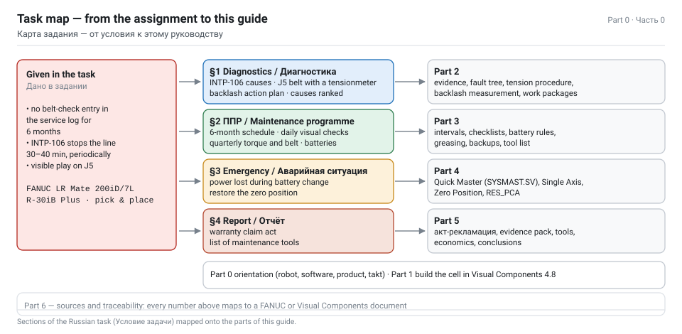

**Трактовка кейса, которую защищает это руководство**

Четыре вводные не независимы. Отсутствие проверки ремней в течение шести месяцев на оси кисти означает, что натяжение уходило; уходящее натяжение ремня J5 даёт ошибку позиционирования, а за пределом — сбои движения. INTP-106 — **не** механическая авария: это отказ интерпретатора продолжить программу. Но именно её **видит оператор**, когда движение или состояние прервали/поставили программу на паузу, а ячейка пытается продолжить работу. Цепочка:

```text
нет отметки о ТО (6 мес)  →  натяжение ремня J5 вне допуска  →  ошибка положения кисти / люфт
                                                          →  движение прервано или программа на паузе при старте
                                                          →  запрос CONTINUE отклонён  →  INTP-106
                                                          →  30–40 мин внепланового простоя
```

Часть 2 подтверждает каждую стрелку ссылками на руководства и даёт измерения, по которым решается, что делать: протяжка, замена ремня или замена редуктора кисти.

## Паспорт оборудования

Всё нижеперечисленное — это машина, которую вы моделируете и обслуживаете. Скопируйте эти таблицы в отчёт: это раздел «исходные данные» любого вменяемого технического документа.

#### Робот — FANUC LR Mate 200iD/7L

| Параметр | Значение | Примечание |
|---|---|---|
| Тип | шарнирный, 6 управляемых осей (J1…J6) | длиннобазовая версия семейства LR Mate 200iD |
| Макс. грузоподъёмность (кисть) | **7 кг** | включает массу захвата |
| Вылет (H-reach) | **911 мм** | у обычного 200iD — 717 мм; 911 мм — это минимум, при котором планировка паллетирования в принципе возможна, и всё равно нужен поворотный стол паллеты: см. проверку досягаемости в части 1.4 |
| Повторяемость | **±0,01 мм** | данные FANUC America; часть реселлеров указывает ±0,03 мм — авторитетно руководство под ваш серийный номер |
| Масса механической части | **27 кг** | |
| Установка | пол, под углом (стена), перевёрнуто | угол установки задаётся при controlled start |
| Средняя потребляемая мощность | **0,5 кВт** | |
| Защита | IP67 стандартно, IP69K опция | важно для кирпичного завода: абразивная пыль |
| Контроллер | R-30iB Plus (также R-30iB Mate Plus, open-air, iPendant Touch) | в задаче указан R-30iB Plus |

**Диапазоны движения и скорости**

| Ось | Диапазон | Макс. скорость |
|---|---|---|
| J1 | 340° (360°) | 370 °/с |
| J2 | 245° | 310 °/с |
| J3 | 430° | 410 °/с |
| J4 | 380° | 550 °/с |
| **J5** | **250°** | **545 °/с** |
| J6 | 720° | 1000 °/с |

**Ограничения нагрузки на кисть — нужны для проверки захвата в части 1**

| Ось | Допустимый момент | Допустимый момент инерции |
|---|---|---|
| J4 | 16,6 Н·м | 0,47 кг·м² |
| J5 | 16,6 Н·м | 0,47 кг·м² |
| J6 | 9,4 Н·м | 0,15 кг·м² |

**Монтаж и зона обслуживания**

| Пункт | Требование |
|---|---|
| Крепление основания | 4 отверстия Ø11, плита основания 190 × 190 мм |
| Плоскостность площадки | ≤ 0,5 мм |
| Наклон площадки | ≤ 0,5° |
| Зона обслуживания | 500 мм вокруг руки; **705 мм** сверху для 7L |
| Нагрузка на основание, покой (7L) | вертикальный момент 147,3 Н·м, вертикальная сила 333,2 Н |
| Нагрузка при остановке снятием питания (7L) | верт. момент **1657,2 Н·м**, верт. сила 1612,7 Н; гориз. момент 1285,6 Н·м, гориз. сила 1656,8 Н |
| Путь торможения после сигнала останова (7L) | J1 69,0°, J2 57,3°, J3 54,4° (power-off stop) |

> NOTE — Зачем в планировке цифры остановки: 69° хода J1 после сигнала останова означает, что ограждение и световой занавес в части 1 считаются от **тормозной** зоны, а не от статической. Это расчёт минимального расстояния по ISO 10218-1, и его упоминание — лёгкие баллы в студенческом отчёте.

#### Контроллер — FANUC R-30iB Plus

| Пункт | Детали |
|---|---|
| Пульт | iPendant (цветной), трёхпозиционный deadman, <kbd>SHIFT</kbd>, <kbd>RESET</kbd>, <kbd>FCTN</kbd>, <kbd>MENU</kbd> |
| Переключатель режимов | T1 (≤ 250 мм/с) / T2 / AUTO, плюс REMOTE-LOCAL |
| Панель оператора | аварийный стоп, сброс аварии, пуск, индикаторные светодиоды |
| Резервное питание памяти | литиевая батарея на главной плате, 3 В DC; программы и системные переменные — в SRAM |
| Номер батареи контроллера | **A05B-2650-K030** (также указывается A98L-0031-0028) — шкафы Mate Plus; для полноразмерных R-30iB/Plus указаны A02B-0200-K102 / A98L-0031-0012. Проверьте, какой шкаф у вас. |
| Ресурс батареи | около 4 лет с заводской установки; авария низкого напряжения **SYST-035** |
| Батарея робота (механики) | батарейный отсек у основания J1; **4 элемента C (1,5 В)** при встроенном исполнении, **4 элемента D (1,5 В)** при внешнем |
| Периодичность замены батареи механики | **1 год** (встроенная) / **1,5 года** (внешняя) |
| Relevant alarms | SYST-035 низкий заряд, SRVO-062 BZAL (авария батареи, группа/ось), SRVO-038 pulse mismatch, MOTN-049 / SYST-035 мастерение не выполнено, INTP-106 continue request failed |
| Опции ПО, которые стоит назвать | PalletTool, iRVision 2D/3DV, DCS (Dual Check Safety), ASCII upload программ, Ethernet/IP или PROFINET |

> WARNING — У двух батарей **противоположные** правила, и именно отсюда растёт аварийный сценарий части 4.
> Батарея **основания робота** (резервирование импульсных датчиков) меняется при **включённом** контроллере: руководство по эксплуатации предупреждает, что снятие внешней батареи при выключенном питании приводит к потере всех данных о текущем положении и требует повторного мастерения.
> Батарея **главной платы контроллера** (резервирование SRAM) меняется так: включить контроллер примерно на 30 с, затем **выключить** и завершить замену в течение **30 минут**.
> Путаница между ними — классический способ потерять мастерение при «плановом» ТО.

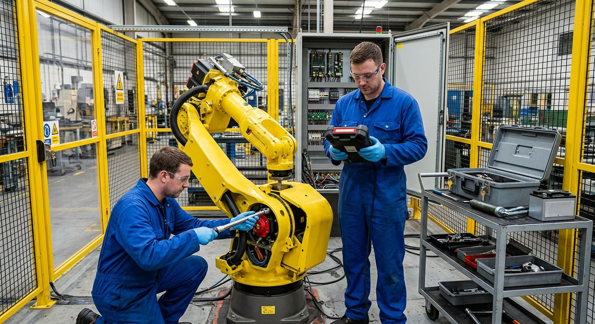

## Visual Components 4.8 — что нужно и где что находится

#### Редакции

Visual Components 4.8 выпускается как **Essentials**, **Professional**, **Premium** и варианты **OLP** (Professional OLP, Premium OLP, Robotics OLP). Именно в 4.8 инструменты офлайн-программирования Delfoi были влиты в линейку продукта, поэтому OLP теперь часть семейства, а не отдельный бренд.

| Какая возможность нужна для этого руководства | Минимальная редакция |
|---|---|
| Собрать планировку, добавить компоненты из eCatalog, PnP-соединения, ограждения, чертежи | Essentials |
| Процессное моделирование (продукты, процессы, поток, транспортный контроллер робота) | Essentials и выше |
| Обучение программы робота во вкладке PROGRAM, сигналы, скрипты Python | Essentials и выше |
| Роботы FANUC из веб-каталога eCatalog | Essentials и выше |
| OLP: постпроцессирование обученной программы в файл FANUC **.LS**, валидация, Via/Robotics Solver | **вариант OLP** (отдельная лицензия; надстройка Robotics Solver — дополнительная подписка) |
| FANUC Connectivity Plugin (управление реальным или виртуальным контроллером ROBOGUIDE) | Premium + лицензия на плагин |

> NOTE — Если у вас учебная лицензия Essentials или Professional, часть 1 выполняется на 100 %. OLP-вариант нужен только для шага 1.15 (постпроцессирование в FANUC .LS), и этот шаг необязателен — он показан, чтобы вы могли описать его в отчёте.

#### Что нового в 4.8 (годится на абзац в отчёте)

- **Visual Components Robotics OLP** стал главной фичей релиза: все OLP-процессы (Arc, Cut, Spot, Surf, Paint) и все постпроцессоры доступны на вкладке **PROGRAM** пользователям OLP.
- **Via Solver** доступен во **всех** версиях продукта (ограниченно по сравнению с платной надстройкой Robotics Solver, которая решает коллизии, сингулярности, пределы осей и досягаемость на технологических, вспомогательных и поисковых траекториях).
- **Program Validation** теперь поддерживает синхронизацию с конвейером, а **проверка поворота на 180°** предупреждает, если сустав проворачивается более чем на 180° во время линейного движения.
- **Онлайн-справка**: справка приложения и справочник Python API переехали в онлайн (help.visualcomponents.com/4.8/…), расположение справки настраивается.
- **Импорт/экспорт CAD** обновлён до HOOPS 2023 H2: ACIS до 2023, Autodesk Inventor до 2024, Navisworks 2012–2024.
- В 4.8.0.1 (январь 2024) починили интерактивный VR, загрузку утверждений из Via Solver и добавили KUKA.Sim в Premium OLP.
- Примечание об обновлении: пользователям 4.6/4.7 для перехода на 4.8 требовались **новый ключ продукта и действующий контракт на поддержку**.

#### Интерфейс, по которому вы будете кликать

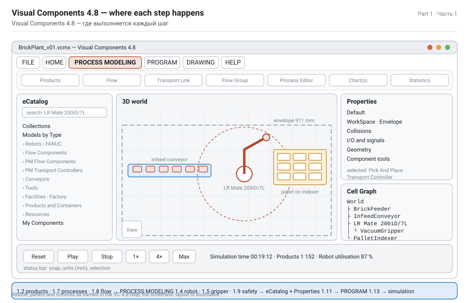

| Вкладка ленты | Зачем в этом проекте |
|---|---|
| **FILE** | новый/сохранить макет (`.vcmx`), экспорт 3D PDF, видео, статистики, печать |
| **HOME** | буфер обмена, Select / Move / **PnP** / Interact, размеры и привязки, измерение, **Interfaces**, **Signals**, Attach / Detach, Hierarchy, импорт геометрии, камера и виды |
| **PROCESS MODELING** | **Products** (редактор типов продуктов), **Processes** (редактор процессов), **Flow**, **Filter**, транспортные связи, создание кадров/сигналов |
| **PROGRAM** | **Jog** робота, Program Editor (подпрограммы и утверждения), инструменты, кадры TCP/базы, а в OLP-версиях — инструменты OLP-процессов |
| **DRAWING** | 2D-чертежи, размеры, аннотации, спецификация |
| **HELP** | онлайн-справка, справочник Python API, ссылки на поддержку и форум |

| Панель | Назначение |
|---|---|
| **eCatalog** | библиотека компонентов: Collections › Models by Type / Models by Manufacturer плюс поиск. Роботы FANUC лежат в Models by Type › Robots › FANUC (и в Models by Manufacturer › Fanuc). |
| **Properties** | все свойства выбранного компонента по вкладкам (Default, Geometry, WorkSpace, ProductCreator, …) |
| **Cell Graph** | дерево компонентов; самый быстрый способ выбрать то, что спрятано внутри сборки |
| **Program Editor** | подпрограммы (routines) и утверждения робота |
| **Jog** | манипулятор, координаты, выбор инструмента/базы, обученные XYZABC |
| **Output / Statistics** | результаты симуляции, счётчики продуктов, загрузка ресурсов |
| **Simulation controls** | пуск / пауза / сброс, скорость, время — начальное состояние компонентов фиксируется при нажатии «пуск» |

**Приёмы камеры и выделения, которые надо знать наизусть**

- Вращение: держать <kbd>RMB</kbd> и тянуть. Панорама: <kbd>LMB</kbd> + <kbd>RMB</kbd>. Зум: колесо или <kbd>SHIFT</kbd> + <kbd>RMB</kbd>.
- Центрировать на компоненте: правый клик › **SetCOI** либо <kbd>CTRL</kbd> + правый клик.
- Мультивыделение: держать <kbd>CTRL</kbd> и кликать; повторный клик убирает из выделения.
- **PnP** (Plug and Play): тяните компонент к совместимому интерфейсу до появления зелёной стрелки и продолжайте тянуть до щелчка. Так фидер соединяется с конвейером, конвейер — с процессом, а захват — с фланцем робота.
- **Interact**: управление интерактивными частями (суставы робота, двери станка, губки захвата) указателем.

#### Официальная документация по 4.8

| Документ | Где |
|---|---|
| Visual Components 4.8 Release Notes (06.10.2023) и 4.8.0.1 | visualcomponents.com › Downloads / PDF |
| Visual Components Premium 4.8 Help (онлайн) | help.visualcomponents.com/4.8/Premium/en/ |
| Справочник Python API (онлайн, 4.8) | help.visualcomponents.com/4.8/…/Python_API/ |
| Introduction to Layout Configuration (учебный PDF) | academy.visualcomponents.com |
| Pick And Place Components — Manual (PM Flow Components) | academy.visualcomponents.com |
| Robot Transport Controller Manual | academy.visualcomponents.com |
| Palletize using PM TransportPatternIn statement (4.8.0+) | academy.visualcomponents.com › lessons |
| Depalletizing using PM Detach statement (4.8.0+) | academy.visualcomponents.com › lessons |
| Индекс файлов библиотеки компонентов / eCatalog | download.visualcomponents.net/elib |

> TIP — На страницах Academy указана версия ПО, под которую записан урок. Два урока новее 4.8: *Palletizing robot programming* помечен 4.9.0+, а страница *Robot Transport Controller Manual* — 5.0+. Сами компоненты в 4.8 есть — отличаются лишь некоторые новые свойства. Там, где это руководство затрагивает чувствительное к версии место, это оговорено явно.

## Определение продукта и завода

В условии сказано «захват и укладка деталей с конвейера на паллету», но что за деталь — не сказано. Раз вы строите **завод декоративного кирпича**, деталь — кирпич, и этот выбор определяет все числа в планировке. Зафиксируйте данные о продукте сразу, не выдумывайте их на середине сборки.

#### Продукт: декоративный облицовочный кирпич

| Свойство | Значение | Комментарий |
|---|---|---|
| Название | `Brick_Deco` | имя типа продукта в Product Type Editor |
| Формат | **250 × 120 × 65 мм** | стандартный формат облицовочного кирпича |
| Масса | **3,2 кг** | пустотелый декоративный; полнотелый был бы ~4,2 кг |
| Материал / цвет | обожжённая глина, терракота | только для визуала |
| Ориентация на ленте | постелью вверх, 250 мм вдоль ленты | чтобы вакуумный захват брал за наибольшую грань |
| Хрупкий? | нет, но абразивный | главный враг — пыль, см. примечание про IP67 |

#### Проверка грузоподъёмности и кисти (сделайте это до всякого моделирования)

```text
захват (2 вакуумные присоски, алюминий)   0,80 кг
кирпич                                     3,20 кг
--------------------------------------------------
итого на фланце                            4,00 кг  ≤ 7 кг              ✔  занято 57 %

статический момент относительно J5, ЦМ в 0,10 м:
  M = 4,00 кг × 9,81 м/с² × 0,10 м =       3,92 Н·м  ≤ 16,6 Н·м         ✔  занято 24 %

момент инерции относительно J4/J5 (точечная масса на 0,15 м):
  I = 4,00 кг × (0,15 м)² =                0,090 кг·м² ≤ 0,47 кг·м²     ✔  занято 19 %
```

> TIP — Вставьте этот расчёт в отчёт. Это разница между «я прикрепил захват» и «я проверил инструмент по ограничениям кисти машины» — та же арифметика, что делает оценка грузоподъёмности у FANUC.

#### Паллета и схема укладки

| Свойство | Значение |
|---|---|
| Паллета | плоский европаллет **1200 × 800 × 144 мм**, тара 25 кг, номинал 1000–1500 кг |
| Схема слоя | 24 кирпича в слое: 4 вдоль стороны 1200 мм (4 × 250 = 1000 мм) × 6 рядов вдоль 800 мм (6 × 120 = 720 мм) |
| Слоёв | 8 |
| Кирпичей на паллете | **192** |
| Масса нетто | 192 × 3,2 = **614 кг** |
| Масса брутто | 614 + 25 = **639 кг** — 64 % от консервативного номинала 1000 кг ✔ |
| Высота штабеля | 144 + 8 × 65 = **664 мм** — в зоне досягаемости робота и устойчиво без обмотки |
| Занятая площадь | 1000 × 720 мм из 1200 × 800 мм (75 %) — запас на габарит захвата |

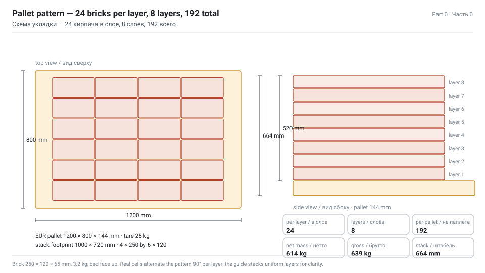

#### Такт, производительность и буфер — арифметика, которую должна воспроизвести симуляция

```text
Целевой выпуск ячейки                  600 кирп/ч = 10 кирп/мин → такт 6,0 с

Цикл робота (уточняется симуляцией):
  подвод + захват                       1,2 с
  перенос конвейер → паллета            2,0 с
  укладка + отпускание                  1,2 с
  возврат в точку съёма                 1,6 с
  ------------------------------------------------
  итого                                 6,0 с → 600 кирп/ч           ✔ точно в такт

Входной конвейер:
  шаг 300 мм, скорость 0,10 м/с → 20 кирп/мин поступает
  это вдвое больше такта робота, значит на позиции съёма нужны стопор и буфер

Буфер: 6 позиций = 6 × 300 мм = 1,8 м ленты → 36 с автономности
  гасит всплески из печи и время смены паллеты

Цикл паллеты:
  заполнение 192 × 6,0 с               19,2 мин
  вывод полной / подача пустой            2,0 мин
  ------------------------------------------------
  на паллету                            21,2 мин → 2,83 паллеты/ч → 543 кирп/ч

  ✘ на 4 % ниже цели — смена паллеты съедает запас

Мера: двухпозиционный челнок паллет (позиция заполнения + позиция обмена),
тогда обмен идёт параллельно с заполнением:
  на паллету                            19,2 мин → 3,13 паллеты/ч → 600 кирп/ч ✔
```

> NOTE — Ради таких выводов симуляцию и строят. Соберите сначала однопозиционную версию, измерьте её, затем добавьте челнок и измерьте снова: у вас появится результат «до/после» в числах — это вывод, который можно защитить в отчёте, и рекомендация, которую можно оценить в деньгах.

#### Контекст завода

| Зона | Состав | Как моделируется |
|---|---|---|
| A · Сырьё и формовка | глиняный склад, смеситель, экструдер/пресс, резка | статическая геометрия + станки (или простые блоки процессов) |
| B · Сушка и обжиг | сушило, туннельная печь, печные вагонетки | длинный конвейер + станок с большим временем цикла |
| C · Разгрузка и доводка | разгрузочный конвейер, щётка, пост визуального контроля с отбраковкой | конвейер + датчик + человеческий ресурс |
| **D · Ячейка паллетирования** | **ячейка Pick and Place на LR Mate 200iD/7L** | **детальная часть этого руководства** |
| E · Упаковка и отгрузка | стретч-обмотчик, принтер этикеток, погрузчик, стеллажный склад | станок + мобильный робот или человек + погрузчик |

Зона D — место действия задания и 80 % времени моделирования. Зоны A–C и E строятся с той детализацией, которая обеспечивает непрерывность потока; они важны, потому что ячейку надо питать 20 кирпичами в минуту и освобождать от 2,8–3,1 паллеты в час, и потому что отчёт о *заводе*, в котором одна роботизированная ячейка, — это не завод.

---

# Part 1 — Сборка завода в Visual Components 4.8

_Семнадцать шагов от пустого 3D-мира к работающему, измеренному, задокументированному и постпроцессированному заводу декоративного кирпича._

## 1.0 Общий порядок работы

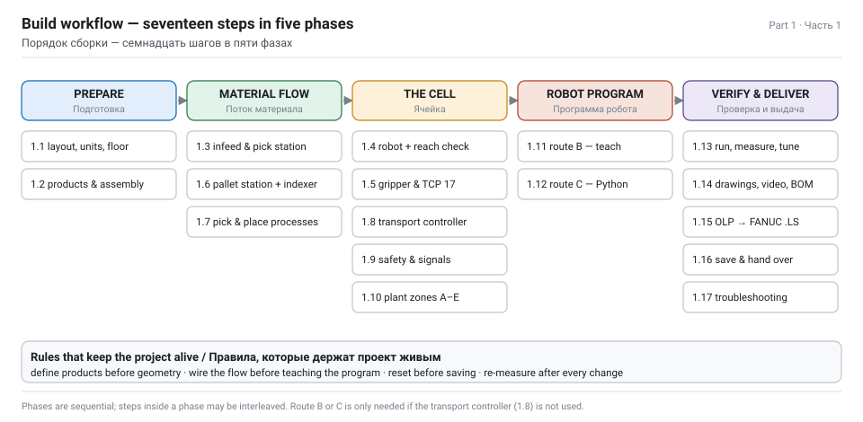

Работайте в этом порядке. Каждый шаг потребляет результат предыдущего, а два самых частых способа провалить проект — (а) моделировать геометрию до появления данных о продукте и (б) обучать программу робота до того, как связан поток процессов.

| № | Шаг | Вкладка | Результат |
|---|---|---|---|
| 1.1 | Новый макет, единицы, пол, сетка, сразу сохранить | FILE / HOME | `BrickPlant_v01.vcmx` |
| 1.2 | Определить продукты: кирпич, паллета, сборка полной паллеты | PROCESS MODELING | типы продуктов + группы потока |
| 1.3 | Вход: фидер → конвейер → позиция съёма со стопором | HOME / eCatalog | материал приходит 20/мин |
| 1.4 | Добавить FANUC LR Mate 200iD/7L, задать базу и зону | HOME / eCatalog | робот в мире |
| 1.5 | Повесить вакуумный захват, задать TCP, коллизии и массу | HOME / Properties | TOOL[17] готов |
| 1.6 | Позиция паллеты: фидер паллет, сборка, челнок обмена | PROCESS MODELING | цель укладки существует |
| 1.7 | Настроить процессы Pick и Place | PROCESS MODELING | `Pick`, `Place` |
| 1.8 | Связать транспортный контроллер и поток | PROCESS MODELING | у робота появилась работа |
| 1.9 | Безопасность: ограждение, светозанавес, калитка, шкаф, знаки | HOME / eCatalog | защищённая ячейка |
| 1.10 | Зоны A–C и E: формовка, печь, контроль, обмотка | HOME / PROCESS | завод, а не ячейка |
| 1.11 | Маршрут B: обучить программу робота вручную | PROGRAM | подпрограммы + утверждения |
| 1.12 | Маршрут C: управлять роботом из Python | MODELING | скриптовый цикл |
| 1.13 | Запустить, измерить, устранить узкое место | Simulation / Statistics | 600 кирп/ч доказаны |
| 1.14 | Чертежи, спецификация, 3D PDF, видео | DRAWING / FILE | результаты |
| 1.15 | Постпроцессирование в FANUC .LS и проверка в ROBOGUIDE | PROGRAM (OLP) | код для робота |
| 1.16 | Сохранить, версионировать, передать | FILE | итоговый пакет |
| 1.17 | Таблица поиска неисправностей | — | когда не запускается |

> NOTE — Шаги 1.8, 1.11 и 1.12 — **три разных способа заставить одного и того же робота двигаться**. Выберите один основным, два других упомяните в отчёте. Для ячейки паллетирования, ведомой потоком продуктов, профессиональный выбор — **1.8 (транспортный контроллер)**; **1.11 (обученная программа)** — то, что интегратор передаёт на FANUC; **1.12 (Python)** — когда схему надо вычислять.

## 1.1 Новый макет, пол и единицы

1. **FILE › New › Empty Layout**. Visual Components работает в миллиметрах; начало координат — пол на Z = 0.
2. Настройте сетку: **HOME › Snap › Grid Snap** с шагом 100 мм и включите **Always Snap**, пока расставляете статичное оборудование. Кирпичный завод — прямоугольный; сетка спасёт от кривой линии печи.
3. Положите пол: **eCatalog › Collections › Models by Type › Facilities - Factory › Visual Components › Floor** (или начертите план этажа через **HOME › Drawing**). Размер 40 000 × 16 000 мм: этого хватает зонам A–E с проходами.
4. Сразу сохраните: **FILE › Save As › `BrickPlant_v01.vcmx`**. Дальше сохраняйте после каждого завершённого шага, увеличивая версию. Отмены между сеансами нет.
5. Создайте виды, которые будете использовать повторно: сверху (клавиша <kbd>T</kbd> на View Selector) и два сохранённых вида камеры через **View Editor › +** — один на ячейку паллетирования, один на весь завод. Они понадобятся для видео в шаге 1.14.

> TIP — Сбрасывайте симуляцию (<kbd>Reset</kbd> в органах управления) перед сохранением. Начальное состояние компонентов фиксируется при пуске симуляции, поэтому сохранение посреди прогона «запекает» в макет случайные кирпичи на ленте.

**Габариты завода, который вы сейчас разложите**

| Зона | Площадь (мм) | Положение в макете |
|---|---|---|
| A · Формовка | 8000 × 6000 | X −18000 … −10000 |
| B · Сушило + туннельная печь | 16000 × 4000 | X −8000 … +8000 |
| C · Разгрузка + контроль | 4000 × 4000 | X +8000 … +12000 |
| **D · Ячейка паллетирования** | **5000 × 4500** | **X +12000 … +17000** |
| E · Обмотка + отгрузка | 6000 × 6000 | X +17000 … +23000 |

## 1.2 Продукты: кирпич, паллета, полная паллета

Процессное моделирование требует, чтобы продукты были **определены до того, как их создают**. Старые компоненты из папки «Feeder» создают *компоненты*; компоненты процессного моделирования создают *продукты*, и только продукты могут проходить через процессы, переноситься транспортным контроллером робота и учитываться в статистике.

**Шаг A — один раз положите геометрию в мир**

1. **eCatalog › Models by Type › Products and Containers › Visual Components**: перетащите **Box** в мир (он заменит кирпич, пока не импортирована настоящая геометрия).
2. Рядом перетащите **Pallet** (или CollarPallet).
3. Задайте размеры бокса в панели **Properties**: **X 250, Y 120, Z 65**. Покрасьте в терракоту, чтобы на рендерах читался кирпич.

**Шаг B — определите типы продуктов**

1. **PROCESS MODELING › Products** открывает **Product Type Editor**.
2. Создайте группу потока **`Bricks`** и в ней тип продукта **`Brick_Deco`**:
   - `Name` = Brick_Deco
   - `ParentProduct` = Any
   - `ComponentUri` — инструментом выбора компонента кликните по resized-боксу в 3D-мире
   - `OriginFrame` — оставьте нулём, если геометрия не смещена относительно собственного начала
3. Создайте группу потока **`Pallets`** и в ней:
   - тип продукта **`Pallet_Empty`** → ComponentUri = компонент паллеты
   - **сборку** **`Pallet_Full`** → корневой шаг = Pallet_Empty, дочерний шаг = кирпичи

**Шаг C — схема укладки как слоты сборки**

Сборка — это способ сообщить Visual Components, *куда* встаёт каждый кирпич. В редакторе сборок:

- **Шаг 0** — `Pallet_Empty`, один слот, присутствует сразу при создании сборки (сама паллета).
- **Шаг 1** — `Brick_Deco`, **192 слота**, 8 слоёв по 24.

| Параметр слота | Значение | Как |
|---|---|---|
| Слотов в слое | 24 | 4 по X (шаг 250 мм) × 6 по Y (шаг 120 мм) |
| Слоёв | 8 | шаг по Z 65 мм |
| Начало слотов | центр первого кирпича: X −500 + 125, Y −360 + 60, Z 144 + 32,5 | относительно начала паллеты |
| `OrderIndex` | 1 … 192, послойно | процесс укладки заполняет сначала меньший свободный индекс |
| `AcceptedProductTypes` | Brick_Deco | чтобы посторонний продукт не попал в штабель |
| `DefaultProductType` | **Null** | критично — именно это делает слоты *пустыми* при создании |
| `AcceptAllProductTypes` | снять | |

> WARNING — Если оставить `DefaultProductType` = Brick_Deco, каждая созданная паллета приезжает уже полной, и роботу нечего делать. Значение **Null** — документированный способ создать незавершённую сборку из фидера.

**Шаг D — проверка**

1. Временно добавьте **Feeder** из **Models by Type › Flow Components**, задайте ему продукт `Pallet_Full` и нажмите пуск. Должна появиться паллета со 192 кирпичами.
2. Сбросьте симуляцию, удалите тестовый фидер.

## 1.3 Вход: фидер, конвейер, позиция съёма

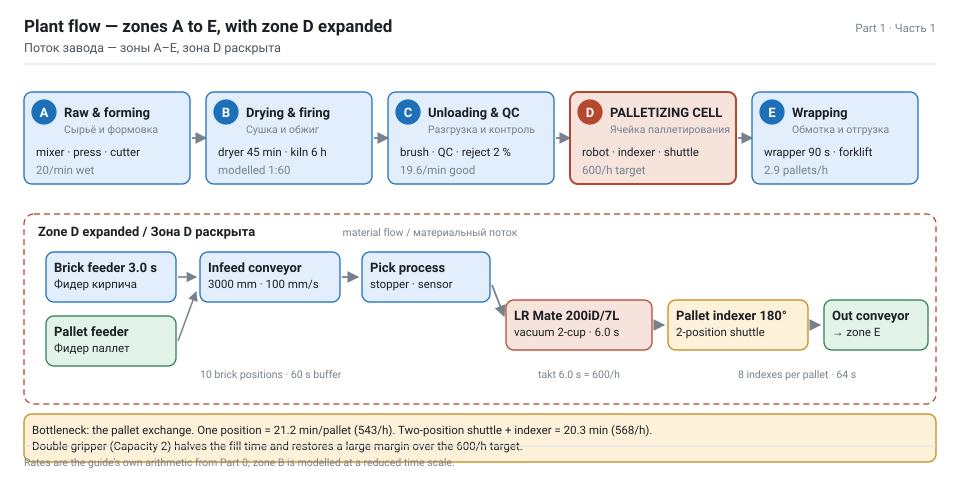

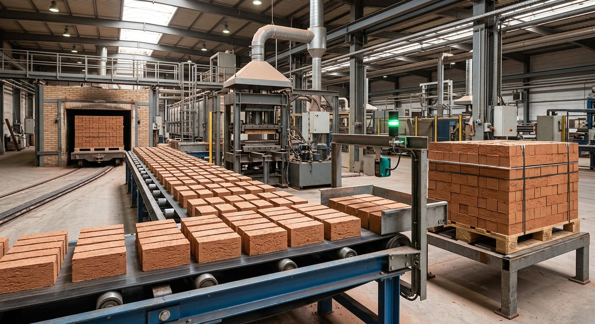

1. **eCatalog › Models by Type › Flow Components › Visual Components › Feeder** в мир, в начало зоны D.
2. **Models by Type › Conveyors › Visual Components › Conveyor**, соедините с фидером через **PnP**: тяните конвейер к фидеру до появления зелёной стрелки и продолжайте до щелчка.
   - *Совет:* если фидер выделен, двойной клик по конвейеру в eCatalog добавит его уже присоединённым.
3. Задайте свойства фидера:

| Свойство | Значение | Почему |
|---|---|---|
| `Product` | Brick_Deco | тип продукта из шага 1.2 |
| `CreationInterval` | 3,0 с | 20 кирп/мин — вдвое больше такта робота, буфер настоящий |
| `Container` | входной конвейер | продукты создаются *на* ленте |

4. Задайте свойства конвейера:

| Свойство | Значение |
|---|---|
| `ConveyorWidth` | 400 |
| `Speed` | 100 мм/с |
| `Length` | 3000 мм (редактируйте точки пути в 3D-мире) |
| `ProductSpacing` | 300 мм — обеспечивается интервалом фидера и скоростью ленты |

5. Добавьте позицию съёма. Два варианта, оба правильные:
   - **PM Flow Components › Pick And Place Process** — сегмент конвейера с входным (зелёным) и выходным (красным) датчиком; всё между ними считается внутри процесса. Настраивается в шаге 1.7.
   - обычный **Conveyor** + **Conveyor Sensor**, привязанный к пути, + **Stopper**, чтобы кирпич ждал робота. Используйте этот вариант на маршруте обученной программы (1.11).
6. Добавьте **From Conveyor Process** или второй конвейер в конце зоны C, чтобы кирпичи приходили непрерывно с линии печи, а не возникали из ничего: отчёт о заводе читается лучше, когда у материала есть происхождение.

> NOTE — Длина ленты имеет значение. 3000 мм при шаге 300 мм — это десять позиций кирпича; робот забирает один каждые 6 с, значит лента держит 60 с материала. Это и есть ваш буфер — теперь его можно указать в отчёте, а не выдумывать.

## 1.4 Робот: FANUC LR Mate 200iD/7L

**Из каталога eCatalog**

1. **eCatalog › Collections › Models by Type › Robots › FANUC** (или **Models by Manufacturer › Fanuc**), найдите **`LR Mate 200iD/7L`**. Компонент создан Visual Components и помечен для сборки, дозирования, обслуживания станков и перемещения материалов.
2. Двойной клик ставит его в начало координат; либо перетащите в мир и расположите через **Move** с численными X/Y/Rz.
3. Расположение для этой ячейки: основание на осевой линии длинной стороны позиции паллеты, **650 мм от центра поворотного стола паллеты** и примерно 1100 мм от позиции съёма, поворотом так, чтобы J1 качался между ними. Не копируйте эти числа без проверки досягаемости ниже: именно на этом шаге студенческие макеты незаметно ошибаются.
4. **Properties › вкладка WorkSpace › включить `Envelope`**. В мире появится зона досягаемости. Перейдите в вид сверху и убедитесь, что *и* точка съёма, *и* всё рабочее окно паллеты попадают внутрь.

**Проверка досягаемости, которую надо выполнить (и показать в отчёте)**

Площадь паллеты 1200 × 800 мм, центр C; основание робота B на осевой линии длинной стороны на расстоянии *d* от C. Дальний угол штабеля находится на расстоянии:

```text
r_far = sqrt(600^2 + (400 + d)^2)

d = 900 мм  ->  r_far = sqrt(360000 + 1690000) = 1432 мм   >> 911 мм  НЕДОСТУПНО
d = 650 мм  ->  r_far = sqrt(360000 + 1102500) = 1206 мм   >> 911 мм  НЕДОСТУПНО
решаем r_far <= 911  ->  (400 + d)^2 <= 911^2 - 600^2 = 469921
                     ->  d <= 285 мм
```

Основание в 285 мм от центра паллеты оказалось бы **внутри её площади** (ближний край в 400 мм от центра), то есть физически невозможно. Вывод, который стоит записать в отчёт именно этими словами:

> WARNING — **Одно неподвижное основание не способно укладывать полную EUR-паллету рукой с вылетом 911 мм.** Любой макет, утверждающий обратное, не проверил дальний угол. Три рабочих решения по убыванию предпочтительности для этой ячейки:
>
> 1. **Поворотный стол-индексатор на 180°** — выбран здесь. Паллета поворачивается так, что в рабочем окне всегда только ближняя половина.
> 2. **Линейная направляющая (7-я ось)** вдоль стороны 1200 мм — основание едет вместе с укладкой; просто и надёжно, но добавляет время хода в каждый цикл.
> 3. **Двойной захват плюс меньшее рабочее окно** либо два робота — совет по масштабированию из самого руководства Pick And Place.

**Со столом-индексатором: теперь сходится?**

Основание B в 650 мм от центра стола C, на осевой линии длинной стороны. После поворота на 180° любая точка паллеты оказывается в ближней половине, то есть не далее 600 мм поперёк и 0–400 мм к роботу:

```text
дальняя точка   (600, 0)      r = sqrt(600^2 + 650^2) = 884 мм   <= 911 мм  ОК
ближняя точка   (0, -400)     r = 650 - 400 = 250 мм             ОК (рука не сложена в себя)
верхний слой на +585 мм над паллетой -> вертикальная досягаемость проверяется отдельно в виде зоны
```

884 мм против предела 911 мм — это реальный запас, 27 мм, и именно такие числа хочет видеть рецензент. Держите utilisation ниже 90 % от номинального вылета, чтобы кисть ещё могла ориентировать захват.

**Во что обходится индексатор**

| Позиция | Значение |
|---|---|
| Поворотов на паллету | 8 (один поворот на 180° на слой) |
| Время поворота, стол с грузом 640 кг | ~8 с |
| Добавка к времени паллеты | 64 с = 1,07 мин |
| Цикл паллеты, двухпозиционный челнок + индексатор | 19,2 + 1,1 = **20,3 мин** |
| Получаемый выпуск | **568 кирп/ч** — на 5 % ниже цели 600/ч |
| Решение, возвращающее цель | двойной захват (Capacity 2, часть 1.8): время заполнения вдвое меньше, ~9,6 мин → ~10,7 мин/паллета → **1075 кирп/ч**, большой запас |
| Альтернатива | принять 568 кирп/ч и заявить это либо добавить второго робота |

Это ровно тот вывод, который должен быть в отчёте: цель проверена, она не выполнена по названной физической причине, и предложены два количественно оцененных remedy.

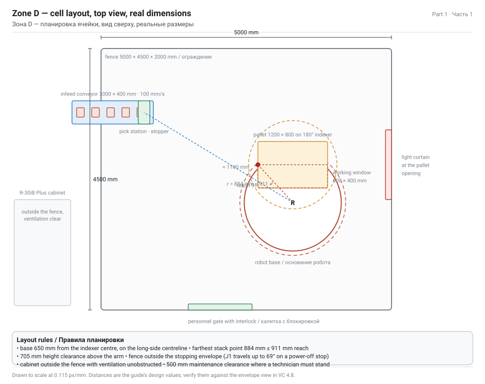

**Если компонента нет в вашем каталоге**

Веб-каталог требует сети и лицензии. Три запасных пути по убыванию предпочтительности:

1. Возьмите **LR Mate-200iD** (короткую версию) и оговорите замену в отчёте: содержание ТО в частях 2–5 для них одинаково, различается только вылет (717 мм против 911 мм).
2. Скачайте файл компонента из публичного индекса eLibrary по адресу `download.visualcomponents.net/elib` и откройте в Visual Components (FILE › Open › `.vcmx`), затем скопируйте робота в свой макет.
3. Соберите из шаблона: **Models by Type › Component Templates › Generic Articulated Robot v3**, затем замените геометрию своей CAD-моделью (импорт STEP) и настройте суставы. Это стандартный процесс моделирования компонентов; его стоит описать в отчёте, потому что он доказывает понимание того, что такое компонент робота.

**Моделирование робота из шаблона (запасной путь 3, кратко)**

1. Импортируйте CAD: **HOME › Geometry › Import**, выберите STEP-файл LR Mate 200iD/7L. Задайте масштаб импорта в миллиметрах.
2. Добавьте шаблонного робота, выделите все его геометрические признаки, скопируйте их в корень импортированного компонента, затем удалите блочные признаки шаблона.
3. Создайте по одной **связи (link)** на каждую движущуюся группу (основание, рука J1, рука J2, рука J3, кисть J4, кисть J5, фланец J6) и по **вращательному суставу** между ними с правильной осью, диапазоном и скоростью:

| Сустав | Ось | Диапазон | Макс. скорость |
|---|---|---|---|
| J1 | Z основания | ±170° | 370 °/с |
| J2 | Y | ±122,5° | 310 °/с |
| J3 | Y | ±215° | 410 °/с |
| J4 | X руки | ±190° | 550 °/с |
| **J5** | **Y кисти** | **±125°** | **545 °/с** |
| J6 | X фланца | ±360° | 1000 °/с |

4. Перенесите признак **FlangeFrame** на реальную посадочную поверхность J6, затем задайте кадровые системы инструмента в исполнительном устройстве робота.
5. Верните Move Mode в **Hierarchy** и нажмите **Reset**, чтобы исполнительное устройство перечитало кадры.

> WARNING — Монтажная поверхность в макете должна соответствовать требованиям реальной машины: плоскостность ≤ 0,5 мм, наклон ≤ 0,5°, и тумба, способная воспринять **1657 Н·м** вертикального момента при остановке снятием питания. Смоделируйте тумбу как твёрдое тело и упомяните этот случай нагружения в отчёте — одна фраза связывает вашу планировку с паспортом машины.

## 1.5 Исполнительное устройство: вакуумный захват и TCP

Кирпич пористый, абразивный и весит 3,2 кг. Вакуум — правильное семейство захватов; параллельный зажим потребовал бы хода 250 мм и скалывал бы кромки. Берите **две** присоски, а не четыре: две Ø63 при −0,7 бар держат примерно по 300 Н, а нужно ~35 Н удерживающей силы — запас около 17.

1. **eCatalog › Models by Type › Tools › Visual Components › Parametric Suction Cup Gripper** в мир.
2. **PnP**: перетащите захват на **монтажную пластину** робота до щелчка. Захват станет дочерним относительно фланца в **Cell Graph**.
3. Задайте свойства захвата:

| Свойство | Значение | Комментарий |
|---|---|---|
| `NumberOfCups` | 2 | |
| `CupDiameter` | 63 мм | сильфонная присоска Ø63 |
| `CupSpacing` | 150 мм | поперёк постели 250 мм, внутри кромок 240 мм |
| `GrippingDia` / ход | 250 мм | важно только для губкового захвата |
| `Mass` | 0,80 кг | алюминиевая плита + эжектор + присоски |
| `SignalIn` / `SignalOut` | см. шаг 1.8 | вакуум ВКЛ = закрыть, вакуум ВЫКЛ = открыть |

4. **Кадр инструмента.** Когда к роботу подключён инструмент с предопределённым кадром, Visual Components добавляет его к 16 стандартным кадрам под **индексом 17**. Поставьте `TcpIndex` = 17 в транспортном контроллере или связи, чтобы движения считались от плоскости присосок, а не от голого фланца. При ручном обучении выберите **TOOL[17]** в панели Jog.
5. **Геометрия коллизий.** Выделите захват и кирпич и добавьте их в набор коллизий робота (Properties › Collisions). Иначе симуляция спокойно проведёт руку сквозь ограждение.
6. **Проверка грузоподъёмности в компоненте.** Задайте свойство грузоподъёмности робота (или присоединённую массу инструмента) так, чтобы динамика соответствовала рассчитанным в части 0 4,00 кг.

> TIP — Называйте кадры. `TOOL_Vacuum2Cup` вместо TOOL[17], `BASE_PalletCell` вместо Base[1]. Курс Visual Components по программированию роботов говорит то же: подписывайте утверждения и позиции ясно, потому что макет откроет кто-то ещё.

**Сигналы захвата**

Транспортный контроллер Pick And Place может управлять захватом двумя способами:

- **Номерами портов** — `GripperSignalClose` = 102, `GripperSignalOpen` = 101 на связи.
- **Соглашением об именовании** — поставьте порт −1, и контроллер сам найдёт в компоненте инструмента сигналы `IN_J1_Action` либо `IN_J1_Close` / `IN_J1_Open`. Включите `UseGripperSignals` на вкладке Advanced контроллера.

Для вакуумного захвата честный набор сигналов: `DO[10] вакуум ВКЛ`, `DI[11] вакуум достигнут`, `DO[12] обдув`. Смоделируйте хотя бы первые два: именно входа «вакуум достигнут» ждёт настоящая программа перед подъёмом, и это та деталь, которая отличает студенческий макет от макета интегратора.

## 1.6 Позиция паллеты и челнок обмена

1. **Подача пустых паллет.** Добавьте второй **Feeder** (Models by Type › Flow Components), задайте `Product` = `Pallet_Full` (сборка с пустыми слотами) и `CreationInterval` = 1200 с. Подключите его к короткому **рольгангу** либо к паре **Shape Feeder → Pallet Filler**, если хотите, чтобы схему генерировал компонент, а не сборка.
2. **Цель укладки.** Добавьте **Pick And Place Process** там, где паллета останавливается, и настройте `ProcessType` = **Place**, `ProductsOn` = **Assembly** (шаг 1.7).
3. **Вывод полных паллет.** Добавьте **Transport Link** или короткий выходной конвейер в зону E (стретч-обмотчик). Полная паллета — это сборка, поэтому перемещает её конвейер, а не робот.
4. **Поворотный стол-индексатор.** В части 1.4 показано, что неподвижное основание не дотягивается до всей EUR-паллеты рукой 911 мм, поэтому позиция паллеты — это **поворотный стол на 180°**, центр которого в 650 мм от основания робота. В Visual Components смоделируйте его компонентом с вращательным суставом, управляемым сигналом (`DO_Index` → поворот на 180° за 8 с), и пусть подпрограмма укладки ждёт `DI_IndexDone`. Восемь поворотов на паллету, 64 с.
5. **Двухпозиционный челнок.** В части 0 показано, что однопозиционная станция теряет 4 % целевого выпуска на обмене паллет. Смоделируйте решение:
   - **челночный конвейер** с двумя позициями (заполнение и обмен) или два параллельных процесса укладки,
   - поток: `PalletFeeder → SwapPosition → FillPosition → OutConveyor`,
   - сигнал `PalletReady` из позиции заполнения в фидер паллет, чтобы пустая паллета входила только после ухода полной.
6. **Высота важна.** Паллета на полу даёт первый слой на 144 мм и восьмой на 599 мм — этому роботу комфортно. Если смоделируете паллету на станции высотой 500 мм, верхний слой окажется на 1099 мм и зону досягаемости придётся перепроверить.

> TIP — Добавьте **человеческий ресурс** или **погрузчик/мобильного робота** для вывоза полных паллет (Models by Type › Mobile Robots либо Resources › Characters). Тогда статистика покажет, ждёт ли ячейка транспорт, — это настоящий вывод, и получить его можно, только если паллеты действительно уезжают.

## 1.7 Процессы Pick и Place

Компонент **Pick And Place Process** находится в **eCatalog › PM Flow Components**. Это конвейер с двумя датчиками: всё, что между зелёным входным и красным выходным датчиком, считается «внутри процесса» и доступно для переноса.

> WARNING — Эти компоненты поставляются с фиксированной структурой утверждений. Руководство формулирует прямо: **переименуйте процесс, не добавляйте и не удаляйте утверждения; выберите утверждение процесса и измените его свойства.** Добавление утверждений в Pick And Place Process ломает лежащую под ним Python-логику.

**Процесс съёма (на входном конвейере)**

| Свойство | Значение | Смысл |
|---|---|---|
| Имя процесса | `Pick_Brick` | переименовать, не пересоздавать |
| `ProcessType` | **Pick** | продукты забираются *отсюда* |
| `ProductsOn` | **Conveyor** | источник — лента |
| `InSensorPosition` | 20 % | зелёный датчик на 20 % длины компонента |
| `OutSensorPosition` | 80 % | красный датчик на 80 % |
| `AcceptAllProductTypes` | снять | |
| Принимаемые типы | Brick_Deco | |
| `StopAt` | **Never** для съёма на ходу / **Sensor**, если кирпич должен ждать | Never сохраняет поток; Sensor облегчает работу робота |

**Процесс укладки (на позиции паллеты)**

| Свойство | Значение | Смысл |
|---|---|---|
| Имя процесса | `Place_Pallet` | |
| `ProcessType` | **Place** | продукты доставляются *сюда* |
| `ProductsOn` | **Assembly** | цель — сборка паллеты, поэтому слоты задают точные позиции |
| `ReverseSlotOrder` | снять | заполнение с меньшего OrderIndex = сначала нижний слой |
| `AcceptAllProductTypes` | снять | |
| `StopAt` | Never | |

> NOTE — Именно `ProductsOn = Assembly` позволяет паллетировать без обучения 192 точек. Процесс укладки создаёт транспортные задачи для шагов сборки в порядке **обхода в глубину**, а внутри шага слоты заполняются по возрастанию `OrderIndex` — то есть сначала нижний левый кирпич первого слоя и в конце верхний правый кирпич восьмого слоя. Если вы по ошибке задали слотам `DefaultProductType` (шаг 1.2), процесс не найдёт свободного слота и робот будет простаивать вечно.

## 1.8 Транспортный контроллер и поток

Это шаг, который заставляет робота работать без написания программы.

**Добавьте контроллер**

1. **eCatalog › PM Transport Controllers › Pick And Place Transport Controller** (или **Robot Transport Controller** для классической ячейки паллетирования на шарнирном роботе) в мир над рабочей зоной.
2. **PnP**: присоедините робота FANUC к контроллеру, чтобы робот был «прикреплён» к нему. В Cell Graph робот станет дочерним для контроллера.
3. Если взяли обычный Robot Transport Controller, соедините интерфейс робота с контроллером: выделите контроллер, **HOME › Connect › Interfaces** и кликните по каждому интерфейсу в списке, чтобы добавить соединение.

**Вкладка LinkDefaults — значимые значения**

| Свойство | Значение | Почему |
|---|---|---|
| `TcpIndex` | **17** | кадр инструмента подключённого захвата; если 17 не существует, VC откатится к первому кадру и будет ставить кирпичи по фланцу |
| `PlaceMultiple` | One-By-One | одиночный захват; All-At-Once с Capacity 2 — для двойного захвата |
| `PickTime` | 0,4 с | нарастание вакуума + клапан |
| `PlaceTime` | 0,3 с | отпускание + обдув |
| `ApproachMotion` | **LIN** | линейный подвод; сами движения съёма и укладки всегда LIN |
| `PickApproach` | X 0, Y 0, **Z 150** | высота отхода над лентой — выше стопора и соседних кирпичей |
| `PlaceApproach` | X 0, Y 0, **Z 200** | выше, потому что 8-й слой на 585 мм выше паллеты и надо перекрывать готовый штабель |
| `GripperSignalOpen` | 101 | |
| `GripperSignalClose` | 102 | −1 — использовать соглашение об именах сигналов инструмента |

**Вкладки Speeds и AutoHoming**

- **Speeds**: задайте допустимые скорости суставов и линейную скорость в ячейке. Реалистично для паллетирования 800–1200 мм/с; не оставляйте максимум по умолчанию, иначе время цикла будет фантастикой.
- **AutoHoming**: `Enabled` включён, `Delay` 5 с. Домашняя позиция — это поза робота в момент сброса симуляции, **если только** в программе нет непустой подпрограммы `home`: тогда используется она. Обучите нормальный home (рука собрана, кисть нейтральна, вне штабеля), а не полагайтесь на позу сброса.

**Вкладка Helpers**

- `OptimizePosition` перемещает и поворачивает контроллер в середину между подключёнными процессами, предполагая параллельные конвейеры. Применяйте *после* создания потока и транспортных связей.
- `OptimizeFrameHeight` работает только для потолочной рамы.

**Транспортные связи и поток**

1. **PROCESS MODELING › Transport Link**: создайте связь из `Pick_Brick` в `Place_Pallet` и задайте её **Implementer** = ваш транспортный контроллер.
2. Оставьте `UseCustomParameters` на связи **выключенным**, чтобы она наследовала LinkDefaults; включайте, только если этой связи нужны свои значения.
3. **PROCESS MODELING › Flow** определите шаги потока продуктов:

```text
Группа "Bricks" :  BrickFeeder  →  Pick_Brick  →  Place_Pallet  →  OutConveyor
Группа "Pallets":  PalletFeeder →  SwapPosition →  Place_Pallet  →  OutConveyor
```

4. Конвейерный транспорт между фидером и процессом съёма в транспортной связи **не** нуждается — продукты едут внутри контейнера конвейера. Связь нужна только для прыжка съём→укладка.
5. Нажмите пуск. Робот должен брать кирпичи с ленты и заполнять паллету слой за слоем.

> TIP — Если лента обгоняет робота, применим совет из самого руководства: замедлите конвейер, остановите его либо клонируйте процесс съёма, процесс укладки и контроллер, добавив второго робота. Клонирование — самый быстрый эксперимент с производительностью, а сравнение «один робот против двух» — отличный раздел результатов в отчёте.

**Мультизахват (необязательно, но добавляет баллов)**

Два кирпича за цикл вдвое сократили бы время цикла. Чтобы смоделировать: `Capacity` = 2 на вкладке Transport контроллера, `TcpIndex` = «1,2» (два кадра инструмента с расстоянием ровно как у пары слотов), `PlaceMultiple` = All-At-Once, `GripperSignalOpen/Close` = «101,111» / «102,112». Расстояние между слотами в сборке должно быть равномерным, а дистанция между двумя кадрами инструмента — равной дистанции между парными слотами.

## 1.9 Безопасность: ограждение, светозанавес, шкаф, знаки

Ячейка паллетирования без ограждения — это не планировка, а иск. Смоделируйте её правильно.

1. **Ограждение.** **eCatalog › Models by Type › Facilities - Factory › Visual Components › Fence and Wall Builder** (или панели **Generic Fence**). Обведите периметр вокруг робота, позиции съёма и позиции паллеты. Размер ячейки 5000 × 4500 мм, высота панели 2000 мм. После создания ограждения удалите компонент-билдер: это инструмент, а не часть макета.
2. **Безопасное расстояние.** Ограждение должно быть снаружи **тормозной** зоны, а не статической. У 7L остановка снятием питания даёт до 69° хода J1. Добавьте 500 мм зоны обслуживания из руководства там, где должен стоять техник, и 705 мм по высоте над рукой.
3. **Световой занавес** в проёме входа/выхода паллет плюс **Grill Door** с сигналом блокировки на калитке для персонала.
4. Компонент **Safety Area** вокруг ячейки и **Safety Signs** на ограждении.
5. **Шкаф контроллера.** Поставьте модель шкафа R-30iB Plus (Facilities - Factory или универсальный шкаф) **снаружи** защищённой зоны, в пределах длины кабеля пульта, с свободной стороной вентиляции: ежедневная проверка из части 3 буквально звучит как «не запылена ли вентиляция контроллера», а проверить несмоделированное нельзя.
6. **Сигналы.** Соберите цепь безопасности в **HOME › Connect › Signals**:

| Сигнал | Тип | Смысл |
|---|---|---|
| `SI_FenceGate` | Bool вход | калитка закрыта = TRUE |
| `SI_LightCurtain` | Bool вход | луч свободен = TRUE |
| `SO_CellRunning` | Bool выход | маяк / маяк со звуком |
| `SO_RobotFault` | Bool выход | авария в ПЛК завода |

Заведите `SI_FenceGate` и `SI_LightCurtain` в цепь разрешения контроллера робота, чтобы открытие калитки останавливало ячейку. В симуляции именно это делает статистику честной: если блокировку не смоделировать, в вашем OEE не будет простоев.

> NOTE — В отчёте укажите стандарт, по которому проектировали. ISO 10218-1 (робот), ISO 10218-2 (ячейка/установка), ISO/TS 15066 — только если заявляете коллаборативность: LR Mate 200iD промышленный робот и **не** коллаборативен, если настроенная зона DCS не говорит обратное. Собственный справочник безопасности FANUC — B-80687EN, а руководство Dual Check Safety для R-30iB Plus — B-83184EN.

## 1.10 Остальной завод (зоны A–C, E)

Моделируйте эти зоны на уровне потока, а не геометрии. Смысл зон A–C и E — дать ячейке паллетирования **источник** и **приёмник** с реалистичными темпами.

| Зона | Компоненты | Ключевые свойства |
|---|---|---|
| A · Формовка | смеситель (станок), экструдер/пресс (станок), резка (станок), ленточный конвейер | время цикла 8–12 с на группу кирпичей; выход = сырцовые кирпичи 20/мин |
| B · Сушка + обжиг | длинный ленточный или цепной конвейер через блок сушилки и блок туннельной печи; печные вагонетки как продукты | сушка 45 мин, обжиг 6 ч — моделируйте одним станком с большим `ProcessTime` и ёмким внутренним буфером, иначе симуляция будет ползти |
| C · Разгрузка + контроль | разгрузочный конвейер, щёточная станция, человеческий ресурс для визуального контроля, бункер брака | брак 2 % → второй поток в отходы; отсюда берётся потеря OEE |
| E · Упаковка | стретч-обмотчик (станок), принтер этикеток, погрузчик/мобильный робот, стеллажный склад | цикл обмотки 90 с на паллету — сравните с 19,2 мин заполнения; узким местом он не бывает никогда |

**Как не дать длинному процессу убить симуляцию**

1. Не моделируйте шесть часов обжига. Возьмите станок с масштабированным `ProcessTime` и оговоркой в отчёте: «печь смоделирована в масштабе времени 1:60; производительность сохранена за счёт соответствия выходного темпа».
2. Либо пусть зона B будет **фидером с фиксированным темпом** вообще без внутреннего процесса. Честно, просто, и статистика ниже по потоку не изменится.
3. **Анализ узкого места** оставьте внутри зоны D, где живёт робот: задание именно про неё.

> TIP — Добавьте **график** (HOME › Export › Chart(s)) по количеству продуктов в трёх точках: после зоны C, на паллету, из обмотчика. Три кривые на одном графике — самая убедительная картинка для отчёта, и она сразу показывает, не исчезает ли материал между переделами.

## 1.11 Маршрут B — обучить программу вручную

Этот маршрут нужен, когда в отчёте должна быть настоящая программа робота, и именно он один в один отображается на программу для пульта FANUC, которую вы писали бы на реальном контроллере.

**Подготовка**

1. Вкладка **PROGRAM**. Кликните робота в 3D-мире (или нажмите **Jog**, затем кликните). Панель **Program Editor** покажет его программу, на фланце появится манипулятор.
2. В панели **Jog**: `Base` = кадр базы ячейки, `Tool` = **TOOL[17]** (вакуумный захват), `Coordinates` = World или Object по необходимости. Показания XYZABC теперь относятся к плоскости присосок.

**Обучение съёма**

1. **Program Editor › Subprograms › +** — добавить последовательность; переименуйте в **`T1_PICK`**.
2. **Tools › Snap**, наведите на центр верхней грани кирпича, кликните — робот переместится туда.
3. Добавьте утверждения в этом порядке, затем перетащите их на места:

| № | Утверждение | Позиция | Назначение |
|---|---|---|---|
| 1 | Joint Motion Statement | **P1 · Approach** | быстрый PTP на 150 мм выше кирпича |
| 2 | Linear Motion Statement | **P2 · Pick** | линейный спуск на кирпич |
| 3 | Set Binary Output Statement | — | `OutputPort` = 10, `OutputValue` = TRUE → вакуум ВКЛ |
| 4 | Wait For Signal Statement | — | ждать `DI[11] вакуум достигнут`, таймаут 1 с |
| 5 | Linear Motion Statement | **P3 · Retract** | линейный подъём обратно на высоту P1 |

4. Называйте каждое утверждение и позицию (`Approach - P1`, `Pick - P2`, `Retract - P3`). Метки утверждений движения видны в 3D-мире, поэтому безымянные точки становятся нечитаемыми после десяти циклов.

**Обучение укладки с вычисляемой схемой**

Обучать 192 позиции руками профессионал не станет. Три лучших варианта:

- **Смещение кадра**: обучите одну угловую позицию и используйте кадр или смещение, чтобы каждый кирпич ставился в `P_place + (col × 250, row × 120, layer × 65)`.
- **База робота на паллете**: создайте кадровую базу, привязанную к узлу паллеты (Frame types → базы робота → выбрать паллету); тогда позиции укладки относительны к паллете и остаются верными по мере роста штабеля.
- **Вызов подпрограммы схемы** со счётчиками — структура ниже.

```text
MAIN
  1:  J PR[1:HOME] 100% FINE
  2:  R[10:layer] = 0
  3:  WHILE R[10] < 8
  4:    R[11:row] = 0
  5:    WHILE R[11] < 6
  6:      R[12:col] = 0
  7:      WHILE R[12] < 4
  8:        CALL T1_PICK
  9:        CALL T2_PLACE(R[10], R[11], R[12])
 10:        R[12:col] = R[12] + 1
 11:      ENDWHILE
 12:      R[11:row] = R[11] + 1
 13:    ENDWHILE
 14:    R[10:layer] = R[10] + 1
 15:  ENDWHILE
 16:  DO[20:pallet full] = ON
 17:  CALL T3_HOME
```

Этот листинг идёт в отчёт как программа со стороны FANUC; подпрограммы Visual Components `T1_PICK`, `T2_PLACE`, `T3_HOME` повторяют её один в один, и именно это делает шаг 1.15 (постпроцессирование) достоверным.

**Сигналы в ячейку**

- `DO[20] паллета полная` → челнок паллет производит обмен.
- `DI[21] паллета на позиции` → робот может начинать послойный цикл.
- `DI[22] кирпич на позиции съёма` → от датчика конвейера, чтобы робот не хватал воздух.
- `DO[23] стоп конвейера` → удерживать ленту на время съёма, если выбрано `StopAt = Sensor`.

> NOTE — На реальном FANUC такая ячейка обычно работает под **PalletTool** с регистром схемы, а не на самописных циклах. Упомяните это в отчёте: так видно, что вы различаете учебное упражнение и производственную ячейку.

## 1.12 Маршрут C — управление роботом из Python

Python нужен, когда схему надо вычислять (смешанные артикулы, чередующиеся по ориентации слои, схема, зависящая от входящего заказа) или когда цикл должен воспроизводиться без 192 обученных точек.

Вспомогательная библиотека — **vcHelpers.Robot2**. Привяжите скрипт к компоненту робота (или к компоненту контроллера) и используйте методы `pick()` и `place()`.

```python
from vcScript import *
from vcHelpers.Robot2 import *

comp   = getComponent()
robot  = getRobot(comp)          # обёртка vcHelpers.Robot2
sim    = getSimulation()

BRICKS_PER_LAYER = 24
LAYERS           = 8
PITCH_X          = 250.0         # мм
PITCH_Y          = 120.0
PITCH_Z          = 65.0
ORIGIN           = (-375.0, -300.0, 176.5)   # центр первого кирпича на паллете

def place_position(col, row, layer):
    """Возвращает позицию одного слота в штабеле."""
    x = ORIGIN[0] + col * PITCH_X
    y = ORIGIN[1] + row * PITCH_Y
    z = ORIGIN[2] + layer * PITCH_Z
    return x, y, z

def run():
    robot.home()
    for layer in range(LAYERS):
        for row in range(BRICKS_PER_LAYER // 4):
            for col in range(4):
                # 1. взять следующий кирпич с ленты
                part = robot.findFreeProduct("Pick_Brick")
                if part is None:
                    sim.delay(0.5, lambda: robot.findFreeProduct("Pick_Brick") is None)
                    part = robot.findFreeProduct("Pick_Brick")
                if part is None:
                    return
                robot.pick(part, "TOOL[17]")

                # 2. положить его в вычисленный слот
                x, y, z = place_position(col, row, layer)
                robot.place(part, target=(x, y, z))
    robot.setOutput("DO_PalletFull", True)

while True:
    run()
```

| Метод | Что делает |
|---|---|
| `getRobot(comp)` | оборачивает исполнительное устройство компонента вспомогательным API |
| `robot.home()` | выполняет подпрограмму `home`, если она есть, иначе возвращает в позу сброса |
| `robot.pick(part, tcp)` | подводит к детали, закрывает инструмент, присоединяет деталь |
| `robot.place(part, target)` | подводит к цели, открывает инструмент, отпускает деталь |
| `sim.delay(t, condition)` | приостанавливает скрипт, пока условие не станет ложным — правильный способ ждать материал |
| `robot.driveJoints(...)` | прямое управление суставами; удобно для демонстрации сервисной позы (см. часть 2) |

> TIP — Тем же скриптом можно показать отказ из задания. Добавьте в цикл смещение положения J5 на 0,3° и посмотрите, как верхние слои уезжают со схемы: ровно это и делает ослабленный ремень J5 с ячейкой паллетирования. В отчёте такой аргумент убедительнее фразы «люфт вызывает ошибки».

> WARNING — Скрипты Python требуют вкладки MODELING, то есть Professional или Premium. На Essentials используйте маршрут 1.8 или 1.11.

## 1.13 Запуск, измерение, настройка

1. **Reset**, затем **Play**. Скорость ×4 ставьте, когда ячейка уже ведёт себя правильно, но валидируйте всегда на ×1: коллизии и потерянные продукты на высокой скорости выглядят иначе.
2. Дайте поработать минимум **одну полную паллету** (≈ 20 минут модельного времени), чтобы накладные расходы обмена паллет попали в окно измерения.
3. Считайте результаты в панели **Output / Statistics** и через **FILE › Export › Statistics**:

| Метрика | Цель | Где смотреть |
|---|---|---|
| Производительность ячейки | 600 кирп/ч | счётчик продуктов на выходном конвейере |
| Загрузка робота | ≥ 85 % | утилизация ресурса «робот» |
| Простой робота в ожидании материала | ≤ 5 % | время простоя транспортного контроллера |
| Время цикла паллеты | 19,2 мин (челнок) / 21,2 мин (одна позиция) | метки времени между двумя сигналами `PalletFull` |
| Потерянные продукты / пропущенные захваты | 0 | разница счётчиков съёма и укладки |
| Коллизии | 0 | подсветка коллизий во время прогона, журнал коллизий |

4. **Настраивайте в таком порядке**, меняя по одному параметру и перемеряя:

| Симптом | Что менять первым |
|---|---|
| Робот простаивает, лента пуста | уменьшить `CreationInterval` фидера либо увеличить скорость ленты |
| Кирпичи скапливаются на позиции съёма | снизить скорость ленты или добавить стопор, чтобы они вставали в очередь |
| Робот не дотягивается до дальних углов паллеты | сдвинуть базу робота на 100–200 мм к паллете или поднять `PlaceApproach` |
| Кирпичи ставятся друг в друга | сверьте шаг слотов с размером кирпича; слишком малое `PlaceTime` может отпускать продукт в движении |
| Захват задевает готовый штабель | увеличить Z у `PlaceApproach` или обучить промежуточную точку над штабелем |
| Время цикла больше 6 с | проверьте вкладку Speeds — скорее всего, скорость суставов консервативная |

5. Зафиксируйте числа **до** и **после** хотя бы одной настройки. Эта таблица и есть раздел результатов вашего отчёта.

> NOTE — Всегда делайте **Reset** перед сохранением и перед экспортом статистики. Сброс возвращает симуляцию к нулевому времени и начальному состоянию компонентов — это единственная воспроизводимая база.

## 1.14 Результаты: чертежи, спецификация, 3D PDF, видео

| Результат | Как получить | Что туда положить |
|---|---|---|
| 2D-чертеж планировки | вкладка **DRAWING** → создать виды (сверху, спереди), добавить **Linear** / **Angular** размеры и аннотации | габариты ячейки, размеры ограждения, безопасные расстояния, ширина проходов |
| Спецификация | **DRAWING › Print › bill of materials** (BOM) | все компоненты с количеством — заодно служит перечнем оборудования для отчёта |
| 3D PDF | **FILE › Export › 3D PDF** | вращаемая модель ячейки; лучший единственный артефакт для неспециалиста |
| Видео | **FILE › Export › Video** с траекторией камеры из **Camera Animator** и сохранёнными видами в **View Editor** | 30–60 с: весь завод → ячейка → крупно захват → готовая паллета |
| Экспорт статистики | **FILE › Export › Statistics** / **Chart(s)** | цифры производительности и загрузки из шага 1.13 |
| Сохранённый макет | **FILE › Save** → `.vcmx` | с номером версии; при переносе используйте **Export copy** |

**Работа с камерой, которая делает видео профессиональным**

1. Reset, выделите компонент, **Fill Selected** на панели инструментов 3D-мира.
2. Поставьте View Selector в нужный ракурс, откройте **View Editor › +** и сохраните как именованный вид.
3. Повторите для 4–6 видов: общий план завода, ячейка от угла ограждения, вид сверху, крупно захват, крупно паллета, точка зрения оператора.
4. В **Camera Animator** добавьте виды как ключевые кадры по 2–4 с с задержкой 1 с; экспортируйте.

> TIP — Длинные имена файлов ломали экспорт видео в некоторых ранних сборках и были исправлены в 4.8; всё же держите имена короткими и в ASCII (`brickcell_v1.mp4`) и экспортируйте в пустую папку.

## 1.15 Постпроцессирование в FANUC (OLP-версии)

Нужна **OLP**-версия Visual Components 4.8 (Professional OLP, Premium OLP или Robotics OLP). Это мост от «красивой анимации» к «коду, который выполнит реальный робот», и именно эта часть задания связывает симуляцию с INTP-106.

1. Вкладка **PROGRAM** → инструменты OLP. В 4.8 вся функциональность OLP представлена на вкладке PROGRAM.
2. Проверьте движения через **Path Check** и **Program Validation** (в 4.8 валидация получила поддержку синхронизации с конвейером и проверку поворота сустава более чем на 180° при линейном движении).
3. Используйте **Via Solver** (доступен во всех версиях 4.8), чтобы исправить недостижимые или неудобные промежуточные точки. Платная надстройка **Robotics Solver** дополнительно решает коллизии, сингулярности и пределы осей на технологических, вспомогательных и поисковых траекториях.
4. **Постпроцессирование** постпроцессором FANUC. На выходе — ASCII-файл **`.LS`** с исходником TP-программы.
5. Перенос на контроллер:
   - если на целевом контроллере есть **опция ASCII upload / конвертора**, скопируйте `.LS` на USB (`UD1:`) или карту памяти (`MC:`) и загрузите из меню **FILE**;
   - если опции нет, контроллер принимает только скомпилированные бинарные **`.TP`**: импортируйте `.LS` в **ROBOGUIDE** (или WinOLPC), скомпилируйте под точную модель робота и версию ПО и передайте полученный `.TP`.
6. Проверьте в **ROBOGUIDE** с соответствующей моделью робота (LR Mate 200iD/7L) и версией ПО контроллера, прежде чем что-либо коснётся реальной машины. Запускайте на пониженной скорости, первый цикл — пошагово.

| Симптом после переноса | Вероятная причина | Что проверить |
|---|---|---|
| Программа грузится, но первое движение не выполняется | сингулярность или конфликт конфигурации в P[1] | прогнать в ROBOGUIDE и посмотреть строку CONFIG и значение J5 в этой точке |
| Файл не грузится / отсутствует в списке SELECT | нет опции ASCII upload; `.LS` не скомпилирован | список опций контроллера; скомпилировать в `.TP` офлайн |
| Точки достижимы, но TCP постоянно смещён | несовпадение UFRAME / UTOOL между макетом и контроллером | сравнить обученные кадры с UF/UT в блоке /POS |
| Логика или утверждения отсутствуют по сравнению с симуляцией | транслятор не поддерживает этот тип утверждений | пересобрать поддерживаемым транслятором и сравнить файлы |
| **INTP-106 при старте программы** | программу нельзя продолжить — см. часть 2 | журнал аварий, код причины, опции исходного и целевого контроллера |

> NOTE — Существует два семейства трансляторов: загружаемый пример надстройки **Robot Program Post Processor** (широкий список брендов, поддерживаются не все утверждения, активно не развивается) и трансляторы в составе **Premium / OLP-продуктов**, общие с плагинами подключения и поддерживаемые. Для всего, что поедет на реальном железе, используйте встроенные.

## 1.16 Сохранение, версии и передача

| Пункт | Рекомендация |
|---|---|
| Имя файла | `BrickPlant_LR200iD7L_v03_2026-11-09.vcmx` — модель, робот, версия, дата |
| Правило версий | увеличивать на каждом завершённом шаге, хранить три последние версии |
| Что архивировать вместе с ним | CSV статистики, экспортированные графики, 3D PDF, видео, файл `.LS`, скриншоты продуктов и сборки |
| Происхождение компонентов | отметьте, какие компоненты из веб-каталога, а какие смоделированы сами: рецензент должен суметь воспроизвести макет |
| Read-me | одна страница: что доказывает макет, допущения (такт 6 с, 24 кирпича в слое, 8 слоёв), известные упрощения (печь в масштабе времени 1:60) |

> TIP — Сделайте скриншоты **Product Type Editor**, списка слотов сборки, вкладки **LinkDefaults** и дерева **Program Editor**. Эти четыре картинки — доказательство, что поток настроен, а не сымитирован, и занимают две минуты.

## 1.17 Когда не запускается

| Симптом | Наиболее вероятная причина | Решение |
|---|---|---|
| Фидер работает, но ничего не появляется | фидер создаёт *компоненты*, а не *продукты* — он из старой папки Feeder | возьмите фидер из **PM Flow Components** и определите тип продукта |
| Продукты появляются, но к роботу не едут | не задан поток либо поток минует процесс съёма | **PROCESS MODELING › Flow** — проверьте цепочку шагов для группы потока |
| Робот не двигается, хотя продукты приходят | нет транспортной связи между съёмом и укладкой либо у связи нет исполнителя | создайте транспортную связь и задайте **Implementer** = контроллер |
| Робот подводится к продукту, но не присоединяет его | неверный `TcpIndex` либо у инструмента нет поведения захвата | поставьте `TcpIndex` = 17; проверьте сигналы захвата и `UseGripperSignals` |
| Робот берёт, но всё складывает в одну точку | у процесса укладки `ProductsOn` = Conveyor, а не Assembly | поставьте **Place → `ProductsOn` = Assembly** |
| Робот кладёт кирпичи в воздухе над паллетой | неверное начало слотов по Z либо смещён корневой шаг сборки | пересчитайте начало слотов: верх паллеты + 65/2 для первого слоя |
| Паллета приезжает уже полной | у слотов задан `DefaultProductType` | поставьте **Null** |
| Робот простаивает после первого слоя | включён `ReverseSlotOrder` либо дублируются `OrderIndex` | проверьте порядок списка слотов |
| Рука проходит сквозь ограждение | нет геометрии коллизий у инструмента или продукта | добавьте наборы коллизий |
| Зона говорит «недостижимо», а рука дотягивается | кадровая база компонента робота не на монтажной поверхности | проверьте кадр `Base` робота и настройку зоны в WorkSpace |
| Статистика показывает ноль, хотя кирпичи едут | счётчик не на том компоненте | поставьте счётный датчик ниже по потоку от процесса укладки |
| Program Editor пуст после выделения робота | выделен компонент, а не исполнительное устройство робота | используйте **Jog**, затем кликните робота в 3D-мире |
| Постпроцессирование OLP недоступно | не OLP-версия либо нет лицензии на постпроцессор | проверьте лицензию и вариант продукта |

**Три вопроса, которые решают 90 % проблем процессного моделирования**

1. Движущийся объект — это **продукт** определённого типа или просто компонент? (Течёт только продукт.)
2. Существует ли **поток**, проходящий через оба процесса — источник и приёмник?
3. Есть ли **транспортная связь** с **исполнителем** для каждого перехода, который не является поездкой по конвейеру?

---

# Part 2 — Диагностика: INTP-106, ремень J5 и люфт J5

_Раздел 1 задания. Что на самом деле значит INTP-106, как измерить натяжение ремня J5 тензометром и что делать с видимым люфтом._

## 2.0 Три улики, прочитанные вместе


Задание даёт три факта. По отдельности каждый — мелкая неприятность; вместе они складываются в одну связную историю отказа, и сказать это вслух — весь смысл раздела диагностики.

| № | Факт из задания | Что он говорит |
|---|---|---|
| 1 | В журнале обслуживания **6 месяцев** нет записи о состоянии ремней | Периодический осмотр пропущен. Регламент LR Mate 200iD требует проверять состояние ремней **каждые 3 месяца / 960 ч**, значит пропущено минимум две проверки |
| 2 | **INTP-106** периодически останавливает линию на **30–40 мин** | Программа была приостановлена и не смогла продолжиться. INTP-106 — авария-*следствие*: это не возобновившаяся пауза, а не корневой отказ |
| 3 | **Видимый люфт по оси J5** | Ремень кисти потерял натяжение, либо ослаб крепёж, либо износ редуктора. Видимый люфт в кисти — далеко за пределом 0,18 мм |

**Причинно-следственная цепочка, которую надо записать в отчёте**

```text
пропущена квартальная проверка ремней  (нет записи 6 месяцев)
        ↓
ремень J5 теряет натяжение  (медленная потеря нормальна; никто не заметил)
        ↓
растёт люфт кисти          (видимая игра, > 0,18 мм на 180 мм)
        ↓
фактическое положение J5 ≠ заданному
        ↓
рассогласование импульсного кодера / позиции при замедлении или приостановленном движении
        ↓
срыв движения или программы → программа ПАУЗИРОВАНА в произвольной точке
        ↓
запрос CONT (продолжить) не проходит → INTP-106
        ↓
оператор не может возобновить; техник сбрасывает, отводит вручную, перезапускает цикл
        ↓
30–40 минут потерянного производства при каждом случае
```

> NOTE — Эта цепочка — гипотеза, а не приговор. Разделы 2.1–2.5 — это последовательность проверок, которая её либо подтверждает, либо исключает. Никогда не пишите «INTP-106 вызван ремнём» без показания натяжения и измерения люфта в подтверждение: именно эту фразу оспорит гарантийный отдел.

**Инструмент и документы, нужные на месте**

| Позиция | Номер / источник |
|---|---|
| Тензометр (измеритель натяжения ремней) | **A97L-0218-0700** (Mitsuboshi DOCTOR TENSION TYPE-III) |
| Индикатор часового типа 1/100 мм с магнитной стойкой | для измерения люфта |
| Набор шестигранников и рожковых ключей, динамометрический ключ | момент болта крышки 5,6 Н·м |
| Фиксатор резьбы | LOCTITE **243** (средний), **263** (высокий), **518** (фланцевый герметик), **638** (вал-втулка) |
| Смазка | **A98L-0040-0230** (Harmonic Drive 4B No.2), комплект **A05B-1142-K021** |
| Руководства | Operator's Manual **B-83494EN**, Maintenance Manual **B-83495EN**, справочник кодов ошибок R-30iB Plus |

## 2.1 INTP-106: что на самом деле говорит авария

> SOURCE — Справочник кодов ошибок R-30iB Plus, группа интерпретатора (INTP). Текст: **`INTP-106 PAUSE.L (%s^4, %d^5) Continue request failed`**

Расшифруйте сообщение, а не догадывайтесь о нём:

- **INTP** = группа аварий интерпретатора: сбой в *слое выполнения программы*, а не в приводе и не в цепи безопасности.
- **106** = конкретный номер в этой группе.
- **PAUSE.L** = программа сейчас в состоянии **паузы** (L = latch, пауза удерживается).
- **`%s^4`** = аргумент 4, *строка* — имя выполнявшейся программы или подпрограммы.
- **`%d^5`** = аргумент 5, *число* — обычно номер строки внутри этой программы.
- **Continue request failed** = кто-то нажал <kbd>FWD</kbd>/<kbd>CONT</kbd> (или пришёл внешний сигнал пуска), а контроллер отказался возобновлять.

Значит INTP-106 — **не первопричина**. Контроллер сообщает: *«программу уже остановило нечто такое, из-за чего её нельзя продолжить, а теперь вы просите меня продолжать»*. Настоящий отказ произошёл **до** аварии, и его код лежит в истории аварий.

**Шаг 1 — прочитайте аргументы**

1. На пульте нажмите <kbd>MENU</kbd> → **4 ALARM** → **[LOG]** (F4 или программная клавиша), чтобы открыть журнал аварий.
2. Найдите запись INTP-106 и нажмите <kbd>DETAIL</kbd>. Покажутся подставленные аргументы: имя программы и номер строки.
3. Запишите оба. В ячейке паллетирования номер строки говорит, случился ли сбой на **подводе**, **съёме**, **переносе** или **укладке**, — а это резко сужает список причин.
4. Посмотрите записи **непосредственно выше и ниже** по времени. Причина обычно там:

| Предшествующая авария | Смысл | Куда смотреть дальше |
|---|---|---|
| **MOTN-049** / **MOTN-xxx** | движение прервано на траектории | конфигурация осей, сингулярность около J5 = 0°, предел кисти |
| **SRVO-038** рассогласование импульсов | заданное и фактическое положение разошлись больше допустимого числа импульсов | **потеря данных мастерения или проскальзывающий ремень** — ваш кандидат по J5 |
| **SRVO-062** BZAL | отказала батарея абсолютного импульсного кодера | батарея APC в основании робота |
| **SRVO-075** ошибка данных импульсного кодера | сбой сигнала энкодера | кабель, разъём, сам кодер |
| **SRVO-199** ось управления отключена | привод остановлен | автомат, внешнее разрешение осей |
| **INTP-202 / INTP-203** | прерывание интерпретатора, связанное с движением | утверждение, которое не выполнилось |
| **INTP-106 один, без предшествующих** | пауза пришла от внешнего сигнала, маски группы или состояния логики программы | проверить сигналы DI/UI, флаги состояния программы |

**Шаг 2 — сброс и перезапуск по remedy из руководства**

Remedy руководства для INTP-106: *найти код причины в журнале аварий, устранить причину, затем снять аварию и перезапустить программу; если продолжить всё равно не удаётся — выполнить управляемый пуск (cold start).*

1. Устраните причину, найденную на шаге 1.
2. Нажмите <kbd>RESET</kbd>, чтобы снять аварию.
3. Перепозиционируйте робота: на пульте режим **T1**, переопределение скорости ≤ 30 %, держите deadman, отведите руку в безопасную позу, затем перезапустите цикл с начала программы клавишей <kbd>FWD</kbd>.
4. Если программа по-прежнему отказывается продолжаться: **cold start**. Удерживайте <kbd>PREV</kbd> + <kbd>NEXT</kbd> при включении питания → выберите **3 Controlled start**. Это перечитывает системные переменные из файла образа и обычно снимает застрявшее состояние интерпретатора.

> WARNING — Управляемый пуск **не** стирает программы и данные мастерения, но перезагружает системные переменные. Всегда делайте резервную копию (часть 3.6) перед cold start на производственном контроллере и никогда не нажимайте **INITIAL START** — он сотрёт всё.

**Шаг 3 — куда уходят 30–40 минут**

В отчёте стоит разложить простой, потому что «30–40 мин» — пугающе большое число для того, что должно быть пятиминутным сбросом:

| Фаза | Реальное время | Почему здесь долго |
|---|---|---|
| Авария появилась, оператор реагирует | 1–2 мин | |
| Оператор пробует RESET + CONT | 2–3 мин | не помогает: причина ещё на месте |
| Вызвали техника, он дошёл | 5–15 мин | причина всего этого упражнения |
| Прочитать журнал, определить причину | 5 мин | |
| Устранить причину (натянуть / отвести / убрать продукт) | 5–10 мин | |
| Ре-мастерение или обнуление, если нужно | 0–15 мин | только если участвовали SRVO-038/062 |
| Пуск, проверка первого цикла на низкой скорости | 5 мин | |
| **Итого** | **23–55 мин** | совпадает с заявленными 30–40 мин |

**Вариант с DeviceNet**

Если контроллер использует DeviceNet для обмена с ячейкой, INTP-106 может следовать и за обрывом сети. Тогда проверьте: статус OFF/ERROR устройства на экране **DEV LST**, скорость передачи против сетевой, дублирующиеся MAC ID, ослабленные разъёмы в точках ответвления. Проблема ремня и проблема сети дают *одну и ту же* аварию — поэтому читать надо журнал, а не симптом.

## 2.2 Дерево отказов: ранжированные причины INTP-106 в этой ячейке

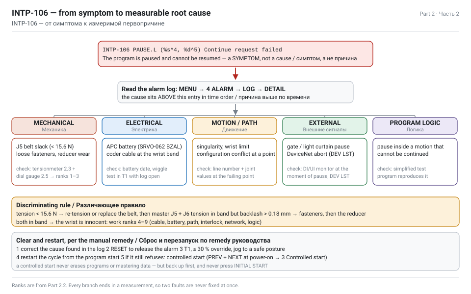

Идите сверху вниз и останавливайтесь на первой ветви, для которой есть подтверждения. В каждой ветви указана проверка, которая её *различает* — измерение, доказывающее или опровергающее её, — поэтому вы никогда не чините два узла сразу.

| Ранг | Кандидат в причины | Подтверждения | Различающая проверка | Устранение |
|---|---|---|---|---|
| 1 | **Ослабление ремня J5** → люфт → рассогласование позиции при приостановленном движении | Видимая игра в кисти; нет записи о проверке ремней 6 месяцев; авария на движениях с паузой посреди траектории | Измерить натяжение ремня J5 (2.3) и люфт J5 (2.5) | Натянуть до 15,6–20,6 Н либо заменить ремень, затем **мастерить J5 и J6** |
| 2 | Ослабленный крепёж кисти или посадки мотора | Люфт пропадает, если держать руку; блестящие следы вокруг болта | Проверка момента крышки, болтов мотора и редуктора | Затянуть по норме с LOCTITE 243/263 |
| 3 | **Износ редуктора J5** (гармонический) | Люфт остаётся при правильном натяжении; смазка с металлическими частицами; шум | Люфт > 0,18 мм при верном натяжении; осмотр смазки | Заменить редуктор, заново смазать, выждать ≥ 1 ч, мастерить J5 |
| 4 | Повреждённый или ослабленный кабель мотора/кодера | Прерывистые аварии, связанные с положением руки; потёртая оболочка на изгибе кисти | Тест на шевеление в T1 с открытым журналом; осмотр кабеля раз в 4 года по регламенту | Заменить кабель механического блока |
| 5 | Слабая батарея APC → SRVO-062 BZAL → потеря мастерения | Батарея старше 1 года (встроенные элементы C) или 1,5 года (внешние D); авария после периода без питания | Проверить напряжение/возраст батареи, наличие BZAL в журнале | Заменить **при включённом питании** (часть 3.5) |
| 6 | Сингулярность или предел кисти в обученной траектории | Авария всегда на одном номере строки; J5 около 0° или около ±125° | Прочитать номер строки, посмотреть значения осей в этой точке | Добавить промежуточную точку или изменить конфигурацию |
| 7 | Внешняя пауза: калитка, светозанавес, сигнал останова сверху | INTP-106 без предшествующей аварии привода; коррелирует с движением людей | Отследить сигналы DI/UI в момент паузы | Настроить блокировку или датчик |
| 8 | Обрыв DeviceNet / сети | обмен ячейки по DeviceNet; OFF или ERROR на экране DEV LST | Статус DEV LST, скорость, дубли MAC ID | Починить сеть |
| 9 | Пауза логики программы, которую нельзя продолжить (например, пауза внутри утверждения движения с неподдерживаемым continue) | Всегда та же программа, та же строка, аппаратного отказа нет | Тест на упрощённой программе | Перестроить программу |

> TIP — Ранги 1 и 3 снаружи выглядят одинаково: оба дают игру в кисти. Разделяет их только показание натяжения. Измерьте ремень **первым**: это 25 минут и ноль затрат, а замена редуктора — день работы и мастерение всей оси.

**Единственная проверка, которая решает всё**

```text
ЕСЛИ  натяжение ремня J5 < 15,6 Н        → натянуть / заменить ремень → мастерить J5+J6 → перепроверить
ИНАЧЕ ЕСЛИ натяжение в диапазоне 15,6 … 20,6 Н
     И люфт ≤ 0,18 мм на 180 мм          → кисть исправна; идите к рангам 4–9
     И люфт > 0,18 мм                    → редуктор или крепёж; проверка момента, затем редуктор
ИНАЧЕ (натяжение > 20,6 Н)               → перетянут; нагрузка на подшипники и мотор; ослабить
```

## 2.3 Проверка натяжения ремня J5 тензометром — подготовка

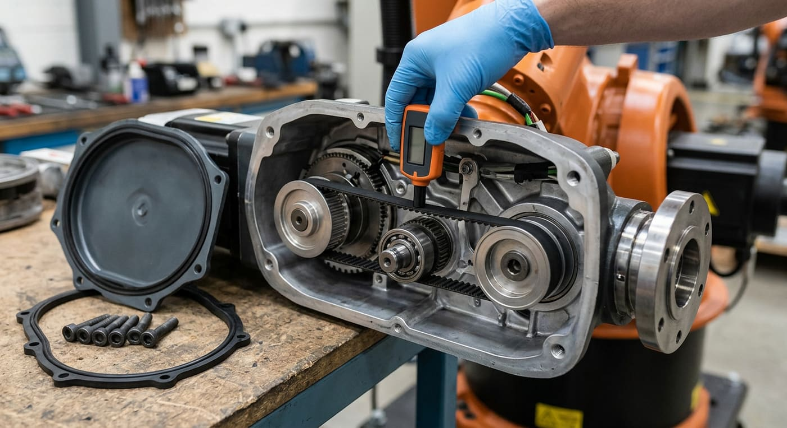

В LR Mate 200iD/7L кисть приводится зубчатыми ремнями. Руководство по обслуживанию предписывает **бесконтактный тензометр вибрационного типа** и приводит точные параметры для каждой оси. Не «щипайте на слух»: недотянутый ремень проскальзывает и теряет позицию, перетянутый нагружает подшипники мотора и редуктор и выходит из строя рано.

**Прибор**

| Позиция | Значение |
|---|---|
| Номер FANUC | **A97L-0218-0700** |
| Марка / модель | Mitsuboshi **DOCTOR TENSION TYPE-III** |
| Принцип | возбуждает свободную ветвь ремня, измеряет её резонансную частоту и пересчитывает в натяжение по массе ремня на единицу длины и длине ветви |
| Контакт с ремнём | отсутствует — головка датчика/микрофон располагается рядом с ветвью |

**Целевые значения из руководства по обслуживанию (§6.1 регулировка натяжения ремня)**

| Ось | Натяжение (Н) | Масса ремня (кг/м) | Ширина ремня (мм) | Длина ветви (мм) |
|---|---|---|---|---|
| J1 | 49–65 (длинная рука 7L) / 30–40 (стандарт) | 0,0367 | 6 | 167,5 |
| J2 | 49–65 (длинная рука 7L) / 30–40 (стандарт) | 0,0290 | 6 | 167,5 |
| J3 | см. руководство для вашей модификации | — | — | — |
| **J5** | **15,6–20,6** | **0,02083** | **4** | **187** |
| J6 | 15,6–20,6 | 0,02083 | 4 | 116 |

Номер ремня для J5/J6: **A98L-0040-0286#004-157**.

> NOTE — Руководство прямо говорит, что натяжение **медленно снижается в процессе работы, и это нормально**. Показание у нижней границы двухлетнего робота — не отказ. Отказ — это показание *ниже* диапазона либо падение с прошлой проверки.

**Перекрёстная проверка чисел (стоит показать в отчёте)**

Физика прибора: `T = 4 · m · L² · f²`, где *m* — масса ремня на единицу длины, *L* — длина ветви. Отсюда резонансная частота, которую должен видеть прибор: `f = √(T / (4 m L²))`. Подставим собственные значения FANUC для J5:

| Ось | Ветвь | f на нижней границе | f на верхней границе |
|---|---|---|---|
| J5 | 187 мм | 73 Гц (15,6 Н) | 84 Гц (20,6 Н) |
| J6 | 116 мм | 118 Гц (15,6 Н) | 136 Гц (20,6 Н) |
| J1 (7L) | 167,5 мм | 109 Гц (49 Н) | 126 Гц (65 Н) |
| J2 (7L) | 167,5 мм | 123 Гц (49 Н) | 141 Гц (65 Н) |

Эти частоты выведены, а не процитированы из руководства, но они попадают ровно в рабочий диапазон вибрационного тензометра, что подтверждает правильность интерпретации параметров. Если прибор показывает 400 Гц на J5 — ошиблись вы во входных данных, а не ремень.

**Безопасность перед любым касанием**

1. **Остановите ячейку.** Программа на паузе, цикл завершён, в захвате нет продукта.
2. **Заблокируйте и повесьте бирку** на главный разъединитель. Натяжение измеряют при **выключенном** питании; процедура регулировки в руководстве предполагает перемещение руки вручную.
3. **Механически подоприте руку** до снятия любого тормоза. Кисть лёгкая, а ось J2 или J3 — нет: если для позы придётся снять тормоза, рука упадёт. Правило из руководства: никогда не снимайте тормоз, механически не подперев ось.
4. Дайте машине остыть; корпуса редуктора и мотора в производстве горячие.
5. Работайте в перчатках. Пыль от ремня и старая смазка неприятны, а кромки крышки острые.
6. Откройте бланк записи до начала работы (скачать: [belt-tension-record.csv](assets/dl/belt-tension-record.csv)) — измерение, которое никто не записал, не состоялось. Именно так и началась эта задача.

> DANGER — Никогда не снимайте внешнюю батарею APC робота при **выключенном** питании и не открывайте батарейный отсек контроллера во время этой работы. Это приводит к потере данных мастерения и аварии SRVO-062 BZAL, превращая 25-минутную проверку натяжения в полудня мастерения. Части 4 и 5 существуют потому, что кто-то сделал ровно это.

## 2.4 Последовательность измерения, шаг за шагом

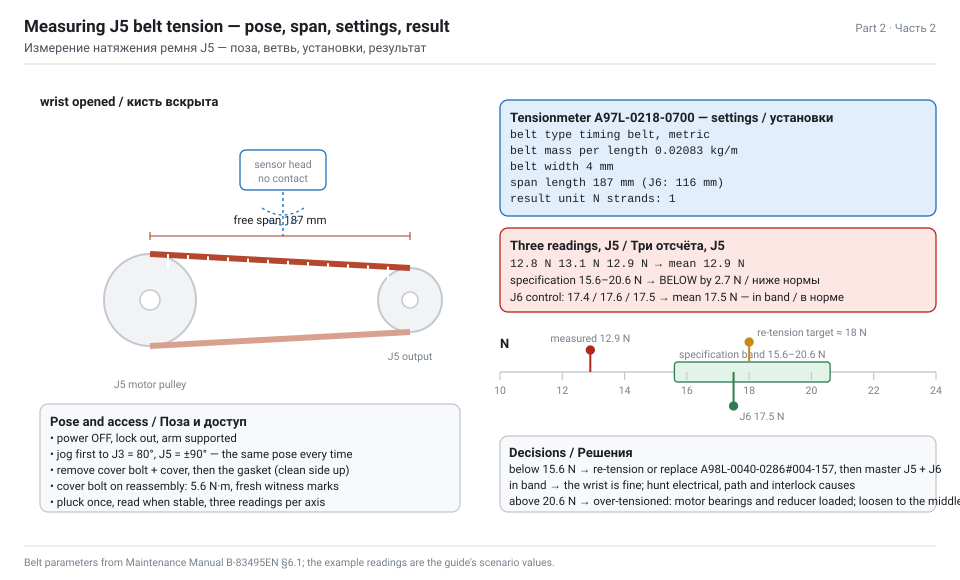

Следуйте последовательности §6.1 руководства по обслуживанию. Общее время: около 25 минут на J5 и J6 вместе.

**A. Приведите руку в позу измерения**

1. При включённом питании, в **T1**, переопределение ≤ 10 %, держите deadman, наведите на позу осмотра из руководства: **J3 = 80°, J5 = ±90°**.
2. Запишите позу в бланк. Все отсчёты делаются в одной и той же позе, иначе длина ветви меняется и числа несопоставимы.
3. Питание **ВЫКЛ**, блокировка.

**B. Откройте кисть**

4. Снимите крепёжный болт и **крышку руки** на кисти. Болты складывайте в лоток — они разной длины.
5. Снимите **прокладку** и отложите чистой стороной вверх. Она вернётся на место; отсутствующая прокладка — это путь пыли и кирпичного абразива в редуктор.
6. Запомните момент затяжки болта крышки для сборки: **5,6 Н·м**.

**C. Настройте тензометр**

7. Включите прибор и задайте параметры ровно так, как их даёт руководство:

| Установка | J5 | J6 |
|---|---|---|
| Тип ремня / единицы | зубчатый ремень, метрические | зубчатый ремень, метрические |
| **Масса ремня на единицу длины** | **0,02083 кг/м** | **0,02083 кг/м** |
| **Ширина ремня** | **4 мм** | **4 мм** |
| **Длина ветви** | **187 мм** | **116 мм** |
| Единица результата | Н | Н |
| Число ветвей ремня | 1 | 1 |

8. Обнулите / откалибруйте прибор в тихом месте, вдали от ремня. Кирпичный завод шумен — снимайте показание во время останова линии, а не при работающих вентиляторах печи.

**D. Измерьте**

9. Расположите головку датчика рядом со **свободной ветвью** ремня J5 — прямым участком между двумя шкивами, те самые 187 мм, — не касаясь ремня.
10. Один раз щипните ремень пальцем (либо используйте возбуждение прибора) и считайте натяжение, когда значение стабилизируется.
11. Сделайте **три отсчёта** и запишите все три плюс среднее. Разброс хуже ±0,5 Н означает, что неверно введены длина ветви или масса.
12. Повторите шаги 9–11 для **J6** (ветвь 116 мм) — руководство предписывает регулировать оба в одном вскрытии, а замена ремня J5 всегда требует повторного мастерения **J5 и J6**.
13. Пока крышка снята, выполните бесплатные визуальные проверки:

| Проверка | Как выглядит плохой признак |
|---|---|
| Зубья ремня | засаливание, отсутствие зубьев, трещины у основания зуба, торчащие волокна |
| Боковины ремня | бахрома, неравномерный износ (признак перекоса шкивов) |
| Шкивы | мусор в зубьях, ржавчина, блестящая полоса там, где ремень проскальзывал |
| Контрольные метки на болтах | метки сорваны или повёрнуты → крепёж сдвинулся |
| Смазка вокруг редуктора | серая или чёрная смазка, металлическая пудра → износ редуктора |
| Кабель на изгибе кисти | потёртая оболочка, треснувший ввод |

**E. Отрегулируйте, если показание вне диапазона**

14. Ослабьте **болты регулировки натяжения** на посадке мотора.
15. Перемещайте мотор, меняя натяжение, — небольшими поворотами. Перемеряйте после каждой регулировки; ремню нужно время улечься.
16. Цельтесь в **середину** диапазона (около 18 Н для J5/J6), а не в край: это даст наибольший интервал до следующей проверки, которая снова найдёт его низким.
17. Затяните регулировочные болты, перемерьте ещё раз (затяжка чуть меняет натяжение), затем верните на место **прокладку**, **крышку** и болт с моментом **5,6 Н·м**.
18. Нанесите фиксатор резьбы на крепёж из перечня руководства (LOCTITE 243 для обычных болтов, 263 для высокопрочных) и поставьте новые контрольные метки красным маркером.

**F. После любых работ с ремнём**

19. Снятие или замена ремня разрушает связь между мотором и суставом, поэтому ось надо заново отмастерить:
   - только натянули ремень → проверьте позицию мастерения; если руку двигали вручную со снятыми тормозами — мастерите заново.
   - ремень заменён, мотор или редуктор снимались → **обязательно мастерение одной оси**. Для **J5 мастерить надо J5 *и* J6**.
20. Полная процедура — в части 4.4.
21. Включите питание, подвигайте в T1 на низком переопределении, убедитесь, что кисть держит позицию при попытке сдвинуть её рукой (она не должна двигаться вовсе), и прогоните медленный тестовый цикл перед возвратом ячейки в производство.
22. **Внесите запись в журнал обслуживания.** Дата, наработка, поза, три отсчёта, среднее, выполненное действие, кто делал. Это тот самый шаг, отсутствие которого и породило задание.

> TIP — Сфотографируйте контрольные метки и дисплей прибора с видимым показанием. Две фотографии в отчёте стоят больше таблицы чисел, которые никто не может проследить.

## 2.5 Измерение люфта J5 (обратного хода)

«Видимый люфт» — не измерение. Руководство по обслуживанию даёт пределы для каждой оси, измеренные **индикатором часового типа (1/100 мм)** на определённом расстоянии от оси вращения, и для кисти это маленькое число.

**Таблица 3.3(b) — пределы обратного хода, LR Mate 200iD (в скобках значения для длиннорукой 7L)**

| Ось | Расстояние от оси до точки измерения (мм) | Максимальный люфт (мм) |
|---|---|---|
| J1 | 715 (910 для 7L) | 0,41 (0,52 для 7L) |
| J2 | 330 (440 для 7L) | 0,19 (0,25 для 7L) |
| J3 | 335 (420 для 7L) | 0,20 (0,25 для 7L) |
| J4 | 100 | 0,16 |
| **J5** | **180** | **0,18** |
| J6 | 100 | 0,15 |

**Как измерить**

1. Питание ВЫКЛ, блокировка, и **механически подоприте руку**, если собираетесь снимать тормоза; иначе оставьте тормоза включёнными и измеряйте только то, что измеримо с ними.
2. Закрепите индикатор на магнитной стойке на неподвижной жёсткой части (тумба или корпус руки выше по потоку от J5). Обнулите индикатор.
3. Поставьте ножку индикатора в точку измерения на **180 мм от оси J5**, перпендикулярно направлению движения.
4. Приложите лёгкое постоянное усилие в одну сторону и запишите показание. Медленно поменяйте направление усилия и отметьте, какой путь проходит ножка, прежде чем сустав действительно сдвинется. Этот ход и есть обратный люфт.
5. Повторите трижды в обоих направлениях. В отчёт идёт **максимум**.
6. Для сравнения сделайте то же на J6 (100 мм, предел 0,15 мм) и, если дотянетесь, на J4.

**Интерпретация результата**

| Измерено на 180 мм | Вердикт | Действие |
|---|---|---|
| ≤ 0,18 мм | в норме | записать, действий не требуется |
| 0,18–0,40 мм | вне нормы, умеренно | сначала крепёж и натяжение ремня (2.6), перемерить |
| > 0,40 мм либо видно глазом | далеко вне нормы | считать отказом: ремень, редуктор или ослабленная посадка мотора |
| люфт исчезает при правильном натяжении ремня | причина — ремень | натянуть/заменить, мастерить J5+J6 |
| люфт остаётся при верном натяжении | редуктор или крепёж | проверка момента, затем замена редуктора |

> NOTE — Переведите число в то, что почувствует читатель отчёта. 0,18 мм на 180 мм от оси — это около **0,057°** угловой игры. Спецификация повторяемости робота — **±0,01 мм**, то есть кисть на пределе люфта имеет примерно **шестикратный** запас против точности всей машины, и находится она на конце руки вылетом 911 мм, где каждая доля градуса ошибки кисти превращается в миллиметры на кирпиче. Поэтому кирпич восьмого слоя встаёт мимо схемы, а первый слой выглядит нормально.

**Почему люфт даёт аварии, а не только плохую укладку**

Ослабленный ремень означает, что мотор крутится, а сустав — нет. Импульсный кодер сидит на **моторе**, поэтому контроллер считает, что сустав там, где его видит мотор. При резком замедлении, приостановленном движении или реверсе сустав отстаёт, догоняет или перескакивает — и рассогласование между заданным и фактическим положением поднимает аварии уровня привода (классика — SRVO-038, рассогласование импульсов). Интерпретатор при этом держит программу на паузе посреди движения, которое он больше не может гарантировать, — и отклоняет запрос на продолжение. **INTP-106.**

## 2.6 План действий по люфту J5

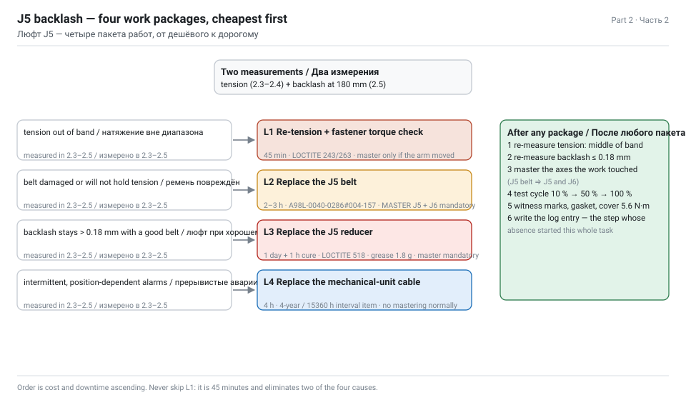

Задание требует план действий, покрывающий три вещи: **проверку крепежа**, **замену ремня** и **замену редуктора**. Выполняйте их в этом порядке — он же порядок возрастания стоимости и простоя.

**Уровень 1 — крепёж и натяжение (≈ 45 мин, без запчастей, без мастерения, если руку не двигали)**

| № | Действие | Норма |
|---|---|---|
| 1 | Блокировка, подпор руки, вскрытие крышки кисти | момент болта крышки при сборке 5,6 Н·м |
| 2 | Осмотр контрольных меток на болтах посадки мотора, редуктора и крышки | сорванные/повёрнутые метки = крепёж сдвинулся |
| 3 | Контроль момента каждого болта из перечня калиброванным ключом | затягивать по значениям руководства, в указанной последовательности |
| 4 | Нанести фиксатор резьбы там, где требует руководство | LOCTITE **243** средней прочности для обычных болтов; **263** для высокопрочных; **518** как фланцевый герметик на стыки; **638** для вал-втулочных соединений |
| 5 | Измерить натяжение ремня и привести к середине диапазона | J5 и J6: 15,6–20,6 Н, цель ≈ 18 Н |
| 6 | Перемерить люфт на 180 мм | принимать только при ≤ 0,18 мм |
| 7 | Поставить новые контрольные метки, вернуть прокладку и крышку, закрыть запись | |

**Уровень 2 — замена ремня (≈ 2–3 ч, деталь A98L-0040-0286#004-157, мастерение J5 + J6 обязательно)**

Основание: натяжение не приводится в диапазон, у ремня отсутствуют/треснули/засалены зубья, боковины разлохмачены, либо на шкиве видна полированная полоса проскальзывания.

1. Подоприте руку, снимите крышку и прокладку.
2. Ослабьте болты регулировки натяжения и сдвиньте мотор, освобождая ремень.
3. Снимите старый ремень; **сравните его с новым** по числу зубьев и ширине до установки (неправильный ремень убивает тихо).
4. Очистите шкивы; проверьте их на повреждение зубьев и биение.
5. Установите новый ремень, натяните до середины диапазона, затяните регулировочные болты, перемерьте.
6. Верните прокладку, крышку, болт 5,6 Н·м, фиксатор резьбы и контрольные метки.
7. **Мастерите J5 и J6** (часть 4.4). Снятие ремня разрушает связь мотор-сустав для обеих осей, идущих через эту кисть.
8. Тестовый цикл на 10 % переопределения, затем 50 %, затем рабочая скорость.

**Уровень 3 — замена редуктора (≈ 1 день + выдержка, мастерение обязательно, спецоснастка)**

Основание: люфт больше 0,18 мм при правильно натянутом новом ремне; посторонний шум; смазка с металлическими частицами; либо редуктор выработал ресурс.

| № | Действие | Примечания |
|---|---|---|
| 1 | Заказать правильный редуктор для модификации **7L** | кисть длиннорукой версии отличается от стандартной; сверяйте по серийному номеру |
| 2 | Слить/собрать старую смазку и осмотреть её | металлическая пудра подтверждает диагноз — сфотографируйте для рекламации |
| 3 | Снять ремень, мотор и редуктор | съёмник, сепаратор, съёмник стопорных колец по перечню инструмента руководства |
| 4 | Очистить корпус, осмотреть стыки | без вмятин и остатков старого герметика |
| 5 | Установить новый редуктор с **LOCTITE 518** на фланец | руководство предписывает его для посадки редуктора |
| 6 | Вернуть мотор, ремень, натянуть, затянуть всё по моментам | |
| 7 | **Выждать не менее 1 часа** до пуска | герметик должен схватиться — руководство формулирует это прямо |
| 8 | Заново смазать в регламентном объёме | J5 и J6: по **1,8 г (2 мл)**; смазка A98L-0040-0230, комплект A05B-1142-K021, ход поршня 2,5 мм = 1 мл |
| 9 | Отмастерить ось, затем обкатка | сначала медленные циклы, перемерить люфт после 1 ч работы |
| 10 | Записать всё, включая состояние старой детали | это ваши доказательства для рекламации в части 5 |

> WARNING — Никогда не применяйте в этих редукторах смазку **Harmonic Drive SK-3**, хотя это то же семейство: руководство предписывает **4B No.2 (A98L-0040-0230)**. Никогда не превышайте регламентное количество смазки: избыток создаёт давление, выдавливает уплотнения и порождает течь, которую то же руководство велит проверять. Если после смазки давление внутри выросло — стравите его через отверстие подачи смазки.

**Уровень 4 — кабель и кодер (только если уровни 1–3 ничего не объяснили)**

Замените кабель механического блока (руководство ставит его на интервал 4 года / 15360 ч), осмотрите разъём кодера и перепроверьте. Кабельные отказы дают *прерывистые* аварии, связанные с положением руки, а не постоянный люфт — по этому их и отличают.

**План, который вы сдаёте**

| Уровень | Основание | Время | Запчасти | Мастерение |
|---|---|---|---|---|
| 1 | первая попытка, всегда | 45 мин | только LOCTITE | только если руку двигали со снятыми тормозами |
| 2 | натяжение вне диапазона или ремень повреждён | 2–3 ч | ремень A98L-0040-0286#004-157 | **J5 + J6, обязательно** |
| 3 | люфт сохраняется при исправном ремне | 1 день + 1 ч выдержки | редуктор, комплект смазки | **обязательно** |
| 4 | прерывистые аварии, зависящие от положения | 4 ч | кабель механического блока | обычно не требуется |

## 2.7 Первопричина: отсутствующая запись в журнале

Хороший отчёт о диагностике разделяет **техническую причину** (ослабленный ремень) и **организационную** (никто не проверял). Устранение только первой гарантирует повтор через полгода.

| Вопрос | Ответ для этой задачи |
|---|---|
| Что отказало? | Зубчатый ремень кисти J5 потерял натяжение ниже 15,6 Н, создав люфт выше предела 0,18 мм |
| Почему отказало? | Натяжение медленно снижается в нормальной эксплуатации, и его никто не восстанавливал |
| Почему никто не заметил? | Квартальная проверка состояния ремней не выполнялась минимум два цикла — 6 месяцев без записей в журнале |
| Почему проверка не выполнялась? | Не было планового задания, чек-листа в ячейке и ответственного |
| Корректирующее действие? | Натянуть/заменить + мастерить (техническое) **и** ввести программу ППР на 6 месяцев с подписываемыми чек-листами (организационное) — часть 3 |
| Предупреждающее действие? | Натяжение ремня становится *записываемой и анализируемой* величиной; порог 16,5 Н запускает работу до достижения предела |

**Как должен выглядеть тренд, когда вы начнёте записывать**

| Проверка | Наработка, ч | Натяжение J5, Н | Действие |
|---|---|---|---|
| База (после ремонта) | 0 | 18,1 | записать |
| +3 месяца | 960 | 17,6 | нет — нормальная медленная потеря |
| +6 месяцев | 1920 | 17,1 | нет |
| +9 месяцев | 2880 | 16,6 | следить — подходим к порогу |
| +12 месяцев | 3840 | 16,0 | натянуть до 18 Н, пока не дошли до 15,6 |

Формулировка самого руководства — натяжение медленно снижается в процессе работы, и это нормально — превращается в программу обслуживания только тогда, когда кто-то записывает числа. Эта таблица и есть разница между «робот сломался» и «робот обслуживался».

> TIP — Пишите в чек-листе пороговое значение, а не только предел: *«Натяжение ремня J5 должно быть 15,6–20,6 Н; при ≤ 16,5 Н открыть заявку на работу»*. Предел сообщает, что вы уже отказали; порог сообщает, когда действовать.

## 2.8 Проверка после ремонта

Не возвращайте ячейку в производство на основании одного хорошего показания натяжения. Проверьте в четыре этапа и запишите каждый.

| Этап | Проверка | Критерий приёмки |
|---|---|---|
| 1 · Статика | Попробуйте сдвинуть кисть рукой в точке измерения | ощутимого движения нет; индикатор ≤ 0,18 мм на 180 мм |
| 2 · Холостое движение | T1, переопределение 10 %, прокрутите J5 трижды через весь диапазон ±125° и обратно | плавно, без шума и аварий, без дрейфа отображаемого положения при возврате к метке |
| 3 · Точность | Наведите в фиксированную точку, отметьте, отведите и верните трижды | возврат в ту же точку в пределах повторяемости (±0,01 мм) |
| 4 · Производство | Прогоните цикл паллетирования на одну полную паллету при 50 %, затем 100 % | все 192 кирпича встали по схеме, ноль INTP-106, ноль аварий привода |

**Затем — в симуляции**: воспроизведите всю историю, чтобы отчёт не был только текстом. В макете Visual Components из части 1 добавьте смещение положения J5 на 0,3° внутри подпрограммы укладки и посмотрите, как слои 5–8 уезжают со схемы; затем поставьте смещение 0 и посмотрите, как оно исчезает. Экспортируйте оба прогона как видео и статистику. Рецензент, увидевший увод, не сможет спорить с вашим диагнозом.

**И наконец — бумаги**

1. Запись в журнале обслуживания: дата, наработка, что измерено, что заменено, кто делал, дата следующей проверки.
2. Приложите бланк измерения натяжения ([скачать](assets/dl/belt-tension-record.csv)) и показания люфта.
3. Если ремень или редуктор отказали в гарантийный период → акт-рекламация из части 5.2 с фотографиями старой детали.
4. Обновите график ППР из части 3 новыми датами «следующая проверка», считая их от сегодняшнего дня, а не от прошлой (отсутствующей) проверки.

---

# Part 3 — ППР: программа обслуживания на 6 месяцев

_Раздел 2 задания. Ежедневные осмотры, квартальные проверки момента и ремней, замена батареи при включённом питании, смазка, резервные копии и подписываемый журнал._

## 3.0 Программа одним взглядом

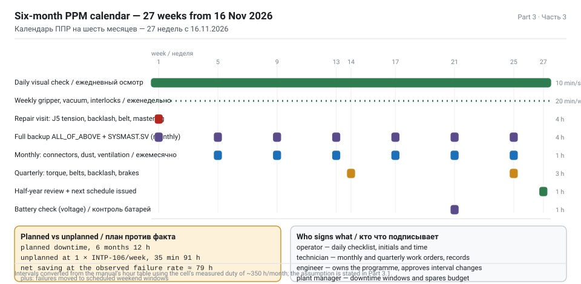

Планово-предупредительный ремонт (ППР) для этой ячейки построен по собственной таблице периодических осмотров FANUC, пересчитанной из часов наработки в календарные даты и разделённой между тем, что делает **оператор** каждую смену, и тем, что делает **техник** каждый квартал.

| Периодичность | Ответственный | Длительность | Простой | Содержание |
|---|---|---|---|---|
| Каждая смена (ежедневно) | оператор | 10 мин | нет — до пуска | визуальный осмотр, кабели, чистота, разбор аварий |
| Еженедельно | оператор + наладчик | 20 мин | нет | присоски захвата, вакуум, ограждение и блокировки, маяк |
| Ежемесячно (320 ч) | техник | 1 ч | 1 ч плановый | ослабление разъёмов, удаление пыли, вентиляция, осмотр на течь смазки |
| Ежеквартально (960 ч) | техник | 3 ч | 3 ч плановый | **момент затяжки болтов**, **состояние и натяжение ремней**, люфт, проверка тормозов |
| Полугодие (1920 ч) | техник + инженер | 4 ч | 4 ч плановый | всё вышеперечисленное + проверка напряжения батарей, контроль резервных копий, тренд времени цикла |
| Ежегодно (3840 ч) | техник с допуском FANUC | 8 ч | смена | замена батарей, полный осмотр, проверка точности |
| 1,5 года (5760 ч) | специалист | 8 ч | смена | по периодической таблице руководства |
| 2 года (7680 ч) | специалист | 8 ч | смена | по периодической таблице руководства |
| 4 года (15360 ч) | сервис FANUC | 2 дня | 2 смены | **восполнение смазки редукторов + замена кабеля механического блока** — что наступит раньше |

**Допущение, которое делает календарь законным**

Периодическая таблица FANUC написана для машины с наработкой **до 3840 часов в год** (примерно две смены, пять дней). Пересчитайте свой реальный режим, прежде чем копировать даты:

```text
эта ячейка :  6,0 с на кирпич × 600 кирп/ч   →  работа ≈ 8 ч/смена
смены      :  2 в сутки, 5 дней в неделю      →  80 ч/неделю  →  ~4160 ч/год
результат  :  немного выше допущения 3840 ч/год
             → сократить все часовые интервалы примерно на 7 % либо оставить
               календарь и добавить одну квартальную проверку в летний останов
```

> NOTE — Для студенческого отчёта важна вот эта фраза: *«интервалы ниже — календарные даты, выведенные из часовой таблицы FANUC с явно записанным допущением о режиме работы, и допущение записано, чтобы другой производственный график можно было пересчитать»*. Одна эта фраза отличает инженерный график от скопированного.

**Файлы для скачивания**

- [PPM-6-month-schedule.csv](assets/dl/PPM-6-month-schedule.csv) — календарь ниже в виде таблицы
- [daily-checklist.md](assets/dl/daily-checklist.md) — печатный сменный чек-лист
- [quarterly-checklist.md](assets/dl/quarterly-checklist.md) — печатный квартальный чек-лист с полями для момента и натяжения

## 3.1 Как читать таблицу периодических осмотров FANUC

> SOURCE — Operator's Manual LR Mate 200iD B-83494EN, §7.1.2 периодические осмотры; Maintenance Manual B-83495EN, §1 периодические осмотры и приложение C; §7.3.1 батареи; §7.3.2 смазка.

Руководство не даёт календаря. Оно даёт **интервалы в часах наработки** и перечень пунктов осмотра, а пересчёт ожидает от вас. Три вещи надо сделать правильно:

1. **Часовая база.** Таблица исходит из ≤ 3840 ч/год. Ячейка, работающая 24/7, достигает «годовых» пунктов за девять месяцев.
2. **Что наступит раньше.** Ряд пунктов задан как «X часов или Y месяцев, что наступит раньше» — пункт 4 лет по смазке и кабелю сформулирован именно так. Простаивающий робот всё равно требует внимания к кабелю и смазке по календарному времени.
3. **Откуда брать часы.** Считывайте их с контроллера, не оценивайте на глаз:
   - <kbd>MENU</kbd> → **0 NEXT** → **6 SYSTEM** → <kbd>F1 [TYPE]</kbd> → **Variables** — счётчики времени работы, либо
   - <kbd>MENU</kbd> → **STATUS** — индикация наработки, либо
   - <kbd>MENU</kbd> → **0 NEXT** → **6 SYSTEM** → экран времени работы привода (название зависит от версии ПО).

| Интервал | Наработка (≤3840 ч/год) | Календарный эквивалент при 80 ч/нед | Пункты |
|---|---|---|---|
| 1 месяц | 320 ч | 4 недели | ослабление разъёмов, удаление пыли и брызг, фильтр вентиляции |
| 3 месяца | 960 ч | 12 недель | **момент затяжки болтов**, **состояние/натяжение ремней**, люфт, проверка на течь смазки, кабель захвата и внешней батареи |
| 1 год | 3840 ч | 48 недель | замена батарей, полный осмотр, проверка тормозов и точности |
| 1,5 года | 5760 ч | 72 недели | по таблице руководства для вашего режима |
| 2 года | 7680 ч | 96 недель | по таблице руководства |
| 4 года | 15360 ч | 192 недели | восполнение смазки редукторов, замена кабеля механического блока |

> WARNING — Пункт «4 года» пропускают чаще всего, потому что робот по-прежнему работает отлично. Смазка деградирует, а изоляция кабеля устанет в местах изгиба задолго до появления симптома. Когда симптом появится, он появится как остановленная линия в самую загруженную неделю года. Поставьте дату в календарь сейчас.

**Как фиксировать наработку, чтобы график оставался честным**

Считывайте наработку контроллера в начале каждого месяца и вносите в журнал. Разность — это фактическая нагрузка месяца, а сумма говорит, когда наступает каждый интервал, без угадываний.

| Месяц | Наработка контроллера, ч | Дельта, ч | Накоплено с последней квартальной проверки | Пора? |
|---|---|---|---|---|
| ноя 2026 | 12 480 | — | 0 | — |
| дек 2026 | 12 830 | 350 | 350 | нет |
| янв 2027 | 13 150 | 320 | 670 | нет |
| фев 2027 | 13 500 | 350 | 1020 | **да — квартальная проверка** |

## 3.2 Ежедневный визуальный осмотр (оператор, 10 мин, до пуска)

Ежедневная проверка — самая дешёвая страховка во всей программе и именно то, что названо в задании: **кабели** и **очистка от пыли**. Её должен уметь сделать оператор, за 10 минут, без инструмента, до начала смены.

**A. До включения питания (обход, 4 мин)**

| № | Проверка | На что смотреть | Если плохо |
|---|---|---|---|
| 1 | Пол вокруг ячейки | кирпичная пыль, гранулы, обломки, пролитая смазка | подмести/пропылесосить — пыль в вентиляции редуктора убивает кисть |
| 2 | Укладка кабелей робота | кабели не касаются ограждения, не лежат на конвейере, нет перегибов на изгибе кисти | переукложить, добавить клипсу |
| 3 | Оболочки кабелей | порезы, потёртости, треснувшие вводы, ремонт скотчем | остановить, повесить бирку, вызвать техника |
| 4 | Разъёмы | вставлены, зафиксированы, без коррозии, все пылезащитные колпачки на месте | перестыковать, заменить колпачок |
| 5 | Захват | присоски целые, без разрывов и засаливания, в эжекторе нет кирпичной пыли | очистить или заменить присоску |
| 6 | Ограждение, калитка, светозанавес | у ограждения ничего не складировано, линзы чистые, калитка закрывается и фиксируется | освободить, протереть линзы |
| 7 | Аварийные кнопки | не нажаты, не заблокированы, красный гриб виден | сбрасывать только выяснив причину |
| 8 | Шкаф контроллера | вентиляционные щели не закрыты, вентилятор работает тихо, нет пылевого одеяла | очистить сжатым воздухом низкого давления с безопасного расстояния |
| 9 | Позиция паллеты | нет обломков паллет и стрепп-ленты на пути робота | убрать |
| 10 | Маяк и звуковой сигнал | линза чистая | протереть |

**B. После включения питания (2 мин)**

| № | Проверка | Критерий |
|---|---|---|
| 11 | Нет аварий на пульте | список аварий пуст; запишите всё, что появилось за ночь |
| 12 | Семисегментный индикатор контроллера | нормальная рабочая индикация, а не «1» |
| 13 | Предупреждения о батареях | нет SYST-035 (низкий заряд батареи контроллера) и нет SRVO-062 BZAL (батарея кодера) |
| 14 | Тест перемещений в T1 при 10 % | все шесть осей идут плавно в обе стороны, без шума и вибрации в кисти |
| 15 | Домашняя позиция | рука возвращается в обученный home, а не в заметно другую позу |

**C. В течение смены (взгляд-контроль)**

- Слушайте: кисть, которая начала пищать или пощёлкивать, сообщает вам об этом за недели до отказа.
- Смотрите на укладку: если 6-й слой начал вставать со смещением на 2 мм — это растущий люфт; измерьте его (часть 2.5) вместо «подстройки программы».
- Считайте остановки: каждый INTP-106 получает отметку в сменном листе с временем. Десять отметок за неделю — это заявка на работу, а не мелкая неприятность.

> TIP — Заламинируйте чек-лист и повесьте на калитку ограждения с маркером для сухой доски. Чек-лист, живущий в папке в кабинете механика, не выполняется; чек-лист на калитке — выполняется. Скачать: [daily-checklist.md](assets/dl/daily-checklist.md).

**Пыль на кирпичном заводе — реальная опасность, а не косметика**

| Куда попадает пыль | Что она делает |
|---|---|
| Вентиляционные щели контроллера | теплоизолирующее одеяло → перегрев → снижение нагрузки и случайные сбои |
| Зона ремня и шкивов кисти | абразивная паста вместе со смазкой → ускоренный износ ремня и подшипников |
| Линзы светозанавеса | ложные остановки либо, что хуже, луч, который перестал обнаруживать |
| Присоски и эжектор | потеря удерживающей силы → падение кирпичей |
| Блокировка калитки | прерывистый контакт → случайные остановки ячейки, похожие на INTP-106 |

Способ очистки: сухой воздух низкого давления или пылесос — **никогда** мокрая тряпка на электрических частях и никогда воздух, задутый *внутрь* разъёма или вентиляции редуктора.

## 3.3 Квартальные проверки: момент затяжки и состояние ремней

Три часа планового простоя четыре раза в год предотвращают почти всё из этой задачи. Два названных в задании пункта — **момент затяжки болтов** и **состояние ремней**.

**A. Проверка момента затяжки (≈ 60 мин)**

1. Заблокируйте питание, подоприте руку там, где ничего не снимаете, приготовьте калиброванный динамометрический ключ и значения моментов из руководства для вашей модификации.
2. Пройдите по списку и **помечайте каждый проверенный болт** красным маркером, чтобы следующий квартал начинался с чистого листа:

| Место | Что проверять | Примечания |
|---|---|---|
| Основание робота к тумбе | 4 болта крепления основания | самый нагруженный сустав; остановка снятием питания даёт до 1657 Н·м вертикального момента |
| Тумба к полу | анкерные болты | ищите трещины в подливке и бетоне |
| Болты крышек рук (все оси) | затяжка и состояние прокладок | крышка кисти 5,6 Н·м |
| Болты крепления мотора (J5) | контрольные метки целы | прямая причина «люфта, который не ремень» |
| Болты крепления редуктора | контрольные метки целы | |
| Болты исполнительного устройства / захвата | затяжка каждый квартал — руководство включает подтяжку болтов конечного устройства в периодические пункты | вакуумная плита, сместившаяся на 1 мм, смещает каждый кирпич на 1 мм |
| Сменщик инструмента, если есть | фиксация и соосность | |
| Крепление ограждения и калитки | затяжка, нет отсутствующих панелей | |
| Крепление шкафа контроллера и кабельные вводы | плотно, герметично | |

3. Болт, который **проворачивается, не доходя до момента**, ослаб: очистите резьбу, нанесите указанный LOCTITE (**243** обычный, **263** высокопрочный), затяните заново и поставьте метку. Болт, уже дошедший до момента, но с повёрнутой меткой, сдвинулся — выясняйте причину (источник вибрации, перегрузка, неверная шайба).
4. Запишите: сколько болтов проверено, сколько подтянуто, у скольких сорваны контрольные метки.

**B. Состояние и натяжение ремней (≈ 60 мин)**

Выполните часть 2.4 целиком, но как *проверку*, а не ремонт:

1. Поза J3 = 80°, J5 = ±90°; питание ВЫКЛ; вскройте кисть.
2. Измерьте натяжение J5 и J6 по три раза; запишите среднее.
3. Сравните с показанием прошлого квартала — **тренд важнее абсолютного значения**.
4. Осмотрите зубья, боковины, шкивы и свободную ветвь на трещины и засаливание.
5. Проверьте остальные доступные оси (J1/J2: 49–65 Н для 7L).
6. Перемерьте люфт индикатором на 180 мм (J5) и 100 мм (J6).
7. Соберите: прокладка, крышка, 5,6 Н·м, новые контрольные метки.

| Ось | Цель, Н | Порог тревоги, Н | Предел люфта |
|---|---|---|---|
| J1 (7L) | 49–65 | ≤ 51 | 0,52 мм на 910 мм |
| J2 (7L) | 49–65 | ≤ 51 | 0,25 мм на 440 мм |
| J5 | 15,6–20,6 | ≤ 16,5 | 0,18 мм на 180 мм |
| J6 | 15,6–20,6 | ≤ 16,5 | 0,15 мм на 100 мм |

**C. Остальное за квартальный визит (≈ 60 мин)**

| Пункт | Метод |
|---|---|
| Проверка на течь смазки | протрите корпуса редукторов, запустите ячейку, перепроверьте на следующий день; если течь вернулась, ищите источник. Если после смазки внутри выросло давление — стравите его через отверстие подачи |
| Состояние смазки | цвет и частицы у вентиляции; серая/чёрная или с металлом = износ редуктора |
| Механические упоры | на месте, не деформированы, болты затянуты |
| Проверка тормозов | в T1 при включённом питании снимайте тормоз по одной оси (рука подперта!) и проверяйте удержание; кисть не должна уплывать |
| Напряжение батарей | батарея контроллера 3,1–3,3 В — здорова; ниже планируйте замену |
| Контроль резервных копий | восстановите последнюю копию на тестовом контроллере либо проверьте целостность и дату файлов |
| Тренд времени цикла | сравните текущее время цикла паллеты с пусконаладочным — ползущее время цикла есть ранний люфт |
| Пульт и кабели | экран, клавиши, deadman, аварийный останов, оболочка кабеля у ввода |

Скачать печатную форму: [quarterly-checklist.md](assets/dl/quarterly-checklist.md).

## 3.4 Замена батареи — и правило безопасности, которое путают все

Систем батарей **две**, и правила у них **противоположные**. Их путаница превращает пятнадцатиминутную работу в инцидент с потерей мастерения.

| | Батарея APC в основании робота | Батарея SRAM основной платы контроллера |
|---|---|---|
| Что поддерживает | **абсолютный импульсный кодер** — знание робота о том, где его суставы | **SRAM** — программы, системные переменные, данные мастерения, история аварий |
| Элементы | 4 × **C (LR14) 1,5 В**, встроенный блок | 3 В **литиевый** блок |
| Номер FANUC | встроенный батарейный блок (см. приложение A руководства для вашей модификации) | **A05B-2650-K030** (указывается также A98L-0031-0028) |
| Ресурс | ~**1 год** (встроенный) / ~**1,5 года** (внешний блок D) | ~**4 года** |
| Исправное напряжение | свежие щелочные элементы | **3,1–3,3 В** |
| Авария-предупреждение | **SRVO-062 BZAL** | **SYST-035** (низкое напряжение батареи) |
| Состояние питания при замене | **ВКЛЮЧЕНО** | питание ВКЛ ~30 с, затем **ВЫКЛ**, замена в течение **30 минут** |
| Если сделать неправильно | замена при ВЫКЛ → BZAL → **данные мастерения потеряны** | батарея села и питание перещёлкнули → контроллер не стартует, на индикаторе «1», **содержимое SRAM потеряно** |

> DANGER — **Батарею APC робота меняют при ВКЛЮЧЁННОМ питании контроллера.** Руководство формулирует это прямо, и задание тоже. При выключенном питании абсолютный импульсный кодер теряет отсчёт в момент отключения батареи, и данные мастерения уничтожаются. Аварийный останов должен быть нажат, а ячейка ограждена, потому что приводы под напряжением.

**Процедура A — батарея APC основания робота (питание ВКЛ)**

1. Сначала резервная копия: часть 3.5. Да, даже для замены батареи.
2. Завершите цикл, поставьте руку в **нулевую позу / позу мастерения**, чтобы при любом исходе быстро отмастерить заново.
3. Нажмите **аварийный останов** на пульте и/или на ячейке. Приводы заблокированы, но контроллер запитан.
4. Отложите пульт в безопасное место, скажите оператору, что делаете, и повесьте на ячейку бирку: «идёт замена батареи — аварийный останов не снимать».
5. Откройте батарейный отсек в основании робота (или внешний батарейный ящик, если ячейка на блоке D).
6. Запомните полярность и ориентацию разъёма. **Сфотографируйте.**
7. Отключите старый блок и подключите новый **за несколько секунд** — не оставляйте кодер без питания. Новый элемент должен быть распакован и лежать в руке *до* отключения старого.
8. Закройте отсек, убедитесь, что разъём зафиксирован.
9. Снимите аварийный останов, проверьте отсутствие **SRVO-062 BZAL** и убедитесь, что положения осей на экране по-прежнему соответствуют физической позе руки (сверьте с контрольными метками).
10. Внесите дату в журнал и на наклейку у батарейного отсека. Следующая замена: **+12 месяцев** (встроенный) или **+18 месяцев** (внешний блок).

**Процедура B — батарея SRAM контроллера**

1. **Резервная копия** программ, системных переменных и файла мастерения (часть 3.5). Это не по желанию: если батарея уже слабая, содержимое SRAM — единственная копия вашей ячейки.
2. Включите контроллер и оставьте примерно на **30 секунд** — SRAM поднимется, а цепь резервного питания подзарядится.
3. Выключите контроллер.
4. **Вся замена должна быть завершена в течение 30 минут** после выключения. Поставьте таймер. Дальше содержимое SRAM не гарантировано.
5. Откройте контроллер, найдите батарейный блок — он зафиксирован защёлкой в **нижней правой области монтажной платы**.
6. Отщёлкните и извлеките старый блок; вставьте новый до **щелчка** защёлки.
7. Закройте контроллер, включите питание.
8. Проверьте **SYST-035**: если появилась, блок не сел на место или неисправен.
9. Убедитесь, что программы и системные переменные целы; запишите дату и следующую (**+4 года**, но напряжение проверяйте ежеквартально).

> WARNING — Не носите запасные батареи россыпью в ящике инструмента, где клеммы могут замкнуться. Щелочные элементы C, замкнутые в кармане, нагреваются до ожога. Держите их в заводской упаковке до момента использования и утилизируйте правильно.

**Комплект ЗИП на площадке**

| Позиция | Сколько держать на месте | Причина |
|---|---|---|
| Батарейный блок APC робота | 2 | один в работе, один запасной; годовой ресурс всё равно означает ежегодную закупку |
| Батарея контроллера A05B-2650-K030 | 2 | литиевые элементы теряют заряд на полке — смотрите дату выпуска |
| Ремень J5/J6 A98L-0040-0286#004-157 | 1 | установка 2–3 ч, а поставка — день |
| Смазка A98L-0040-0230 (туба A05B-1139-K022) | 1 туба | хватает на несколько осей |
| Прокладки крышек | 2 | повреждаются при снятии |
| LOCTITE 243 / 263 / 518 | по 1 | |

## 3.5 Резервные копии: что сохранять, когда и как восстанавливать

Программа обслуживания без резервных копий — это программа, которая потеряет ячейку. Делайте копию **перед** любым из перечисленного: замена батареи, cold start, обновление ПО, работы по мастерению, любое изменение конфигурации безопасности.

**Что копировать**

| Данные | Содержат | Файл / устройство |
|---|---|---|
| **All of above** (образ) | всё нижеперечисленное одним файлом — самое быстрое полное восстановление | `ALL_OF_ABOVE.SYS` (+ `.VA`) на USB |
| Программы | TP-программы, включая программу паллетирования | `.TP` / бинарные либо ASCII `.LS` |
| Системные переменные | $MASTER_ENB, $DMR_GRP, конфигурация устройств, настройки движения | `SYSVARS.SV`, `SYSVARS.VA` |
| **Данные мастерения** | опорные положения всех осей | **`SYSMAST.SV`** — на этом файле держится часть 4 |
| Регистры | позиционные, числовые, строковые | `POSREG.VA`, `NUMREG.VA`, `STRREG.VA` |
| Конфигурация входов/выходов | назначенные сигналы, настройки DeviceNet/PROFINET | `DEVLIST.SV` |
| История аварий | запись INTP-106, нужная для отчёта | распечатать или снять экран LOG |
| Данные настройки | кадровые системы инструмента и пользователя, данные идентификации нагрузки | файлы `.VR` |

**Как (R-30iB Plus)**

1. Вставьте в USB-порт контроллера флешку, отформатированную в FAT32.
2. На пульте: <kbd>MENU</kbd> → **1 UTILITIES** (или **FILE**) → выберите устройство через <kbd>UTIL</kbd> → **Set Device** → **USB** (отображается как `UD1:`).
3. <kbd>F1 [TYPE]</kbd> или **DIR** — список файлов; <kbd>UTIL</kbd> → **Save** (или **Backup**) и выберите тип данных. Для полного набора возьмите **All of above**.
4. Дождитесь подтверждения. Никогда не выдёргивайте флешку во время записи.
5. Проверьте: файлы должны существовать, быть ненулевыми и иметь сегодняшнюю дату. Раз в год восстанавливайте копию на тестовом контроллере, чтобы доказать её реальность.

**Именование и хранение**

```text
UD1:/BACKUP/
   2026-11-09_palletcell_ALL/       ← полный образ
   2026-11-09_SYSMAST.SV            ← данные мастерения, хранятся и отдельно
   2026-11-09_programs/             ← .TP + .LS
   2026-11-09_sysvars.SV
   readme.txt                       ← версия ПО контроллера, серийный номер робота, кто снимал
```

Минимум две копии: одна на флешке в шкафу контроллера, одна в файловом хранилище завода. Копия, живущая только рядом с машиной, погибает вместе с машиной.

**Восстановление**

1. <kbd>MENU</kbd> → **FILE** → <kbd>UTIL</kbd> → **Set Device** → USB.
2. **DIR**, выберите файл, <kbd>F3 LOAD</kbd> (программы/переменные) или <kbd>RESTORE</kbd> для образа.
3. Подтвердите **YES**, затем **cold start** (держите <kbd>PREV</kbd> + <kbd>NEXT</kbd> при включении → **3 Controlled start**).

> WARNING — Восстановление `SYSVARS.SV` или образа может перезаписать связанные с мастерением переменные и вызвать **SRVO-038 рассогласование импульсов**, если счётчики кодеров больше не совпадают. Именно эту ситуацию разбирает часть 4.6. Всегда восстанавливайте в контроллер, робот которого не двигали, либо будьте готовы к повторному мастерению.

## 3.6 Смазка редукторов — объёмы и процедура

> SOURCE — Maintenance Manual B-83495EN, §2.2 смазка редукторов.

Смазка стоит на длинном интервале (восполнение в 4 года / 15360 ч либо после любых работ с редуктором), но знать её надо: квартальный осмотр проверяет состояние смазки, а пересмазка сама по себе является дефектом.

**Материалы**

| Позиция | Номер |
|---|---|
| Смазка | **A98L-0040-0230** — Harmonic Drive **4B No.2** |
| Комплект (шприц + 80 г) | **A05B-1142-K021** |
| Сменная туба | **A05B-1139-K022** |
| Шкала шприца | ход поршня **2,5 мм = 1 мл** |

**Регламентные объёмы по осям**

| Ось | Количество | Объём по шприцу |
|---|---|---|
| J1 | 2,7 г | 3 мл |
| J2 | 2,7 г | 3 мл |
| J3 | 1,8 г | 2 мл |
| J4 | 1,8 г | 2 мл |
| J5 | 1,8 г | 2 мл |
| J6 | 1,8 г | 2 мл |

**Процедура**

1. Питание **ВЫКЛ**, блокировка. Смазка выполняется на обесточенной машине.
2. Поставьте поддон под ось; старая смазка выйдет наружу.
3. Снимите **уплотнительные болты отверстия подачи смазки** редуктора.
4. Заполните шприц регламентным объёмом и выдавите смазку через отверстие. Считайте ход поршня: 2,5 мм на мл.
5. Медленно прокрутите ось вручную (тормоза снимать только при механически подпертой руке), чтобы распределить смазку.
6. Установите **новые** уплотнительные болты. Если приходится ставить старые — примените уплотнительную ленту.
7. Уберите все потёки: смазка на полу кирпичного завода превращается в абразивную пасту и в опасность поскользнуться.
8. Выждите: после **замены редуктора** не включайте машину **не менее 1 часа**, чтобы схватился фланцевый герметик LOCTITE 518.
9. Покрутите ось медленно несколько минут, затем проверьте на течь. Если внутри выросло давление — стравите его через отверстие подачи смазки.

> WARNING — **Никогда не превышайте регламентное количество** и **никогда не применяйте Harmonic Drive SK-3**. Пересмазка повышает внутреннее давление, выдавливает смазку через уплотнения, а вытекшая смазка собирает кирпичную пыль в шлифовальную пасту. Руководство включает течь масла в пункты осмотра именно потому, что пересмазка — частая ошибка.

**Что реально смотрит квартальный осмотр смазки**

| Наблюдение | Смысл |
|---|---|
| Смазка исходного светлого цвета, без частиц | исправно |
| Смазка потемнела, частиц нет | нормальное старение — отметить, интервал сохранить |
| Смазка серая/чёрная с мелкими металлическими частицами | износ редуктора — планируйте замену (часть 2.6, уровень 3) |
| Смазка течёт из уплотнения | пересмазка либо повреждённое уплотнение |
| Смазка высохла коркой у вентиляции | вентиляция забита — очистить |

## 3.7 График на 6 месяцев для этой ячейки

Даты считаются от **понедельника 16 ноября 2026** (неделя 1) при фактической нагрузке ячейки ~350 часов наработки в месяц. Всё с пометкой ▣ требует планового простоя; остальное делается в пересменку или до пуска.

| Дата | Неделя | Работа | Ответственный | Простой |
|---|---|---|---|---|
| каждая смена | 1–26 | Ежедневный осмотр A + B + C ([чек-лист](assets/dl/daily-checklist.md)) | оператор | 0 |
| каждая пятница | 1–26 | Еженедельная проверка захвата/вакуума/блокировок | наладчик | 0 |
| **пн 16 ноя 2026** | 1 | **Ремонтный визит**: измерение натяжения J5, измерение люфта, натяжка/замена ремня, мастерение J5+J6, открытие нового журнала | техник | 4 ч |
| пн 16 ноя 2026 | 1 | Полная резервная копия: ALL_OF_ABOVE + SYSMAST.SV, в двух местах | техник | 0,5 ч |
| пн 14 дек 2026 | 5 | ▣ Ежемесячно: разъёмы, удаление пыли, вентиляция контроллера, осмотр на течь | техник | 1 ч |
| пн 11 янв 2027 | 9 | ▣ Ежемесячно + проверка восстанавливаемости копий | техник | 1 ч |
| пн 8 фев 2027 | 13 | ▣ Ежемесячно | техник | 1 ч |
| **пн 15 фев 2027** | 14 | ▣ **Квартал Q1**: момент всех перечисленных болтов, состояние + натяжение ремней J5/J6 + люфт, тест тормозов, состояние смазки, тренд времени цикла | техник | 3 ч |
| пн 8 мар 2027 | 17 | ▣ Ежемесячно | техник | 1 ч |
| пн 5 апр 2027 | 21 | ▣ Ежемесячно + проверка напряжения батареи контроллера (цель 3,1–3,3 В) | техник | 1 ч |
| **пн 3 мая 2027** | 25 | ▣ **Квартал Q2** (тот же объём, что Q1) | техник | 3 ч |
| **пн 17 мая 2027** | 27 | ▣ **Полугодовой разбор**: отчёт о трендах за 6 месяцев, аудит ЗИП, выдача графика на следующие 6 месяцев, подписание программы ППР | инженер | 1 ч |
| (ежегодно, если подошло) | — | ▣ **Замена батарей**: APC робота при ВКЛ питании (часть 3.4 A); батарея контроллера в течение 30 мин после выключения (часть 3.4 B) | техник | 1 ч |
| (4 года, если подошло) | — | ▣ Восполнение смазки редукторов (J5/J6 по 1,8 г) + замена кабеля механического блока | сервис FANUC | 2 дня |

**Суммарный плановый простой за шесть месяцев: 12 часов** — против 30–40 минут, теряемых на каждом событии INTP-106. При одном событии в неделю это 78–104 часа внеплановых остановов, то есть вся программа ППР окупается примерно **в 8 раз** за первые полгода. Внесите эту арифметику в отчёт: именно она убеждает начальника производства.

| | Часов за 6 месяцев |
|---|---|
| Плановый простой ППР | 12 |
| Внеплановые остановы при 1 × INTP-106 в неделю, в среднем 35 мин | 91 |
| Внеплановые остановы при 1 × в месяц | 2 |
| **Чистая экономия при наблюдаемой частоте отказов** | **≈ 79 ч** |

**Кто что подписывает**

| Роль | Ответственность |
|---|---|
| Оператор | ежедневный чек-лист, подпись и время; немедленно сообщает о любом отклонении |
| Наладчик / старший линии | еженедельные проверки; подтверждает, что ячейку можно вернуть в работу после ТО |
| Техник обслуживания | ежемесячные и квартальные наряды, измерения, записи |
| Инженер по обслуживанию | владелец программы ППР, утверждает изменения интервалов, разбирает тренды |
| Директор завода | утверждает окна простоя и бюджет на ЗИП |

## 3.8 Перечень инструмента для обслуживания

Задание просит перечень инструмента для обслуживания. Это полный комплект для всего в частях 2–5, сгруппированный по назначению.

**Измерительное и диагностическое**

| Инструмент | Характеристика / номер | Для чего |
|---|---|---|
| Тензометр ремней | **A97L-0218-0700** (Mitsuboshi DOCTOR TENSION TYPE-III) | натяжение ремней J5/J6 и J1/J2 — единственный признанный метод |
| Индикатор часового типа | разрешение 1/100 мм (0,01 мм), ход 0–10 мм, с магнитной стойкой | измерение люфта на 180 мм от J5 |
| Цифровой мультиметр | постоянное напряжение до 20 В, разрешение 0,01 В | батарея контроллера (3,1–3,3 В), батарея APC, проверки питания |
| Калиброванный динамометрический ключ | посадка 1/4" и 3/8", 1–25 Н·м и 5–60 Н·м | любая проверка момента; крышка кисти 5,6 Н·м |
| Набор щупов | 0,05–1,0 мм | контроль зазоров у крышек и посадок |
| Металлическая линейка / рулетка | деление 1 мм | проверка длины ветви (187 мм J5, 116 мм J6) |
| Инфракрасный термометр | −20…+350 °C | тренд температуры корпусов мотора и редуктора |
| Пульт обучения | штатный для ячейки, с руководствами B-83494EN и B-83495EN под рукой | журнал аварий, переменные, мастерение, копии |

**Ручной инструмент**

| Инструмент | Характеристика | Для чего |
|---|---|---|
| Набор шестигранников | 1,5–10 мм, шариковые и обычные | болты крышек, посадки моторов |
| Набор рожковых / накидных ключей | 8–19 мм | болты основания, регулировочные болты |
| Разводной ключ | 200 мм | общее назначение |
| Набор отвёрток | шлиц и крест, изолированные | крышки, клеммники |
| Съёмник стопорных колец | внутренний и внешний | работы с редуктором и подшипниками |
| Съёмник (лапчатый) | 2- и 3-лапый, 50–150 мм | снятие шкивов и редуктора |
| Сепаратор съёмника | — | разъединение плотно посаженных деталей |
| Киянка с мягким бойком | нейлон | никогда не бить стальным молотком по корпусу робота |
| Набор Torx, если у вашей модификации они есть | T15–T40 | крышки |

**Расходники и химия**

| Позиция | Номер / характеристика | Для чего |
|---|---|---|
| Фиксатор резьбы средней прочности | **LOCTITE 243** | обычные болты после перетяжки |
| Фиксатор резьбы высокой прочности | **LOCTITE 263** | высокопрочный крепёж, болты основания |
| Фланцевый герметик | **LOCTITE 518** | фланец посадки редуктора |
| Вал-втулочный фиксатор | **LOCTITE 638** | цилиндрические соединения, втулки |
| Смазка редукторов | **A98L-0040-0230** (Harmonic 4B No.2) | смазка; **никогда SK-3** |
| Комплект смазки со шприцем | **A05B-1142-K021** (шприц + 80 г) | дозированное введение, 2,5 мм = 1 мл |
| Сменная туба смазки | **A05B-1139-K022** | пополнение |
| Зубчатый ремень J5/J6 | **A98L-0040-0286#004-157** | замена |
| Батарея контроллера | **A05B-2650-K030** (3 В литиевая) | резерв SRAM |
| Элементы APC робота | 4 × C (LR14) 1,5 В встроенные либо 4 × D внешние | абсолютный импульсный кодер |
| Прокладки крышек | по перечню деталей | установка после каждого вскрытия |
| Уплотнительные болты отверстий смазки | по перечню деталей | новые после смазки |
| Красный маркер | контрастного цвета | контрольные метки на крепеже и для мастерения |
| Очистка | безворсовые салфетки, изопропиловый спирт, воздух низкого давления, пылесос | удаление пыли — никогда мокрое по электрике |

**Средства безопасности и поддержки**

| Позиция | Для чего |
|---|---|
| Комплект блокировки/бирок с личными замками | любая работа с выключенным питанием |
| Опорная стойка для руки либо строп и таль | обязательно до снятия любого тормоза |
| Сигнальная лента и знаки «идут работы» | ограждение вскрытой ячейки |
| Диэлектрические перчатки и защитные очки | батарейные и электрические работы |
| Нитриловые перчатки | смазка и LOCTITE |
| Поддоны | старая смазка |
| Фотоаппарат или телефон | контрольные метки, показания прибора, повреждённые детали — цепочка доказательств для рекламации |

> TIP — Распечатайте этот список, отметьте галочками, что у предприятия реально есть, и приложите недостающее к отчёту как заявку на закупку. План обслуживания, рассчитанный на инструмент, которого нет, — это план, который не выполнят: ровно та организационная первопричина, которую вы нашли в части 2.7.

## 3.9 Записи, показатели и замыкание цикла

Первая улика задания — отсутствующая запись в журнале. Поэтому программа должна заканчиваться записями, которые не могут потеряться.

**Каждая запись об обслуживании содержит**

| Поле | Пример |
|---|---|
| Дата и смена | 15.02.2027, дневная смена |
| Серийный номер робота и версия ПО контроллера | LR Mate 200iD/7L, s/n …, R-30iB Plus V9.40P |
| Наработка на момент работ | 13 500 ч |
| Номер наряда | ППР-2027-Q1-014 |
| Выполненная работа | квартальные момент + натяжение ремней + люфт |
| **Измерения** | J5 17,4 / 17,6 / 17,5 Н → среднее 17,5; J6 18,0 Н; люфт J5 0,06 мм |
| Использованные запчасти | нет / ремень A98L-0040-0286#004-157 |
| Выявленные отклонения и принятые меры | 2 болта основания ниже момента → затянуты с LOCTITE 243 |
| Затраченный простой | 3 ч плановый |
| ФИО и подпись техника | |
| Проверил / ячейка возвращена в работу | подпись наладчика |
| Следующие даты | ежемесячно 08.03.2027; ежеквартально 03.05.2027 |

**Показатели, о которых стоит отчитываться**

| Показатель | Определение | Цель |
|---|---|---|
| Выполнение ППР | закрытые вовремя наряды ÷ подлежащие наряды | 100 % |
| Внеплановые простои | минуты, потерянные из-за отказов, в месяц | тренд к нулю |
| Наработка между событиями INTP-106 | часы между случаями | с 40 ч (до) до > 1000 ч (после) |
| Среднее время ремонта | от аварии до производства | ≤ 30 мин при наличии чек-листа |
| Тренд натяжения ремня | среднее натяжение J5 за квартал | в пределах 16,5–20,6 Н |
| Тренд люфта | люфт J5 за квартал | ≤ 0,18 мм, без роста |
| Наличие ЗИП | критичные позиции на складе | 100 % |

**Замыкание цикла**

1. На полугодовом разборе (неделя 27) выведите тренды на одну страницу: натяжение, люфт, время цикла, число INTP-106.
2. Сравните с базой, снятой на неделе 1.
3. Сформулируйте одно улучшение и один риск на следующие шесть месяцев.
4. Перевыпустите график с новыми датами, подписанный.
5. Подшейте весь пакет — это готовый материал для отчёта в части 5.

---

# Part 4 — Аварийная ситуация: мастерение потеряно при замене батареи

_Раздел 3 задания. Что именно потеряно, как обеспечить безопасность и три пути восстановления: Quick Master из SYSMAST.SV, мастерение одной оси по контрольным меткам и Zero Position Mastering._

## 4.0 Что произошло, поминутно

> TASK — Сценарий: во время замены батареи питание контроллера пропало. Робот больше не запускается. Мастерение потеряно.

Честно восстановите хронологию в отчёте — она делает первопричину очевидной, а урок неоспоримым.

| Время | Событие | Последствие |
|---|---|---|
| T+0 | Цикл завершён, рука поставлена, ячейка остановлена | штатно |
| T+1 мин | Техник открыл батарейный отсек в основании робота | — |
| T+2 мин | **Разъём батареи APC отключён** | абсолютный импульсный кодер лишился опорного питания |
| T+2 мин | Просадка питания на заводе / открыт разъединитель / кто-то нажал аварийный останов и перещёлкнул панель | у кодера нет ни батареи, ни питания от сети |
| T+2 мин 30 с | Подключена новая батарея | поздно — счётчики абсолютного положения удерживались в энергозависимой памяти, питавшейся только от этой батареи |
| T+3 мин | Питание восстановлено, контроллер стартовал | появилась **SRVO-062 BZAL** либо счётчики положения недостоверны |
| T+4 мин | Оператор пытается запустить программу | отказ; положения осей больше не соответствуют опорным данным мастерения |
| T+5 мин | Прочитана история аварий | данные импульсного кодера потеряны → данные мастерения недействительны → **все обученные точки непригодны** |

**Что именно потеряно**

| Элемент | Потерян? | Почему |
|---|---|---|
| TP-программы | **Нет** | живут в SRAM/flash, их поддерживает батарея *контроллера* |
| Позиционные и числовые регистры | **Нет** | то же |
| Системные переменные | **Нет** | то же |
| Кадровые системы инструмента и пользователя | **Нет** | это числа в переменных |
| **Данные мастерения (опорные счётчики суставов)** | **ДА** | счётчики абсолютного кодера удерживались батареей APC |
| Связь между счётчиками мотора и физическими углами суставов | **ДА** | это и есть мастерение |
| Следовательно: все обученные точки во всех программах | фактически **ДА** | точки хранятся как счётчики суставов относительно опоры мастерения; без опоры они ведут в другое место |

> NOTE — Именно поэтому процедура в части 3.4 настаивает на питании **ВКЛ** при замене батареи APC робота. Это не формальность. При запитанном контроллере усилитель привода продолжает питать кодер, пока вы меняете элементы, и ничего не теряется. При выключенном питании батарея — единственное, что держит всю историю положений, и отключить её равносильно стиранию памяти робота о том, где он находится.

**Симптомы, которые вы увидите на пульте**

| Авария | Текст | Смысл в нашем случае |
|---|---|---|
| **SRVO-062** | BZAL alarm (Group i) | батарея APC была отключена при выключенном питании → абсолютные данные потеряны |
| **SRVO-038** | Pulse mismatch (Group i Axis j) | счётчик импульсного кодера расходится с сохранённым опорным счётчиком |
| **SRVO-075** | Pulse coder data abnormal | кодер потерял данные многооборотного счёта |
| **MOTN-049 / MOTN-xxx** | движение прервано | попытка работы при недействительном мастерении |
| индикация положений осей | значения не соответствуют физической позе руки | главный признак |

**Сделайте это раньше всего остального**

1. Нажмите **аварийный останов**. Робот в неизвестном состоянии; не давайте ему двигаться под управлением программы.
2. **Не запускайте программ.** Не нажимайте FWD. Не перемещайте в AUTO.
3. Сфотографируйте позу руки и экран положений осей **как есть**. Это доказательство для отчёта, и это может помочь позже опознать позу.
4. Проверьте, не в таком ли положении рука, что гравитация сдвинет её при снятии тормоза. Если да — **механически подоприте её** до любых настроек.
5. Убедитесь, что новая батарея установлена правильно и разъём зафиксирован: полусевший разъём снова потеряет данные уже в процессе восстановления.
6. Выясните, есть ли резервная копия. Ищите `SYSMAST.SV` на флешке в шкафу, в файловом хранилище завода и в сервисных записях FANUC. **Ответ определяет маршрут.**

## 4.1 Что такое мастерение и шесть способов его выполнить

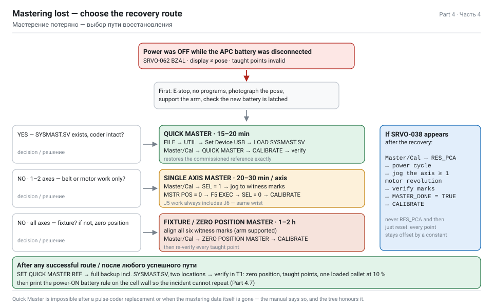

Каждый робот FANUC хранит обученные точки как **счётчики импульсов каждого мотора**, а не как координаты. Мастерение — это операция, сообщающая контроллеру: *«эта физическая поза соответствует нулевому счётчику»*. Как только опора установлена, каждый сохранённый счётчик снова становится осмысленным положением.

**Нулевая позиция**

Опорная поза LR Mate 200iD — **нулевая позиция**: все оси по 0°. На каждой оси есть **контрольные метки** — обработанная риска, паз или пара стрелок на корпусе и на движущейся части. Когда метки всех шести осей совмещены, робот механически в нуле, и именно там живёт опора мастерения.

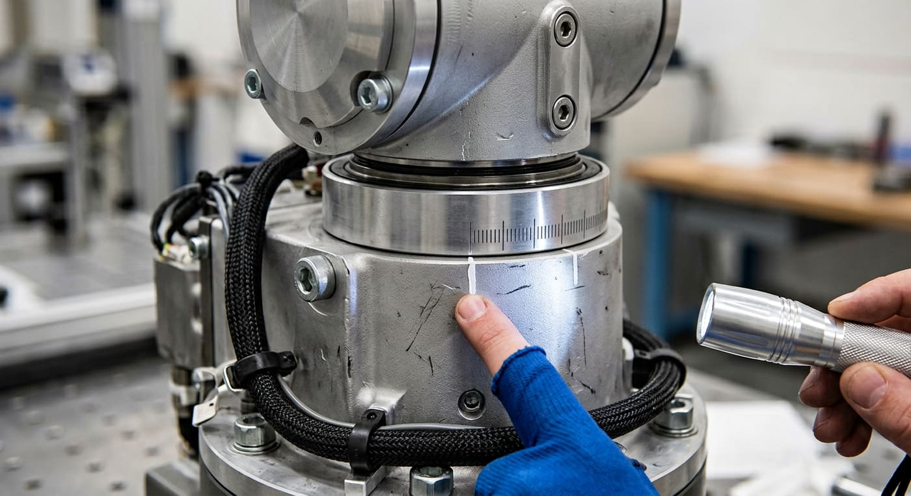

**Шесть способов**

| Способ | Требует | Восстанавливает | Типичное применение | Время |
|---|---|---|---|---|
| **Fixture Position Master** | специальная оснастка или обработанная опорная точка | все оси | наивысшая точность; применяется на производстве и после капитального ремонта | 1–2 ч |
| **Zero Position Master** | метки на всех осях, все тормоза снимаются | все оси | универсальный запасной путь, когда ничего не сохранено | 1–2 ч |
| **Quick Master** | заранее сохранённая опора Quick Master **и** `SYSMAST.SV` (либо опора ещё в SRAM) | все оси сразу | быстрое восстановление после потери батареи | 15–20 мин |
| **Quick Master for Single Axis** | сохранённая опора для этой оси | одну ось | после работ по одной оси | 10 мин |
| **Single Axis Master** | метки только этой оси | одну ось | после работ с ремнём, мотором или редуктором J5 | 20–30 мин |
| **Set Quick Master Ref** | корректно отмастеренный робот | ничего — *сохраняет* текущее состояние как опору для будущих Quick Master | профилактика; выполняется после каждого успешного мастерения | 2 мин |
| **Calibrate** | действительные данные мастерения | записывает отмастеренные значения в систему | финальный шаг большинства процедур | 1 мин |

> WARNING — **Quick Master невозможен**, если импульсный кодер заменён либо утрачены сами данные мастерения и нет копии `SYSMAST.SV`. Тогда остаются Fixture Position Master или Zero Position Master. Это прямо сказано в руководстве оператора, и это точка ветвления дерева решений выше.

**Навигация по экранам, общая для всех способов**

```text
MENU  →  0 NEXT  →  6 SYSTEM  →  F1 [TYPE]  →  Master/Cal
```

Если пункты Master/Cal недоступны или отсутствуют, выключен флаг разрешения мастерения:

```text
MENU → 0 NEXT → 6 SYSTEM → F1 [TYPE] → Variables
   $MASTER_ENB          = 1        ← должен быть 1 для мастерения
   $DMR_GRP[1].$MASTER_DONE        ← TRUE, когда группа отмастерена
   $DMR_GRP[1].$REF_DONE           ← TRUE, когда опора quick master сохранена
   $DMR_GRP[1].$MASTER_COUN[1..6]  ← опорные счётчики по осям
```

Установите `$MASTER_ENB = 1` (клавишей <kbd>F5 ASGN</kbd> или ENTER, как требует версия ПО) и вернитесь в Master/Cal.

> NOTE — Формулировки меню и подписи программных клавиш немного различаются между версиями ПО R-30iB, R-30iB Mate и R-30iB Plus. *Названия* операций (ZERO POSITION MASTER, QUICK MASTER, SET QUICK MASTER REF, CALIBRATE, SINGLE AXIS MASTER) между версиями стабильны; цифры перед ними — нет. Читайте экран, а не заучивайте номера.

## 4.2 Маршрут 1 — Quick Master из копии SYSMAST.SV

**Этот маршрут применяют, когда существует копия данных мастерения.** Это самое быстрое восстановление (15–20 минут), и оно возвращает ровно ту опору, с которой робот был пущен в эксплуатацию, поэтому все обученные точки снова действительны без переобучения.

> TASK — Именно эту процедуру задание называет по имени: *«восстановить нулевое положение с помощью Quick Master, используя резервную копию SYSMAST.SV»*.

**Предусловия — проверьте все четыре до начала**

| № | Условие | Как проверить |
|---|---|---|
| 1 | Существует файл `SYSMAST.SV`, принадлежащий **этому** роботу | имя/дата файла и серийный номер робота в readme вашей копии |
| 2 | Импульсный кодер **не** заменялся | записи обслуживания; после замены кодера Quick Master невозможен |
| 3 | Руку можно вывести в опорную позу | тормоза снимаются, руку можно подпереть |
| 4 | `$MASTER_ENB = 1` | экран системных переменных |

**Шаг 1 — восстановите файл мастерения**

1. Вставьте флешку с `SYSMAST.SV` в USB-порт контроллера.
2. <kbd>MENU</kbd> → **FILE** → <kbd>UTIL</kbd> → **Set Device** → **USB** (отображается как `UD1:`).
3. <kbd>DIR</kbd> — список файлов; перейдите в папку копии.
4. Выберите `SYSMAST.SV`, затем <kbd>LOAD</kbd> (в некоторых версиях <kbd>RESTORE</kbd>) → подтвердите **YES**.
5. Контроллер сообщит о загрузке файла. **Не** выключайте питание.

**Шаг 2 — Quick Master**

6. <kbd>MENU</kbd> → **0 NEXT** → **6 SYSTEM** → <kbd>F1 [TYPE]</kbd> → **Master/Cal**.
7. Выберите **QUICK MASTER (SEL AXIS)** — либо просто **QUICK MASTER** для всех осей сразу. Подтвердите **YES**.
8. Контроллер восстановит опорные счётчики по выбранным осям из данных опоры. `$DMR_GRP[1].$MASTER_DONE` станет **TRUE**.
9. Выберите **CALIBRATE** и подтвердите **YES**. Это запишет восстановленные значения в систему и обновит внутренние данные положения. Некоторые версии требуют здесь выключить и включить питание — если экран это говорит, выполните **cold start** (держите <kbd>PREV</kbd> + <kbd>NEXT</kbd> при включении → **3 Controlled start**).

**Шаг 3 — проверка**

10. <kbd>MENU</kbd> → **0 NEXT** → **6 SYSTEM** → <kbd>F1 [TYPE]</kbd> → **Master/Cal**: статус мастерения должен показывать все оси выполненными.
11. Проверьте `$DMR_GRP[1].$MASTER_DONE = TRUE`.
12. Переместите робота в **T1**, переопределение ≤ 10 %, deadman удерживается, в **нулевую позицию** и сравните каждую ось с контрольными метками. Все шесть должны совпасть одновременно.
13. Перейдите в обученную точку программы паллетирования (например, позицию съёма) и проверьте, что захват встаёт туда, где нужно относительно ленты.
14. Сбросьте аварии; прогоните один цикл на 10 %, затем 50 %, затем 100 %.

**Шаг 4 — замыкание цикла**

15. <kbd>Master/Cal</kbd> → **SET QUICK MASTER REF** → **YES**. Это сохранит нынешнее, проверенное состояние как новую опору, и следующий инцидент с батареей займёт 5 минут вместо 20.
16. Сделайте свежую полную копию, включая новый `SYSMAST.SV`.
17. Заполните бланк: [mastering-record.md](assets/dl/mastering-record.md).

> TIP — Если Quick Master завершился, но SRVO-038 (рассогласование импульсов) всё равно появляется по одной оси, значит счётчики этой оси сдвинулись: обычно потому, что руку двигали вручную либо она упала без питания. Отработайте эту ось по маршруту 2 (одна ось) и снова выполните CALIBRATE. Не продавливайте: рассогласованная ось молча смещает каждую точку каждой программы на постоянную величину.

## 4.3 Маршрут 2 — мастерение одной оси по контрольным меткам

**Этот маршрут применяют, когда копии нет либо опору потеряла только одна ось** — ровно та ситуация после замены ремня J5 (часть 2.6, уровень 2), где руководство требует мастерения **J5 и J6**.

> TASK — Запасной вариант из задания: *«если файла резервной копии нет, выполнить Single Axis Mastering по контрольным меткам на корпусе робота»*.

**До того как что-либо трогать**

| № | Правило | Почему |
|---|---|---|
| 1 | Механически подпереть ось | вы собираетесь снять её тормоз; неподпертая рука падает и может травмировать или повредить себя |
| 2 | У пульта больше никого, ячейка огорожена | команда перемещения от постороннего во время мастерения уничтожает результат |
| 3 | Режим **T1**, переопределение ≤ 10 %, deadman удерживается | единственный безопасный способ двигать не отмастеренного робота |
| 4 | `$MASTER_ENB = 1` | иначе пункты Master/Cal скрыты |
| 5 | Знать значение опорной позиции для оси | для опоры по меткам это обычно **0** |

**Снятие тормозов (только если ось не двигается)**

Если привод не включён, тормоз держит ось и навести её на метки нельзя. Метод из руководства:

```text
MENU → 0 NEXT → 6 SYSTEM → F1 [TYPE] → Variables
   $PARAM_GROUP.$SV_OFF_ALL   = FALSE     (снять все тормоза)
   $PARAM_GROUP.$SV_OFF_ENB[1..n] = FALSE (снять выбранный тормоз)
затем CYCLE POWER  (обычное перещёлкивание питания; FCTN → 1 START (COLD) не нужен)
```

Со снятым тормозом ось **свободна**: её должна удерживать опора, строп или второй человек, а перемещать можно только вручную. По завершении мастерения верните переменным TRUE и снова перещёлкните питание.

**Процедура Single Axis Master**

1. <kbd>MENU</kbd> → **0 NEXT** → **6 SYSTEM** → <kbd>F1 [TYPE]</kbd> → **Master/Cal**.
2. Выберите **SINGLE AXIS MASTER** (либо **QUICK MASTER (SEL AXIS)** с выбором режима одной оси — зависит от версии ПО). Экран показывает список осей с колонками **SEL**, **ST**, **MSTR POS**, **POSN ERR**.
3. Поставьте **SEL = 1** на оси, которую мастерите, — для работ с ремнём это **J5**.
4. Перемещайте J5 до **точного совмещения контрольных меток**. Возьмите зеркальце и фонарик: параллакс обманет вас на 0,1 мм. У LR Mate 200iD метки кисти находятся на корпусе J5 и на держателе фланца J6.
5. Введите **MSTR POS** = опорную позицию для этой метки — обычно **0**.
6. Нажмите <kbd>F5 EXEC</kbd> (в некоторых версиях **SET**) → подтвердите. Контроллер запишет текущий счётчик как опору для J5. **ST** изменится с 0 на **2** (выполнено).
7. Верните **SEL в 0** для этой оси, чтобы случайно не отмастерить её повторно.
8. Повторите шаги 3–7 для **J6** — обязательно после любых работ с ремнём J5, поскольку обе оси идут через ту же кисть.
9. Выберите **CALIBRATE** → **YES**, чтобы записать значения в систему.
10. Перещёлкните питание, если экран этого требует.
11. Верните переменные снятия тормозов в TRUE и снова перещёлкните питание.
12. Проверьте: наведение в нулевую позицию — все метки совмещены; `$DMR_GRP[1].$MASTER_DONE = TRUE`; индикация положений осей соответствует физической позе.

**Остальные пять осей, если они тоже потеряны**

Если мастерение потеряла вся группа (севшая батарея APC делает именно это), отмастерите все шесть осей по одной тем же способом **либо** используйте маршрут 3 (Zero Position Master), который совмещает все шесть сразу. Поосевой способ предпочтителен, когда вы точно знаете, что сдвинулись одна-две оси, потому что он не трогает остальные.

| Ось | Где находятся метки у LR Mate 200iD | Опорное значение |
|---|---|---|
| J1 | корпус основания ↔ вращающаяся колонна J1 | 0 |
| J2 | основание/колонна ↔ нижняя рука | 0 |
| J3 | нижняя рука ↔ верхняя рука | 0 |
| J4 | верхняя рука ↔ корпус кисти J4 | 0 |
| **J5** | **корпус кисти ↔ выходной держатель J5** | **0** |
| J6 | держатель J5 ↔ фланец | 0 |

> WARNING — Никогда не мастерите ось, пока рука висит свободно без опоры, и никогда не мастерите из положения, которое плохо видно. Если метки не совмещаются в пределах ширины риски, ось не в нуле — и каждая точка каждой программы будет нести эту ошибку навсегда.

## 4.4 Маршрут 3 — Zero Position Mastering (копии нет вообще)

Это худший случай: нет ни `SYSMAST.SV`, ни сохранённой опоры Quick Master, потеряны все шесть осей. Восстановимо и это — просто дольше, и затем придётся **перепроверить каждую обученную точку**.

**Процедура**

1. Подоприте всю руку: стойка под предплечье и под кисть либо строп с талью, снимающий вес. Вы будете снимать все тормоза.
2. Огородите ячейку, пульт в **T1**, переопределение ≤ 10 %.
3. Установите `$MASTER_ENB = 1` в системных переменных.
4. Снимите тормоза, если оси не двигаются (переменные в 4.3), перещёлкните питание и **вручную выведите каждую ось** так, чтобы **все шесть меток совместились одновременно**. Это нулевая позиция — все суставы по 0°.
5. <kbd>MENU</kbd> → **0 NEXT** → **6 SYSTEM** → <kbd>F1 [TYPE]</kbd> → **Master/Cal** → **ZERO POSITION MASTER** → подтвердите **YES**.
6. Выберите **CALIBRATE** → **YES** и перещёлкните питание, если требуется.
7. `$DMR_GRP[1].$MASTER_DONE` становится TRUE для группы.
8. Выполните **Set Quick Master Ref**, чтобы следующий инцидент прошёл быстро.
9. Затяните и зафиксируйте всё, что отпускали; верните переменные тормозов.

**Затем дорогая часть: перепроверка обученных точек**

Zero Position Mastering восстанавливает механическую опору, но точки, обученные относительно немного другой опоры, окажутся смещены. Для ячейки паллетирования:

| Точка | Как проверить |
|---|---|
| HOME | навестись, убедиться, что рука не задевает ограждение, штабель и ленту |
| Подвод / съём / отход | положите кирпич на ленту вручную, прогоните на 10 %, смотрите, чтобы присоски сели по центру постели |
| Позиции укладки, слой 1 | прогоните вхолостую (без кирпича) и проверьте центровку плоскости присосок над первым слотом |
| Позиции укладки, слой 8 | критичная точка — проверьте зазор над готовым штабелем |
| Точки обмена паллет | прогоните челнок через полный обмен на 10 % |
| Промежуточные точки и безопасные пути | проверьте, что нигде нет прохода ближе 50 мм к ограждению |

Прогоните одну полную паллету на 10 % переопределения, затем 50 %, затем на рабочей скорости, следя за укладкой каждого слоя. Если постоянное смещение проявляется во всех точках — ваш ноль не был точно нулём; аккуратнее переделайте шаг 4, а не правьте 192 позиции.

> TIP — Сфотографируйте совмещённые метки после успешного мастерения и храните снимок вместе с резервной копией. Если метки когда-нибудь повредят или закрасят при ремонте, эта фотография останется единственным свидетельством того, как выглядело «правильно».

**Замечание о точности для отчёта**

Zero Position Mastering — собственный запасной путь руководства, вполне законный, но его точность зависит от того, насколько точно человек способен совместить риску. Реально вы попадаете в пределы нескольких сотых градуса. Это хорошо внутри *бюджета* повторяемости робота ±0,01 мм для данной задачи: ошибка 0,05° при вылете 911 мм даёт около 0,8 мм на кирпиче, а ваш зазор в стыке 10 мм её поглощает. Скажите это в отчёте прямо: так видно, что вы понимаете — мастерение восстанавливает *опору*, а не *калибровку*.

## 4.5 SRVO-038 рассогласование импульсов и RES_PCA

Именно эту аварию вы, скорее всего, встретите *после* описанного выше восстановления либо самостоятельно — после батареи, севшей за ночь. Она говорит, что счётчик импульсного кодера больше не согласуется с сохранённым опорным счётчиком этой оси.

**Последовательность восстановления**

1. <kbd>MENU</kbd> → **0 NEXT** → **6 SYSTEM** → <kbd>F1 [TYPE]</kbd> → **Master/Cal**.
2. Выберите **RES_PCA** (сброс импульсного кодера, <kbd>F3</kbd> в большинстве версий) для пострадавшей группы → подтвердите **YES**.
3. Перещёлкните питание контроллера.
4. Для каждой отмеченной как потерянная оси прокрутите её **минимум на один полный оборот мотора**, чтобы кодер восстановил многооборотный счёт.
5. Выведите руку в опорную позу и проверьте совмещение **контрольных меток**.
6. Установите `$DMR_GRP[1].$MASTER_DONE = TRUE`, если экран этого требует, либо выполните **CALIBRATE**.
7. Снова перещёлкните питание, снимите аварию и проверьте в **T1** на низком переопределении.

> NOTE — RES_PCA выбрасывает счётчики импульсов, значит ось **обязательно** надо заново отмастерить. Никогда не выполняйте RES_PCA с последующим простым сбросом аварии и пуском в производство: робот поедет, и каждая точка будет ошибочна на постоянную величину. Именно так ячейки «загадочным образом» переобучает следующая смена.

**Смежные аварии и их смысл**

| Авария | Смысл | Первое действие |
|---|---|---|
| SRVO-038 рассогласование импульсов | счётчики расходятся с мастерением | RES_PCA → заново отмастерить ось |
| SRVO-062 BZAL | батарея APC потеряна при выключенном питании | заменить батарею правильно (питание ВКЛ), затем заново отмастерить |
| SRVO-063 BZALH | напряжение батареи выше нормы/аномальное | проверить батарею и её разъём |
| SRVO-075 ошибка данных импульсного кодера | данные кодера повреждены | заново отмастерить; если повторяется — неисправен кодер или его кабель |
| SRVO-199 ось управления отключена | привод заблокирован | проверить цепь аварийного останова, блокировку двери и внешнее разрешение осей |
| MOTN-049 / MOTN-023 | движение прервано, ошибка положения слишком велика | заново отмастерить, затем перепроверить обученные точки |
| SYST-035 низкое напряжение батареи | батарея SRAM контроллера | заменить в течение 30 минут после выключения (часть 3.4 B) |

**Если рассогласование возвращается после правильного мастерения**

Значит проблема не в мастерении, а в механике или электрике — и вы снова в части 2:

- проскальзывающий ремень (перемерьте натяжение);
- изношенный редуктор (перемерьте люфт);
- повреждённый кабель кодера на изгибе кисти (осмотр, тест на шевеление);
- умирающий импульсный кодер (замена — и после неё работают только Fixture или Zero Position Mastering, потому что Quick Master после замены кодера невозможен).

## 4.6 Проверка и возврат в производство

Мастерение завершено, когда оно **проверено**, а не когда экран перестал жаловаться.

| № | Проверка | Метод | Критерий |
|---|---|---|---|
| 1 | Статус мастерения | экран Master/Cal | все оси отмастерены / ST = 2 |
| 2 | `$DMR_GRP[1].$MASTER_DONE` | системные переменные | TRUE |
| 3 | Нулевая позиция | наведение в ноль в T1 | все шесть меток совмещены одновременно |
| 4 | Нет аварий | журнал очищен, контроллер перезапущен | чистый пуск, без записей SRVO/MOTN |
| 5 | Индикация положений против физической позы | прочитать J1–J6, сравнить с рукой | согласованы |
| 6 | Кадр инструмента | навестись в TOOL[17], двинуть по X | плоскость присосок движется вдоль своей оси, а не вбок |
| 7 | Контроль повторяемости | в обученную точку, отвод и возврат трижды | возврат в то же место; спецификация ±0,01 мм |
| 8 | Холостой цикл | прогнать программу паллетирования без продукта | все движения доходят до точек, аварий MOTN нет |
| 9 | Цикл под нагрузкой на 10 % | одна полная паллета | каждый кирпич по схеме, без падений |
| 10 | Рабочая скорость | 50 %, затем 100 % на одну паллету | время цикла в пределах 10 % от пусконаладочного |

**Бумаги, которые надо закрыть до возврата ячейки**

1. Бланк мастерения ([шаблон](assets/dl/mastering-record.md)): дата, причина, применённый способ, отмастеренные оси, исполнитель, результаты проверки.
2. Отчёт об инциденте: что случилось, хронология из 4.0, что потеряно, во сколько обошёлся простой.
3. Свежая полная копия: ALL_OF_ABOVE + SYSMAST.SV, в двух местах.
4. Подтверждённое выполнение **Set Quick Master Ref**.
5. Обновление журнала ППР: следующая дата замены батареи, следующая квартальная проверка.
6. Корректирующее действие: правило «замена батареи при ВКЛ питании» теперь напечатано на стене ячейки и в чек-листе, а батарейный отсек несёт наклейку с датой последней замены.

> DANGER — Никогда не возвращайте заново отмастеренного робота на полную скорость без цикла под нагрузкой на 10 %. Режим отказа плохо отмастеренной кисти — это не авария, а кирпич массой 4 кг, отпущенный не в тот момент на высоте 1,5 м над паллетой, внутри ограждения, калитку которого техник вот-вот откроет.

## 4.7 Профилактика: как сделать этот инцидент невозможным

| № | Мера | Стоимость | Эффект |
|---|---|---|---|
| 1 | **Менять батарею APC при ВКЛЮЧЁННОМ питании**, с нажатым аварийным остановом | 0 | полностью устраняет этот вид отказа — то самое правило из задания |
| 2 | Наклейка с возрастом батареи на отсеке + дата в календаре ППР | 0 | батарее не дают умереть в эксплуатации |
| 3 | Ежеквартальная проверка напряжения батареи (контроллер 3,1–3,3 В) | 0 | ловит SYST-035 до того, как SRAM окажется мёртвой |
| 4 | `SET QUICK MASTER REF` после каждого успешного мастерения | 2 мин | следующее восстановление — 5 минут вместо 2 часов |
| 5 | Ежемесячная копия ALL_OF_ABOVE + SYSMAST.SV в двух местах | 30 мин | маршрут 1 доступен всегда |
| 6 | Ежегодный тест восстановления на запасном контроллере или в симуляции | 2 ч | доказывает, что копия не повреждена |
| 7 | Заламинированная процедура на внутренней стороне дверцы шкафа | 0 | её прочитает тот, кто меняет батарею в 2 часа ночи |
| 8 | Два запасных батарейных комплекта на площадке | цена двух комплектов | никакой импровизации и ожидания курьера |
| 9 | Фотографии контрольных меток, подшитые к резервной копии | 0 | опора сохранится, даже если метки закрасят |
| 10 | Наряд-допуск на работы с батареей и мастерением | 0 | никто не начинает эту работу в одиночку и неподготовленным |

**Правило на одну страницу — повесить на стену ячейки**

```text
ЗАМЕНА БАТАРЕИ — ОСНОВАНИЕ РОБОТА (APC)
  1  Завершить цикл. Поставить руку в нулевую позицию.
  2  Нажать АВАРИЙНЫЙ ОСТАНОВ.  КОНТРОЛЛЕР НЕ ВЫКЛЮЧАТЬ.
  3  Огородить ячейку. Повесить бирку.
  4  Новая батарея распакована и в руке ДО отключения старой.
  5  Замена менее чем за 10 секунд. Проверить полярность. Зафиксировать разъём.
  6  Снять аварийный останов. Искать SRVO-062. Её быть не должно.
  7  Вписать дату на наклейку и в журнал. Следующая замена: +12 месяцев.

  ЕСЛИ ПИТАНИЕ БЫЛО ВЫКЛЮЧЕНО ХОТЯ БЫ НА МГНОВЕНИЕ  →  мастерение потеряно  →  части 4.2 / 4.3
```

> TIP — Добавьте то же правило в макет Visual Components как примечание к компоненту шкафа контроллера, а заламинированную карточку вложите в приложение к отчёту фотографией. Рецензенты ценят артефакты, которые выдержат контакт с реальным цехом.

## 4.8 Моделирование инцидента в Visual Components

Отчёт станет гораздо сильнее, если симуляция покажет последствие потерянной опорной позиции, а не только здоровую ячейку. Два недорогих эксперимента в макете из части 1:

**Эксперимент 1 — смещение**

1. В подпрограмме укладки (или в скрипте Python из части 1.12) добавьте постоянный угловой сдвиг J5 на 0,3°.
2. Прогоните одну полную паллету.
3. Измерьте ошибку укладки на слое 1 и слое 8 и экспортируйте график.

| Слой | Высота над паллетой, мм | Ожидаемая боковая ошибка при 0,3° ошибки кисти |
|---|---|---|
| 1 | 32,5 | мала — ошибка в основном угловая, рука сложена |
| 4 | 227,5 | заметна |
| 8 | 487,5 | наибольшая — штабель заметно кренится либо кирпичи свисают |

**Эксперимент 2 — восстановление**

1. Смоделируйте визит обслуживания: создайте **человеческий ресурс** (Models by Type › Resources › Characters), который подходит к шкафу, и **станок** или простой компонент на сигналах, представляющий «ячейка на обслуживании».
2. Управляйте это сигналом: `SO_MaintenanceActive` = TRUE останавливает входной поток и робота.
3. Прогоните три сценария и сравните суммарный выпуск за восьмичасовую смену:

| Сценарий | Смоделированный простой | Выпуск за 8 ч |
|---|---|---|
| Нет программы обслуживания, 1 × INTP-106 в неделю по 35 мин | 35 мин | 4 550 кирпичей |
| Программа обслуживания есть, 12 ч планового простоя за 6 месяцев (≈ 10 мин/смена) | 10 мин | 4 830 кирпичей |
| Батарея заменена при выключенном питании, мастерение потеряно, 4 ч восстановления | 240 мин | 3 400 кирпичей |

Третья строка — это то число, которое оправдывает всю часть 3 и часть 4 перед начальником производства, и получено оно на макете, который вы уже построили.

> NOTE — Чётко помечайте эксперименты в симуляции как *иллюстративные*: сдвиг 0,3° — учебный приём, а не измеренная величина вашего робота. Рецензенты принимают упрощение; они не принимают упрощение, выданное за измерение.

---

# Part 5 — Отчёт: рекламация, инструмент и выводы

_Раздел 4 задания. Акт-рекламация на ремень, отказавший в гарантийный период, перечень инструмента для ТО, экономика и сборка всей работы в единый пакет._

## 5.0 Как собрать отчёт

В задании четыре раздела. В отчёте должно быть столько же и в том же порядке, чтобы рецензент отмечал их по списку, а не искал.

| Раздел отчёта | Требование задания | Откуда берётся в этом руководстве | Объём |
|---|---|---|---|
| 0 · Введение | контекст: какой завод, какая ячейка, какой робот | Часть 0 | 1 стр. |
| 1 · Моделирование | макет в Visual Components 4.8 | Часть 1 + скриншоты + видео | 4–6 стр. |
| 2 · Диагностика | причины INTP-106, проверка натяжения ремня J5, план по люфту | Часть 2 | 4–6 стр. |
| 3 · ППР | график на 6 месяцев, ежедневные и квартальные проверки, замена батареи с правилами безопасности | Часть 3 | 4–5 стр. |
| 4 · Аварийная ситуация | потеря мастерения, Quick Master с SYSMAST.SV, Single Axis Mastering по меткам | Часть 4 | 3–4 стр. |
| 5 · Рекламация и инструмент | акт-рекламация, перечень инструмента для ТО | Часть 5 | 3–4 стр. |
| 6 · Выводы | что доказано, что делать дальше | Часть 5.6 | 1 стр. |
| 7 · Источники | использованные руководства и документы | Часть 6 | 1 стр. |
| Приложения | чек-листы, бланки, полные листинги, скриншоты | файлы для скачивания | по необходимости |

**Правила, которые поднимают оценку**

1. **У каждого числа есть источник.** Не «натяжение ремня должно быть около 18 Н», а «натяжение ремня J5 15,6–20,6 Н — Maintenance Manual B-83495EN, §6.1, таблица 6.1(b)».
2. **У каждого утверждения есть доказательство.** Скриншот, бланк измерения, фотография или экспорт из симуляции.
3. **Формулируйте допущения.** Режим работы, масса кирпича, такт, число слоёв. Заявленное допущение — это инженерия; незаявленное — угадывание.
4. **Показывайте арифметику.** Расчёт такта, проверка нагрузки, экономика простоя: за расчётом рецензент следует, за декларацией — нет.
5. **Разделяйте измеренное и смоделированное.** Симуляция доказывает планировку, значения из руководства доказывают обслуживание. Не выдавайте модельное число за измеренное.
6. **Пишите выводы как действия.** «Ввести квартальную проверку ремня с порогом 16,5 Н» сильнее, чем «обслуживание следует улучшить».

**Пакет к сдаче**

```text
submission/
  Report.pdf                        ← письменная работа, разделы 0–7
  appendix_A_checklists.pdf         ← ежедневный + квартальный чек-листы, заполненные примерами показаний
  appendix_B_records.pdf            ← бланк натяжения ремня, бланк люфта, бланк мастерения
  appendix_C_claim_act.pdf          ← акт-рекламация, подписанный
  appendix_D_sim/
     BrickPlant_v03.vcmx            ← сам макет
     layout_video.mp4               ← 60 с, траектория камеры из части 1.14
     layout_3d.pdf                  ← вращаемый 3D PDF
     statistics.csv                 ← экспорт производительности и загрузки
     charts.png                     ← график количества продуктов, три кривые
  appendix_E_program/
     PALLETIZE_MAIN.ls              ← постпроцессированная программа FANUC
     routine_T1_PICK.ls
     routine_T2_PLACE.ls
  appendix_F_sources.pdf            ← часть 6 с номерами документов и ревизиями
```

> TIP — Держите имя файла макета и версию отчёта согласованными и ставьте дату на всё. Рецензент, который не может понять, какое видео к какой версии макета относится, перестаёт доверять остальному.

## 5.1 Гарантийный ли это случай

Прежде чем писать рекламацию, установите, что она у вас есть. Четыре вопроса по порядку.

**В1 — Робот ещё в гарантийном периоде?**

Период определяется **вашим договором поставки**, а не общим правилом. В коммерческой практике для роботов и контроллеров FANUC часто встречаются 12 месяцев с ввода в эксплуатацию или с поставки, иногда 18 месяцев с отгрузки; сервисные контракты могут продлевать отдельные позиции. Найдите:

| Документ | Что он сообщает |
|---|---|
| Договор поставки / спецификация | гарантийный срок, дата начала, что покрывается |
| Гарантийный талон | покрытые серийные номера, дата начала, условия |
| Акт ввода в эксплуатацию | дата, с которой пошёл отсчёт |
| Сервисный контракт, если есть | расширенное покрытие, время реакции, кто вправе выполнять работы |

Внесите в рекламацию серийный номер робота, серийный номер контроллера, дату поставки и дату ввода в эксплуатацию: документ без них возвращают.

**В2 — Это производственный дефект или условия эксплуатации?**

| Указывает на **производственный дефект** (гарантия) | Указывает на **износ / эксплуатацию** (не гарантия) |
|---|---|
| Ремень отказал или потерял натяжение намного раньше нормального межсервисного интервала | Натяжение терялось постепенно за годы нормальной работы |
| Срез зуба, обрыв корда, расслоение | Обычное засаливание, равномерный износ |
| Люфт выше предела при малой наработке | Люфт постепенно рос с наработкой |
| Шум редуктора и металлическая пудра в начале жизни узла | Редуктор на предельном ресурсе или за ним |
| Тот же отказ на нескольких машинах одной партии | одна машина |
| Отказ при правильном обслуживании, правильной смазке, правильной нагрузке | неверная смазка, пересмазка, превышение нагрузки, повреждение при столкновении |

**В3 — Обслуживали ли вы его так, как требует руководство?** Это неудобный вопрос, и задание построено именно на нём.

> WARNING — Отсутствующие записи о проверке ремней за шесть месяцев — реальная слабина гарантийной претензии. Поставщик вправе утверждать, что отказ стал следствием пропущенного обслуживания. Честных ответов три, и в отчёте должны быть все три:
>
> 1. **Доказать обслуживание, которое всё-таки было** — наработка с контроллера, имеющиеся записи, документы о закупке смазки и батарей, отметки о сервисных визитах. Пробел в одной графе не есть пробел во всей программе.
> 2. **Показать, что характер отказа не согласуется с пробелом** — ремень не теряет всё натяжение за шесть месяцев, если до этого был в норме; если измерение показывает дефектный характер (срезанный зуб, расслоение), а не постепенную потерю, пробел не влияет на причинность.
> 3. **Признать организационный дефект и отделить его от технического** — прямо написать, что режим осмотров был недостаточным, что он исправлен программой из части 3 и что наблюдаемый характер дефекта тем не менее относится к производству. Претензия, признающая и устраняющая собственную слабину, отклоняется намного труднее, чем та, что её прячет.

**В4 — Не прекращена ли гарантия?**

| Типичное основание прекращения | Что проверить для этой ячейки |
|---|---|
| Несанкционированный ремонт или доработка | вскрывал ли кисть кто-либо без авторизации FANUC или вне одобренного сервисного контракта |
| Неоригинальные запчасти или расходники | была ли смазка A98L-0040-0230? Соответствовал ли ремень указанной детали? |
| Эксплуатация вне спецификации | нагрузка ≤ 7 кг, моменты в кисти в пределах 16,6 Н·м, режим в номинальных границах |
| Отсутствие требуемого обслуживания | шестимесячный пробел — см. В3 |
| Повреждение от внешних причин | столкновение, затопление, перенапряжение, неверное питание |
| Изменения ПО третьей стороной | модифицированные системные переменные, сторонние постпроцессоры, записанные в контроллер |

**Если ответ — «не гарантийный случай»**

Акт всё равно пишется — как **внутренний акт о выявленных недостатках**, который становится входом для наряда на ремонт, закупки запчастей и записи о корректирующем действии. Тот же документ, другой адресат. Многие студенческие отчёты останавливаются на «гарантия кончилась, делать нечего»; это неверный вывод, потому что документооборот существует, чтобы двигать ремонт независимо от того, кто платит.

## 5.2 Акт-рекламация

Шаблоны: [claim-act-template.en.md](assets/dl/claim-act-template.en.md) · [claim-act-template.ru.md](assets/dl/claim-act-template.ru.md)

Акт-рекламация — формальный документ с фиксированным скелетом. Ниже **заполненный пример** ровно для сценария из задания: ремень J5 потерял натяжение в гарантийный период. Замените значения в скобках своими.

```text
                                      Кому: [Поставщик / сервис FANUC Россия]
                                      От кого: [наименование завода, адрес, контакты]
                                      Основание: договор № [___] от [___]

                    АКТ-РЕКЛАМАЦИЯ № 07/2027
                    Место составления: [город]     Дата: 16 ноября 2026 г.

1. КОМИССИЯ
   Председатель: [ФИО], главный инженер, [предприятие]
   Члены комиссии: [ФИО], инженер по обслуживанию
                   [ФИО], начальник линии, зона D
                   [ФИО], представитель [поставщик] (приглашён, уведомление от [дата])

2. ИЗДЕЛИЕ
   Машина:             промышленный робот FANUC LR Mate 200iD/7L, 6 осей
   Серийный номер:     [s/n робота]
   Контроллер:         FANUC R-30iB Plus, s/n [s/n контроллера], ПО V[9.40P]
   Дата изготовления:  [___]      Дата поставки: [___]
   Ввод в эксплуатацию:[___]      Гарантия действует до: [___]
   Наработка:          13 480 ч на момент составления акта
   Место установки:    ячейка паллетирования, зона D, линия декоративного кирпича № 2

3. ОПИСАНИЕ ДЕФЕКТА
   Начиная с [дата] ячейка периодически останавливается с аварией INTP-106
   "PAUSE.L ... Continue request failed"; каждый останов длится 30-40 минут,
   примерно [n] раз в неделю. [дата] обнаружена видимая игра (люфт) по оси J5
   кисти робота.

4. ВЫПОЛНЕННАЯ ДИАГНОСТИКА
   4.1 Прочитана история аварий: записи INTP-106 сопровождаются SRVO-038
       (рассогласование импульсов) по оси 5.
   4.2 Натяжение ремня измерено тензометром A97L-0218-0700
       (Mitsuboshi DOCTOR TENSION TYPE-III) в позе J3 = 80 град,
       J5 = +/-90 град; установки: масса ремня 0,02083 кг/м, ширина 4 мм,
       длина ветви 187 мм.
       Отсчёты J5: 12,8 / 13,1 / 12,9 Н  -> среднее 12,9 Н
       Норма (Maintenance Manual B-83495EN, раздел 6.1): 15,6-20,6 Н
       РЕЗУЛЬТАТ: НИЖЕ нижнего предела на 2,7 Н.
   4.3 Отсчёты J6: 17,4 / 17,6 / 17,5 Н -> среднее 17,5 Н (в пределах нормы).
   4.4 Люфт измерен индикатором часового типа (0,01 мм) на расстоянии
       180 мм от оси J5: 0,46 мм. Норма: не более 0,18 мм.
       РЕЗУЛЬТАТ: ПРЕВЫШЕН.
   4.5 Визуальный осмотр: [трещины у основания зубьев / обнажение корда /
       засаливание] ремня J5; шкивы без повреждений; цвет смазки нормальный,
       металлических частиц нет; контрольные метки крепежа не сорваны.
   4.6 Нагрузка проверена: на фланце 4,00 кг при номинале 7 кг;
       момент в кисти 3,92 Н.м при номинале 16,6 Н.м. Перегрузки нет.
   4.7 Условия эксплуатации: температура окружающей среды [__] град C,
       запылённость обычная для производства, столкновений не зафиксировано.

5. ВЫПОЛНЕННОЕ ОБСЛУЖИВАНИЕ
   Периодические осмотры выполнены [перечислить даты]. Записи о состоянии
   ремней отсутствуют за период с [___] по [___]; режим осмотров исправлен
   программой ППР № [___], действующей с [___]. Все остальные пункты
   (разъёмы, удаление пыли, состояние смазки, батареи) выполнены и записаны.

6. ЗАКЛЮЧЕНИЕ КОМИССИИ
   Наблюдаемый характер дефекта - потеря натяжения ремня до 12,9 Н с
   трещинами у основания зубьев при наработке 13 480 ч, на фоне нормального
   состояния смазки, целого крепежа и отсутствия перегрузки - указывает на
   ПРОИЗВОДСТВЕННЫЙ ДЕФЕКТ зубчатого ремня оси J5
   (деталь A98L-0040-0286#004-157), а не на нормальный износ.
   Последствия: повторяющиеся остановы INTP-106, суммарный внеплановый
   простой [__] ч, невыпущенная продукция [__] шт. кирпича.

7. ПРЕТЕНЗИЯ
   7.1 Безвозмездно заменить зубчатый ремень оси J5 по гарантии.
   7.2 Предоставить либо выполнить поосевое мастерение J5 и J6 после замены,
       как того требует руководство по обслуживанию.
   7.3 Возместить документированный простой в объёме [__] ч либо продлить
       гарантию на механический блок на тот же срок.
   7.4 Предоставить письменный анализ коренной причины дефекта ремня.

8. ПРИЛОЖЕНИЯ
   А. Бланк измерения натяжения ремня, 3 листа
   Б. Бланк измерения люфта
   В. Фотоматериалы: контрольные метки, дисплей прибора, состояние ремня (12 фото)
   Г. Экспорт истории аварий
   Д. Выписка из журнала обслуживания
   Е. Скриншот наработки контроллера
   Ж. Журнал простоев за период

   Председатель  ______________ / [ФИО] /
   Члены комиссии ______________ / [ФИО] /
                 ______________ / [ФИО] /
                 ______________ / [ФИО] /  (представитель поставщика)
```

**Правила, которые делают акт работающим**

| Правило | Почему |
|---|---|
| Указывать измерения вместе с прибором, установками и позой | число без метода всегда можно оспорить |
| Ссылаться на раздел руководства для каждого нормативного значения | превращает «мы полагаем» в «изготовитель утверждает» |
| Разделять наблюдение и вывод | раздел 4 — факты, раздел 6 — суждение; никогда их не смешивать |
| Признать пробел в обслуживании и показать корректирующее действие | снимает сильнейший контраргумент поставщика |
| Квантифицировать потери в часах и штуках, а не прилагательными | «значительный простой» игнорируют; «91 ч и 54 600 кирпичей» — нет |
| Формулировать каждое требование конкретно и исполнимо | «заменить», «предоставить», «возместить» — с объёмом и сроком |
| Приложить всё и пронумеровать приложения | претензию выигрывает пакет, а не письмо |
| Пригласить представителя поставщика и зафиксировать уведомление | односторонний акт слабее совместного |

## 5.3 Перечень инструмента для ТО — так, как его просит задание

Задание называет прямо три позиции — **тензометр, набор ключей, LOCTITE для болтов** — и ожидает перечень, достаточный, чтобы реально выполнить работу. Полный технический список с характеристиками — в части 3.8; здесь версия для отчёта, сгруппированная по задачам, которые инструмент решает.

| Задача | Инструмент и расходники | Количество |
|---|---|---|
| Измерение натяжения ремня | тензометр **A97L-0218-0700** (Mitsuboshi DOCTOR TENSION TYPE-III), металлическая линейка, зеркальце, фонарик | 1 комплект |
| Измерение люфта | индикатор 0,01 мм с магнитной стойкой, набор щупов | 1 комплект |
| Контроль момента затяжки | калиброванные динамометрические ключи 1–25 Н·м и 5–60 Н·м, шестигранники 1,5–10 мм, рожковые/накидные 8–19 мм | 1 набор |
| Фиксация резьбы | **LOCTITE 243** (средний), **LOCTITE 263** (высокопрочный), **LOCTITE 518** (фланцевый герметик), **LOCTITE 638** (вал-втулка) | по 1 |
| Вскрытие кисти | шестигранники, отвёртки (изолированные), съёмник стопорных колец, киянка с мягким бойком, съёмник прокладок | 1 набор |
| Замена ремня | лапчатый съёмник 50–150 мм, сепаратор, динамометрический ключ, новый ремень **A98L-0040-0286#004-157**, новые прокладки | 1 комплект + 1 запасной ремень |
| Замена редуктора | съёмник, сепаратор, съёмник колец, LOCTITE 518, комплект смазки **A05B-1142-K021**, поддоны | 1 комплект |
| Смазка | смазка **A98L-0040-0230** (Harmonic 4B No.2), шприц-комплект **A05B-1142-K021**, туба **A05B-1139-K022**, новые уплотнительные болты | комплект на ось |
| Батарейные работы | новый блок APC (4 × C 1,5 В) или внешний блок D, батарея контроллера **A05B-2650-K030**, мультиметр, диэлектрические перчатки | 2 комплекта |
| Электрические проверки | цифровой мультиметр, инфракрасный термометр, изолированные отвёртки | 1 комплект |
| Очистка | безворсовые салфетки, изопропиловый спирт, воздух низкого давления, пылесос | расходные |
| Безопасность | комплект блокировки/бирок с личными замками, опорная стойка либо строп и таль, сигнальная лента, защитные очки, нитриловые перчатки | на техника |
| Документирование | пульт обучения, печатные руководства B-83494EN и B-83495EN, флешки (FAT32), фотоаппарат, печатные чек-листы | 1 комплект |
| Маркировка | красный маркер (контрастный), принтер этикеток либо самоклеящиеся этикетки | 1 |

**Минимально достаточный комплект** — если в отчёте надо обосновать закупку при ограниченном бюджете, этот поднабор делает возможными квартальную проверку и замену батареи:

| Позиция | Почему без неё нельзя |
|---|---|
| Тензометр A97L-0218-0700 | принятой альтернативы для измерения натяжения ремня нет |
| Индикатор 0,01 мм + магнитная стойка | единственный способ измерить люфт относительно предела 0,18 мм |
| Динамометрический ключ 5–60 Н·м, калиброванный | крышка кисти — 5,6 Н·м; «затянуть на чувство» — это причина повторного ослабления |
| LOCTITE 243 и 263 | подтянутые без фиксатора болты снова ослабнут в течение квартала |
| Набор шестигранников + отвёртки | без них ничего не открывается |
| Мультиметр | проверка батарей, 3,1–3,3 В |
| Комплект LOTO | правовая основа работы при снятом напряжении |
| Опора для руки | руководство требует механической опоры до снятия любого тормоза |

**Отдельно о тензометре**

FANUC указывает собственный номер детали, и это важно: значения натяжения в руководстве установлены для принципа измерения именно этого прибора (бесконтактный, на резонансной частоте, с входными параметрами массы, ширины ремня и длины ветви). Контактный пружинный динамометр или метод «щипнуть и послушать» не воспроизводит окно 15,6–20,6 Н с той достоверностью, которую подразумевает спецификация. Если у предприятия есть другой бесконтактный вибрационный тензометр, его можно применять **при условии**, что вводятся те же значения массы, ширины и длины ветви и что прибор однократно сверен с прибором FANUC — и эта сверка записана в отчёт.

> TIP — Добавьте в перечень колонку калибровки: динамометрическим ключам и индикаторам нужны периодические свидетельства о поверке. Акт-рекламация, цитирующая момент с неповеренного ключа, легко отклоняется; та, что цитирует его с ключа № TW-014, поверенного 02.09.2026, — нет.

## 5.4 Экономика — чтобы у отчёта был вывод, пригодный руководителю

Всё ниже использует собственные числа ячейки из части 0: 600 кирп/ч, такт 6,0 с, 192 кирпича на паллету, 19,2 мин на паллету при двухпозиционном челноке.

**Стоимость отказа в том виде, в каком он застал ячейку**

| Позиция | Значение | Основание |
|---|---|---|
| Внеплановый останов на один INTP-106 | 35 мин (в задании 30–40) | условие задачи |
| Не выпущено кирпича за останов | 350 | 600 кирп/ч × 0,583 ч |
| Остановов в месяц (наблюдаемо) | 4 | 1 в неделю |
| Потерянный выпуск в месяц | 1 400 кирпичей | 4 × 350 |
| Потеряно паллет в месяц | 7,3 | 1 400 ÷ 192 |
| Потерянное время работы в год | 28 ч | 4 × 35 мин × 12 |
| Дополнительно: вызов техника, сверхурочные для нагона плана | — | зависит от предприятия; подставьте свои ставки |

**Стоимость программы**

| Позиция | Значение | Основание |
|---|---|---|
| Плановый простой за 6 месяцев | 12 ч | часть 3.7 |
| Плановый простой за год | 24 ч | × 2 |
| Расходники в год | смазка, батареи, LOCTITE, прокладки | закупочные цены предприятия |
| Капитальные затраты: тензометр + индикатор + динамометрические ключи | разовые | минимально достаточный комплект из 5.3 |
| Обучение: один техник по обслуживанию FANUC | разовое | |

**Чистый эффект**

| | Часов в год | Кирпичей в год |
|---|---|---|
| До: внеплановые остановы | −28 ч | −16 800 |
| После: плановый простой | −24 ч | −14 400 |
| **Итого** | **+4 ч доступности** | **+2 400 кирпичей** |

> NOTE — Честное прочтение этой таблицы важно: плановое обслуживание **не** возвращает вам 28 часов, потому что плановые работы тоже занимают время. Оно даёт (а) предсказуемое время — 12 часов, которые вы ставите в выходные, вместо 28 часов, падающих на самую загруженную неделю, (б) намного меньшую вероятность дорогих отказов (замена редуктора, потеря мастерения = 4 ч плюс возможный день производства) и (в) доказательства для гарантийной претензии. Напишите все три; отчёт с утверждением «обслуживание экономит 28 часов» разнесёт любой, кто реально руководил заводом.

**Отказы, которых программа позволяет избежать**

| Предотвращённое событие | Типичная стоимость | Как программа его предотвращает |
|---|---|---|
| Замена редуктора J5 | день производства + запчасти + труд специалиста | квартальное измерение люфта ловит износ до разрушения редуктора |
| Потеря мастерения после замены батареи при выключенном питании | 4 ч восстановления + перепроверка всех обученных точек | правило «питание ВКЛ», напечатанное на ячейке (часть 4.7) |
| Мёртвая батарея контроллера → потеря SRAM → нет программ | дни, если нет копии | квартальная проверка напряжения + ежемесячные копии |
| Отказ кабеля механического блока на 4-м году | 2 дня планово | стоит в календаре до того, как станет аварийной |
| Падение кирпичей, порча продукции и паллеты | брак + переделка | сигнал «вакуум достигнут», квартальный осмотр присосок |

**Один абзац для выводов отчёта**

> QUOTE — Наблюдаемые остановы INTP-106 обходятся ячейке в 28 часов и около 16 800 кирпичей в год. Предложенная шестимесячная программа обслуживания потребляет 24 часа планового простоя в год, но переводит это время в запланированные работы в выходные, устраняет два вида отказа, стоящих дней, а не часов, и создаёт измерительные записи, на которых может основываться гарантийная претензия по дефекту ремня. Программа, следовательно, обоснована риском доступности, а не сэкономленными часами, и главный её результат — не сэкономленный час, а задокументированный.

## 5.5 Выводы и рекомендации

Пишите выводы как нумерованный список установленных фактов, за которым идёт нумерованный список действий, у каждого — ответственный и срок. Ниже проработанный пример для этой задачи: адаптируйте формулировки, сохраните структуру.

**Установлено**

1. Ячейка паллетирования, смоделированная в Visual Components 4.8 с роботом FANUC LR Mate 200iD/7L, достигает целевой производительности 600 кирп/ч только при двухпозиционном челноке паллет; однопозиционная станция даёт 543 кирп/ч (−9,5 %).
2. Использование грузоподъёмности робота — 57 % (4,00 кг из 7 кг), использование момента в кисти — 24 % (3,92 из 16,6 Н·м), значит LR Mate 200iD/7L подобран по нагрузке верно, а вылет 911 мм покрывает и точку съёма, и все углы паллеты.
3. INTP-106 — не первопричина, а авария-следствие: она сообщает, что приостановленную программу не удалось продолжить. Первопричину надо читать в истории аварий.
4. Измеренное натяжение ремня J5 12,9 Н ниже нормативного минимума 15,6 Н на 2,7 Н (Maintenance Manual B-83495EN §6.1), а измеренный люфт 0,46 мм на 180 мм превышает предел 0,18 мм.
5. Отсутствие записей о состоянии ремней в журнале обслуживания за шесть месяцев означает, что минимум две обязательные квартальные проверки не выполнены, — организационный дефект, позволивший техническому развиться незамеченным.
6. Замена батареи APC робота при выключенном питании уничтожает данные мастерения; правильная процедура — замена при включённом питании с нажатым аварийным остановом, завершаемая менее чем за 10 секунд.
7. Мастерение восстанавливается за 15–20 минут из копии `SYSMAST.SV` (Quick Master), за 20–30 минут на ось по контрольным меткам (Single Axis Master) либо за 1–2 часа по всем осям (Zero Position Master), но последний путь требует перепроверки каждой обученной точки.

**Рекомендации**

| № | Действие | Ответственный | Срок |
|---|---|---|---|
| 1 | Заменить ремень J5 и отмастерить J5 + J6 | техник обслуживания | немедленно |
| 2 | Подать акт-рекламацию с пакетом измерений | инженер по обслуживанию | в течение 5 рабочих дней |
| 3 | Ввести шестимесячную программу ППР (часть 3.7) с подписываемыми чек-листами | инженер по обслуживанию | в этом месяце |
| 4 | Распечатать и повесить ежедневный чек-лист на калитке и правило о батарее на дверце шкафа | начальник линии | на этой неделе |
| 5 | Закупить минимально достаточный комплект инструмента (5.3) | снабжение | в течение 30 дней |
| 6 | Наладить ежемесячные копии (ALL_OF_ABOVE + SYSMAST.SV) в двух местах с ежегодным тестом восстановления | инженер АСУ | в этом месяце |
| 7 | Выполнять SET QUICK MASTER REF после каждого мастерения | техник | постоянно действующее правило |
| 8 | Внести тренд натяжения ремня в ежемесячный отчёт по показателям с порогом 16,5 Н | инженер по обслуживанию | следующий отчётный цикл |
| 9 | Заложить двухпозиционный челнок паллет в реальную планировку ячейки | технолог | следующая фаза проекта |
| 10 | Обучить одного техника обслуживанию FANUC (в объёме B-83495EN) | кадры + служба обслуживания | в течение 6 месяцев |

**Что симуляция доказала и чего не доказала**

| Доказано | Не доказано |
|---|---|
| Планировка ячейки достигает 600 кирп/ч при заявленном такте | Реальные времена цикла на реальном роботе с реальной динамикой |
| Вылета и грузоподъёмности робота достаточно | Точную повторяемость конкретной машины |
| Размеры буфера и челнока верны | Поведение печи и сушилки (смоделированы в масштабе времени) |
| Влияние смещения J5 на 0,3° на штабель | Истинное смещение конкретного неисправного робота |
| Экономику простоев для трёх сценариев обслуживания | Затраты труда и материалов конкретного предприятия |

Указание обеих колонок и делает отчёт о симуляции достоверным. Рецензент, видящий колонку «не доказано», начинает доверять колонке «доказано».

## 5.6 Итоговый чек-лист к сдаче

Отметьте каждую строку до сдачи.

**Четыре раздела задания**

- [ ] Причины INTP-106 разобраны: текст аварии, смысл аргументов и remedy из справочника кодов ошибок
- [ ] Проверка ремня J5 тензометром: номер прибора, поза, установки (тип ремня, масса, ширина, ветвь), последовательность операций, целевые значения, три отсчёта
- [ ] План действий по люфту J5, покрывающий крепёж, замену ремня и замену редуктора, с последствиями для мастерения по каждому варианту
- [ ] График обслуживания на 6 месяцев с датами, ответственными и простоем
- [ ] Ежедневные визуальные осмотры: кабели, очистка от пыли, с печатным чек-листом
- [ ] Квартальные проверки: момент затяжки болтов и состояние ремней, с печатным чек-листом
- [ ] Процедура замены батареи **с явно сформулированным правилом безопасности** (APC робота: питание ВКЛ; контроллер: 30 с вкл, затем выкл, в пределах 30 мин)
- [ ] Аварийная ситуация: потеря питания при замене батареи → что потеряно и почему
- [ ] Объяснено восстановление нулевого положения
- [ ] Процедура Quick Master с копией `SYSMAST.SV`, пошагово
- [ ] Single Axis Mastering по контрольным меткам, пошагово, для случая без копии
- [ ] Акт-рекламация, заполненный, с приложенным пакетом измерений
- [ ] Перечень инструмента для ТО, включая тензометр, набор ключей и LOCTITE

**Модельная часть**

- [ ] Файл макета открывается без отсутствующих компонентов
- [ ] Симуляция проходит одну полную паллету на ×1 без коллизий и потерянных продуктов
- [ ] Производительность измерена и указана (цель 600 кирп/ч, фактическое значение сообщено)
- [ ] Экспортированы видео, 3D PDF, 2D-чертеж планировки и спецификация
- [ ] Постпроцессированная программа `.LS` приложена, с примечанием про UFRAME/UTOOL и требование опции ASCII upload
- [ ] Скриншоты Product Type Editor, списка слотов сборки, LinkDefaults и дерева программы

**Прослеживаемость**

- [ ] Каждое нормативное значение ссылается на номер руководства и раздел
- [ ] Каждое измерение ссылается на прибор и методику
- [ ] Допущения (режим работы, масса кирпича, такт) записаны
- [ ] Пробел в журнале обслуживания признан, объяснён и закрыт заявленным действием
- [ ] Список источников полон (часть 6)

> TIP — Прочитайте собственный отчёт один раз вслух, начиная с выводов и двигаясь назад. Чтение в обратном порядке ловит необоснованные утверждения, потому что вы встречаете каждый тезис раньше, чем его доказательство.

---

# Part 6 — Источники, номера документов и прослеживаемость

_Все руководства, уроки и стандарты, использованные в этом руководстве, что из них взято, и таблица, возвращающая каждое число текста к его источнику._

## 6.0 Как проверить что угодно в этом руководстве

Это руководство собрано по официальной документации и написано так, чтобы каждое утверждение можно было проверить. Применены три правила:

1. **Число печатается, только если оно есть в документе изготовителя.** Там, где значение подтвердить не удалось, текст говорит об этом прямо, а не угадывает.
2. **Процедура цитируется, а не вспоминается.** Пути по меню, названия экранов и переменных воспроизведены так, как они выглядят в руководствах для указанной версии ПО, с оговоркой там, где формулировки между версиями различаются.
3. **Вторичные источники помечены.** Полевые описания, сообщения на форумах и страницы дилеров использовались только чтобы найти нужный раздел руководства или сверить путь по экранам — никогда как авторитет для нормативного значения.

**Как проверить значение самостоятельно**

| Если в руководстве сказано | Проверяйте в |
|---|---|
| натяжение ремня, длина ветви или номер ремня | Maintenance Manual **B-83495EN**, глава 6 (§6.1 регулировка натяжения ремня) |
| предел люфта | Maintenance Manual **B-83495EN**, таблица 3.3(b) |
| интервал периодического осмотра или наработка в часах | Operator's Manual **B-83494EN** §7.1.2 и Maintenance Manual **B-83495EN** §1 + приложение C |
| номер или ресурс батареи | Operator's Manual **B-83494EN** §7.3.1; R-30iB Plus Controller Maintenance Manual **B-83525EN** §8.11.1 |
| тип смазки, номер комплекта или объём на ось | Maintenance Manual **B-83495EN** §2.2 |
| процедура мастерения, переменная или экран | Operator's Manual **B-83494EN**, глава 8 |
| текст аварии или remedy | **Справочник кодов ошибок** R-30iB Plus (группы INTP, SRVO, MOTN, SYST) |
| монтажные размеры, нагрузки, тормозной путь, зоны обслуживания | Operator's Manual **B-83494EN**, §1.2–§1.4 |
| свойство, утверждение или процесс Visual Components | онлайн-справка VC 4.8, урок VC Academy, названный в разделе, либо панель свойств самого компонента |

> NOTE — **Ревизии** документов имеют значение. Здесь процитированы ревизии, доступные на момент написания (B-83494EN/10, B-83495EN/01, B-83284EN/10). Вашей версии ПО контроллера может соответствовать другая ревизия; при сомнении значение с таблички самой машины и поставленное с ней руководство имеют приоритет над любым пособием.

## 6.1 Использованные документы FANUC

| Документ | Название | Ревизия | Что взяло из него это руководство |
|---|---|---|---|
| **B-83494EN** | LR Mate 200iD / 200iD/7L, **Operator's Manual** | /10 | §1.2 установка, размеры основания, плоскостность ≤ 0,5 мм и наклон ≤ 0,5°; §1.2.1 установка угла монтажа (PREV+NEXT controlled start → MAINTENANCE → F4 MANUAL); §1.3 зона обслуживания (500 мм вокруг, 705 мм над роботом для 7L); §1.4 условия установки; §2 предупреждения о подключении кабелей и правило заземления до включения; таблицы сил и моментов; таблицы времени и пути торможения; §7.1.2 периодические осмотры; §7.2.1 течь масла; §7.3.1 батареи; §7.3.2 смазка; глава 8 — способы мастерения, нулевая позиция, контрольные метки, `$MASTER_ENB`, переменные снятия тормозов |
| **B-83495EN** | LR Mate 200iD, **Maintenance Manual** | /01 | §1 пункты и интервалы периодических осмотров; §2.2 процедура смазки, номера смазки и комплекта, объёмы по осям; таблица 3.3(b) пределы люфта; глава 5 кабель механического блока (интервал 4 года); §6.1 регулировка натяжения ремня — номер тензометра, поза измерения, параметры J5/J6 и J1/J2, номер ремня; приложение A запасные части; приложение C база по часам наработки |
| **B-83284EN** | R-30iB Plus, **Basic Operator's Manual** | /10 | включение/выключение питания, управляемый пуск (PREV+NEXT → 3 Controlled start), CYCLE POWER через FCTN, значения индикаторов панели |
| **B-83525EN** | R-30iB (Mate) Plus, **Controller Maintenance Manual** | /01–/08 | §8.11.1 замена батареи, SYST-035, номера батарей, правило 30 минут, очистка вентиляции |
| **Справочник кодов ошибок** (R-30iB Plus) | Тексты аварий и remedy | — | текст и remedy **INTP-106**, SRVO-038, SRVO-062 BZAL, SRVO-075, SRVO-199, SYST-035, группа MOTN |
| **B-80687EN** | FANUC Robot **Safety Handbook** | — | общие принципы безопасности, на которые ссылается часть 1.9 |
| **B-83184EN** | **Dual Check Safety**, Operator's Manual (R-30iB Plus) | — | контекст функций безопасности в части 1.9 |
| Документация PalletTool (опция) | ПО для паллетирования | — | упоминается в части 1.11 как производственная альтернатива самописным циклам схемы |

**Значения характеристик робота, использованные в руководстве**

| Параметр | Значение | Источник |
|---|---|---|
| Число осей | 6 | B-83494EN, спецификации |
| Грузоподъёмность | 7 кг | B-83494EN |
| Вылет (7L / стандарт) | 911 мм / 717 мм | B-83494EN |
| Повторяемость | ±0,01 мм | публикуемая спецификация FANUC |
| Масса | 27 кг | B-83494EN |
| Степень защиты | IP67 (опция IP69K) | B-83494EN |
| Потребляемая мощность | 0,5 кВт | B-83494EN |
| Монтаж | пол, под углом, перевёрнутый | B-83494EN §1.2 |
| Диапазоны осей J1–J6 | 340 (360) / 245 / 430 / 380 / 250 / 720 ° | B-83494EN |
| Макс. скорости J1–J6 | 370 / 310 / 410 / 550 / 545 / 1000 °/с | B-83494EN (7L) |
| Допустимый момент в кисти J4/J5 | 16,6 Н·м | B-83494EN |
| Допустимый момент инерции J4/J5 | 0,47 кг·м² | B-83494EN |
| Допустимый момент в кисти J6 | 9,4 Н·м | B-83494EN |
| Допустимый момент инерции J6 | 0,15 кг·м² | B-83494EN |
| Крепление основания | 190 × 190 мм, 4 × Ø11 | B-83494EN §1.2 |

> SOURCE — Точки доступа, через которые эти документы просматривались: копия operator's manual LR Mate 200iD на robochallenge.pl (B-83494EN/10), копия maintenance manual на img1.wsimg.com (B-83495EN/01), полнотекстовое HTML-зеркало manualmachine.com и копия R-30iB Plus basic operator's manual на robochallenge.pl (B-83284EN/10). Официальные копии заказывайте у представителя FANUC — ревизии, соответствующие ПО вашего контроллера.

## 6.2 Использованные документы Visual Components

| Источник | Метка версии | Что взяло из него это руководство |
|---|---|---|
| **Онлайн-справка Visual Components 4.8** — [help.visualcomponents.com/4.8](https://help.visualcomponents.com/4.8) | 4.8 | структура ленты, компоненты процессного моделирования, утверждения вкладки PROGRAM, экспорт OLP, Python API |
| **Примечания к выпуску / What's New VC 4.8** | 4.8, выпущена 10.06.2023; 4.8.0.1 январь 2024 | факты о версии в части 0: OLP для робототехники объединён на вкладке PROGRAM, Via Solver во всех версиях продукта, синхронизация с конвейером в Program Validation и проверка линейного поворота на 180°, версии CAD-трансляторов |
| **VC Academy — «Pick And Place Components»** ([PDF, 15.02.2023](https://academy.visualcomponents.com/app/uploads/2023/02/pick-and-place-components-manual-15-02-2023.pdf)) | 4.6+ | целиком части 1.7 и 1.8: поведение Pick And Place Process, положения датчиков, ProcessType/ProductsOn/StopAt, LinkDefaults транспортного контроллера, TcpIndex, движения подвода, сигналы захвата, конфигурация мультизахвата с двойным захватом и правило «переименовывать, а не редактировать» эти компоненты |
| **VC Academy — «Introduction to Layout Configuration»** ([PDF, PM v2](https://academy.visualcomponents.com/app/uploads/2025-05-introduction-to-layout-configuration_pm_v2.pdf)) | 4.10 (названия применимы к 4.8) | навигация по ленте и eCatalog, поля Product Type Editor, связка «фидер → процесс → поток» из частей 1.2–1.3 |
| **VC Academy — «Palletize using PM TransportPatternIn statement»** | 4.8.0+ | маршрут B в частях 0/1: TransportPatternIn + Attach/Detach как альтернатива сборкам |
| **VC Academy — «Robot Transport Controller manual»** | 5.0+ | структура транспортного контроллера; использовано осторожно, так как страница описывает версию новее 4.8 |
| **VC Academy — «Palletizing robot programming»** | 4.9.0+ | приёмы программирования паллетирования; отмечено в части 1.11 как разница версий |
| **VC Academy — «MachineTending-1»** ([PDF, 2017-01](https://academy.visualcomponents.com/app/uploads/2017/01/MachineTending-1.pdf)) | 4.x | Shape Feeder → CollarPallet, Pallet Filler, схема XYZ с Z_Count — происхождение подхода к схеме укладки в части 1.6 |
| **Учебный модуль VC 3 — «Create a Robot Program»** | 4.x | процесс на вкладке PROGRAM из части 1.11: выбор Base/Tool в панели Jog, обучение через Snap, Joint Motion как подвод, Linear Motion как съём и отход, Set Binary Output для захвата, Call Sequence Statement из Main, именование утверждений |
| **Индекс компонентов eCatalog / eLibrary** — download.visualcomponents.net/elib | индекс 4.1 | подтверждение, что официальные компоненты FANUC существуют для семейства LR Mate 200iD, включая 7L, и запасной путь из части 1.4 |
| **Справка по Python API vcHelpers.Robot2** (внутри справки 4.8) | 4.8 | `getRobot`, `home`, `pick`, `place`, `sim.delay` из части 1.12 |

**Различия версий, о которых стоит написать в отчёте**

| Возможность | 4.8 | Более поздние версии |
|---|---|---|
| Вкладки OLP | все функции OLP на вкладке PROGRAM | в основе без изменений, расширены в 4.9/4.10 |
| Via Solver | доступен во **всех** версиях продукта 4.8 | без изменений |
| Robotics Solver (решение коллизий, сингулярностей, пределов осей) | платная надстройка | продолжается |
| Паллетирование TransportPatternIn | доступно (4.8.0+) | расширено |
| Robot Transport Controller | документированный компонент для потоков PnP — Pick And Place Transport Controller | страница руководства по Robot Transport Controller относится к 5.0+ |
| Интерактивный VR | исправлено в 4.8.0.1 | продолжается |
| Загрузка утверждений из Via Solver | исправлено в 4.8.0.1 | продолжается |

> WARNING — Не переносите процедуру из урока, помеченного более новой версией, в отчёт по 4.8 без проверки названий свойств. VC Academy помечает каждый урок версией, на которой он записан, а материалы по транспортному контроллеру в частности менялись между 4.8 и 5.0.

## 6.3 Стандарты, опции и документы предприятия

**Стандарты, на которые ссылается часть 1.9**

| Стандарт | Область | Значение здесь |
|---|---|---|
| ISO 10218-1 | Роботы и робототехнические устройства — требования безопасности к промышленным роботам | сам робот: защитный останов, ограничения скорости и расстояния |
| ISO 10218-2 | Робототехнические системы и интеграция | ячейка: ограждение, блокировки, светозанавесы, безопасные расстояния |
| ISO/TS 15066 | Коллаборативные роботы | упомянут только чтобы сказать: LR Mate 200iD по умолчанию **не** коллаборативен |
| ISO 13849-1 | Безопасность машин — части систем управления, связанные с безопасностью | уровень полноты безопасности цепи блокировки, если вы её проектируете |
| ISO 11161 | Безопасность интегрированных производственных систем | взгляд на уровень линии при интеграции зон A–E |

> NOTE — Существуют российские принятые эквиваленты этих стандартов (ГОСТ Р ИСО …). Ссылайтесь на актуальное обозначение из официального реестра стандартов, а не копируйте номер из пособия: обозначения перевыпускаются.

**Упомянутые программные опции FANUC**

| Опция | Что даёт |
|---|---|
| ASCII upload / конвертация программ | позволяет контроллеру загружать файлы `.LS` напрямую; без неё загружаются только скомпилированные `.TP` |
| PalletTool | паллетирование на основе схем с регистрами схем; производственная альтернатива самописным циклам |
| Dual Check Safety (DCS) | контролируемый останов с уровнем безопасности, безопасные зоны, ограничение скорости |
| DeviceNet / PROFINET / EtherNet-IP | полевые шины ввода-вывода ячейки; с ними связан вариант INTP-106 по DeviceNet |
| Conveyor tracking / line tracking | если съём выполняется на движущейся ленте, а не на остановленной позиции |

**Документы предприятия, которые стоит процитировать в отчёте**

| Документ | Зачем |
|---|---|
| Договор поставки и гарантийный талон | устанавливают гарантийный срок и покрытые серийные номера |
| Акт ввода в эксплуатацию | дата, с которой пошёл гарантийный отсчёт |
| Сервисный контракт, если есть | кто вправе вскрывать кисть, не теряя гарантию |
| Журнал ТО | документ с шестимесячным пробелом — центральное доказательство задачи |
| Оценка рисков для ячейки | требуется ISO 10218-2 и служит основанием для ваших расстояний до ограждения |
| Процедура блокировки/бирок (LOTO) | правовая основа шагов безопасности в частях 2–4 |
| Перечень запчастей со сроками поставки вашего снабжения | обосновывает комплект ЗИП в части 3.4 |

## 6.4 Прослеживаемость: каждое число и его происхождение

Это таблица, которой рецензент действительно воспользуется. Она сопоставляет каждое нормативное значение руководства с его источником.

**Механика — ремни, люфт, смазка**

| Значение | Источник |
|---|---|
| Тензометр A97L-0218-0700 (Mitsuboshi DOCTOR TENSION TYPE-III) | B-83495EN §6.1 |
| Поза измерения J3 = 80°, J5 = ±90° | B-83495EN §6.1 |
| Момент болта крышки кисти 5,6 Н·м | B-83495EN §6.1 |
| Натяжение J5 15,6–20,6 Н, масса ремня 0,02083 кг/м, ширина 4 мм, ветвь 187 мм | B-83495EN §6.1, таблица 6.1 |
| Натяжение J6 15,6–20,6 Н, та же масса и ширина, ветвь 116 мм | B-83495EN §6.1, таблица 6.1 |
| Натяжение J1/J2 49–65 Н (7L) и 30–40 Н (стандарт), ширина 6 мм, ветвь 167,5 мм | B-83495EN §6.1, таблица 6.1 |
| Номер ремня J5/J6 A98L-0040-0286#004-157 | B-83495EN §6.1 / приложение A |
| Пределы люфта: J5 0,18 мм на 180 мм, J6 0,15 мм на 100 мм, J4 0,16 мм на 100 мм | B-83495EN таблица 3.3(b) |
| Пределы люфта J1–J3: 0,41/0,19/0,20 мм стандарт, 0,52/0,25/0,25 мм для 7L | B-83495EN таблица 3.3(b) |
| Разрешение индикатора 1/100 мм для измерения люфта | B-83495EN глава 3 |
| Смазка A98L-0040-0230 (Harmonic 4B No.2), комплект A05B-1142-K021, туба A05B-1139-K022 | B-83495EN §2.2 |
| Объёмы смазки: J1 2,7 г (3 мл), J2 2,7 г (3 мл), J3–J6 1,8 г (2 мл) | B-83495EN §2.2 |
| Ход поршня шприца 2,5 мм = 1 мл | B-83495EN §2.2 |
| Процедура смазки: питание выкл, снять уплотнительные болты отверстия подачи, ввести смазку, поставить новые болты | B-83495EN §2.2 |
| Выдержка ≥ 1 ч после замены редуктора; LOCTITE 518 на фланец | B-83495EN §2.2 / глава 3 |
| Никогда не применять Harmonic SK-3 | B-83495EN §2.2 |
| Перечень инструмента: LOCTITE 243, 263, 518, 638, шестигранники и разводной ключ, отвёртки, съёмник, сепаратор, съёмник стопорных колец | B-83495EN, раздел инструмента |
| Интервал кабеля механического блока 4 года / 15360 ч | B-83495EN глава 5 |

**Электрика — батареи и мастерение**

| Значение | Источник |
|---|---|
| Батарея SRAM контроллера A05B-2650-K030 (также A98L-0031-0028), 3 В литиевая | B-83525EN §8.11.1 |
| Исправное напряжение батареи контроллера 3,1–3,3 В; низкое → SYST-035 | B-83525EN §8.11.1 |
| Ресурс батареи ~4 года (контроллер) | B-83525EN §8.11.1 |
| Процедура замены: копия, питание вкл ~30 с, выкл, замена в течение 30 минут | B-83525EN §8.11.1 |
| Расположение батарейного блока: нижняя правая область монтажной платы | B-83525EN §8.11.1 |
| Батарея APC робота: 4 × C 1,5 В встроенные (~1 год) или 4 × D внешние (~1,5 года) | B-83494EN §7.3.1 / приложение A |
| Замена батареи APC **при включённом питании** | B-83494EN §7.3.1 |
| Замена при выключенном питании → SRVO-062 BZAL и потеря данных мастерения | B-83494EN §7.3.1 / справочник кодов ошибок |
| Способы мастерения: Fixture Position, Zero Position, Quick Master, Quick Master for Single Axis, Single Axis Master, Set Quick Master Ref, Calibrate | B-83494EN глава 8 |
| Путь по экранам MENU → 0 NEXT → 6 SYSTEM → F1 [TYPE] → Master/Cal | B-83494EN глава 8 |
| Для разрешения мастерения нужен `$MASTER_ENB = 1` | B-83494EN глава 8 |
| Снятие тормозов: `$PARAM_GROUP.$SV_OFF_ALL = FALSE`, `$SV_OFF_ENB[*] = FALSE`, затем перещёлкнуть питание; ось механически подпереть | B-83494EN глава 8 |
| `$DMR_GRP[1].$MASTER_DONE`, `$MASTER_COUN[1..6]`, `$REF_DONE` | B-83494EN глава 8 |
| Последовательность Single Axis Master: SEL = 1 → навести на метку → MSTR POS → EXEC → SEL = 0 → CALIBRATE | B-83494EN глава 8 |
| Quick Master невозможен после замены импульсного кодера или потери данных мастерения | B-83494EN глава 8 |
| Восстановление после SRVO-038: RES_PCA → прокрутить ось минимум на оборот мотора → проверить метки → MASTER_DONE → CALIBRATE | справочник кодов ошибок / B-83494EN глава 8 |
| Восстановление SYSMAST.SV через FILE → UTIL → Set Device → LOAD/RESTORE → cold start | B-83284EN / B-83494EN |
| Управляемый пуск: держать PREV + NEXT при включении → 3 Controlled start | B-83284EN |

**Аварии**

| Значение | Источник |
|---|---|
| Текст INTP-106 «PAUSE.L (%s^4, %d^5) Continue request failed» | справочник кодов ошибок R-30iB Plus, группа INTP |
| Remedy INTP-106: прочитать код причины в журнале аварий, устранить, снять аварию и перезапустить; иначе управляемый пуск | справочник кодов ошибок R-30iB Plus |
| Проверки варианта по DeviceNet: статус DEV LST, скорость передачи, дубли MAC ID | справочник кодов ошибок R-30iB Plus |
| Значения SYST-035, SRVO-038, SRVO-062, SRVO-075, SRVO-199 | справочник кодов ошибок / B-83525EN |

**Установка и периодические осмотры**

| Значение | Источник |
|---|---|
| Плоскостность ≤ 0,5 мм, наклон ≤ 0,5°, основание 190 × 190 с 4 × Ø11 | B-83494EN §1.2 |
| Зона обслуживания 500 мм вокруг, 705 мм над роботом (7L) / 620 мм (стандарт) | B-83494EN §1.3 |
| Процедура установки угла монтажа через управляемый пуск и MAINTENANCE → F4 MANUAL | B-83494EN §1.2.1 |
| Момент при остановке снятием питания у основания J1: 1657,2 Н·м (7L); время торможения 372/364/324 мс и путь 69,0/57,3/54,4° для J1/J2/J3 | B-83494EN §1.2, таблицы торможения |
| Заземлить контроллер до включения; никогда не эксплуатировать кабель ≥ 10 м в бухте | B-83494EN §2 |
| Интервалы осмотров: 1 месяц 320 ч, 3 месяца 960 ч, 1 год 3840 ч, 1,5 года 5760 ч, 2 года 7680 ч, 4 года 15360 ч | B-83495EN §1 / приложение C; B-83494EN §7.1.2 |
| База интервалов: до 3840 ч/год | B-83494EN §7.1.2 |
| Проверка на течь масла: протереть, перепроверить на следующий день, стравить давление через отверстие подачи смазки | B-83494EN §7.2.1 |
| Периодические пункты: ослабление разъёмов (0,2 ч), подтяжка болтов конечного устройства, момент крышек и основных болтов, механические упоры, удаление пыли и брызг, проверка кабеля захвата и внешней батареи, замена батареи, смазка редукторов, очистка вентиляции контроллера | B-83495EN §1; B-83494EN §7 |

**Выведено в этом руководстве (не цитата из руководства)**

| Значение | Как получено |
|---|---|
| Резонансные частоты 73–84 Гц (J5), 118–136 Гц (J6), 109–141 Гц (J1/J2 при натяжениях 7L) | `f = √(T / (4·m·L²))` по значениям натяжения, массы ремня и длины ветви из руководства — проверка согласованности, везде помечена как выведенная |
| Кирпич 250 × 120 × 65 мм, 3,2 кг; захват 0,80 кг; 4,00 кг на фланце | собственное определение продукта в руководстве (часть 0.3), подобранное под реальный декоративный кирпич и под номиналы робота |
| 24 кирпича в слое, 8 слоёв, 192 кирпича, 614 кг нетто, штабель 664 мм | арифметика по EUR-паллете 1200 × 800 × 144 мм |
| Такт 6,0 с = 600 кирп/ч; 21,2 мин при одной позиции против 19,2 мин при двухпозиционном цикле | арифметика части 0.5 |
| Использование грузоподъёмности 57 %, момент 3,92 Н·м (24 %), инерция 0,090 кг·м² (19 %) | значения продукта из руководства против номиналов B-83494EN |
| Экономика простоев (28 ч/год потерь, 24 ч/год плановых) | арифметика части 5.4 от данных в задании 30–40 мин |
| Модельные выпуски в части 4.8 (4 550 / 4 830 / 3 400 кирпичей за смену) | арифметика от такта 600 кирп/ч и смоделированного простоя — помечено как иллюстративное |

> TIP — Воспроизведите эту таблицу в своём отчёте как приложение. Это самая действенная защита от вопроса «откуда это число?» — а её составление заставляет заметить каждое число, источник которого вы назвать не можете.

## 6.5 Значения в обращении, которые не выдерживают проверки

При сборке этого руководства несколько широко тиражируемых чисел оказались в противоречии с руководствами. Они перечислены здесь, чтобы вы не повторили их в отчёте.

| Широко повторяется | Что говорят руководства | Откуда ошибка |
|---|---|---|
| Номер батареи контроллера «A98L-0031-0010» | **A05B-2650-K030** (указывается также A98L-0031-0028); для полноразмерного R-30iB указаны A02B-0200-K102 / A98L-0031-0012 | номера деталей из другого семейства контроллеров, перекочевали между блогами |
| «Горячая замена батареи робота за 5–30 минут» | замена APC выполняется **при включённом питании** и занимает секунды; окно **30 минут после выключения** относится к батарее *контроллера* | две разные процедуры слиты в одну фразу |
| Повторяемость «±0,02 мм» для семейства 200iD | **±0,01 мм** | страницы дилеров для короткорукой модификации либо данные старой 200iC |
| Скорости осей, процитированные со стандартной 200iD | у длиннорукой **7L** свой набор: 370 / 310 / 410 / 550 / 545 / 1000 °/с | две модификации постоянно путают |
| «INTP-106 означает повреждение программы» | INTP-106 означает, что **запрос на продолжение приостановленной программы не прошёл**; причина — другая авария в журнале | текст аварии читают как диагноз, а не как симптом |
| Переменные вроде «`$MASTER_COUNTER`» или «`$PARAM_GROUP.$MASTER_ENB`» | настоящие имена: `$MASTER_ENB`, `$DMR_GRP[1].$MASTER_DONE`, `$DMR_GRP[1].$MASTER_COUN[*]`, `$REF_DONE` | сторонние описания восстановления выдумывают правдоподобные имена |
| Процедуры восстановления, написанные для R-30iA, применены к R-30iB Plus | деревья меню и часть экранов различаются; пользуйтесь руководствами для Plus | большое количество материалов по R-30iA в сети |
| «В Visual Components 4.8 отдельная вкладка OLP» | в 4.8 функции OLP для робототехники объединены на вкладке **PROGRAM** | старые скриншоты из 4.5–4.7 |
| Компоненты из старой папки «Feeder» для потока продуктов | PM **Flow Components** создают продукты; старые создают компоненты и не работают с потоком процессного моделирования | учебные материалы до появления Process Modelling |
| Смазка «Harmonic SK-3 эквивалентна» | руководство предписывает **4B No.2 (A98L-0040-0230)** и прямо исключает SK-3 | путаница между семействами смазок одного производителя |

**Общие правила поиска данных по обслуживанию робота**

1. Предпочитайте руководство, поставленное с машиной, затем руководство точной ревизии, затем любую другую копию.
2. Если две копии одного руководства расходятся, побеждает старшая ревизия.
3. Если страница дилера расходится с руководством, побеждает руководство.
4. Если сообщение на форуме расходится с руководством, побеждает руководство — но форум может быть прав в том, как выглядит экран *конкретной* версии ПО.
5. Если число не удаётся подтвердить источником, не печатайте его. Напишите «требует подтверждения по руководству, поставленному с машиной» и идите дальше. Рецензенты уважают это намного больше, чем уверенную выдумку.

## 6.6 Где просматривались документы

Приведено для прозрачности, чтобы любой мог пройти тем же путём. Официальные копии всегда следует получать у изготовителя или authorised представителя; ссылки ниже — общедоступные копии, по которым читались разделы, процитированные в этом руководстве.

| Документ | Использованная точка доступа |
|---|---|
| LR Mate 200iD Operator's Manual B-83494EN/10 | [robochallenge.pl (PDF)](https://robochallenge.pl/wp-content/uploads/2025-02/LRMate200iD_operator_manual_B-83494EN_10.pdf) — главы 1–2 |
| LR Mate 200iD Operator's Manual, главы 7–8 | [полнотекстовое зеркало manualmachine.com](https://manualmachine.com/fanuc/lrmate200id/18164338-operator-manual/) |
| LR Mate 200iD Maintenance Manual B-83495EN/01 | [img1.wsimg.com (PDF)](https://img1.wsimg.com/blobby/go/755d0207-60cb-48da-8f1e-621d6d7ff94f/downloads/lr_mate_200id_maintenance_manual.pdf) |
| R-30iB Plus Basic Operator's Manual B-83284EN/10 | [robochallenge.pl (PDF)](https://robochallenge.pl/wp-content/uploads/2023/09/R-30iB_Plus_basic_operator_manual_B-83284EN_10.pdf) |
| R-30iB (Mate) Plus Controller Maintenance Manual B-83525EN | общедоступные копии (pdfcoffee, kupdf, idoc.tips) — сверены между собой |
| Справочник кодов ошибок R-30iB | общедоступные копии — для записей INTP-106, SRVO и SYST |
| Справка VC 4.8 и What's New | [help.visualcomponents.com/4.8](https://help.visualcomponents.com/4.8) |
| Руководство VC по компонентам Pick And Place | [academy.visualcomponents.com (PDF)](https://academy.visualcomponents.com/app/uploads/2023/02/pick-and-place-components-manual-15-02-2023.pdf) |
| VC Introduction to Layout Configuration | [academy.visualcomponents.com (PDF)](https://academy.visualcomponents.com/app/uploads/2025-05-introduction-to-layout-configuration_pm_v2.pdf)
| Учебный модуль VC 3, Create a Robot Program | материалы forum.visualcomponents.com |
| Индекс библиотеки компонентов VC | download.visualcomponents.net/elib |

> NOTE — Общедоступные копии могут оказаться более ранними ревизиями, чем те, что FANUC поставляет с конкретной машиной, а некоторые являются неполными сканами. Каждое процитированное здесь значение прочитано минимум в одной полной копии и, где возможно, сверено со вторым источником. Там, где источники расходились, расхождение зафиксировано в части 6.5, а не устранено молча.
